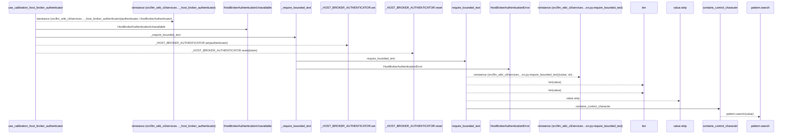
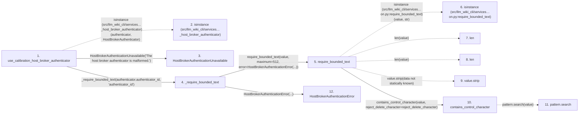

# use_calibration_host_broker_authenticator

**Entry point:** `use_calibration_host_broker_authenticator` (`api`)
**Source:** [host_broker](../modules/host_broker.md)
**Modules touched:** [host_broker](../modules/host_broker.md), [validation](../modules/validation.md)

## Call sequence

> Static overview in presentation order, not runtime execution order. Arrows retain captured callers; representative internal continuations and boundary examples precede repeated helper detail.

<!-- Auto-generated from static call edges. Dashed arrows are external or unresolved calls. Reviewed runtime conditions and side effects belong in Behavior. -->

> Call sequence diagram shows 13 of 13 interactions; 0 omitted to keep the visualization within the 30-interaction and generated-diagram limits, with uncertain identities omitted rather than inferred.

> Captured boundary calls: external 4 of 4 (0 omitted); unresolved 4 of 4 (0 omitted). These counts cover the captured static trace.
> Detailed flow queries retain their own coverage and limits; omitted paths may execute at runtime.

## Data flow

<!-- Auto-generated static analysis. Treat values and boundaries as best-effort hints, not runtime proof. -->

### Analysis coverage

**Effect analysis partially available.** Flow assembly and source effect analysis are separate; empty observations do not prove an empty handler body.

Source steps: 6; effect analysis evaluated: 4, partial: 0, unavailable: 2. Counts include steps omitted from the displayed trace.

Collector observations for 4 source steps with known totals: observed: 19, emitted: 19, omitted: 0. Unavailable totals are excluded.

- Callable record unavailable for one or more source steps; those steps have no represented callable body.
- Effect collector totals unavailable; observed counts cover captured records only.

| Step | Callable record | Effect analysis | Collector totals | Observed | Emitted | Omitted |
|---|---|---|---|---:|---:|---:|
| `use_calibration_host_broker_authenticator` | `available` | `evaluated` | `available` | `2` | `2` | `0` |
| `isinstance (src/llm_wiki_cli/services…_host_broker_authenticator)` | `not_applicable` | `not_applicable` | `not_applicable` | — | — | — |
| `HostBrokerAuthenticationUnavailable` | `unavailable` | `unavailable` | `unavailable` | — | — | — |
| `_require_bounded_text` | `available` | `evaluated` | `available` | `3` | `3` | `0` |
| `require_bounded_text` | `available` | `evaluated` | `available` | `9` | `9` | `0` |
| `isinstance (src/llm_wiki_cli/services…on.py:require_bounded_text)` | `not_applicable` | `not_applicable` | `not_applicable` | — | — | — |
| `len` | `not_applicable` | `not_applicable` | `not_applicable` | — | — | — |
| `len` | `not_applicable` | `not_applicable` | `not_applicable` | — | — | — |
| `value.strip` | `not_applicable` | `not_applicable` | `not_applicable` | — | — | — |
| `contains_control_character` | `available` | `evaluated` | `available` | `5` | `5` | `0` |
| `pattern.search` | `not_applicable` | `not_applicable` | `not_applicable` | — | — | — |
| `HostBrokerAuthenticationError` | `unavailable` | `unavailable` | `unavailable` | — | — | — |

### Step data

| Step | Inputs | Reads | Writes | Returns |
|---|---|---|---|---|
| `use_calibration_host_broker_authenticator` | `authenticator: HostBrokerAuthenticator` | `HostBrokerAuthenticator` | - | - |
| `isinstance (src/llm_wiki_cli/services…_host_broker_authenticator)` | - | - | - | - |
| `HostBrokerAuthenticationUnavailable` | - | - | - | - |
| `_require_bounded_text` | `value: Any`, `label: str` | - | - | `require_bounded_text(...)` |
| `require_bounded_text` | `value: object`, `maximum: int`, `error: Exception`, `minimum: int`, `control_error: Exception \| None`, `require_trimmed: bool`, `reject_control_characters: bool`, `reject_delete_character: bool` | - | - | `value` |
| `isinstance (src/llm_wiki_cli/services…on.py:require_bounded_text)` | - | - | - | - |
| `len` | - | - | - | - |
| `len` | - | - | - | - |
| `value.strip` | - | - | - | - |
| `contains_control_character` | `value: str`, `reject_delete_character: bool` | `_ASCII_CONTROL_DELETE`, `_ASCII_CONTROL` | - | `...` |
| `pattern.search` | - | - | - | - |
| `HostBrokerAuthenticationError` | - | - | - | - |

### Call data

| From | To | Line | Call |
|---|---|---:|---|
| use_calibration_host_broker_authenticator | isinstance (src/llm_wiki_cli/services…_host_broker_authenticator) | 195 | `isinstance(authenticator, HostBrokerAuthenticator)` |
| use_calibration_host_broker_authenticator | HostBrokerAuthenticationUnavailable | 196 | `HostBrokerAuthenticationUnavailable('The host broker authenticator is malformed.')` |
| use_calibration_host_broker_authenticator | _require_bounded_text | 199 | `_require_bounded_text(authenticator.authenticator_id, 'authenticator_id')` |
| _require_bounded_text | require_bounded_text | 321 | `require_bounded_text(value, maximum=512, error=HostBrokerAuthenticationError(...))` |
| require_bounded_text | isinstance (src/llm_wiki_cli/services…on.py:require_bounded_text) | 650 | `isinstance(value, str)` |
| require_bounded_text | len | 651 | `len(value)` |
| require_bounded_text | len | 652 | `len(value)` |
| require_bounded_text | value.strip | 653 | `value.strip(data not statically known)` |
| require_bounded_text | contains_control_character | 656 | `contains_control_character(value, reject_delete_character=reject_delete_character)` |
| contains_control_character | pattern.search | 685 | `pattern.search(value)` |
| _require_bounded_text | HostBrokerAuthenticationError | 324 | `HostBrokerAuthenticationError(...)` |

### Boundary effects

*No boundary-effect observations were captured in this static trace.*

### Static analysis gaps

| Kind | Step | Target | Line |
|---|---|---|---:|
| external_call | `use_calibration_host_broker_authenticator` | `isinstance` | 195 |
| external_call | `require_bounded_text` | `isinstance` | 650 |
| unresolved_call | `require_bounded_text` | `value.strip` | 653 |
| unresolved_call | `contains_control_character` | `pattern.search` | 685 |
| step_limit | `use_calibration_host_broker_authenticator` | `first 12 steps` | 0 |

## Behavior

This flow starts at `use_calibration_host_broker_authenticator` and is classified as `api`. The generated call and data-flow sections are bounded static projections; runtime conditions and side effects require source-level confirmation.
