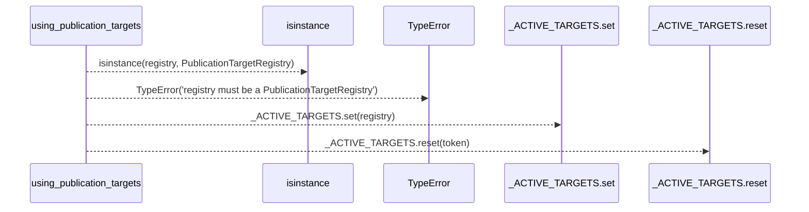
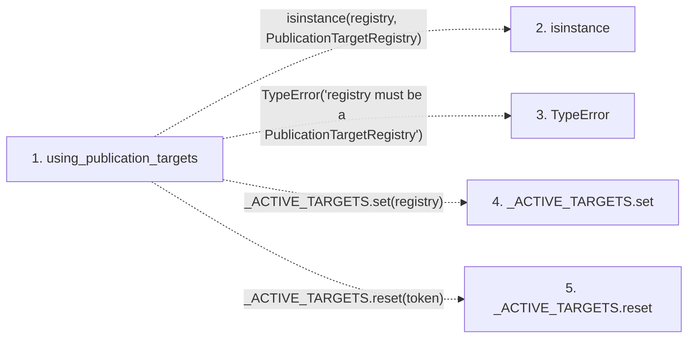

# using_publication_targets

**Entry point:** `using_publication_targets` (`api`)
**Source:** [publication_targets](../modules/publication_targets.md)
**Modules touched:** [publication_targets](../modules/publication_targets.md)

## Call sequence

> Static overview in presentation order, not runtime execution order. Arrows retain captured callers; representative internal continuations and boundary examples precede repeated helper detail.

<!-- Auto-generated from static call edges. Dashed arrows are external or unresolved calls. Reviewed runtime conditions and side effects belong in Behavior. -->

> Call sequence diagram shows 4 of 4 interactions; 0 omitted to keep the visualization within the 30-interaction and generated-diagram limits, with uncertain identities omitted rather than inferred.

> Captured boundary calls: external 2 of 2 (0 omitted); unresolved 2 of 2 (0 omitted). These counts cover the captured static trace.
> Detailed flow queries retain their own coverage and limits; omitted paths may execute at runtime.

## Data flow

<!-- Auto-generated static analysis. Treat values and boundaries as best-effort hints, not runtime proof. -->

### Analysis coverage

**Effect analysis evaluated.** Flow assembly and source effect analysis are separate; empty observations do not prove an empty handler body.

Source steps: 1; effect analysis evaluated: 1, partial: 0, unavailable: 0. Counts include steps omitted from the displayed trace.

Collector observations for 1 source steps with known totals: observed: 2, emitted: 2, omitted: 0. Unavailable totals are excluded.

### Step data

| Step | Inputs | Reads | Writes | Returns |
|---|---|---|---|---|
| `using_publication_targets` | `registry: PublicationTargetRegistry` | `PublicationTargetRegistry` | - | - |
| `isinstance` | - | - | - | - |
| `TypeError` | - | - | - | - |
| `_ACTIVE_TARGETS.set` | - | - | - | - |
| `_ACTIVE_TARGETS.reset` | - | - | - | - |

### Call data

| From | To | Line | Call |
|---|---|---:|---|
| using_publication_targets | isinstance | 191 | `isinstance(registry, PublicationTargetRegistry)` |
| using_publication_targets | TypeError | 192 | `TypeError('registry must be a PublicationTargetRegistry')` |
| using_publication_targets | _ACTIVE_TARGETS.set | 193 | `_ACTIVE_TARGETS.set(registry)` |
| using_publication_targets | _ACTIVE_TARGETS.reset | 197 | `_ACTIVE_TARGETS.reset(token)` |

### Boundary effects

*No boundary-effect observations were captured in this static trace.*

### Static analysis gaps

| Kind | Step | Target | Line |
|---|---|---|---:|
| external_call | `using_publication_targets` | `isinstance` | 191 |
| external_call | `using_publication_targets` | `TypeError` | 192 |
| unresolved_call | `using_publication_targets` | `_ACTIVE_TARGETS.reset` | 197 |

## Behavior

This flow starts at `using_publication_targets` and is classified as `api`. The generated call and data-flow sections are bounded static projections; runtime conditions and side effects require source-level confirmation.
