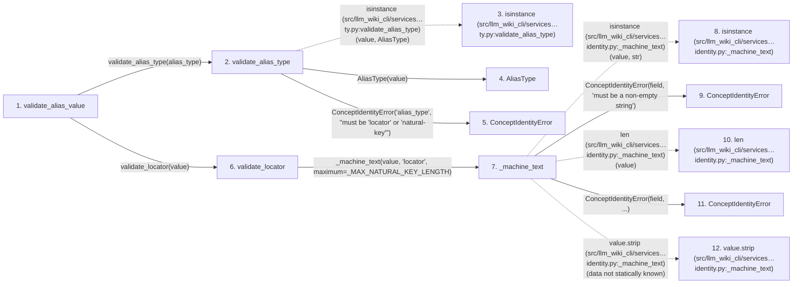

# validate_alias_value

**Entry point:** `validate_alias_value` (`api`)
**Source:** [concept_identity](../modules/concept_identity.md)
**Modules touched:** [concept_identity](../modules/concept_identity.md), [validation](../modules/validation.md), [wiki_surface](../modules/wiki_surface.md)

## Call sequence

> Static overview in presentation order, not runtime execution order. Arrows retain captured callers; representative internal continuations and boundary examples precede repeated helper detail.

```mermaid
sequenceDiagram
    participant p0 as validate_alias_value
    participant p1 as validate_alias_type
    participant p2 as validate_locator
    participant p3 as validate_natural_key
    participant p4 as _machine_text
    participant p5 as validate_exact_page_coordinate
    participant p6 as _safe_decoded_coordinate
    participant p7 as _matches_directory_path
    participant p8 as _matches_directory_uri
    participant p9 as is_safe_page_id
    participant p10 as canonical_path
    participant p11 as mcp_uri
    participant p12 as _entry_for
    participant p13 as _validate_page_id
    participant p14 as is_portable_path_component
    participant p15 as AliasType
    participant p16 as _contains_uri_userinfo
    participant p17 as ConceptIdentityError
    participant p18 as _looks_absolute_path
    participant p19 as _contains_coordinate_userinfo
    participant p20 as WikiSurfaceError
    participant p21 as require_portable_path_component
    participant p22 as PageKind
    participant p23 as isinstance (src/llm_wiki_cli/services…ty.py:validate_alias_type)
    participant p24 as text.partition
    participant p25 as _NATURAL_KEY_PREFIX_RE.fullmatch
    participant p26 as _NATURAL_KEY_PAYLOAD_RE.fullmatch
    participant p27 as _INVALID_PERCENT_RE.search
    participant p28 as _PERCENT_ESCAPE_RE.finditer
    participant p29 as match.group
    participant p30 as match.group(…).upper
    p0->>p1: validate_alias_type
    p0->>p2: validate_locator
    p0->>p3: validate_natural_key
    p2->>p4: _machine_text
    p2->>p5: validate_exact_page_coordinate
    p3->>p6: _safe_decoded_coordinate
    p5->>p7: _matches_directory_path
    p5->>p8: _matches_directory_uri
    p7->>p9: is_safe_page_id
    p7->>p10: canonical_path
    p8->>p11: mcp_uri
    p10->>p12: _entry_for
    p10->>p13: _validate_page_id
    p9->>p14: is_portable_path_component
    p1->>p15: AliasType
    p2->>p16: _contains_uri_userinfo
    p1->>p17: ConceptIdentityError
    p2->>p18: _looks_absolute_path
    p3->>p19: _contains_coordinate_userinfo
    p5->>p20: WikiSurfaceError
    p14->>p21: require_portable_path_component
    p12->>p22: PageKind
    p1-->>p23: isinstance (src/llm_wiki_cli/services…ty.py:validate_alias_type)(value, AliasType)
    p3-->>p24: text.partition(':')
    p3-->>p25: _NATURAL_KEY_PREFIX_RE.fullmatch(prefix)
    p3-->>p26: _NATURAL_KEY_PAYLOAD_RE.fullmatch(payload)
    p3-->>p27: _INVALID_PERCENT_RE.search(payload)
    p3-->>p28: _PERCENT_ESCAPE_RE.finditer(payload)
    p3-->>p29: match.group(1)
    p3-->>p30: match.group(…).upper
```

<!-- Auto-generated from static call edges. Dashed arrows are external or unresolved calls. Reviewed runtime conditions and side effects belong in Behavior. -->

> Call sequence diagram shows 30 of 121 interactions; 91 omitted to keep the visualization within the 30-interaction and generated-diagram limits, with uncertain identities omitted rather than inferred.

> Captured boundary calls: external 1 of 31 (30 omitted); unresolved 7 of 30 (23 omitted). These counts cover the captured static trace.

Omitted captured detail, grouped by actual caller occurrence and target module:

| Caller | Parent step | Target module | Kind | Omitted interactions |
| --- | --- | --- | --- | --- |
| `src/llm_wiki_cli/services/concept_identity.py:_machine_text` | 7 | - | external | 6 |
| `src/llm_wiki_cli/services/concept_identity.py:_machine_text` | 7 | [src/llm_wiki_cli/services/concept_identity.py](../modules/concept_identity.md) | internal | 5 |
| `src/llm_wiki_cli/services/concept_identity.py:_machine_text` | 7 | - | unresolved | 3 |
| `src/llm_wiki_cli/services/concept_identity.py:_contains_uri_userinfo` | 22 | - | external | 1 |
| `src/llm_wiki_cli/services/concept_identity.py:_looks_absolute_path` | 24 | - | unresolved | 2 |
| `src/llm_wiki_cli/services/concept_identity.py:validate_locator` | 6 | [src/llm_wiki_cli/services/concept_identity.py](../modules/concept_identity.md) | internal | 3 |
| `src/llm_wiki_cli/services/wiki_surface.py:validate_exact_page_coordinate` | 28 | - | external | 4 |
| `src/llm_wiki_cli/services/wiki_surface.py:validate_exact_page_coordinate` | 28 | - | unresolved | 2 |
> Omission summary shows 8 of 31 groups; 23 further groups are not expanded here. Counts above include all omitted interactions.
> Detailed flow queries retain their own coverage and limits; omitted paths may execute at runtime.

> Trace truncated at the depth limit; deeper calls are omitted.

## Data flow

<!-- Auto-generated static analysis. Treat values and boundaries as best-effort hints, not runtime proof. -->

### Analysis coverage

**Effect analysis partially available.** Flow assembly and source effect analysis are separate; empty observations do not prove an empty handler body.

Source steps: 61; effect analysis evaluated: 27, partial: 1, unavailable: 33. Counts include steps omitted from the displayed trace.

Collector observations for 28 source steps with known totals: observed: 113, emitted: 112, omitted: 1. Unavailable totals are excluded.

- Callable record unavailable for one or more source steps; those steps have no represented callable body.
- Effect collector omitted observations before flow assembly; displayed effects are partial.
- Effect collector totals unavailable; observed counts cover captured records only.

| Step | Callable record | Effect analysis | Collector totals | Observed | Emitted | Omitted |
|---|---|---|---|---:|---:|---:|
| `validate_alias_value` | `available` | `evaluated` | `available` | `5` | `5` | `0` |
| `validate_alias_type` | `available` | `evaluated` | `available` | `3` | `3` | `0` |
| `isinstance (src/llm_wiki_cli/services…ty.py:validate_alias_type)` | `not_applicable` | `not_applicable` | `not_applicable` | — | — | — |
| `AliasType` | `unavailable` | `unavailable` | `unavailable` | — | — | — |
| `ConceptIdentityError` | `unavailable` | `unavailable` | `unavailable` | — | — | — |
| `validate_locator` | `available` | `evaluated` | `available` | `4` | `4` | `0` |
| `_machine_text` | `available` | `evaluated` | `available` | `4` | `4` | `0` |
| `isinstance (src/llm_wiki_cli/services…identity.py:_machine_text)` | `not_applicable` | `not_applicable` | `not_applicable` | — | — | — |
| `ConceptIdentityError` | `unavailable` | `unavailable` | `unavailable` | — | — | — |
| `len (src/llm_wiki_cli/services…identity.py:_machine_text)` | `not_applicable` | `not_applicable` | `not_applicable` | — | — | — |
| `ConceptIdentityError` | `unavailable` | `unavailable` | `unavailable` | — | — | — |
| `value.strip (src/llm_wiki_cli/services…identity.py:_machine_text)` | `not_applicable` | `not_applicable` | `not_applicable` | — | — | — |

### Step data

| Step | Inputs | Reads | Writes | Returns |
|---|---|---|---|---|
| `validate_alias_value` | `alias_type: AliasType \| str`, `value: object` | `AliasType` | - | `validate_locator(...)`, `validate_natural_key(...)` |
| `validate_alias_type` | `value: AliasType \| str` | `AliasType` | - | `...` |
| `isinstance (src/llm_wiki_cli/services…ty.py:validate_alias_type)` | - | - | - | - |
| `AliasType` | - | - | - | - |
| `ConceptIdentityError` | - | - | - | - |
| `validate_locator` | `value: object` | `_MAX_NATURAL_KEY_LENGTH`, `WikiSurfaceError` | - | `normalized` |
| `_machine_text` | `value: object`, `field: str`, `maximum: int` | - | - | `value` |
| `isinstance (src/llm_wiki_cli/services…identity.py:_machine_text)` | - | - | - | - |
| `ConceptIdentityError` | - | - | - | - |
| `len (src/llm_wiki_cli/services…identity.py:_machine_text)` | - | - | - | - |
| `ConceptIdentityError` | - | - | - | - |
| `value.strip (src/llm_wiki_cli/services…identity.py:_machine_text)` | - | - | - | - |

### Call data

| From | To | Line | Call |
|---|---|---:|---|
| validate_alias_value | validate_alias_type | 486 | `validate_alias_type(alias_type)` |
| validate_alias_type | isinstance (src/llm_wiki_cli/services…ty.py:validate_alias_type) | 475 | `isinstance(value, AliasType)` |
| validate_alias_type | AliasType | 475 | `AliasType(value)` |
| validate_alias_type | ConceptIdentityError | 477 | `ConceptIdentityError('alias_type', "must be 'locator' or 'natural-key'")` |
| validate_alias_value | validate_locator | 488 | `validate_locator(value)` |
| validate_locator | _machine_text | 438 | `_machine_text(value, 'locator', maximum=_MAX_NATURAL_KEY_LENGTH)` |
| _machine_text | isinstance (src/llm_wiki_cli/services…identity.py:_machine_text) | 942 | `isinstance(value, str)` |
| _machine_text | ConceptIdentityError | 943 | `ConceptIdentityError(field, 'must be a non-empty string')` |
| _machine_text | len (src/llm_wiki_cli/services…identity.py:_machine_text) | 944 | `len(value)` |
| _machine_text | ConceptIdentityError | 945 | `ConceptIdentityError(field, ...)` |
| _machine_text | value.strip (src/llm_wiki_cli/services…identity.py:_machine_text) | 946 | `value.strip(data not statically known)` |

### Boundary effects

*No boundary-effect observations were captured in this static trace.*

### Static analysis gaps

| Kind | Step | Target | Line |
|---|---|---|---:|
| external_call | `validate_alias_type` | `isinstance` | 475 |
| external_call | `_machine_text` | `isinstance` | 942 |
| unresolved_call | `_machine_text` | `value.strip` | 946 |
| step_limit | `validate_alias_value` | `first 12 steps` | 0 |
| truncated_flow | `validate_alias_value` | `depth limit` | 0 |

## Behavior

This flow starts at `validate_alias_value` and is classified as `api`. The generated call and data-flow sections are bounded static projections; runtime conditions and side effects require source-level confirmation.
