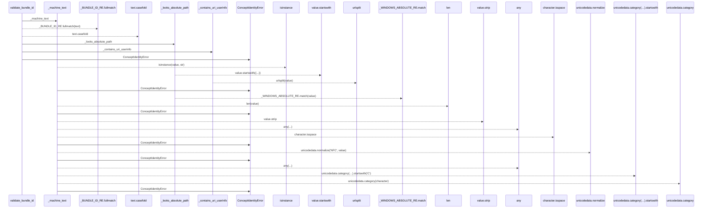

# validate_bundle_id

**Entry point:** `validate_bundle_id` (`api`)
**Source:** [concept_identity](../modules/concept_identity.md)
**Modules touched:** [concept_identity](../modules/concept_identity.md)

## Call sequence

> Static overview in presentation order, not runtime execution order. Arrows retain captured callers; representative internal continuations and boundary examples precede repeated helper detail.

<!-- Auto-generated from static call edges. Dashed arrows are external or unresolved calls. Reviewed runtime conditions and side effects belong in Behavior. -->

> Call sequence diagram shows 23 of 23 interactions; 0 omitted to keep the visualization within the 30-interaction and generated-diagram limits, with uncertain identities omitted rather than inferred.

> Captured boundary calls: external 7 of 7 (0 omitted); unresolved 7 of 7 (0 omitted). These counts cover the captured static trace.
> Detailed flow queries retain their own coverage and limits; omitted paths may execute at runtime.

## Data flow

```mermaid
flowchart LR
    s1["1. validate_bundle_id"]
    s2["2. _machine_text"]
    s3["3. isinstance"]
    s4["4. ConceptIdentityError"]
    s5["5. len"]
    s6["6. ConceptIdentityError"]
    s7["7. value.strip"]
    s8["8. any"]
    s9["9. character.isspace"]
    s10["10. ConceptIdentityError"]
    s11["11. unicodedata.normalize"]
    s12["12. ConceptIdentityError"]
    s1 -->|"_machine_text(value, 'bundle_id', maximum=_MAX_BUNDLE_ID_LENGTH)"| s2
    s2 -. "isinstance(value, str)" .-> s3
    s2 -->|"ConceptIdentityError(field, 'must be a non-empty string')"| s4
    s2 -. "len(value)" .-> s5
    s2 -->|"ConceptIdentityError(field, ...)"| s6
    s2 -. "value.strip(data not statically known)" .-> s7
    s2 -. "any(...)" .-> s8
    s2 -. "character.isspace(data not statically known)" .-> s9
    s2 -->|"ConceptIdentityError(field, 'must not contain whitespace')"| s10
    s2 -. "unicodedata.normalize('NFC', value)" .-> s11
    s2 -->|"ConceptIdentityError(field, 'must use Unicode NFC normalization')"| s12
    click s1 "../modules/concept_identity.md"
    click s2 "../modules/concept_identity.md"
    click s4 "../modules/concept_identity.md"
    click s6 "../modules/concept_identity.md"
    click s10 "../modules/concept_identity.md"
    click s12 "../modules/concept_identity.md"
```

<!-- Auto-generated static analysis. Treat values and boundaries as best-effort hints, not runtime proof. -->

### Step data

| Step | Inputs | Reads | Writes | Returns |
|---|---|---|---|---|
| `validate_bundle_id` | `value: object` | `_MAX_BUNDLE_ID_LENGTH` | - | `text` |
| `_machine_text` | `value: object`, `field: str`, `maximum: int` | - | - | `value` |
| `isinstance` | - | - | - | - |
| `ConceptIdentityError` | - | - | - | - |
| `len` | - | - | - | - |
| `ConceptIdentityError` | - | - | - | - |
| `value.strip` | - | - | - | - |
| `any` | - | - | - | - |
| `character.isspace` | - | - | - | - |
| `ConceptIdentityError` | - | - | - | - |
| `unicodedata.normalize` | - | - | - | - |
| `ConceptIdentityError` | - | - | - | - |

### Call data

| From | To | Line | Call |
|---|---|---:|---|
| validate_bundle_id | _machine_text | 289 | `_machine_text(value, 'bundle_id', maximum=_MAX_BUNDLE_ID_LENGTH)` |
| _machine_text | isinstance | 942 | `isinstance(value, str)` |
| _machine_text | ConceptIdentityError | 943 | `ConceptIdentityError(field, 'must be a non-empty string')` |
| _machine_text | len | 944 | `len(value)` |
| _machine_text | ConceptIdentityError | 945 | `ConceptIdentityError(field, ...)` |
| _machine_text | value.strip | 946 | `value.strip(data not statically known)` |
| _machine_text | any | 946 | `any(...)` |
| _machine_text | character.isspace | 946 | `character.isspace(data not statically known)` |
| _machine_text | ConceptIdentityError | 947 | `ConceptIdentityError(field, 'must not contain whitespace')` |
| _machine_text | unicodedata.normalize | 948 | `unicodedata.normalize('NFC', value)` |
| _machine_text | ConceptIdentityError | 949 | `ConceptIdentityError(field, 'must use Unicode NFC normalization')` |

### Boundary effects

*No boundary effects detected.*

### Static analysis gaps

| Kind | Step | Target | Line |
|---|---|---|---:|
| external_call | `_machine_text` | `isinstance` | 942 |
| unresolved_call | `_machine_text` | `value.strip` | 946 |
| external_call | `_machine_text` | `any` | 946 |
| unresolved_call | `_machine_text` | `character.isspace` | 946 |
| external_call | `_machine_text` | `unicodedata.normalize` | 948 |
| step_limit | `validate_bundle_id` | `first 12 steps` | 0 |

## Behavior

This flow starts at `validate_bundle_id` and is classified as `api`. The generated call and data-flow sections are bounded static projections; runtime conditions and side effects require source-level confirmation.
