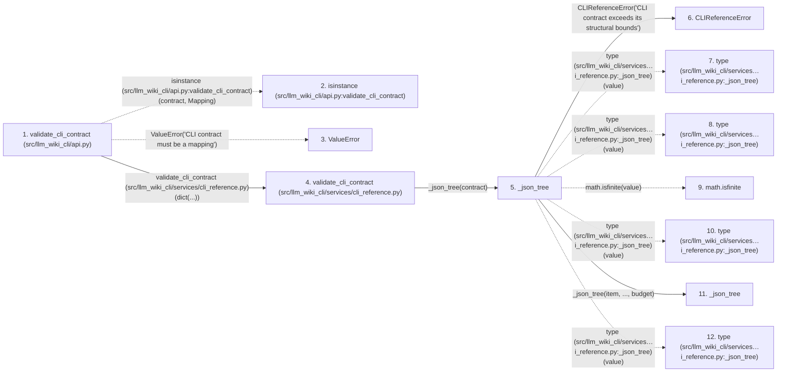

# validate_cli_contract

**Entry point:** `validate_cli_contract` (`api`)
**Source:** [api](../modules/api.md)
**Modules touched:** [api](../modules/api.md), [cli_reference](../modules/cli_reference.md), [knowledge_evidence](../modules/knowledge_evidence.md)

## Call sequence

> Static overview in presentation order, not runtime execution order. Arrows retain captured callers; representative internal continuations and boundary examples precede repeated helper detail.

```mermaid
sequenceDiagram
    participant p0 as validate_cli_contract (src/llm_wiki_cli/api.py)
    participant p1 as validate_cli_contract (src/llm_wiki_cli/services/cli_reference.py)
    participant p2 as _json_tree
    participant p3 as _validate_schema
    participant p4 as _validate_command
    participant p5 as hash_json
    participant p6 as canonical_json_bytes
    participant p7 as CLIReferenceError
    participant p8 as _schema
    participant p9 as sha256_bytes
    participant p10 as _matches_type
    participant p11 as canonical_json_text
    participant p12 as isinstance (src/llm_wiki_cli/api.py:validate_cli_contract)
    participant p13 as json.dumps(…).encode
    participant p14 as ValueError
    participant p15 as dict
    participant p16 as json.dumps (src/llm_wiki_cli/services….py:validate_cli_contract)
    participant p17 as len (src/llm_wiki_cli/services….py:validate_cli_contract)
    participant p18 as isinstance (src/llm_wiki_cli/services….py:validate_cli_contract)
    participant p19 as contract.items
    participant p20 as json.loads
    participant p21 as type (src/llm_wiki_cli/services…i_reference.py:_json_tree)
    participant p22 as resources.files(…).joinpath(…).read_text
    participant p23 as rule[…].rsplit
    participant p24 as len (src/llm_wiki_cli/services…ence.py:_validate_command)
    participant p25 as resources.files(…).joinpath
    participant p26 as math.isfinite
    participant p27 as resources.files
    p0->>p1: validate_cli_contract (src/llm_wiki_cli/services/cli_reference.py)
    p1->>p2: _json_tree
    p1->>p3: _validate_schema
    p1->>p4: _validate_command
    p1->>p5: hash_json
    p5->>p6: canonical_json_bytes
    p1->>p7: CLIReferenceError
    p1->>p8: _schema
    p5->>p9: sha256_bytes
    p3->>p10: _matches_type
    p6->>p11: canonical_json_text
    p0-->>p12: isinstance (src/llm_wiki_cli/api.py:validate_cli_contract)(contract, Mapping)
    p1-->>p13: json.dumps(…).encode('utf-8')
    p0-->>p14: ValueError('CLI contract must be a mapping')
    p0-->>p15: dict(contract)
    p1-->>p16: json.dumps (src/llm_wiki_cli/services….py:validate_cli_contract)(contract, ensure_ascii=False, allow_nan=False)
    p1-->>p17: len (src/llm_wiki_cli/services….py:validate_cli_contract)(encoded)
    p1-->>p18: isinstance (src/llm_wiki_cli/services….py:validate_cli_contract)(contract, dict)
    p1-->>p19: contract.items
    p8-->>p20: json.loads(...)
    p2-->>p21: type (src/llm_wiki_cli/services…i_reference.py:_json_tree)(value)
    p8-->>p22: resources.files(…).joinpath(…).read_text(encoding='utf-8')
    p3-->>p23: rule[…].rsplit('/', 1)
    p4-->>p24: len (src/llm_wiki_cli/services…ence.py:_validate_command)(arguments)
    p2-->>p21: type (src/llm_wiki_cli/services…i_reference.py:_json_tree)(value)
    p8-->>p25: resources.files(…).joinpath(_SCHEMA_NAME)
    p4-->>p24: len (src/llm_wiki_cli/services…ence.py:_validate_command)(node[...])
    p2-->>p26: math.isfinite(value)
    p8-->>p27: resources.files('llm_wiki_cli.schemas')
    p4-->>p24: len (src/llm_wiki_cli/services…ence.py:_validate_command)(groups)
```

<!-- Auto-generated from static call edges. Dashed arrows are external or unresolved calls. Reviewed runtime conditions and side effects belong in Behavior. -->

> Call sequence diagram shows 30 of 125 interactions; 95 omitted to keep the visualization within the 30-interaction and generated-diagram limits, with uncertain identities omitted rather than inferred.

> Captured boundary calls: external 14 of 56 (42 omitted); unresolved 5 of 25 (20 omitted). These counts cover the captured static trace.

Omitted captured detail, grouped by actual caller occurrence and target module:

| Caller | Parent step | Target module | Kind | Omitted interactions |
| --- | --- | --- | --- | --- |
| `src/llm_wiki_cli/services/cli_reference.py:_json_tree` | 5 | [src/llm_wiki_cli/services/cli_reference.py](../modules/cli_reference.md) | internal | 4 |
| `src/llm_wiki_cli/services/cli_reference.py:_json_tree` | 5 | - | external | 4 |
| `src/llm_wiki_cli/services/cli_reference.py:_json_tree` | 5 | - | unresolved | 1 |
| `src/llm_wiki_cli/services/cli_reference.py:_validate_schema` | 27 | [src/llm_wiki_cli/services/cli_reference.py](../modules/cli_reference.md) | internal | 12 |
| `src/llm_wiki_cli/services/cli_reference.py:_validate_schema` | 27 | - | unresolved | 10 |
| `src/llm_wiki_cli/services/cli_reference.py:_validate_schema` | 27 | - | external | 17 |
| `src/llm_wiki_cli/services/cli_reference.py:_matches_type` | 35 | - | external | 6 |
| `src/llm_wiki_cli/services/cli_reference.py:_validate_command` | 76 | [src/llm_wiki_cli/services/cli_reference.py](../modules/cli_reference.md) | internal | 15 |
> Omission summary shows 8 of 15 groups; 7 further groups are not expanded here. Counts above include all omitted interactions.
> Detailed flow queries retain their own coverage and limits; omitted paths may execute at runtime.

## Data flow

<!-- Auto-generated static analysis. Treat values and boundaries as best-effort hints, not runtime proof. -->

### Analysis coverage

**Effect analysis partially available.** Flow assembly and source effect analysis are separate; empty observations do not prove an empty handler body.

Source steps: 45; effect analysis evaluated: 18, partial: 0, unavailable: 27. Counts include steps omitted from the displayed trace.

Collector observations for 18 source steps with known totals: observed: 92, emitted: 92, omitted: 0. Unavailable totals are excluded.

- Callable record unavailable for one or more source steps; those steps have no represented callable body.
- Effect collector totals unavailable; observed counts cover captured records only.

| Step | Callable record | Effect analysis | Collector totals | Observed | Emitted | Omitted |
|---|---|---|---|---:|---:|---:|
| `validate_cli_contract (src/llm_wiki_cli/api.py)` | `available` | `evaluated` | `available` | `2` | `2` | `0` |
| `isinstance (src/llm_wiki_cli/api.py:validate_cli_contract)` | `not_applicable` | `not_applicable` | `not_applicable` | — | — | — |
| `ValueError` | `not_applicable` | `not_applicable` | `not_applicable` | — | — | — |
| `validate_cli_contract (src/llm_wiki_cli/services/cli_reference.py)` | `available` | `evaluated` | `available` | `3` | `3` | `0` |
| `_json_tree` | `available` | `evaluated` | `available` | `10` | `10` | `0` |
| `CLIReferenceError` | `unavailable` | `unavailable` | `unavailable` | — | — | — |
| `type (src/llm_wiki_cli/services…i_reference.py:_json_tree)` | `not_applicable` | `not_applicable` | `not_applicable` | — | — | — |
| `type (src/llm_wiki_cli/services…i_reference.py:_json_tree)` | `not_applicable` | `not_applicable` | `not_applicable` | — | — | — |
| `math.isfinite` | `not_applicable` | `not_applicable` | `not_applicable` | — | — | — |
| `type (src/llm_wiki_cli/services…i_reference.py:_json_tree)` | `not_applicable` | `not_applicable` | `not_applicable` | — | — | — |
| `_json_tree` | `available` | `evaluated` | `available` | `10` | `10` | `0` |
| `type (src/llm_wiki_cli/services…i_reference.py:_json_tree)` | `not_applicable` | `not_applicable` | `not_applicable` | — | — | — |

### Step data

| Step | Inputs | Reads | Writes | Returns |
|---|---|---|---|---|
| `validate_cli_contract (src/llm_wiki_cli/api.py)` | `contract: Mapping[str, Any]` | `Mapping` | - | - |
| `isinstance (src/llm_wiki_cli/api.py:validate_cli_contract)` | - | - | - | - |
| `ValueError` | - | - | - | - |
| `validate_cli_contract (src/llm_wiki_cli/services/cli_reference.py)` | `contract: object` | `MAX_CLI_CONTRACT_BYTES`, `CLIReferenceError` | - | - |
| `_json_tree` | `value: object`, `depth: int`, `budget` | `_MAX_NODES`, `_MAX_DEPTH` | `budget[...]` | `none`, `none`, `none`, `none` |
| `CLIReferenceError` | - | - | - | - |
| `type (src/llm_wiki_cli/services…i_reference.py:_json_tree)` | - | - | - | - |
| `type (src/llm_wiki_cli/services…i_reference.py:_json_tree)` | - | - | - | - |
| `math.isfinite` | - | - | - | - |
| `type (src/llm_wiki_cli/services…i_reference.py:_json_tree)` | - | - | - | - |
| `_json_tree` | `value: object`, `depth: int`, `budget` | `_MAX_NODES`, `_MAX_DEPTH` | `budget[...]` | `none`, `none`, `none`, `none` |
| `type (src/llm_wiki_cli/services…i_reference.py:_json_tree)` | - | - | - | - |

### Call data

| From | To | Line | Call |
|---|---|---:|---|
| validate_cli_contract (src/llm_wiki_cli/api.py) | isinstance (src/llm_wiki_cli/api.py:validate_cli_contract) | 3583 | `isinstance(contract, Mapping)` |
| validate_cli_contract (src/llm_wiki_cli/api.py) | ValueError | 3584 | `ValueError('CLI contract must be a mapping')` |
| validate_cli_contract (src/llm_wiki_cli/api.py) | validate_cli_contract (src/llm_wiki_cli/services/cli_reference.py) | 3585 | `validate(dict(...))` |
| validate_cli_contract (src/llm_wiki_cli/services/cli_reference.py) | _json_tree | 456 | `_json_tree(contract)` |
| _json_tree | CLIReferenceError | 291 | `CLIReferenceError('CLI contract exceeds its structural bounds')` |
| _json_tree | type (src/llm_wiki_cli/services…i_reference.py:_json_tree) | 292 | `type(value)` |
| _json_tree | type (src/llm_wiki_cli/services…i_reference.py:_json_tree) | 294 | `type(value)` |
| _json_tree | math.isfinite | 294 | `math.isfinite(value)` |
| _json_tree | type (src/llm_wiki_cli/services…i_reference.py:_json_tree) | 296 | `type(value)` |
| _json_tree | _json_tree | 298 | `_json_tree(item, ..., budget)` |
| _json_tree | type (src/llm_wiki_cli/services…i_reference.py:_json_tree) | 300 | `type(value)` |

### Boundary effects

*No boundary-effect observations were captured in this static trace.*

### Static analysis gaps

| Kind | Step | Target | Line |
|---|---|---|---:|
| external_call | `validate_cli_contract` | `isinstance` | 3583 |
| external_call | `validate_cli_contract` | `ValueError` | 3584 |
| external_call | `_json_tree` | `type` | 292 |
| external_call | `_json_tree` | `type` | 294 |
| external_call | `_json_tree` | `math.isfinite` | 294 |
| external_call | `_json_tree` | `type` | 296 |
| external_call | `_json_tree` | `type` | 300 |
| step_limit | `validate_cli_contract` | `first 12 steps` | 0 |

## Behavior

This flow starts at `validate_cli_contract` and is classified as `api`. The generated call and data-flow sections are bounded static projections; runtime conditions and side effects require source-level confirmation.
