# validate_compact_task_context

**Entry point:** `validate_compact_task_context` (`api`)
**Source:** [api](../modules/api.md)
**Modules touched:** [analysis_capture](../modules/analysis_capture.md), [api](../modules/api.md), [change_selection](../modules/change_selection.md), [context_budget](../modules/context_budget.md), and 20 more

**Complete modules touched:**

- [analysis_capture](../modules/analysis_capture.md)
- [api](../modules/api.md)
- [change_selection](../modules/change_selection.md)
- [context_budget](../modules/context_budget.md)
- [context_packet](../modules/context_packet.md)
- [documentation_query_builder](../modules/documentation_query_builder.md)
- [implementation_evidence](../modules/implementation_evidence.md)
- [knowledge_envelope](../modules/knowledge_envelope.md)
- [knowledge_evidence](../modules/knowledge_evidence.md)
- [knowledge_graph](../modules/knowledge_graph.md)
- [knowledge_storage](../modules/knowledge_storage.md)
- [knowledge_storage_io](../modules/knowledge_storage_io.md)
- [maintenance_status](../modules/maintenance_status.md)
- [storage_receipts](../modules/storage_receipts.md)
- [task_compact](../modules/task_compact.md)
- [task_compact_readable](../modules/task_compact_readable.md)
- [task_context](../modules/task_context.md)
- [task_context_v2](../modules/task_context_v2.md)
- [task_contract](../modules/task_contract.md)
- [task_evidence](../modules/task_evidence.md)
- [task_implementation](../modules/task_implementation.md)
- [token_counting](../modules/token_counting.md)
- [validation](../modules/validation.md)
- [workflow_profile](../modules/workflow_profile.md)

## Call sequence

> Static overview in presentation order, not runtime execution order. Arrows retain captured callers; representative internal continuations and boundary examples precede repeated helper detail.

```mermaid
sequenceDiagram
    participant p0 as validate_compact_task_context (src/llm_wiki_cli/api.py)
    participant p1 as validate_compact_task_context (src/llm_wiki_cli/services/task_compact.py)
    participant p2 as render_compact_task_context
    participant p3 as _validated
    participant p4 as normalize_view_options
    participant p5 as _projection
    participant p6 as _same
    participant p7 as normalize_task_request
    participant p8 as _counter
    participant p9 as validate_task_context
    participant p10 as _encode_observation
    participant p11 as exact_fields
    participant p12 as _encode_contract
    participant p13 as bounded_text
    participant p14 as _array
    participant p15 as coordinate
    participant p16 as _validate_task_claims
    participant p17 as validate_changes
    participant p18 as normalize_profile
    participant p19 as content_id
    participant p20 as validate_context_packet
    participant p21 as validate_task_implementations
    participant p22 as validate_scoped_bindings
    participant p23 as TaskCompactError
    participant p24 as canonical_json
    participant p25 as readable_projection
    participant p26 as _accounted_render
    participant p27 as CompactTaskContext
    participant p28 as _CheckedCounter
    participant p29 as isinstance (src/llm_wiki_cli/services…date_compact_task_context)
    participant p30 as canonical_json(…).decode (src/llm_wiki_cli/services…date_compact_task_context)
    p0->>p1: validate_compact_task_context (src/llm_wiki_cli/services/task_compact.py)
    p1->>p2: render_compact_task_context
    p2->>p3: _validated
    p2->>p4: normalize_view_options
    p2->>p5: _projection
    p5->>p6: _same
    p3->>p7: normalize_task_request
    p3->>p8: _counter
    p3->>p9: validate_task_context
    p5->>p10: _encode_observation
    p7->>p11: exact_fields
    p10->>p12: _encode_contract
    p7->>p13: bounded_text
    p7->>p14: _array
    p7->>p15: coordinate
    p9->>p16: _validate_task_claims
    p7->>p17: validate_changes
    p7->>p18: normalize_profile
    p7->>p19: content_id
    p9->>p20: validate_context_packet
    p9->>p21: validate_task_implementations
    p9->>p22: validate_scoped_bindings
    p1->>p23: TaskCompactError
    p1->>p24: canonical_json
    p2->>p25: readable_projection
    p2->>p26: _accounted_render
    p2->>p27: CompactTaskContext
    p3->>p28: _CheckedCounter
    p1-->>p29: isinstance (src/llm_wiki_cli/services…date_compact_task_context)(compact_text, str)
    p1-->>p30: canonical_json(…).decode (src/llm_wiki_cli/services…date_compact_task_context)('utf-8')
```

<!-- Auto-generated from static call edges. Dashed arrows are external or unresolved calls. Reviewed runtime conditions and side effects belong in Behavior. -->

> Call sequence diagram shows 30 of 606 interactions; 576 omitted to keep the visualization within the 30-interaction and generated-diagram limits, with uncertain identities omitted rather than inferred.

> Captured boundary calls: external 1 of 307 (306 omitted); unresolved 1 of 144 (143 omitted). These counts cover the captured static trace.

Omitted captured detail, grouped by actual caller occurrence and target module:

| Caller | Parent step | Target module | Kind | Omitted interactions |
| --- | --- | --- | --- | --- |
| `src/llm_wiki_cli/services/task_compact.py:_validated` | 4 | - | external | 3 |
| `src/llm_wiki_cli/services/task_compact.py:_validated` | 4 | [src/llm_wiki_cli/services/task_compact.py](../modules/task_compact.md) | internal | 4 |
| `src/llm_wiki_cli/services/workflow_profile.py:exact_fields` | 10 | - | external | 5 |
| `src/llm_wiki_cli/services/workflow_profile.py:exact_fields` | 10 | [src/llm_wiki_cli/services/workflow_profile.py](../modules/workflow_profile.md) | internal | 2 |
| `src/llm_wiki_cli/services/task_contract.py:normalize_task_request` | 9 | - | unresolved | 22 |
| `src/llm_wiki_cli/services/task_contract.py:normalize_task_request` | 9 | - | external | 10 |
| `src/llm_wiki_cli/services/task_contract.py:normalize_task_request` | 9 | [src/llm_wiki_cli/services/workflow_profile.py](../modules/workflow_profile.md) | internal | 16 |
| `src/llm_wiki_cli/services/workflow_profile.py:bounded_text` | 21 | - | external | 2 |
> Omission summary shows 8 of 90 groups; 82 further groups are not expanded here. Counts above include all omitted interactions.
> Detailed flow queries retain their own coverage and limits; omitted paths may execute at runtime.

> Trace truncated at the depth limit; deeper calls are omitted.

## Data flow

```mermaid
flowchart LR
    s1["1. validate_compact_task_context (src/llm_wiki_cli/api.py)"]
    s2["2. validate_compact_task_context (src/llm_wiki_cli/services/task_compact.py)"]
    s3["3. render_compact_task_context"]
    s4["4. _validated"]
    s5["5. isinstance (src/llm_wiki_cli/services…ask_compact.py:_validated)"]
    s6["6. TaskCompactError"]
    s7["7. isinstance (src/llm_wiki_cli/services…ask_compact.py:_validated)"]
    s8["8. TaskCompactError"]
    s9["9. normalize_task_request"]
    s10["10. exact_fields"]
    s11["11. isinstance (src/llm_wiki_cli/services…w_profile.py:exact_fields)"]
    s12["12. any (src/llm_wiki_cli/services…w_profile.py:exact_fields)"]
    s1 -->|"validate_compact_task_context (src/llm_wiki_cli/services/task_compact.py)(…)"| s2
    s2 -->|"render_compact_task_context(canonical_text, request, view_options=view_options, profile=profile, policy=policy, counter=counter)"| s3
    s3 -->|"_validated(canonical_text, request, profile, policy, counter)"| s4
    s4 -. "isinstance (src/llm_wiki_cli/services…ask_compact.py:_validated)(canonical_text, TaskContext)" .-> s5
    s4 -->|"TaskCompactError('canonical-unavailable', 'An unsuccessful canonical result has no compact context')"| s6
    s4 -. "isinstance (src/llm_wiki_cli/services…ask_compact.py:_validated)(canonical_text, str)" .-> s7
    s4 -->|"TaskCompactError('canonical-invalid', 'Canonical context must be original text')"| s8
    s4 -->|"normalize_task_request(request, profile=profile, policy=policy)"| s9
    s9 -->|"exact_fields(request, {...}, 'request')"| s10
    s10 -. "isinstance (src/llm_wiki_cli/services…w_profile.py:exact_fields)(value, Mapping)" .-> s11
    s10 -. "any (src/llm_wiki_cli/services…w_profile.py:exact_fields)(...)" .-> s12
    b0["mutation anchors.append"]
    s9 -. "mutation anchors.append" .-> b0
    b1["mutation ids.add"]
    s9 -. "mutation ids.add" .-> b1
    b2["mutation requirements.append"]
    s9 -. "mutation requirements.append" .-> b2
    b3["mutation requirements.sort"]
    s9 -. "mutation requirements.sort" .-> b3
    click s1 "../modules/api.md"
    click s2 "../modules/task_compact.md"
    click s3 "../modules/task_compact.md"
    click s4 "../modules/task_compact.md"
    click s6 "../modules/task_compact.md"
    click s8 "../modules/task_compact.md"
    click s9 "../modules/task_contract.md"
    click s10 "../modules/workflow_profile.md"
    classDef boundary stroke:#b45309,stroke-dasharray: 4 2
    class b0 boundary
    class b1 boundary
    class b2 boundary
    class b3 boundary
```

<!-- Auto-generated static analysis. Treat values and boundaries as best-effort hints, not runtime proof. -->

### Analysis coverage

**Effect analysis partially available.** Flow assembly and source effect analysis are separate; empty observations do not prove an empty handler body.

Source steps: 156; effect analysis evaluated: 108, partial: 3, unavailable: 45. Counts include steps omitted from the displayed trace.

Collector observations for 111 source steps with known totals: observed: 524, emitted: 519, omitted: 5. Unavailable totals are excluded.

- Callable record unavailable for one or more source steps; those steps have no represented callable body.
- Effect collector omitted observations before flow assembly; displayed effects are partial.
- Effect collector totals unavailable; observed counts cover captured records only.

| Step | Callable record | Effect analysis | Collector totals | Observed | Emitted | Omitted |
|---|---|---|---|---:|---:|---:|
| `validate_compact_task_context (src/llm_wiki_cli/api.py)` | `available` | `evaluated` | `available` | `8` | `8` | `0` |
| `validate_compact_task_context (src/llm_wiki_cli/services/task_compact.py)` | `available` | `evaluated` | `available` | `10` | `10` | `0` |
| `render_compact_task_context` | `available` | `evaluated` | `available` | `12` | `12` | `0` |
| `_validated` | `available` | `evaluated` | `available` | `8` | `8` | `0` |
| `isinstance (src/llm_wiki_cli/services…ask_compact.py:_validated)` | `not_applicable` | `not_applicable` | `not_applicable` | — | — | — |
| `TaskCompactError` | `unavailable` | `unavailable` | `unavailable` | — | — | — |
| `isinstance (src/llm_wiki_cli/services…ask_compact.py:_validated)` | `not_applicable` | `not_applicable` | `not_applicable` | — | — | — |
| `TaskCompactError` | `unavailable` | `unavailable` | `unavailable` | — | — | — |
| `normalize_task_request` | `available` | `partial` | `available` | `23` | `21` | `2` |
| `exact_fields` | `available` | `evaluated` | `available` | `5` | `5` | `0` |
| `isinstance (src/llm_wiki_cli/services…w_profile.py:exact_fields)` | `not_applicable` | `not_applicable` | `not_applicable` | — | — | — |
| `any (src/llm_wiki_cli/services…w_profile.py:exact_fields)` | `not_applicable` | `not_applicable` | `not_applicable` | — | — | — |

### Step data

| Step | Inputs | Reads | Writes | Returns |
|---|---|---|---|---|
| `validate_compact_task_context (src/llm_wiki_cli/api.py)` | `compact_text: str`, `canonical_text: str`, `request: Mapping[str, Any]`, `view_options: Mapping[str, Any]`, `profile: WorkflowProfile \| Mapping[str, Any] \| None`, `policy: WorkflowPolicy \| None`, `counter: TokenCounter \| None` | - | - | `validate(...)` |
| `validate_compact_task_context (src/llm_wiki_cli/services/task_compact.py)` | `compact_text`, `canonical_text`, `request`, `view_options`, `profile`, `policy`, `counter` | `_pairs`, `_constant` | - | `deepcopy(...)` |
| `render_compact_task_context` | `canonical_text`, `request`, `view_options`, `profile`, `policy`, `counter` | `VIEW_REQUEST_SCHEMA_V2`, `COMPACT_SCHEMA_V2`, `COMPACT_SCHEMA`, `COMPACT_SCHEMA_V2` | - | `CompactTaskContext(...)`, `CompactTaskContext(...)` |
| `_validated` | `canonical_text`, `request`, `profile`, `policy`, `counter` | `TaskContext`, `TASK_REQUEST_SCHEMA_V2` | - | `(...)` |
| `isinstance (src/llm_wiki_cli/services…ask_compact.py:_validated)` | - | - | - | - |
| `TaskCompactError` | - | - | - | - |
| `isinstance (src/llm_wiki_cli/services…ask_compact.py:_validated)` | - | - | - | - |
| `TaskCompactError` | - | - | - | - |
| `normalize_task_request` | `request: Mapping[str, Any]`, `profile: WorkflowProfile \| Mapping[str, Any] \| None`, `policy: WorkflowPolicy \| None` | `TASK_REQUEST_SCHEMA_V2`, `TASK_REQUEST_SCHEMA`, `TASK_REQUEST_SCHEMA_V2`, `TASK_KINDS`, `ANCHOR_KINDS`, `canonical_json`, `FACETS`, `MAX_SELECTORS` | `changes[...]`, `normalized[...]`, `normalized[...]`, `normalized[...]`, `normalized[...]` | `(...)` |
| `exact_fields` | `value: object`, `allowed: set[str]`, `field: str` | `Mapping` | - | `dict(...)` |
| `isinstance (src/llm_wiki_cli/services…w_profile.py:exact_fields)` | - | - | - | - |
| `any (src/llm_wiki_cli/services…w_profile.py:exact_fields)` | - | - | - | - |

### Call data

| From | To | Line | Call |
|---|---|---:|---|
| validate_compact_task_context (src/llm_wiki_cli/api.py) | validate_compact_task_context (src/llm_wiki_cli/services/task_compact.py) | 1470 | `validate(compact_text, canonical_text, request, view_options=view_options, profile=profile, policy=policy, counter=counter)` |
| validate_compact_task_context (src/llm_wiki_cli/services/task_compact.py) | render_compact_task_context | 560 | `render_compact_task_context(canonical_text, request, view_options=view_options, profile=profile, policy=policy, counter=counter)` |
| render_compact_task_context | _validated | 475 | `_validated(canonical_text, request, profile, policy, counter)` |
| _validated | isinstance (src/llm_wiki_cli/services…ask_compact.py:_validated) | 171 | `isinstance(canonical_text, TaskContext)` |
| _validated | TaskCompactError | 173 | `TaskCompactError('canonical-unavailable', 'An unsuccessful canonical result has no compact context')` |
| _validated | isinstance (src/llm_wiki_cli/services…ask_compact.py:_validated) | 178 | `isinstance(canonical_text, str)` |
| _validated | TaskCompactError | 179 | `TaskCompactError('canonical-invalid', 'Canonical context must be original text')` |
| _validated | normalize_task_request | 182 | `normalize_task_request(request, profile=profile, policy=policy)` |
| normalize_task_request | exact_fields | 53 | `exact_fields(request, {...}, 'request')` |
| exact_fields | isinstance (src/llm_wiki_cli/services…w_profile.py:exact_fields) | 67 | `isinstance(value, Mapping)` |
| exact_fields | any (src/llm_wiki_cli/services…w_profile.py:exact_fields) | 67 | `any(...)` |

### Boundary effects

| Kind | Target | Step | Line |
|---|---|---|---:|
| mutation | `anchors.append` | `normalize_task_request` | 71 |
| mutation | `ids.add` | `normalize_task_request` | 79 |
| mutation | `requirements.append` | `normalize_task_request` | 89 |
| mutation | `requirements.sort` | `normalize_task_request` | 90 |

### Static analysis gaps

| Kind | Step | Target | Line |
|---|---|---|---:|
| external_call | `_validated` | `isinstance` | 171 |
| external_call | `_validated` | `isinstance` | 178 |
| external_call | `exact_fields` | `isinstance` | 67 |
| external_call | `exact_fields` | `any` | 67 |
| step_limit | `validate_compact_task_context` | `first 12 steps` | 0 |
| truncated_flow | `validate_compact_task_context` | `depth limit` | 0 |

## Behavior

This flow starts at `validate_compact_task_context` and is classified as `api`. The generated call and data-flow sections are bounded static projections; runtime conditions and side effects require source-level confirmation.
