# validate_compact_task_context

**Entry point:** `validate_compact_task_context` (`api`)
**Source:** [api](../modules/api.md)
**Modules touched:** [api](../modules/api.md), [change_selection](../modules/change_selection.md), [context_budget](../modules/context_budget.md), [context_packet](../modules/context_packet.md), and 17 more

**Complete modules touched:**

- [api](../modules/api.md)
- [change_selection](../modules/change_selection.md)
- [context_budget](../modules/context_budget.md)
- [context_packet](../modules/context_packet.md)
- [documentation_query_builder](../modules/documentation_query_builder.md)
- [implementation_evidence](../modules/implementation_evidence.md)
- [knowledge_envelope](../modules/knowledge_envelope.md)
- [knowledge_evidence](../modules/knowledge_evidence.md)
- [knowledge_storage](../modules/knowledge_storage.md)
- [knowledge_storage_io](../modules/knowledge_storage_io.md)
- [maintenance_status](../modules/maintenance_status.md)
- [storage_receipts](../modules/storage_receipts.md)
- [task_compact](../modules/task_compact.md)
- [task_context](../modules/task_context.md)
- [task_context_v2](../modules/task_context_v2.md)
- [task_contract](../modules/task_contract.md)
- [task_evidence](../modules/task_evidence.md)
- [task_implementation](../modules/task_implementation.md)
- [token_counting](../modules/token_counting.md)
- [validation](../modules/validation.md)
- [workflow_profile](../modules/workflow_profile.md)

## Call sequence

> Static overview in presentation order, not runtime execution order. Arrows retain captured callers; siblings are shown before deeper helper detail.

```mermaid
sequenceDiagram
    participant p0 as validate_compact_task_context (src/llm_wiki_cli/api.py)
    participant p1 as validate_compact_task_context (src/llm_wiki_cli/services/task_compact.py)
    participant p2 as render_compact_task_context
    participant p3 as isinstance (src/llm_wiki_cli/services…date_compact_task_context)
    participant p4 as TaskCompactError
    participant p5 as json.loads (src/llm_wiki_cli/services…date_compact_task_context)
    participant p6 as canonical_json(…).decode (src/llm_wiki_cli/services…date_compact_task_context)
    participant p7 as canonical_json
    participant p8 as deepcopy (src/llm_wiki_cli/services…date_compact_task_context)
    participant p9 as _validated
    participant p10 as normalize_view_options
    participant p11 as _projection
    participant p12 as _accounted_render
    participant p13 as CompactTaskContext
    participant p14 as isinstance (src/llm_wiki_cli/services…ask_compact.py:_validated)
    participant p15 as isinstance (src/llm_wiki_cli/services…py:normalize_view_options)
    participant p16 as deepcopy (src/llm_wiki_cli/services…sk_compact.py:_projection)
    participant p17 as range
    participant p18 as set (src/llm_wiki_cli/services…py:normalize_view_options)
    participant p19 as facts[…][…].items
    participant p20 as render
    participant p21 as all (src/llm_wiki_cli/services…sk_compact.py:_projection)
    participant p22 as counter.count (src/llm_wiki_cli/services…dget.py:_accounted_render)
    p0->>p1: validate_compact_task_context (src/llm_wiki_cli/services/task_compact.py)
    p1->>p2: render_compact_task_context
    p1-->>p3: isinstance (src/llm_wiki_cli/services…date_compact_task_context)(compact_text, str)
    p1->>p4: TaskCompactError
    p1-->>p5: json.loads (src/llm_wiki_cli/services…date_compact_task_context)(compact_text, object_pairs_hook=_pairs, parse_constant=_constant)
    p1->>p4: TaskCompactError
    p1-->>p6: canonical_json(…).decode (src/llm_wiki_cli/services…date_compact_task_context)('utf-8')
    p1->>p7: canonical_json
    p1->>p4: TaskCompactError
    p1-->>p8: deepcopy (src/llm_wiki_cli/services…date_compact_task_context)(payload)
    p2->>p9: _validated
    p2->>p10: normalize_view_options
    p2->>p11: _projection
    p2->>p12: _accounted_render
    p2->>p12: _accounted_render
    p2->>p13: CompactTaskContext
    p2->>p13: CompactTaskContext
    p9-->>p14: isinstance (src/llm_wiki_cli/services…ask_compact.py:_validated)(canonical_text, TaskContext)
    p10-->>p15: isinstance (src/llm_wiki_cli/services…py:normalize_view_options)(value, Mapping)
    p11-->>p16: deepcopy (src/llm_wiki_cli/services…sk_compact.py:_projection)(value)
    p12-->>p17: range(32)
    p9->>p4: TaskCompactError
    p10-->>p18: set (src/llm_wiki_cli/services…py:normalize_view_options)(value)
    p11-->>p19: facts[…][…].items
    p12-->>p20: render(accounting)
    p9-->>p14: isinstance (src/llm_wiki_cli/services…ask_compact.py:_validated)(canonical_text, str)
    p10->>p4: TaskCompactError
    p11-->>p21: all (src/llm_wiki_cli/services…sk_compact.py:_projection)(...)
    p12-->>p22: counter.count (src/llm_wiki_cli/services…dget.py:_accounted_render)(text)
    p9->>p4: TaskCompactError
```

<!-- Auto-generated from static call edges. Dashed arrows are external or unresolved calls. Reviewed runtime conditions and side effects belong in Behavior. -->

> Call sequence diagram shows 30 of 586 interactions; 556 omitted to keep the visualization within the 30-interaction and generated-diagram limits, with uncertain identities omitted rather than inferred.

> Captured boundary calls: external 10 of 297 (287 omitted); unresolved 4 of 141 (137 omitted). These counts cover the captured static trace.

Omitted captured detail, grouped by actual caller occurrence and target module:

| Caller | Parent step | Target module | Kind | Omitted interactions |
| --- | --- | --- | --- | --- |
| `src/llm_wiki_cli/services/task_compact.py:_validated` | 4 | [src/llm_wiki_cli/services/task_contract.py](../modules/task_contract.md) | internal | 1 |
| `src/llm_wiki_cli/services/task_contract.py:normalize_task_request` | 9 | [src/llm_wiki_cli/services/workflow_profile.py](../modules/workflow_profile.md) | internal | 20 |
| `src/llm_wiki_cli/services/workflow_profile.py:exact_fields` | 10 | - | external | 5 |
| `src/llm_wiki_cli/services/workflow_profile.py:exact_fields` | 10 | [src/llm_wiki_cli/services/workflow_profile.py](../modules/workflow_profile.md) | internal | 2 |
| `src/llm_wiki_cli/services/task_contract.py:normalize_task_request` | 9 | - | unresolved | 22 |
| `src/llm_wiki_cli/services/task_contract.py:normalize_task_request` | 9 | - | external | 10 |
| `src/llm_wiki_cli/services/workflow_profile.py:bounded_text` | 21 | - | external | 2 |
| `src/llm_wiki_cli/services/workflow_profile.py:bounded_text` | 21 | - | unresolved | 2 |
> Omission summary shows 8 of 86 groups; 78 further groups are not expanded here. Counts above include all omitted interactions.
> Detailed flow queries retain their own coverage and limits; omitted paths may execute at runtime.

> Trace truncated at the depth limit; deeper calls are omitted.

## Data flow

```mermaid
flowchart LR
    s1["1. validate_compact_task_context (src/llm_wiki_cli/api.py)"]
    s2["2. validate_compact_task_context (src/llm_wiki_cli/services/task_compact.py)"]
    s3["3. render_compact_task_context"]
    s4["4. _validated"]
    s5["5. isinstance (src/llm_wiki_cli/services…ask_compact.py:_validated)"]
    s6["6. TaskCompactError"]
    s7["7. isinstance (src/llm_wiki_cli/services…ask_compact.py:_validated)"]
    s8["8. TaskCompactError"]
    s9["9. normalize_task_request"]
    s10["10. exact_fields"]
    s11["11. isinstance (src/llm_wiki_cli/services…w_profile.py:exact_fields)"]
    s12["12. any (src/llm_wiki_cli/services…w_profile.py:exact_fields)"]
    s1 -->|"validate_compact_task_context (src/llm_wiki_cli/services/task_compact.py)(…)"| s2
    s2 -->|"render_compact_task_context(canonical_text, request, view_options=view_options, profile=profile, policy=policy, counter=counter)"| s3
    s3 -->|"_validated(canonical_text, request, profile, policy, counter)"| s4
    s4 -. "isinstance (src/llm_wiki_cli/services…ask_compact.py:_validated)(canonical_text, TaskContext)" .-> s5
    s4 -->|"TaskCompactError('canonical-unavailable', 'An unsuccessful canonical result has no compact context')"| s6
    s4 -. "isinstance (src/llm_wiki_cli/services…ask_compact.py:_validated)(canonical_text, str)" .-> s7
    s4 -->|"TaskCompactError('canonical-invalid', 'Canonical context must be original text')"| s8
    s4 -->|"normalize_task_request(request, profile=profile, policy=policy)"| s9
    s9 -->|"exact_fields(request, {...}, 'request')"| s10
    s10 -. "isinstance (src/llm_wiki_cli/services…w_profile.py:exact_fields)(value, Mapping)" .-> s11
    s10 -. "any (src/llm_wiki_cli/services…w_profile.py:exact_fields)(...)" .-> s12
    b0["mutation anchors.append"]
    s9 -. "mutation anchors.append" .-> b0
    b1["mutation ids.add"]
    s9 -. "mutation ids.add" .-> b1
    b2["mutation requirements.append"]
    s9 -. "mutation requirements.append" .-> b2
    b3["mutation requirements.sort"]
    s9 -. "mutation requirements.sort" .-> b3
    click s1 "../modules/api.md"
    click s2 "../modules/task_compact.md"
    click s3 "../modules/task_compact.md"
    click s4 "../modules/task_compact.md"
    click s6 "../modules/task_compact.md"
    click s8 "../modules/task_compact.md"
    click s9 "../modules/task_contract.md"
    click s10 "../modules/workflow_profile.md"
    classDef boundary stroke:#b45309,stroke-dasharray: 4 2
    class b0 boundary
    class b1 boundary
    class b2 boundary
    class b3 boundary
```

<!-- Auto-generated static analysis. Treat values and boundaries as best-effort hints, not runtime proof. -->

### Step data

| Step | Inputs | Reads | Writes | Returns |
|---|---|---|---|---|
| `validate_compact_task_context (src/llm_wiki_cli/api.py)` | `compact_text: str`, `canonical_text: str`, `request: Mapping[str, Any]`, `view_options: Mapping[str, Any]`, `profile: WorkflowProfile \| Mapping[str, Any] \| None`, `policy: WorkflowPolicy \| None`, `counter: TokenCounter \| None` | - | - | `validate(...)` |
| `validate_compact_task_context (src/llm_wiki_cli/services/task_compact.py)` | `compact_text`, `canonical_text`, `request`, `view_options`, `profile`, `policy`, `counter` | `_pairs`, `_constant` | - | `deepcopy(...)` |
| `render_compact_task_context` | `canonical_text`, `request`, `view_options`, `profile`, `policy`, `counter` | - | - | `CompactTaskContext(...)`, `CompactTaskContext(...)` |
| `_validated` | `canonical_text`, `request`, `profile`, `policy`, `counter` | `TaskContext`, `TASK_REQUEST_SCHEMA_V2` | - | `(...)` |
| `isinstance (src/llm_wiki_cli/services…ask_compact.py:_validated)` | - | - | - | - |
| `TaskCompactError` | - | - | - | - |
| `isinstance (src/llm_wiki_cli/services…ask_compact.py:_validated)` | - | - | - | - |
| `TaskCompactError` | - | - | - | - |
| `normalize_task_request` | `request: Mapping[str, Any]`, `profile: WorkflowProfile \| Mapping[str, Any] \| None`, `policy: WorkflowPolicy \| None` | `TASK_REQUEST_SCHEMA`, `TASK_REQUEST_SCHEMA_V2`, `TASK_KINDS`, `ANCHOR_KINDS`, `canonical_json`, `FACETS`, `MAX_SELECTORS`, `TASK_REQUEST_SCHEMA_V2` | `changes[...]`, `normalized[...]`, `normalized[...]`, `normalized[...]` | `(...)` |
| `exact_fields` | `value: object`, `allowed: set[str]`, `field: str` | `Mapping` | - | `dict(...)` |
| `isinstance (src/llm_wiki_cli/services…w_profile.py:exact_fields)` | - | - | - | - |
| `any (src/llm_wiki_cli/services…w_profile.py:exact_fields)` | - | - | - | - |

### Call data

| From | To | Line | Call |
|---|---|---:|---|
| validate_compact_task_context (src/llm_wiki_cli/api.py) | validate_compact_task_context (src/llm_wiki_cli/services/task_compact.py) | 1454 | `validate(compact_text, canonical_text, request, view_options=view_options, profile=profile, policy=policy, counter=counter)` |
| validate_compact_task_context (src/llm_wiki_cli/services/task_compact.py) | render_compact_task_context | 553 | `render_compact_task_context(canonical_text, request, view_options=view_options, profile=profile, policy=policy, counter=counter)` |
| render_compact_task_context | _validated | 473 | `_validated(canonical_text, request, profile, policy, counter)` |
| _validated | isinstance (src/llm_wiki_cli/services…ask_compact.py:_validated) | 169 | `isinstance(canonical_text, TaskContext)` |
| _validated | TaskCompactError | 171 | `TaskCompactError('canonical-unavailable', 'An unsuccessful canonical result has no compact context')` |
| _validated | isinstance (src/llm_wiki_cli/services…ask_compact.py:_validated) | 176 | `isinstance(canonical_text, str)` |
| _validated | TaskCompactError | 177 | `TaskCompactError('canonical-invalid', 'Canonical context must be original text')` |
| _validated | normalize_task_request | 180 | `normalize_task_request(request, profile=profile, policy=policy)` |
| normalize_task_request | exact_fields | 53 | `exact_fields(request, {...}, 'request')` |
| exact_fields | isinstance (src/llm_wiki_cli/services…w_profile.py:exact_fields) | 67 | `isinstance(value, Mapping)` |
| exact_fields | any (src/llm_wiki_cli/services…w_profile.py:exact_fields) | 67 | `any(...)` |

### Boundary effects

| Kind | Target | Step | Line |
|---|---|---|---:|
| mutation | `anchors.append` | `normalize_task_request` | 71 |
| mutation | `ids.add` | `normalize_task_request` | 79 |
| mutation | `requirements.append` | `normalize_task_request` | 89 |
| mutation | `requirements.sort` | `normalize_task_request` | 90 |

### Static analysis gaps

| Kind | Step | Target | Line |
|---|---|---|---:|
| external_call | `_validated` | `isinstance` | 169 |
| external_call | `_validated` | `isinstance` | 176 |
| external_call | `exact_fields` | `isinstance` | 67 |
| external_call | `exact_fields` | `any` | 67 |
| step_limit | `validate_compact_task_context` | `first 12 steps` | 0 |
| truncated_flow | `validate_compact_task_context` | `depth limit` | 0 |

## Behavior

This flow starts at `validate_compact_task_context` and is classified as `api`. The generated call and data-flow sections are bounded static projections; runtime conditions and side effects require source-level confirmation.
