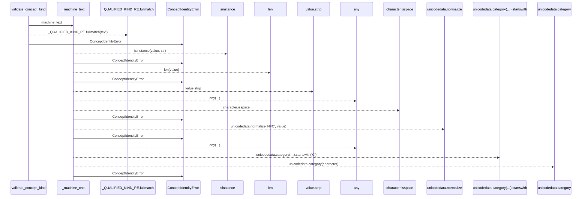
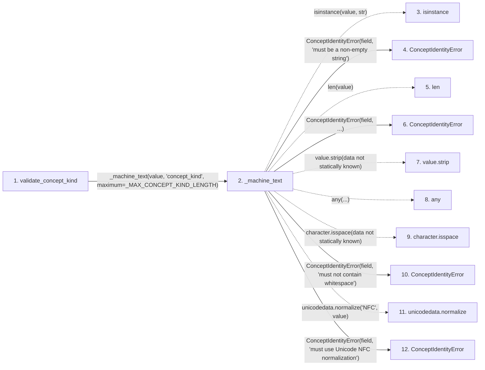

# validate_concept_kind

**Entry point:** `validate_concept_kind` (`api`)
**Source:** [concept_identity](../modules/concept_identity.md)
**Modules touched:** [concept_identity](../modules/concept_identity.md)

## Call sequence

> Static overview in presentation order, not runtime execution order. Arrows retain captured callers; representative internal continuations and boundary examples precede repeated helper detail.

<!-- Auto-generated from static call edges. Dashed arrows are external or unresolved calls. Reviewed runtime conditions and side effects belong in Behavior. -->

> Call sequence diagram shows 17 of 17 interactions; 0 omitted to keep the visualization within the 30-interaction and generated-diagram limits, with uncertain identities omitted rather than inferred.

> Captured boundary calls: external 6 of 6 (0 omitted); unresolved 4 of 4 (0 omitted). These counts cover the captured static trace.
> Detailed flow queries retain their own coverage and limits; omitted paths may execute at runtime.

## Data flow

<!-- Auto-generated static analysis. Treat values and boundaries as best-effort hints, not runtime proof. -->

### Analysis coverage

**Effect analysis partially available.** Flow assembly and source effect analysis are separate; empty observations do not prove an empty handler body.

Source steps: 8; effect analysis evaluated: 2, partial: 0, unavailable: 6. Counts include steps omitted from the displayed trace.

Collector observations for 2 source steps with known totals: observed: 8, emitted: 8, omitted: 0. Unavailable totals are excluded.

- Callable record unavailable for one or more source steps; those steps have no represented callable body.
- Effect collector totals unavailable; observed counts cover captured records only.

| Step | Callable record | Effect analysis | Collector totals | Observed | Emitted | Omitted |
|---|---|---|---|---:|---:|---:|
| `validate_concept_kind` | `available` | `evaluated` | `available` | `4` | `4` | `0` |
| `_machine_text` | `available` | `evaluated` | `available` | `4` | `4` | `0` |
| `isinstance` | `not_applicable` | `not_applicable` | `not_applicable` | — | — | — |
| `ConceptIdentityError` | `unavailable` | `unavailable` | `unavailable` | — | — | — |
| `len` | `not_applicable` | `not_applicable` | `not_applicable` | — | — | — |
| `ConceptIdentityError` | `unavailable` | `unavailable` | `unavailable` | — | — | — |
| `value.strip` | `not_applicable` | `not_applicable` | `not_applicable` | — | — | — |
| `any` | `not_applicable` | `not_applicable` | `not_applicable` | — | — | — |
| `character.isspace` | `not_applicable` | `not_applicable` | `not_applicable` | — | — | — |
| `ConceptIdentityError` | `unavailable` | `unavailable` | `unavailable` | — | — | — |
| `unicodedata.normalize` | `not_applicable` | `not_applicable` | `not_applicable` | — | — | — |
| `ConceptIdentityError` | `unavailable` | `unavailable` | `unavailable` | — | — | — |

### Step data

| Step | Inputs | Reads | Writes | Returns |
|---|---|---|---|---|
| `validate_concept_kind` | `value: object` | `_MAX_CONCEPT_KIND_LENGTH`, `_UID_TAG_BY_KIND` | - | `text` |
| `_machine_text` | `value: object`, `field: str`, `maximum: int` | - | - | `value` |
| `isinstance` | - | - | - | - |
| `ConceptIdentityError` | - | - | - | - |
| `len` | - | - | - | - |
| `ConceptIdentityError` | - | - | - | - |
| `value.strip` | - | - | - | - |
| `any` | - | - | - | - |
| `character.isspace` | - | - | - | - |
| `ConceptIdentityError` | - | - | - | - |
| `unicodedata.normalize` | - | - | - | - |
| `ConceptIdentityError` | - | - | - | - |

### Call data

| From | To | Line | Call |
|---|---|---:|---|
| validate_concept_kind | _machine_text | 306 | `_machine_text(value, 'concept_kind', maximum=_MAX_CONCEPT_KIND_LENGTH)` |
| _machine_text | isinstance | 942 | `isinstance(value, str)` |
| _machine_text | ConceptIdentityError | 943 | `ConceptIdentityError(field, 'must be a non-empty string')` |
| _machine_text | len | 944 | `len(value)` |
| _machine_text | ConceptIdentityError | 945 | `ConceptIdentityError(field, ...)` |
| _machine_text | value.strip | 946 | `value.strip(data not statically known)` |
| _machine_text | any | 946 | `any(...)` |
| _machine_text | character.isspace | 946 | `character.isspace(data not statically known)` |
| _machine_text | ConceptIdentityError | 947 | `ConceptIdentityError(field, 'must not contain whitespace')` |
| _machine_text | unicodedata.normalize | 948 | `unicodedata.normalize('NFC', value)` |
| _machine_text | ConceptIdentityError | 949 | `ConceptIdentityError(field, 'must use Unicode NFC normalization')` |

### Boundary effects

*No boundary-effect observations were captured in this static trace.*

### Static analysis gaps

| Kind | Step | Target | Line |
|---|---|---|---:|
| external_call | `_machine_text` | `isinstance` | 942 |
| unresolved_call | `_machine_text` | `value.strip` | 946 |
| external_call | `_machine_text` | `any` | 946 |
| unresolved_call | `_machine_text` | `character.isspace` | 946 |
| external_call | `_machine_text` | `unicodedata.normalize` | 948 |
| step_limit | `validate_concept_kind` | `first 12 steps` | 0 |

## Behavior

This flow starts at `validate_concept_kind` and is classified as `api`. The generated call and data-flow sections are bounded static projections; runtime conditions and side effects require source-level confirmation.
