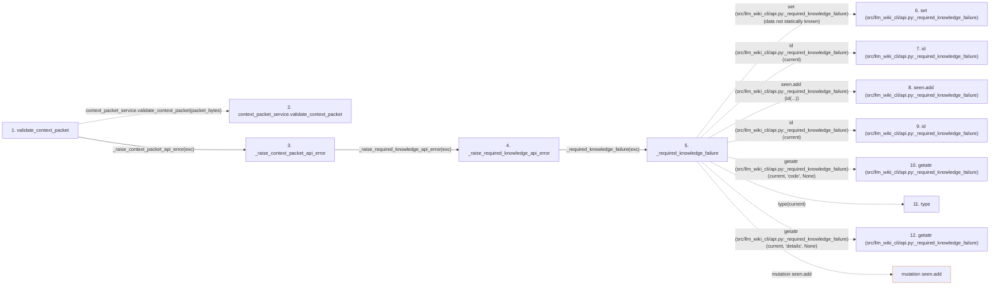

# validate_context_packet

**Entry point:** `validate_context_packet` (`api`)
**Source:** [api](../modules/api.md)
**Modules touched:** [api](../modules/api.md), [context_packet_builder](../modules/context_packet_builder.md)

## Call sequence

> Static overview in presentation order, not runtime execution order. Arrows retain captured callers; representative internal continuations and boundary examples precede repeated helper detail.

```mermaid
sequenceDiagram
    participant p0 as validate_context_packet
    participant p1 as _raise_context_packet_api_error
    participant p2 as _raise_required_knowledge_api_error
    participant p3 as describe_context_packet_error
    participant p4 as _required_knowledge_failure
    participant p5 as WorkspaceStateError
    participant p6 as isinstance (src/llm_wiki_cli/services…cribe_context_packet_error)
    participant p7 as context_packet_service.validate_context_packet
    participant p8 as leaf
    participant p9 as str (src/llm_wiki_cli/api.py:_…quired_knowledge_api_error)
    participant p10 as str (src/llm_wiki_cli/services…cribe_context_packet_error)
    participant p11 as deepcopy
    participant p12 as getattr (src/llm_wiki_cli/services…cribe_context_packet_error)
    participant p13 as {'source': 'source_snapshot', 'wiki': 'wiki_dir'}.get
    participant p14 as re.match
    participant p15 as flag.group
    participant p16 as set (src/llm_wiki_cli/services…cribe_context_packet_error)
    participant p17 as id (src/llm_wiki_cli/services…cribe_context_packet_error)
    participant p18 as seen.add (src/llm_wiki_cli/services…cribe_context_packet_error)
    p0->>p1: _raise_context_packet_api_error
    p1->>p2: _raise_required_knowledge_api_error
    p1->>p3: describe_context_packet_error
    p2->>p4: _required_knowledge_failure
    p2->>p5: WorkspaceStateError
    p3-->>p6: isinstance (src/llm_wiki_cli/services…cribe_context_packet_error)(error, HelperPreparationError)
    p0-->>p7: context_packet_service.validate_context_packet(packet_bytes)
    p1-->>p8: leaf(failure[...], code=failure[...], details=failure[...])
    p3-->>p6: isinstance (src/llm_wiki_cli/services…cribe_context_packet_error)(error, ContextPacketAuthorityError)
    p2-->>p9: str (src/llm_wiki_cli/api.py:_…quired_knowledge_api_error)(exc)
    p3-->>p10: str (src/llm_wiki_cli/services…cribe_context_packet_error)(error)
    p3-->>p11: deepcopy(error.details)
    p3-->>p12: getattr (src/llm_wiki_cli/services…cribe_context_packet_error)(error, 'field', None)
    p3-->>p6: isinstance (src/llm_wiki_cli/services…cribe_context_packet_error)(error, ContextPacketMalformedError)
    p3-->>p6: isinstance (src/llm_wiki_cli/services…cribe_context_packet_error)(error, ContextPacketSourceMutationError)
    p3-->>p13: {'source': 'source_snapshot', 'wiki': 'wiki_dir'}.get(error.facet, error.facet)
    p3-->>p6: isinstance (src/llm_wiki_cli/services…cribe_context_packet_error)(error, ContextPacketUnavailableError)
    p3-->>p6: isinstance (src/llm_wiki_cli/services…cribe_context_packet_error)(error, (...))
    p3-->>p6: isinstance (src/llm_wiki_cli/services…cribe_context_packet_error)(error, PathValidationError)
    p3-->>p14: re.match('^(?:Error:\\s*)?--(src|wiki)-dir\\b', str(...))
    p3-->>p10: str (src/llm_wiki_cli/services…cribe_context_packet_error)(error)
    p3-->>p15: flag.group(1)
    p3-->>p16: set (src/llm_wiki_cli/services…cribe_context_packet_error)
    p3-->>p17: id (src/llm_wiki_cli/services…cribe_context_packet_error)(cause)
    p3-->>p18: seen.add (src/llm_wiki_cli/services…cribe_context_packet_error)(id(...))
    p3-->>p17: id (src/llm_wiki_cli/services…cribe_context_packet_error)(cause)
    p3-->>p6: isinstance (src/llm_wiki_cli/services…cribe_context_packet_error)(cause, OSError)
    p3-->>p6: isinstance (src/llm_wiki_cli/services…cribe_context_packet_error)(cause, OSError)
    p3-->>p6: isinstance (src/llm_wiki_cli/services…cribe_context_packet_error)(error, context_service.ProtocolRequestError)
    p3-->>p6: isinstance (src/llm_wiki_cli/services…cribe_context_packet_error)(error, (...))
```

<!-- Auto-generated from static call edges. Dashed arrows are external or unresolved calls. Reviewed runtime conditions and side effects belong in Behavior. -->

> Call sequence diagram shows 30 of 49 interactions; 19 omitted to keep the visualization within the 30-interaction and generated-diagram limits, with uncertain identities omitted rather than inferred.

> Captured boundary calls: external 20 of 34 (14 omitted); unresolved 5 of 10 (5 omitted). These counts cover the captured static trace.

Omitted captured detail, grouped by actual caller occurrence and target module:

| Caller | Parent step | Target module | Kind | Omitted interactions |
| --- | --- | --- | --- | --- |
| `src/llm_wiki_cli/api.py:_required_knowledge_failure` | 5 | - | external | 10 |
| `src/llm_wiki_cli/api.py:_required_knowledge_failure` | 5 | - | unresolved | 2 |
| `src/llm_wiki_cli/services/context_packet_builder.py:describe_context_packet_error` | 20 | - | external | 4 |
| `src/llm_wiki_cli/services/context_packet_builder.py:describe_context_packet_error` | 20 | - | unresolved | 3 |
> Detailed flow queries retain their own coverage and limits; omitted paths may execute at runtime.

## Data flow

<!-- Auto-generated static analysis. Treat values and boundaries as best-effort hints, not runtime proof. -->

### Analysis coverage

**Effect analysis partially available.** Flow assembly and source effect analysis are separate; empty observations do not prove an empty handler body.

Source steps: 6; effect analysis evaluated: 5, partial: 0, unavailable: 1. Counts include steps omitted from the displayed trace.

Collector observations for 5 source steps with known totals: observed: 30, emitted: 30, omitted: 0. Unavailable totals are excluded.

- Callable record unavailable for one or more source steps; those steps have no represented callable body.
- Effect collector totals unavailable; observed counts cover captured records only.

| Step | Callable record | Effect analysis | Collector totals | Observed | Emitted | Omitted |
|---|---|---|---|---:|---:|---:|
| `validate_context_packet` | `available` | `evaluated` | `available` | `3` | `3` | `0` |
| `context_packet_service.validate_context_packet` | `not_applicable` | `not_applicable` | `not_applicable` | — | — | — |
| `_raise_context_packet_api_error` | `available` | `evaluated` | `available` | `3` | `3` | `0` |
| `_raise_required_knowledge_api_error` | `available` | `evaluated` | `available` | `2` | `2` | `0` |
| `_required_knowledge_failure` | `available` | `evaluated` | `available` | `9` | `9` | `0` |
| `set (src/llm_wiki_cli/api.py:_required_knowledge_failure)` | `not_applicable` | `not_applicable` | `not_applicable` | — | — | — |
| `id (src/llm_wiki_cli/api.py:_required_knowledge_failure)` | `not_applicable` | `not_applicable` | `not_applicable` | — | — | — |
| `seen.add (src/llm_wiki_cli/api.py:_required_knowledge_failure)` | `not_applicable` | `not_applicable` | `not_applicable` | — | — | — |
| `id (src/llm_wiki_cli/api.py:_required_knowledge_failure)` | `not_applicable` | `not_applicable` | `not_applicable` | — | — | — |
| `getattr (src/llm_wiki_cli/api.py:_required_knowledge_failure)` | `not_applicable` | `not_applicable` | `not_applicable` | — | — | — |
| `type` | `not_applicable` | `not_applicable` | `not_applicable` | — | — | — |
| `getattr (src/llm_wiki_cli/api.py:_required_knowledge_failure)` | `not_applicable` | `not_applicable` | `not_applicable` | — | — | — |

### Step data

| Step | Inputs | Reads | Writes | Returns |
|---|---|---|---|---|
| `validate_context_packet` | `packet_bytes: bytes \| bytearray \| memoryview` | `context_packet_service` | - | `validation` |
| `context_packet_service.validate_context_packet` | - | - | - | - |
| `_raise_context_packet_api_error` | `exc: BaseException` | `WorkspaceStateError`, `InvalidRequestError` | - | - |
| `_raise_required_knowledge_api_error` | `exc: BaseException` | - | - | `none` |
| `_required_knowledge_failure` | `exc: BaseException` | `Mapping`, `Mapping`, `KNOWLEDGE_MODE_REQUEST_FIELD` | - | `dict(...)`, `copied`, `None`, `{...}` |
| `set (src/llm_wiki_cli/api.py:_required_knowledge_failure)` | - | - | - | - |
| `id (src/llm_wiki_cli/api.py:_required_knowledge_failure)` | - | - | - | - |
| `seen.add (src/llm_wiki_cli/api.py:_required_knowledge_failure)` | - | - | - | - |
| `id (src/llm_wiki_cli/api.py:_required_knowledge_failure)` | - | - | - | - |
| `getattr (src/llm_wiki_cli/api.py:_required_knowledge_failure)` | - | - | - | - |
| `type` | - | - | - | - |
| `getattr (src/llm_wiki_cli/api.py:_required_knowledge_failure)` | - | - | - | - |

### Call data

| From | To | Line | Call |
|---|---|---:|---|
| validate_context_packet | context_packet_service.validate_context_packet | 2021 | `context_packet_service.validate_context_packet(packet_bytes)` |
| validate_context_packet | _raise_context_packet_api_error | 2023 | `_raise_context_packet_api_error(exc)` |
| _raise_context_packet_api_error | _raise_required_knowledge_api_error | 475 | `_raise_required_knowledge_api_error(exc)` |
| _raise_required_knowledge_api_error | _required_knowledge_failure | 455 | `_required_knowledge_failure(exc)` |
| _required_knowledge_failure | set (src/llm_wiki_cli/api.py:_required_knowledge_failure) | 424 | `set(data not statically known)` |
| _required_knowledge_failure | id (src/llm_wiki_cli/api.py:_required_knowledge_failure) | 425 | `id(current)` |
| _required_knowledge_failure | seen.add (src/llm_wiki_cli/api.py:_required_knowledge_failure) | 426 | `seen.add(id(...))` |
| _required_knowledge_failure | id (src/llm_wiki_cli/api.py:_required_knowledge_failure) | 426 | `id(current)` |
| _required_knowledge_failure | getattr (src/llm_wiki_cli/api.py:_required_knowledge_failure) | 427 | `getattr(current, 'code', None)` |
| _required_knowledge_failure | type | 428 | `type(current)` |
| _required_knowledge_failure | getattr (src/llm_wiki_cli/api.py:_required_knowledge_failure) | 431 | `getattr(current, 'details', None)` |

### Boundary effects

| Kind | Target | Step | Line |
|---|---|---|---:|
| mutation | `seen.add` | `_required_knowledge_failure` | 426 |

### Static analysis gaps

| Kind | Step | Target | Line |
|---|---|---|---:|
| unresolved_call | `validate_context_packet` | `context_packet_service.validate_context_packet` | 2021 |
| external_call | `_required_knowledge_failure` | `id` | 425 |
| external_call | `_required_knowledge_failure` | `getattr` | 427 |
| external_call | `_required_knowledge_failure` | `type` | 428 |
| external_call | `_required_knowledge_failure` | `getattr` | 431 |
| step_limit | `validate_context_packet` | `first 12 steps` | 0 |

## Behavior

This flow starts at `validate_context_packet` and is classified as `api`. The generated call and data-flow sections are bounded static projections; runtime conditions and side effects require source-level confirmation.
