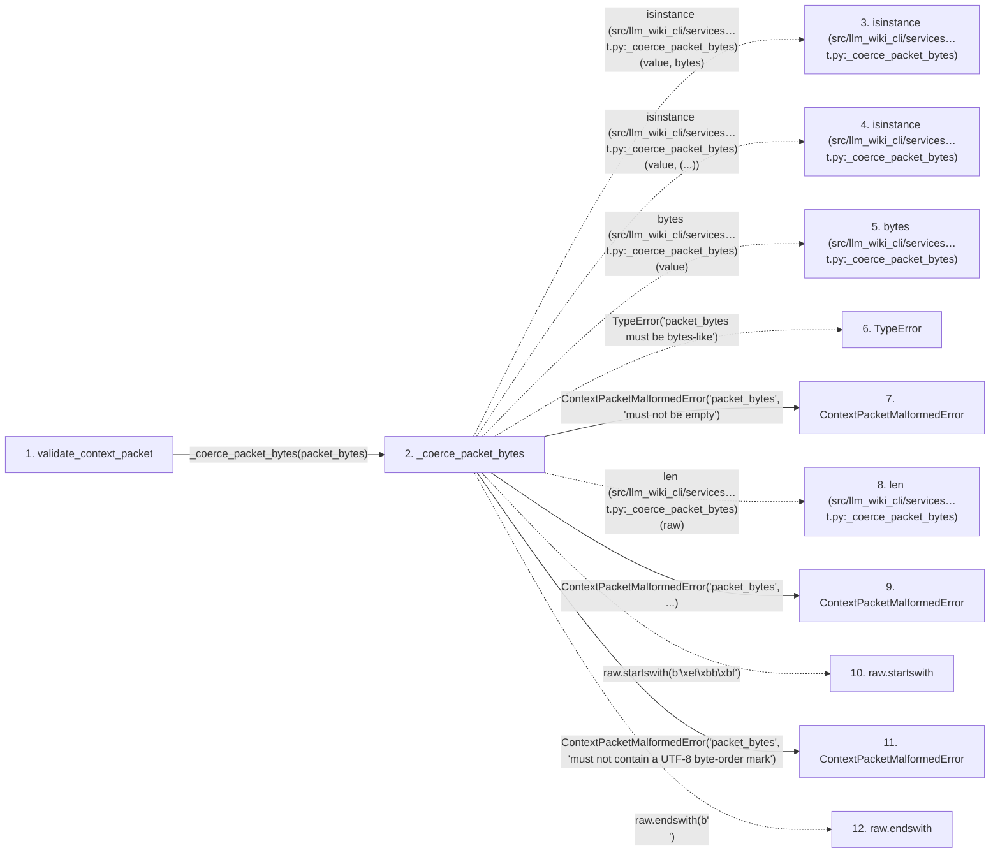

# validate_context_packet

**Entry point:** `validate_context_packet` (`api`)
**Source:** [context_packet](../modules/context_packet.md)
**Modules touched:** [change_selection](../modules/change_selection.md), [context_budget](../modules/context_budget.md), [context_packet](../modules/context_packet.md), [context_service](../modules/context_service.md), and 6 more

**Complete modules touched:**

- [change_selection](../modules/change_selection.md)
- [context_budget](../modules/context_budget.md)
- [context_packet](../modules/context_packet.md)
- [context_service](../modules/context_service.md)
- [knowledge_evidence](../modules/knowledge_evidence.md)
- [knowledge_graph](../modules/knowledge_graph.md)
- [knowledge_model](../modules/knowledge_model.md)
- [maintenance_status](../modules/maintenance_status.md)
- [packet_field_policy](../modules/packet_field_policy.md)
- [validation](../modules/validation.md)

## Call sequence

> Static overview in presentation order, not runtime execution order. Arrows retain captured callers; siblings are shown before deeper helper detail.

```mermaid
sequenceDiagram
    participant p0 as validate_context_packet
    participant p1 as _coerce_packet_bytes
    participant p2 as _strict_json_payload
    participant p3 as _packet_contract_for_schema
    participant p4 as payload.get
    participant p5 as len (src/llm_wiki_cli/services…y:validate_context_packet)
    participant p6 as ContextPacketMalformedError
    participant p7 as _validate_packet_shape
    participant p8 as _encode_packet_payload
    participant p9 as payload.items
    participant p10 as _packet_id
    participant p11 as _path_policy_receipt
    participant p12 as ContextPacketPathPolicyError
    participant p13 as QualifiedContextPacket._from_validated_payload
    participant p14 as ContextPacketValidation
    participant p15 as isinstance (src/llm_wiki_cli/services…t.py:_coerce_packet_bytes)
    participant p16 as raw.decode
    participant p17 as isinstance (src/llm_wiki_cli/services…acket_contract_for_schema)
    participant p18 as _exact_fields
    participant p19 as _validate_json_tree
    participant p20 as validate_field_coverage
    participant p21 as QualifiedContextPacket
    participant p22 as canonical_json_bytes
    p0->>p1: _coerce_packet_bytes
    p0->>p2: _strict_json_payload
    p0->>p3: _packet_contract_for_schema
    p0-->>p4: payload.get('schema_version')
    p0-->>p5: len (src/llm_wiki_cli/services…y:validate_context_packet)(raw)
    p0->>p6: ContextPacketMalformedError
    p0->>p7: _validate_packet_shape
    p0->>p8: _encode_packet_payload
    p0->>p6: ContextPacketMalformedError
    p0-->>p9: payload.items
    p0->>p10: _packet_id
    p0->>p6: ContextPacketMalformedError
    p0-->>p9: payload.items
    p0->>p11: _path_policy_receipt
    p0->>p12: ContextPacketPathPolicyError
    p0->>p13: QualifiedContextPacket._from_validated_payload
    p0->>p14: ContextPacketValidation
    p1-->>p15: isinstance (src/llm_wiki_cli/services…t.py:_coerce_packet_bytes)(value, bytes)
    p2-->>p16: raw.decode('utf-8')
    p3-->>p17: isinstance (src/llm_wiki_cli/services…acket_contract_for_schema)(schema_version, str)
    p7->>p18: _exact_fields
    p8->>p19: _validate_json_tree
    p10->>p3: _packet_contract_for_schema
    p11->>p20: validate_field_coverage
    p13->>p21: QualifiedContextPacket
    p1-->>p15: isinstance (src/llm_wiki_cli/services…t.py:_coerce_packet_bytes)(value, (...))
    p2->>p6: ContextPacketMalformedError
    p3->>p6: ContextPacketMalformedError
    p7->>p6: ContextPacketMalformedError
    p8->>p22: canonical_json_bytes
```

<!-- Auto-generated from static call edges. Dashed arrows are external or unresolved calls. Reviewed runtime conditions and side effects belong in Behavior. -->

> Call sequence diagram shows 30 of 754 interactions; 724 omitted to keep the visualization within the 30-interaction and generated-diagram limits, with uncertain identities omitted rather than inferred.

> Captured boundary calls: external 4 of 231 (227 omitted); unresolved 4 of 135 (131 omitted). These counts cover the captured static trace.

Omitted captured detail, grouped by actual caller occurrence and target module:

| Caller | Parent step | Target module | Kind | Omitted interactions |
| --- | --- | --- | --- | --- |
| `src/llm_wiki_cli/services/context_packet.py:_coerce_packet_bytes` | 2 | - | external | 3 |
| `src/llm_wiki_cli/services/context_packet.py:_coerce_packet_bytes` | 2 | [src/llm_wiki_cli/services/context_packet.py](../modules/context_packet.md) | internal | 4 |
| `src/llm_wiki_cli/services/context_packet.py:_coerce_packet_bytes` | 2 | - | unresolved | 3 |
| `src/llm_wiki_cli/services/context_packet.py:_strict_json_payload` | 15 | - | external | 2 |
| `src/llm_wiki_cli/services/context_packet.py:_strict_json_payload` | 15 | [src/llm_wiki_cli/services/context_packet.py](../modules/context_packet.md) | internal | 3 |
| `src/llm_wiki_cli/services/context_packet.py:_validate_json_tree` | 22 | - | external | 1 |
| `src/llm_wiki_cli/services/context_packet.py:_validate_json_tree` | 22 | - | unresolved | 1 |
| `src/llm_wiki_cli/services/context_packet.py:_packet_contract_for_schema` | 25 | - | unresolved | 1 |
> Omission summary shows 8 of 142 groups; 134 further groups are not expanded here. Counts above include all omitted interactions.
> Detailed flow queries retain their own coverage and limits; omitted paths may execute at runtime.

> Trace truncated at the depth limit; deeper calls are omitted.

## Data flow

<!-- Auto-generated static analysis. Treat values and boundaries as best-effort hints, not runtime proof. -->

### Step data

| Step | Inputs | Reads | Writes | Returns |
|---|---|---|---|---|
| `validate_context_packet` | `packet_bytes: bytes \| bytearray \| memoryview` | - | - | `ContextPacketValidation(...)` |
| `_coerce_packet_bytes` | `value: bytes \| bytearray \| memoryview` | `_MAX_PACKET_BYTES`, `_MAX_PACKET_BYTES` | - | `raw` |
| `isinstance (src/llm_wiki_cli/services…t.py:_coerce_packet_bytes)` | - | - | - | - |
| `isinstance (src/llm_wiki_cli/services…t.py:_coerce_packet_bytes)` | - | - | - | - |
| `bytes (src/llm_wiki_cli/services…t.py:_coerce_packet_bytes)` | - | - | - | - |
| `TypeError` | - | - | - | - |
| `ContextPacketMalformedError` | - | - | - | - |
| `len (src/llm_wiki_cli/services…t.py:_coerce_packet_bytes)` | - | - | - | - |
| `ContextPacketMalformedError` | - | - | - | - |
| `raw.startswith` | - | - | - | - |
| `ContextPacketMalformedError` | - | - | - | - |
| `raw.endswith` | - | - | - | - |

### Call data

| From | To | Line | Call |
|---|---|---:|---|
| validate_context_packet | _coerce_packet_bytes | 1712 | `_coerce_packet_bytes(packet_bytes)` |
| _coerce_packet_bytes | isinstance (src/llm_wiki_cli/services…t.py:_coerce_packet_bytes) | 2493 | `isinstance(value, bytes)` |
| _coerce_packet_bytes | isinstance (src/llm_wiki_cli/services…t.py:_coerce_packet_bytes) | 2495 | `isinstance(value, (...))` |
| _coerce_packet_bytes | bytes (src/llm_wiki_cli/services…t.py:_coerce_packet_bytes) | 2496 | `bytes(value)` |
| _coerce_packet_bytes | TypeError | 2498 | `TypeError('packet_bytes must be bytes-like')` |
| _coerce_packet_bytes | ContextPacketMalformedError | 2500 | `ContextPacketMalformedError('packet_bytes', 'must not be empty')` |
| _coerce_packet_bytes | len (src/llm_wiki_cli/services…t.py:_coerce_packet_bytes) | 2501 | `len(raw)` |
| _coerce_packet_bytes | ContextPacketMalformedError | 2502 | `ContextPacketMalformedError('packet_bytes', ...)` |
| _coerce_packet_bytes | raw.startswith | 2506 | `raw.startswith(b'\xef\xbb\xbf')` |
| _coerce_packet_bytes | ContextPacketMalformedError | 2507 | `ContextPacketMalformedError('packet_bytes', 'must not contain a UTF-8 byte-order mark')` |
| _coerce_packet_bytes | raw.endswith | 2511 | `raw.endswith(b'\n')` |

### Boundary effects

*No boundary effects detected.*

### Static analysis gaps

| Kind | Step | Target | Line |
|---|---|---|---:|
| external_call | `_coerce_packet_bytes` | `isinstance` | 2493 |
| external_call | `_coerce_packet_bytes` | `isinstance` | 2495 |
| external_call | `_coerce_packet_bytes` | `bytes` | 2496 |
| external_call | `_coerce_packet_bytes` | `TypeError` | 2498 |
| unresolved_call | `_coerce_packet_bytes` | `raw.startswith` | 2506 |
| unresolved_call | `_coerce_packet_bytes` | `raw.endswith` | 2511 |
| step_limit | `validate_context_packet` | `first 12 steps` | 0 |
| truncated_flow | `validate_context_packet` | `depth limit` | 0 |

## Behavior

This flow starts at `validate_context_packet` and is classified as `api`. The generated call and data-flow sections are bounded static projections; runtime conditions and side effects require source-level confirmation.
