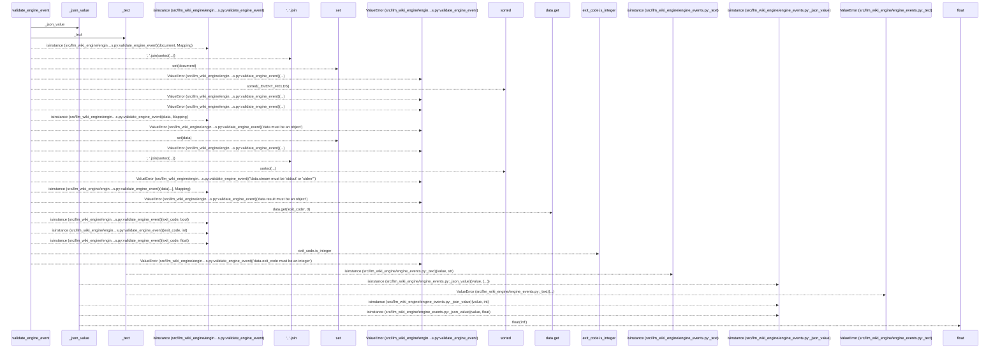
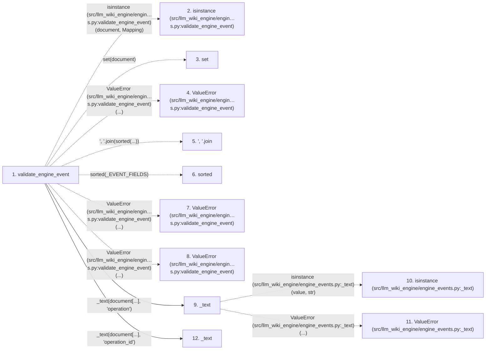

# validate_engine_event

**Entry point:** `validate_engine_event` (`api`)
**Source:** [engine_events](../modules/engine_events.md)
**Modules touched:** [engine_events](../modules/engine_events.md)

## Call sequence

> Static overview in presentation order, not runtime execution order. Arrows retain captured callers; representative internal continuations and boundary examples precede repeated helper detail.

<!-- Auto-generated from static call edges. Dashed arrows are external or unresolved calls. Reviewed runtime conditions and side effects belong in Behavior. -->

> Call sequence diagram shows 30 of 46 interactions; 16 omitted to keep the visualization within the 30-interaction and generated-diagram limits, with uncertain identities omitted rather than inferred.

> Captured boundary calls: external 24 of 32 (8 omitted); unresolved 4 of 5 (1 omitted). These counts cover the captured static trace.

Omitted captured detail, grouped by actual caller occurrence and target module:

| Caller | Parent step | Target module | Kind | Omitted interactions |
| --- | --- | --- | --- | --- |
| `src/llm_wiki_engine/engine_events.py:validate_engine_event` | 1 | [src/llm_wiki_engine/engine_events.py](../modules/engine_events.md) | internal | 5 |
| `src/llm_wiki_engine/engine_events.py:_json_value` | 19 | - | external | 8 |
| `src/llm_wiki_engine/engine_events.py:_json_value` | 19 | [src/llm_wiki_engine/engine_events.py](../modules/engine_events.md) | internal | 2 |
| `src/llm_wiki_engine/engine_events.py:_json_value` | 19 | - | unresolved | 1 |
> Detailed flow queries retain their own coverage and limits; omitted paths may execute at runtime.

## Data flow

<!-- Auto-generated static analysis. Treat values and boundaries as best-effort hints, not runtime proof. -->

### Analysis coverage

**Effect analysis partially available.** Flow assembly and source effect analysis are separate; empty observations do not prove an empty handler body.

Source steps: 10; effect analysis evaluated: 9, partial: 1, unavailable: 0. Counts include steps omitted from the displayed trace.

Collector observations for 10 source steps with known totals: observed: 52, emitted: 51, omitted: 1. Unavailable totals are excluded.

- Effect collector omitted observations before flow assembly; displayed effects are partial.

| Step | Callable record | Effect analysis | Collector totals | Observed | Emitted | Omitted |
|---|---|---|---|---:|---:|---:|
| `validate_engine_event` | `available` | `partial` | `available` | `10` | `9` | `1` |
| `isinstance (src/llm_wiki_engine/engin…s.py:validate_engine_event)` | `not_applicable` | `not_applicable` | `not_applicable` | — | — | — |
| `set` | `not_applicable` | `not_applicable` | `not_applicable` | — | — | — |
| `ValueError (src/llm_wiki_engine/engin…s.py:validate_engine_event)` | `not_applicable` | `not_applicable` | `not_applicable` | — | — | — |
| `', '.join` | `not_applicable` | `not_applicable` | `not_applicable` | — | — | — |
| `sorted` | `not_applicable` | `not_applicable` | `not_applicable` | — | — | — |
| `ValueError (src/llm_wiki_engine/engin…s.py:validate_engine_event)` | `not_applicable` | `not_applicable` | `not_applicable` | — | — | — |
| `ValueError (src/llm_wiki_engine/engin…s.py:validate_engine_event)` | `not_applicable` | `not_applicable` | `not_applicable` | — | — | — |
| `_text` | `available` | `evaluated` | `available` | `3` | `3` | `0` |
| `isinstance (src/llm_wiki_engine/engine_events.py:_text)` | `not_applicable` | `not_applicable` | `not_applicable` | — | — | — |
| `ValueError (src/llm_wiki_engine/engine_events.py:_text)` | `not_applicable` | `not_applicable` | `not_applicable` | — | — | — |
| `_text` | `available` | `evaluated` | `available` | `3` | `3` | `0` |

### Step data

| Step | Inputs | Reads | Writes | Returns |
|---|---|---|---|---|
| `validate_engine_event` | `document: object` | `Mapping`, `_EVENT_FIELDS`, `_EVENT_FIELDS`, `ENGINE_EVENT_SCHEMA_VERSION`, `ENGINE_EVENT_SCHEMA_VERSION`, `EVENT_KINDS`, `Mapping`, `_DATA_FIELDS` | - | - |
| `isinstance (src/llm_wiki_engine/engin…s.py:validate_engine_event)` | - | - | - | - |
| `set` | - | - | - | - |
| `ValueError (src/llm_wiki_engine/engin…s.py:validate_engine_event)` | - | - | - | - |
| `', '.join` | - | - | - | - |
| `sorted` | - | - | - | - |
| `ValueError (src/llm_wiki_engine/engin…s.py:validate_engine_event)` | - | - | - | - |
| `ValueError (src/llm_wiki_engine/engin…s.py:validate_engine_event)` | - | - | - | - |
| `_text` | `value: object`, `path: str`, `empty: bool` | - | - | - |
| `isinstance (src/llm_wiki_engine/engine_events.py:_text)` | - | - | - | - |
| `ValueError (src/llm_wiki_engine/engine_events.py:_text)` | - | - | - | - |
| `_text` | `value: object`, `path: str`, `empty: bool` | - | - | - |

### Call data

| From | To | Line | Call |
|---|---|---:|---|
| validate_engine_event | isinstance (src/llm_wiki_engine/engin…s.py:validate_engine_event) | 125 | `isinstance(document, Mapping)` |
| validate_engine_event | set | 125 | `set(document)` |
| validate_engine_event | ValueError (src/llm_wiki_engine/engin…s.py:validate_engine_event) | 126 | `ValueError(...)` |
| validate_engine_event | ', '.join | 126 | `', '.join(sorted(...))` |
| validate_engine_event | sorted | 126 | `sorted(_EVENT_FIELDS)` |
| validate_engine_event | ValueError (src/llm_wiki_engine/engin…s.py:validate_engine_event) | 128 | `ValueError(...)` |
| validate_engine_event | ValueError (src/llm_wiki_engine/engin…s.py:validate_engine_event) | 131 | `ValueError(...)` |
| validate_engine_event | _text | 132 | `_text(document[...], 'operation')` |
| _text | isinstance (src/llm_wiki_engine/engine_events.py:_text) | 119 | `isinstance(value, str)` |
| _text | ValueError (src/llm_wiki_engine/engine_events.py:_text) | 120 | `ValueError(...)` |
| validate_engine_event | _text | 133 | `_text(document[...], 'operation_id')` |

### Boundary effects

*No boundary-effect observations were captured in this static trace.*

### Static analysis gaps

| Kind | Step | Target | Line |
|---|---|---|---:|
| external_call | `validate_engine_event` | `isinstance` | 125 |
| external_call | `validate_engine_event` | `ValueError` | 126 |
| unresolved_call | `validate_engine_event` | `', '.join` | 126 |
| external_call | `validate_engine_event` | `sorted` | 126 |
| external_call | `validate_engine_event` | `ValueError` | 128 |
| external_call | `validate_engine_event` | `ValueError` | 131 |
| external_call | `_text` | `isinstance` | 119 |
| external_call | `_text` | `ValueError` | 120 |
| step_limit | `validate_engine_event` | `first 12 steps` | 0 |

## Behavior

This flow starts at `validate_engine_event` and is classified as `api`. The generated call and data-flow sections are bounded static projections; runtime conditions and side effects require source-level confirmation.
