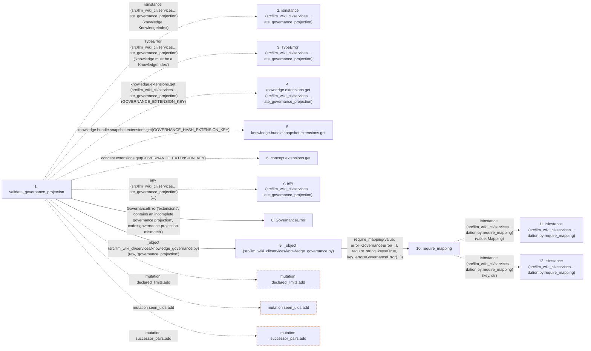

# validate_governance_projection

**Entry point:** `validate_governance_projection` (`api`)
**Source:** [knowledge_governance](../modules/knowledge_governance.md)
**Modules touched:** [concept_identity](../modules/concept_identity.md), [knowledge_evidence](../modules/knowledge_evidence.md), [knowledge_governance](../modules/knowledge_governance.md), and 5 more

**Complete modules touched:**

- [concept_identity](../modules/concept_identity.md)
- [knowledge_evidence](../modules/knowledge_evidence.md)
- [knowledge_governance](../modules/knowledge_governance.md)
- [knowledge_graph](../modules/knowledge_graph.md)
- [knowledge_model](../modules/knowledge_model.md)
- [validation](../modules/validation.md)
- [wiki_media](../modules/wiki_media.md)
- [wiki_surface](../modules/wiki_surface.md)

## Call sequence

> Static overview in presentation order, not runtime execution order. Arrows retain captured callers; representative internal continuations and boundary examples precede repeated helper detail.

```mermaid
sequenceDiagram
    participant p0 as validate_governance_projection
    participant p1 as _object (src/llm_wiki_cli/services/knowledge_governance.py)
    participant p2 as _exact_fields
    participant p3 as _bundle_id
    participant p4 as validate_governance_ledger
    participant p5 as _event_limit
    participant p6 as _validate_concept_summary
    participant p7 as _validate_supersession_projection
    participant p8 as apply_governance_projection
    participant p9 as _governance_supersession_edge_payloads
    participant p10 as GovernanceError
    participant p11 as _hash (src/llm_wiki_cli/services/knowledge_governance.py)
    participant p12 as _nonnegative_int (src/llm_wiki_cli/services/knowledge_governance.py)
    participant p13 as strip_governance_projection
    participant p14 as validate_bundle_id
    participant p15 as concept_references_from_knowledge
    participant p16 as _array (src/llm_wiki_cli/services/knowledge_governance.py)
    participant p17 as lifecycle_state_by_uid
    participant p18 as _concept_uid
    participant p19 as _concept_kind
    participant p20 as _identity_value
    participant p21 as _identity_ownership_key
    participant p22 as _validate_bounded_events
    participant p23 as evaluate_review_event
    participant p24 as _add_supersession_edges
    participant p25 as _validate_lifecycle_event_fields
    participant p26 as _validate_lifecycle_histories
    participant p27 as _validate_review_event_fields
    participant p28 as _machine_text
    participant p29 as isinstance (src/llm_wiki_cli/services…ate_governance_projection)
    participant p30 as knowledge.extensions.get (src/llm_wiki_cli/services…ate_governance_projection)
    p0->>p1: _object (src/llm_wiki_cli/services/knowledge_governance.py)
    p0->>p2: _exact_fields
    p0->>p3: _bundle_id
    p0->>p4: validate_governance_ledger
    p0->>p5: _event_limit
    p0->>p6: _validate_concept_summary
    p0->>p7: _validate_supersession_projection
    p0->>p8: apply_governance_projection
    p0->>p9: _governance_supersession_edge_payloads
    p0->>p10: GovernanceError
    p0->>p11: _hash (src/llm_wiki_cli/services/knowledge_governance.py)
    p0->>p12: _nonnegative_int (src/llm_wiki_cli/services/knowledge_governance.py)
    p0->>p13: strip_governance_projection
    p3->>p14: validate_bundle_id
    p8->>p15: concept_references_from_knowledge
    p6->>p16: _array (src/llm_wiki_cli/services/knowledge_governance.py)
    p8->>p17: lifecycle_state_by_uid
    p4->>p18: _concept_uid
    p4->>p19: _concept_kind
    p4->>p20: _identity_value
    p4->>p21: _identity_ownership_key
    p6->>p22: _validate_bounded_events
    p8->>p23: evaluate_review_event
    p8->>p24: _add_supersession_edges
    p4->>p25: _validate_lifecycle_event_fields
    p4->>p26: _validate_lifecycle_histories
    p4->>p27: _validate_review_event_fields
    p14->>p28: _machine_text
    p0-->>p29: isinstance (src/llm_wiki_cli/services…ate_governance_projection)(knowledge, KnowledgeIndex)
    p0-->>p30: knowledge.extensions.get (src/llm_wiki_cli/services…ate_governance_projection)(GOVERNANCE_EXTENSION_KEY)
```

<!-- Auto-generated from static call edges. Dashed arrows are external or unresolved calls. Reviewed runtime conditions and side effects belong in Behavior. -->

> Call sequence diagram shows 30 of 1268 interactions; 1238 omitted to keep the visualization within the 30-interaction and generated-diagram limits, with uncertain identities omitted rather than inferred.

> Captured boundary calls: external 1 of 396 (395 omitted); unresolved 1 of 310 (309 omitted). These counts cover the captured static trace.

Omitted captured detail, grouped by actual caller occurrence and target module:

| Caller | Parent step | Target module | Kind | Omitted interactions |
| --- | --- | --- | --- | --- |
| `src/llm_wiki_cli/services/knowledge_governance.py:validate_governance_projection` | 1 | - | external | 14 |
| `src/llm_wiki_cli/services/knowledge_governance.py:validate_governance_projection` | 1 | - | unresolved | 12 |
| `src/llm_wiki_cli/services/knowledge_governance.py:_object` | 9 | [src/llm_wiki_cli/services/validation.py](../modules/validation.md) | internal | 1 |
| `src/llm_wiki_cli/services/validation.py:require_mapping` | 10 | - | external | 2 |
| `src/llm_wiki_cli/services/validation.py:require_mapping` | 10 | - | unresolved | 1 |
| `src/llm_wiki_cli/services/knowledge_governance.py:_object` | 9 | [src/llm_wiki_cli/services/knowledge_governance.py](../modules/knowledge_governance.md) | internal | 2 |
| `src/llm_wiki_cli/services/knowledge_governance.py:_object` | 9 | - | external | 1 |
| `src/llm_wiki_cli/services/knowledge_governance.py:_exact_fields` | 17 | [src/llm_wiki_cli/services/validation.py](../modules/validation.md) | internal | 1 |
> Omission summary shows 8 of 272 groups; 264 further groups are not expanded here. Counts above include all omitted interactions.
> Detailed flow queries retain their own coverage and limits; omitted paths may execute at runtime.

> Trace truncated at the depth limit; deeper calls are omitted.

## Data flow

<!-- Auto-generated static analysis. Treat values and boundaries as best-effort hints, not runtime proof. -->

### Analysis coverage

**Effect analysis partially available.** Flow assembly and source effect analysis are separate; empty observations do not prove an empty handler body.

Source steps: 563; effect analysis evaluated: 338, partial: 11, unavailable: 214. Counts include steps omitted from the displayed trace.

Collector observations for 349 source steps with known totals: observed: 1793, emitted: 1737, omitted: 56. Unavailable totals are excluded.

- Callable record unavailable for one or more source steps; those steps have no represented callable body.
- Effect collector omitted observations before flow assembly; displayed effects are partial.
- Effect collector totals unavailable; observed counts cover captured records only.

| Step | Callable record | Effect analysis | Collector totals | Observed | Emitted | Omitted |
|---|---|---|---|---:|---:|---:|
| `validate_governance_projection` | `available` | `partial` | `available` | `22` | `16` | `6` |
| `isinstance (src/llm_wiki_cli/services…ate_governance_projection)` | `not_applicable` | `not_applicable` | `not_applicable` | — | — | — |
| `TypeError (src/llm_wiki_cli/services…ate_governance_projection)` | `not_applicable` | `not_applicable` | `not_applicable` | — | — | — |
| `knowledge.extensions.get (src/llm_wiki_cli/services…ate_governance_projection)` | `not_applicable` | `not_applicable` | `not_applicable` | — | — | — |
| `knowledge.bundle.snapshot.extensions.get` | `not_applicable` | `not_applicable` | `not_applicable` | — | — | — |
| `concept.extensions.get` | `not_applicable` | `not_applicable` | `not_applicable` | — | — | — |
| `any (src/llm_wiki_cli/services…ate_governance_projection)` | `not_applicable` | `not_applicable` | `not_applicable` | — | — | — |
| `GovernanceError` | `unavailable` | `unavailable` | `unavailable` | — | — | — |
| `_object (src/llm_wiki_cli/services/knowledge_governance.py)` | `available` | `evaluated` | `available` | `3` | `3` | `0` |
| `require_mapping` | `available` | `evaluated` | `available` | `8` | `8` | `0` |
| `isinstance (src/llm_wiki_cli/services…dation.py:require_mapping)` | `not_applicable` | `not_applicable` | `not_applicable` | — | — | — |
| `isinstance (src/llm_wiki_cli/services…dation.py:require_mapping)` | `not_applicable` | `not_applicable` | `not_applicable` | — | — | — |

### Step data

| Step | Inputs | Reads | Writes | Returns |
|---|---|---|---|---|
| `validate_governance_projection` | `knowledge: KnowledgeIndex`, `ledger: GovernanceLedger \| None`, `event_limit: int \| None` | `KnowledgeIndex`, `GOVERNANCE_EXTENSION_KEY`, `GOVERNANCE_HASH_EXTENSION_KEY`, `GOVERNANCE_EXTENSION_KEY`, `GOVERNANCE_SCHEMA_VERSION`, `GOVERNANCE_SCHEMA_VERSION`, `GOVERNANCE_HASH_EXTENSION_KEY`, `GOVERNANCE_EXTENSION_KEY` | - | `None`, `projection` |
| `isinstance (src/llm_wiki_cli/services…ate_governance_projection)` | - | - | - | - |
| `TypeError (src/llm_wiki_cli/services…ate_governance_projection)` | - | - | - | - |
| `knowledge.extensions.get (src/llm_wiki_cli/services…ate_governance_projection)` | - | - | - | - |
| `knowledge.bundle.snapshot.extensions.get` | - | - | - | - |
| `concept.extensions.get` | - | - | - | - |
| `any (src/llm_wiki_cli/services…ate_governance_projection)` | - | - | - | - |
| `GovernanceError` | - | - | - | - |
| `_object (src/llm_wiki_cli/services/knowledge_governance.py)` | `value: object`, `path: str` | - | - | `dict(...)` |
| `require_mapping` | `value: object`, `error: Exception`, `require_string_keys: bool`, `key_error: Exception \| None`, `require_utf8_keys: bool`, `utf8_key_error: Exception \| None` | `Mapping` | - | `value` |
| `isinstance (src/llm_wiki_cli/services…dation.py:require_mapping)` | - | - | - | - |
| `isinstance (src/llm_wiki_cli/services…dation.py:require_mapping)` | - | - | - | - |

### Call data

| From | To | Line | Call |
|---|---|---:|---|
| validate_governance_projection | isinstance (src/llm_wiki_cli/services…ate_governance_projection) | 1848 | `isinstance(knowledge, KnowledgeIndex)` |
| validate_governance_projection | TypeError (src/llm_wiki_cli/services…ate_governance_projection) | 1849 | `TypeError('knowledge must be a KnowledgeIndex')` |
| validate_governance_projection | knowledge.extensions.get (src/llm_wiki_cli/services…ate_governance_projection) | 1850 | `knowledge.extensions.get(GOVERNANCE_EXTENSION_KEY)` |
| validate_governance_projection | knowledge.bundle.snapshot.extensions.get | 1851 | `knowledge.bundle.snapshot.extensions.get(GOVERNANCE_HASH_EXTENSION_KEY)` |
| validate_governance_projection | concept.extensions.get | 1855 | `concept.extensions.get(GOVERNANCE_EXTENSION_KEY)` |
| validate_governance_projection | any (src/llm_wiki_cli/services…ate_governance_projection) | 1859 | `any(...)` |
| validate_governance_projection | GovernanceError | 1862 | `GovernanceError('extensions', 'contains an incomplete governance projection', code='governance-projection-mismatch')` |
| validate_governance_projection | _object (src/llm_wiki_cli/services/knowledge_governance.py) | 1868 | `_object(raw, 'governance_projection')` |
| _object (src/llm_wiki_cli/services/knowledge_governance.py) | require_mapping | 3173 | `require_mapping(value, error=GovernanceError(...), require_string_keys=True, key_error=GovernanceError(...))` |
| require_mapping | isinstance (src/llm_wiki_cli/services…dation.py:require_mapping) | 773 | `isinstance(value, Mapping)` |
| require_mapping | isinstance (src/llm_wiki_cli/services…dation.py:require_mapping) | 777 | `isinstance(key, str)` |

### Boundary effects

| Kind | Target | Step | Line |
|---|---|---|---:|
| mutation | `declared_limits.add` | `validate_governance_projection` | 1953 |
| mutation | `seen_uids.add` | `validate_governance_projection` | 1960 |
| mutation | `successor_pairs.add` | `validate_governance_projection` | 1975 |

### Static analysis gaps

| Kind | Step | Target | Line |
|---|---|---|---:|
| external_call | `validate_governance_projection` | `isinstance` | 1848 |
| external_call | `validate_governance_projection` | `TypeError` | 1849 |
| unresolved_call | `validate_governance_projection` | `knowledge.extensions.get` | 1850 |
| unresolved_call | `validate_governance_projection` | `knowledge.bundle.snapshot.extensions.get` | 1851 |
| unresolved_call | `validate_governance_projection` | `concept.extensions.get` | 1855 |
| external_call | `validate_governance_projection` | `any` | 1859 |
| external_call | `require_mapping` | `isinstance` | 773 |
| external_call | `require_mapping` | `isinstance` | 777 |
| step_limit | `validate_governance_projection` | `first 12 steps` | 0 |
| truncated_flow | `validate_governance_projection` | `depth limit` | 0 |

## Behavior

This flow starts at `validate_governance_projection` and is classified as `api`. The generated call and data-flow sections are bounded static projections; runtime conditions and side effects require source-level confirmation.
