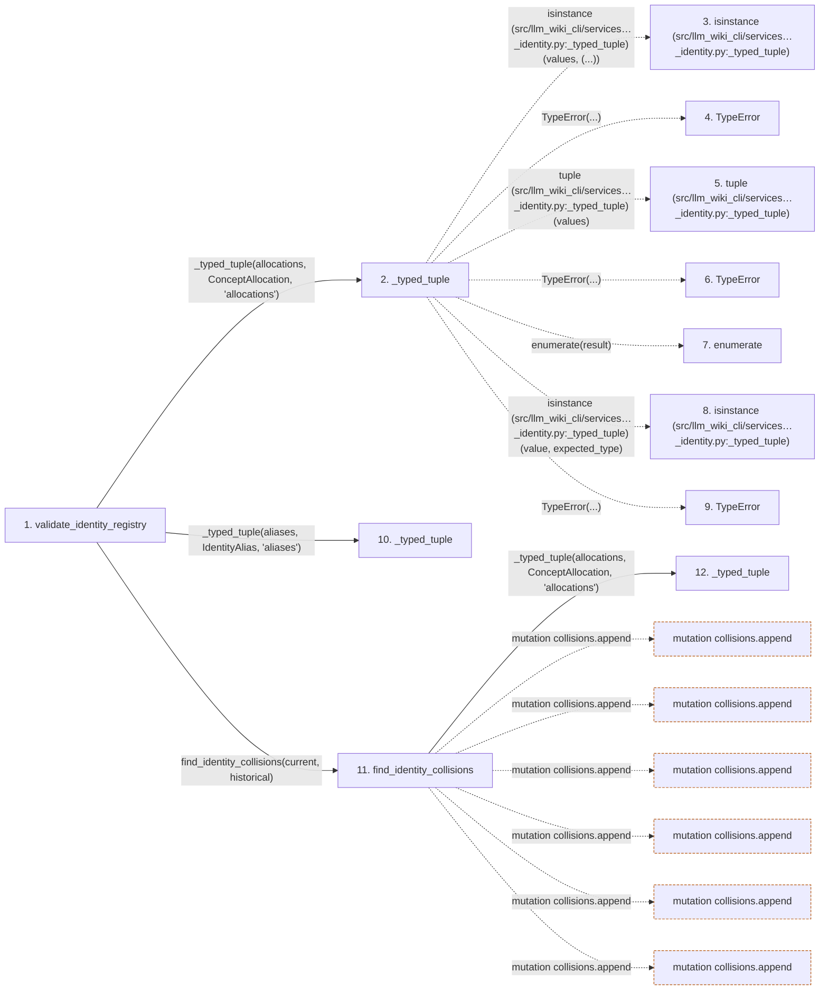

# validate_identity_registry

**Entry point:** `validate_identity_registry` (`api`)
**Source:** [concept_identity](../modules/concept_identity.md)
**Modules touched:** [concept_identity](../modules/concept_identity.md), [wiki_surface](../modules/wiki_surface.md)

## Call sequence

> Static overview in presentation order, not runtime execution order. Arrows retain captured callers; representative internal continuations and boundary examples precede repeated helper detail.

```mermaid
sequenceDiagram
    participant p0 as validate_identity_registry
    participant p1 as find_identity_collisions
    participant p2 as _typed_tuple
    participant p3 as IdentityCollisionError
    participant p4 as _sorted_aliases
    participant p5 as identity_coordinate_key
    participant p6 as validate_alias_type
    participant p7 as validate_alias_value
    participant p8 as validate_locator
    participant p9 as validate_natural_key
    participant p10 as _machine_text
    participant p11 as validate_exact_page_coordinate
    participant p12 as _safe_decoded_coordinate
    participant p13 as IdentityCollision
    participant p14 as iter_page_kinds
    participant p15 as canonical_path
    participant p16 as mcp_uri
    participant p17 as AliasType
    participant p18 as ConceptIdentityError
    participant p19 as _contains_uri_userinfo
    participant p20 as _looks_absolute_path
    participant p21 as _contains_coordinate_userinfo
    participant p22 as WikiSurfaceError
    participant p23 as _matches_directory_path
    participant p24 as _matches_directory_uri
    participant p25 as tuple (src/llm_wiki_cli/services…alidate_identity_registry)
    participant p26 as allocations_by_uid[…].append
    participant p27 as sorted (src/llm_wiki_cli/services…alidate_identity_registry)
    participant p28 as isinstance (src/llm_wiki_cli/services…_identity.py:_typed_tuple)
    participant p29 as tuple (src/llm_wiki_cli/services…entity.py:_sorted_aliases)
    participant p30 as TypeError
    p0->>p1: find_identity_collisions
    p0->>p2: _typed_tuple
    p0->>p3: IdentityCollisionError
    p0->>p4: _sorted_aliases
    p1->>p5: identity_coordinate_key
    p5->>p6: validate_alias_type
    p5->>p7: validate_alias_value
    p7->>p8: validate_locator
    p7->>p9: validate_natural_key
    p8->>p10: _machine_text
    p8->>p11: validate_exact_page_coordinate
    p9->>p12: _safe_decoded_coordinate
    p1->>p13: IdentityCollision
    p5->>p14: iter_page_kinds
    p5->>p15: canonical_path
    p5->>p16: mcp_uri
    p6->>p17: AliasType
    p6->>p18: ConceptIdentityError
    p8->>p19: _contains_uri_userinfo
    p8->>p20: _looks_absolute_path
    p9->>p21: _contains_coordinate_userinfo
    p11->>p22: WikiSurfaceError
    p11->>p23: _matches_directory_path
    p11->>p24: _matches_directory_uri
    p0-->>p25: tuple (src/llm_wiki_cli/services…alidate_identity_registry)(sorted(...))
    p1-->>p26: allocations_by_uid[…].append(allocation)
    p0-->>p27: sorted (src/llm_wiki_cli/services…alidate_identity_registry)(current, key=...)
    p2-->>p28: isinstance (src/llm_wiki_cli/services…_identity.py:_typed_tuple)(values, (...))
    p4-->>p29: tuple (src/llm_wiki_cli/services…entity.py:_sorted_aliases)(sorted(...))
    p2-->>p30: TypeError(...)
```

<!-- Auto-generated from static call edges. Dashed arrows are external or unresolved calls. Reviewed runtime conditions and side effects belong in Behavior. -->

> Call sequence diagram shows 30 of 163 interactions; 133 omitted to keep the visualization within the 30-interaction and generated-diagram limits, with uncertain identities omitted rather than inferred.

> Captured boundary calls: external 5 of 58 (53 omitted); unresolved 1 of 42 (41 omitted). These counts cover the captured static trace.

Omitted captured detail, grouped by actual caller occurrence and target module:

| Caller | Parent step | Target module | Kind | Omitted interactions |
| --- | --- | --- | --- | --- |
| `src/llm_wiki_cli/services/concept_identity.py:_typed_tuple` | 2 | - | external | 5 |
| `src/llm_wiki_cli/services/concept_identity.py:validate_identity_registry` | 1 | [src/llm_wiki_cli/services/concept_identity.py](../modules/concept_identity.md) | internal | 1 |
| `src/llm_wiki_cli/services/concept_identity.py:find_identity_collisions` | 11 | [src/llm_wiki_cli/services/concept_identity.py](../modules/concept_identity.md) | internal | 8 |
| `src/llm_wiki_cli/services/concept_identity.py:find_identity_collisions` | 11 | - | external | 24 |
| `src/llm_wiki_cli/services/concept_identity.py:find_identity_collisions` | 11 | - | unresolved | 14 |
| `src/llm_wiki_cli/services/concept_identity.py:validate_alias_type` | 21 | - | external | 1 |
| `src/llm_wiki_cli/services/concept_identity.py:validate_alias_value` | 25 | [src/llm_wiki_cli/services/concept_identity.py](../modules/concept_identity.md) | internal | 1 |
| `src/llm_wiki_cli/services/concept_identity.py:_machine_text` | 28 | - | external | 6 |
> Omission summary shows 8 of 28 groups; 20 further groups are not expanded here. Counts above include all omitted interactions.
> Detailed flow queries retain their own coverage and limits; omitted paths may execute at runtime.

> Trace truncated at the depth limit; deeper calls are omitted.

## Data flow

<!-- Auto-generated static analysis. Treat values and boundaries as best-effort hints, not runtime proof. -->

### Step data

| Step | Inputs | Reads | Writes | Returns |
|---|---|---|---|---|
| `validate_identity_registry` | `allocations: Iterable[ConceptAllocation]`, `aliases: Iterable[IdentityAlias]` | `ConceptAllocation`, `IdentityAlias` | - | `(...)` |
| `_typed_tuple` | `values: Iterable[_RecordT]`, `expected_type: type[_RecordT]`, `field: str` | - | - | `result` |
| `isinstance (src/llm_wiki_cli/services…_identity.py:_typed_tuple)` | - | - | - | - |
| `TypeError` | - | - | - | - |
| `tuple (src/llm_wiki_cli/services…_identity.py:_typed_tuple)` | - | - | - | - |
| `TypeError` | - | - | - | - |
| `enumerate` | - | - | - | - |
| `isinstance (src/llm_wiki_cli/services…_identity.py:_typed_tuple)` | - | - | - | - |
| `TypeError` | - | - | - | - |
| `_typed_tuple` | `values: Iterable[_RecordT]`, `expected_type: type[_RecordT]`, `field: str` | - | - | `result` |
| `find_identity_collisions` | `allocations: Iterable[ConceptAllocation]`, `aliases: Iterable[IdentityAlias]` | `ConceptAllocation`, `IdentityAlias`, `AliasType`, `AliasType`, `AliasType` | - | `tuple(...)` |
| `_typed_tuple` | `values: Iterable[_RecordT]`, `expected_type: type[_RecordT]`, `field: str` | - | - | `result` |

### Call data

| From | To | Line | Call |
|---|---|---:|---|
| validate_identity_registry | _typed_tuple | 758 | `_typed_tuple(allocations, ConceptAllocation, 'allocations')` |
| _typed_tuple | isinstance (src/llm_wiki_cli/services…_identity.py:_typed_tuple) | 1013 | `isinstance(values, (...))` |
| _typed_tuple | TypeError | 1014 | `TypeError(...)` |
| _typed_tuple | tuple (src/llm_wiki_cli/services…_identity.py:_typed_tuple) | 1016 | `tuple(values)` |
| _typed_tuple | TypeError | 1018 | `TypeError(...)` |
| _typed_tuple | enumerate | 1021 | `enumerate(result)` |
| _typed_tuple | isinstance (src/llm_wiki_cli/services…_identity.py:_typed_tuple) | 1022 | `isinstance(value, expected_type)` |
| _typed_tuple | TypeError | 1023 | `TypeError(...)` |
| validate_identity_registry | _typed_tuple | 759 | `_typed_tuple(aliases, IdentityAlias, 'aliases')` |
| validate_identity_registry | find_identity_collisions | 760 | `find_identity_collisions(current, historical)` |
| find_identity_collisions | _typed_tuple | 645 | `_typed_tuple(allocations, ConceptAllocation, 'allocations')` |

### Boundary effects

| Kind | Target | Step | Line |
|---|---|---|---:|
| mutation | `collisions.append` | `find_identity_collisions` | 671 |
| mutation | `collisions.append` | `find_identity_collisions` | 683 |
| mutation | `collisions.append` | `find_identity_collisions` | 705 |
| mutation | `collisions.append` | `find_identity_collisions` | 717 |
| mutation | `collisions.append` | `find_identity_collisions` | 726 |
| mutation | `collisions.append` | `find_identity_collisions` | 740 |

### Static analysis gaps

| Kind | Step | Target | Line |
|---|---|---|---:|
| external_call | `_typed_tuple` | `isinstance` | 1013 |
| external_call | `_typed_tuple` | `TypeError` | 1014 |
| external_call | `_typed_tuple` | `TypeError` | 1018 |
| external_call | `_typed_tuple` | `enumerate` | 1021 |
| external_call | `_typed_tuple` | `isinstance` | 1022 |
| external_call | `_typed_tuple` | `TypeError` | 1023 |
| step_limit | `validate_identity_registry` | `first 12 steps` | 0 |
| truncated_flow | `validate_identity_registry` | `depth limit` | 0 |

## Behavior

This flow starts at `validate_identity_registry` and is classified as `api`. The generated call and data-flow sections are bounded static projections; runtime conditions and side effects require source-level confirmation.
