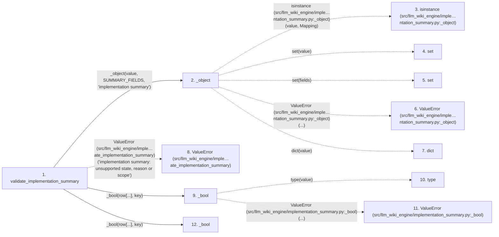

# validate_implementation_summary

**Entry point:** `validate_implementation_summary` (`api`)
**Source:** [implementation_summary](../modules/implementation_summary.md)
**Modules touched:** [canonical_json](../modules/canonical_json.md), [implementation_summary](../modules/implementation_summary.md)

## Call sequence

> Static overview in presentation order, not runtime execution order. Arrows retain captured callers; representative internal continuations and boundary examples precede repeated helper detail.

```mermaid
sequenceDiagram
    participant p0 as validate_implementation_summary
    participant p1 as _object
    participant p2 as ValueError (src/llm_wiki_engine/imple…ate_implementation_summary)
    participant p3 as _bool
    participant p4 as isinstance (src/llm_wiki_engine/imple…ate_implementation_summary)
    participant p5 as tuple
    participant p6 as list
    participant p7 as _copy
    participant p8 as isinstance (src/llm_wiki_engine/imple…ntation_summary.py:_object)
    participant p9 as type
    participant p10 as json.loads
    participant p11 as set
    participant p12 as ValueError (src/llm_wiki_engine/implementation_summary.py:_bool)
    participant p13 as compact_line_bytes
    participant p14 as ValueError (src/llm_wiki_engine/imple…ntation_summary.py:_object)
    participant p15 as dict
    participant p16 as (…).encode
    participant p17 as compact_text
    participant p18 as json.dumps
    p0->>p1: _object
    p0-->>p2: ValueError (src/llm_wiki_engine/imple…ate_implementation_summary)('implementation summary: unsupported state, reason or scope')
    p0->>p3: _bool
    p0->>p3: _bool
    p0-->>p4: isinstance (src/llm_wiki_engine/imple…ate_implementation_summary)(row[...], (...))
    p0-->>p5: tuple(row[...])
    p0-->>p2: ValueError (src/llm_wiki_engine/imple…ate_implementation_summary)('implementation summary: fixed limitations required')
    p0-->>p2: ValueError (src/llm_wiki_engine/imple…ate_implementation_summary)('implementation summary: verdict requires qualified live comparison')
    p0-->>p2: ValueError (src/llm_wiki_engine/imple…ate_implementation_summary)('implementation summary: changed syntax/docstrings require changed source bytes')
    p0-->>p2: ValueError (src/llm_wiki_engine/imple…ate_implementation_summary)('implementation summary: unavailable cannot assert executable comparison')
    p0-->>p2: ValueError (src/llm_wiki_engine/imple…ate_implementation_summary)('implementation summary: snapshot has no live verdict')
    p0-->>p6: list(row[...])
    p0->>p7: _copy
    p1-->>p8: isinstance (src/llm_wiki_engine/imple…ntation_summary.py:_object)(value, Mapping)
    p3-->>p9: type(value)
    p7-->>p10: json.loads(compact_line_bytes(...))
    p1-->>p11: set(value)
    p3-->>p12: ValueError (src/llm_wiki_engine/implementation_summary.py:_bool)(...)
    p7->>p13: compact_line_bytes
    p1-->>p11: set(fields)
    p1-->>p14: ValueError (src/llm_wiki_engine/imple…ntation_summary.py:_object)(...)
    p1-->>p15: dict(value)
    p13-->>p16: (…).encode('utf-8')
    p13->>p17: compact_text
    p17-->>p18: json.dumps(value, ensure_ascii=False, sort_keys=True, separators=(...), allow_nan=allow_nan)
```

<!-- Auto-generated from static call edges. Dashed arrows are external or unresolved calls. Reviewed runtime conditions and side effects belong in Behavior. -->

> Call sequence diagram shows 25 of 25 interactions; 0 omitted to keep the visualization within the 30-interaction and generated-diagram limits, with uncertain identities omitted rather than inferred.

> Captured boundary calls: external 18 of 18 (0 omitted); unresolved 1 of 1 (0 omitted). These counts cover the captured static trace.
> Detailed flow queries retain their own coverage and limits; omitted paths may execute at runtime.

## Data flow

<!-- Auto-generated static analysis. Treat values and boundaries as best-effort hints, not runtime proof. -->

### Analysis coverage

**Effect analysis evaluated.** Flow assembly and source effect analysis are separate; empty observations do not prove an empty handler body.

Source steps: 7; effect analysis evaluated: 7, partial: 0, unavailable: 0. Counts include steps omitted from the displayed trace.

Collector observations for 7 source steps with known totals: observed: 26, emitted: 26, omitted: 0. Unavailable totals are excluded.

### Step data

| Step | Inputs | Reads | Writes | Returns |
|---|---|---|---|---|
| `validate_implementation_summary` | `value: object` | `SUMMARY_FIELDS`, `REASONS`, `SCOPES`, `ANALYSIS_SCOPES`, `LIMITATIONS` | `row[...]` | `_copy(...)` |
| `_object` | `value`, `fields`, `label` | `Mapping` | - | `dict(...)` |
| `isinstance (src/llm_wiki_engine/imple…ntation_summary.py:_object)` | - | - | - | - |
| `set` | - | - | - | - |
| `set` | - | - | - | - |
| `ValueError (src/llm_wiki_engine/imple…ntation_summary.py:_object)` | - | - | - | - |
| `dict` | - | - | - | - |
| `ValueError (src/llm_wiki_engine/imple…ate_implementation_summary)` | - | - | - | - |
| `_bool` | `value`, `label` | - | - | `value` |
| `type` | - | - | - | - |
| `ValueError (src/llm_wiki_engine/implementation_summary.py:_bool)` | - | - | - | - |
| `_bool` | `value`, `label` | - | - | `value` |

### Call data

| From | To | Line | Call |
|---|---|---:|---|
| validate_implementation_summary | _object | 81 | `_object(value, SUMMARY_FIELDS, 'implementation summary')` |
| _object | isinstance (src/llm_wiki_engine/imple…ntation_summary.py:_object) | 64 | `isinstance(value, Mapping)` |
| _object | set | 64 | `set(value)` |
| _object | set | 64 | `set(fields)` |
| _object | ValueError (src/llm_wiki_engine/imple…ntation_summary.py:_object) | 65 | `ValueError(...)` |
| _object | dict | 66 | `dict(value)` |
| validate_implementation_summary | ValueError (src/llm_wiki_engine/imple…ate_implementation_summary) | 88 | `ValueError('implementation summary: unsupported state, reason or scope')` |
| validate_implementation_summary | _bool | 90 | `_bool(row[...], key)` |
| _bool | type | 70 | `type(value)` |
| _bool | ValueError (src/llm_wiki_engine/implementation_summary.py:_bool) | 71 | `ValueError(...)` |
| validate_implementation_summary | _bool | 93 | `_bool(row[...], key)` |

### Boundary effects

*No boundary-effect observations were captured in this static trace.*

### Static analysis gaps

| Kind | Step | Target | Line |
|---|---|---|---:|
| external_call | `_object` | `isinstance` | 64 |
| external_call | `_object` | `ValueError` | 65 |
| external_call | `validate_implementation_summary` | `ValueError` | 88 |
| external_call | `_bool` | `type` | 70 |
| external_call | `_bool` | `ValueError` | 71 |
| step_limit | `validate_implementation_summary` | `first 12 steps` | 0 |

## Behavior

This flow starts at `validate_implementation_summary` and is classified as `api`. The generated call and data-flow sections are bounded static projections; runtime conditions and side effects require source-level confirmation.
