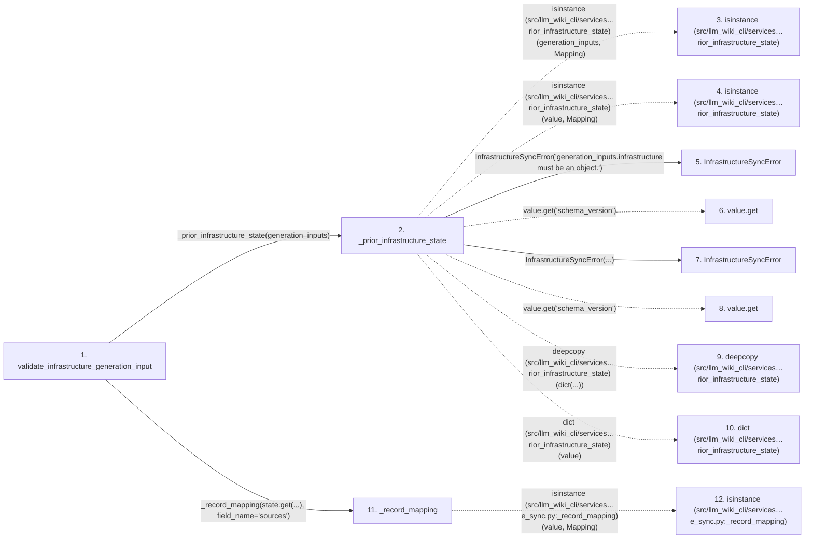

# validate_infrastructure_generation_input

**Entry point:** `validate_infrastructure_generation_input` (`api`)
**Source:** [infrastructure_sync](../modules/infrastructure_sync.md)
**Modules touched:** [infrastructure_sync](../modules/infrastructure_sync.md), [knowledge_evidence](../modules/knowledge_evidence.md), [validation](../modules/validation.md)

## Call sequence

> Static overview in presentation order, not runtime execution order. Arrows retain captured callers; representative internal continuations and boundary examples precede repeated helper detail.

```mermaid
sequenceDiagram
    participant p0 as validate_infrastructure_generation_input
    participant p1 as _prior_infrastructure_state
    participant p2 as _record_mapping
    participant p3 as _valid_repository_path
    participant p4 as is_portable_relative_path
    participant p5 as require_portable_relative_path
    participant p6 as _default_path_error
    participant p7 as _check_path_collision
    participant p8 as require_portable_path_component
    participant p9 as InfrastructureSyncError
    participant p10 as _valid_page_path
    participant p11 as is_valid_sha256
    participant p12 as _syntax_key
    participant p13 as _known_syntax
    participant p14 as _remember_syntax
    participant p15 as SharedValidationError
    participant p16 as portable_path_key
    participant p17 as isinstance (src/llm_wiki_cli/services…rior_infrastructure_state)
    participant p18 as state.get
    participant p19 as isinstance (src/llm_wiki_cli/services…e_sync.py:_record_mapping)
    participant p20 as value.items
    participant p21 as value.get
    participant p22 as deepcopy (src/llm_wiki_cli/services…rior_infrastructure_state)
    participant p23 as dict (src/llm_wiki_cli/services…rior_infrastructure_state)
    participant p24 as raw_record.get
    p0->>p1: _prior_infrastructure_state
    p0->>p2: _record_mapping
    p2->>p3: _valid_repository_path
    p3->>p4: is_portable_relative_path
    p4->>p5: require_portable_relative_path
    p5->>p6: _default_path_error
    p5->>p7: _check_path_collision
    p5->>p8: require_portable_path_component
    p2->>p9: InfrastructureSyncError
    p2->>p10: _valid_page_path
    p2->>p11: is_valid_sha256
    p5->>p12: _syntax_key
    p5->>p13: _known_syntax
    p5->>p14: _remember_syntax
    p6->>p15: SharedValidationError
    p7->>p16: portable_path_key
    p1-->>p17: isinstance (src/llm_wiki_cli/services…rior_infrastructure_state)(generation_inputs, Mapping)
    p0-->>p18: state.get('sources')
    p0-->>p18: state.get('tombstones')
    p2-->>p19: isinstance (src/llm_wiki_cli/services…e_sync.py:_record_mapping)(value, Mapping)
    p1-->>p17: isinstance (src/llm_wiki_cli/services…rior_infrastructure_state)(value, Mapping)
    p2-->>p20: value.items
    p1-->>p21: value.get('schema_version')
    p2-->>p19: isinstance (src/llm_wiki_cli/services…e_sync.py:_record_mapping)(key, str)
    p2-->>p19: isinstance (src/llm_wiki_cli/services…e_sync.py:_record_mapping)(raw_record, Mapping)
    p1-->>p21: value.get('schema_version')
    p1-->>p22: deepcopy (src/llm_wiki_cli/services…rior_infrastructure_state)(dict(...))
    p1-->>p23: dict (src/llm_wiki_cli/services…rior_infrastructure_state)(value)
    p2-->>p24: raw_record.get('source_path')
    p2-->>p24: raw_record.get('page_path')
```

<!-- Auto-generated from static call edges. Dashed arrows are external or unresolved calls. Reviewed runtime conditions and side effects belong in Behavior. -->

> Call sequence diagram shows 30 of 114 interactions; 84 omitted to keep the visualization within the 30-interaction and generated-diagram limits, with uncertain identities omitted rather than inferred.

> Captured boundary calls: external 7 of 34 (27 omitted); unresolved 7 of 34 (27 omitted). These counts cover the captured static trace.

Omitted captured detail, grouped by actual caller occurrence and target module:

| Caller | Parent step | Target module | Kind | Omitted interactions |
| --- | --- | --- | --- | --- |
| `src/llm_wiki_cli/services/infrastructure_sync.py:_prior_infrastructure_state` | 2 | [src/llm_wiki_cli/services/infrastructure_sync.py](../modules/infrastructure_sync.md) | internal | 2 |
| `src/llm_wiki_cli/services/infrastructure_sync.py:_record_mapping` | 11 | [src/llm_wiki_cli/services/infrastructure_sync.py](../modules/infrastructure_sync.md) | internal | 14 |
| `src/llm_wiki_cli/services/infrastructure_sync.py:_valid_repository_path` | 18 | - | external | 1 |
| `src/llm_wiki_cli/services/validation.py:require_portable_relative_path` | 21 | - | external | 4 |
| `src/llm_wiki_cli/services/validation.py:require_portable_relative_path` | 21 | [src/llm_wiki_cli/services/validation.py](../modules/validation.md) | internal | 7 |
| `src/llm_wiki_cli/services/validation.py:_syntax_key` | 28 | - | external | 6 |
| `src/llm_wiki_cli/services/validation.py:_known_syntax` | 35 | - | unresolved | 2 |
| `src/llm_wiki_cli/services/validation.py:_check_path_collision` | 38 | - | unresolved | 2 |
> Omission summary shows 8 of 22 groups; 14 further groups are not expanded here. Counts above include all omitted interactions.
> Detailed flow queries retain their own coverage and limits; omitted paths may execute at runtime.

> Trace truncated at the depth limit; deeper calls are omitted.

## Data flow

<!-- Auto-generated static analysis. Treat values and boundaries as best-effort hints, not runtime proof. -->

### Analysis coverage

**Effect analysis partially available.** Flow assembly and source effect analysis are separate; empty observations do not prove an empty handler body.

Source steps: 47; effect analysis evaluated: 22, partial: 2, unavailable: 23. Counts include steps omitted from the displayed trace.

Collector observations for 24 source steps with known totals: observed: 114, emitted: 103, omitted: 11. Unavailable totals are excluded.

- Callable record unavailable for one or more source steps; those steps have no represented callable body.
- Effect collector omitted observations before flow assembly; displayed effects are partial.
- Effect collector totals unavailable; observed counts cover captured records only.

| Step | Callable record | Effect analysis | Collector totals | Observed | Emitted | Omitted |
|---|---|---|---|---:|---:|---:|
| `validate_infrastructure_generation_input` | `available` | `evaluated` | `available` | `2` | `2` | `0` |
| `_prior_infrastructure_state` | `available` | `evaluated` | `available` | `9` | `9` | `0` |
| `isinstance (src/llm_wiki_cli/services…rior_infrastructure_state)` | `not_applicable` | `not_applicable` | `not_applicable` | — | — | — |
| `isinstance (src/llm_wiki_cli/services…rior_infrastructure_state)` | `not_applicable` | `not_applicable` | `not_applicable` | — | — | — |
| `InfrastructureSyncError` | `unavailable` | `unavailable` | `unavailable` | — | — | — |
| `value.get` | `not_applicable` | `not_applicable` | `not_applicable` | — | — | — |
| `InfrastructureSyncError` | `unavailable` | `unavailable` | `unavailable` | — | — | — |
| `value.get` | `not_applicable` | `not_applicable` | `not_applicable` | — | — | — |
| `deepcopy (src/llm_wiki_cli/services…rior_infrastructure_state)` | `not_applicable` | `not_applicable` | `not_applicable` | — | — | — |
| `dict (src/llm_wiki_cli/services…rior_infrastructure_state)` | `not_applicable` | `not_applicable` | `not_applicable` | — | — | — |
| `_record_mapping` | `available` | `evaluated` | `available` | `9` | `9` | `0` |
| `isinstance (src/llm_wiki_cli/services…e_sync.py:_record_mapping)` | `not_applicable` | `not_applicable` | `not_applicable` | — | — | — |

### Step data

| Step | Inputs | Reads | Writes | Returns |
|---|---|---|---|---|
| `validate_infrastructure_generation_input` | `generation_inputs: Mapping[str, object] \| None` | - | - | `none` |
| `_prior_infrastructure_state` | `generation_inputs: Mapping[str, object] \| None` | `Mapping`, `INFRASTRUCTURE_GENERATION_INPUT_KEY`, `INFRASTRUCTURE_GENERATION_INPUT_KEY`, `Mapping`, `INFRASTRUCTURE_SYNC_SCHEMA_VERSION` | - | `{...}`, `{...}`, `deepcopy(...)` |
| `isinstance (src/llm_wiki_cli/services…rior_infrastructure_state)` | - | - | - | - |
| `isinstance (src/llm_wiki_cli/services…rior_infrastructure_state)` | - | - | - | - |
| `InfrastructureSyncError` | - | - | - | - |
| `value.get` | - | - | - | - |
| `InfrastructureSyncError` | - | - | - | - |
| `value.get` | - | - | - | - |
| `deepcopy (src/llm_wiki_cli/services…rior_infrastructure_state)` | - | - | - | - |
| `dict (src/llm_wiki_cli/services…rior_infrastructure_state)` | - | - | - | - |
| `_record_mapping` | `value: object`, `field_name: str` | `Mapping`, `Mapping`, `Mapping`, `INFRASTRUCTURE_DISCOVERY_ROOT` | `result[...]` | `{...}`, `result` |
| `isinstance (src/llm_wiki_cli/services…e_sync.py:_record_mapping)` | - | - | - | - |

### Call data

| From | To | Line | Call |
|---|---|---:|---|
| validate_infrastructure_generation_input | _prior_infrastructure_state | 244 | `_prior_infrastructure_state(generation_inputs)` |
| _prior_infrastructure_state | isinstance (src/llm_wiki_cli/services…rior_infrastructure_state) | 107 | `isinstance(generation_inputs, Mapping)` |
| _prior_infrastructure_state | isinstance (src/llm_wiki_cli/services…rior_infrastructure_state) | 112 | `isinstance(value, Mapping)` |
| _prior_infrastructure_state | InfrastructureSyncError | 113 | `InfrastructureSyncError('generation_inputs.infrastructure must be an object.')` |
| _prior_infrastructure_state | value.get | 116 | `value.get('schema_version')` |
| _prior_infrastructure_state | InfrastructureSyncError | 117 | `InfrastructureSyncError(...)` |
| _prior_infrastructure_state | value.get | 119 | `value.get('schema_version')` |
| _prior_infrastructure_state | deepcopy (src/llm_wiki_cli/services…rior_infrastructure_state) | 121 | `deepcopy(dict(...))` |
| _prior_infrastructure_state | dict (src/llm_wiki_cli/services…rior_infrastructure_state) | 121 | `dict(value)` |
| validate_infrastructure_generation_input | _record_mapping | 247 | `_record_mapping(state.get(...), field_name='sources')` |
| _record_mapping | isinstance (src/llm_wiki_cli/services…e_sync.py:_record_mapping) | 149 | `isinstance(value, Mapping)` |

### Boundary effects

*No boundary-effect observations were captured in this static trace.*

### Static analysis gaps

| Kind | Step | Target | Line |
|---|---|---|---:|
| external_call | `_prior_infrastructure_state` | `isinstance` | 107 |
| external_call | `_prior_infrastructure_state` | `isinstance` | 112 |
| unresolved_call | `_prior_infrastructure_state` | `value.get` | 116 |
| unresolved_call | `_prior_infrastructure_state` | `value.get` | 119 |
| external_call | `_prior_infrastructure_state` | `deepcopy` | 121 |
| external_call | `_record_mapping` | `isinstance` | 149 |
| step_limit | `validate_infrastructure_generation_input` | `first 12 steps` | 0 |
| truncated_flow | `validate_infrastructure_generation_input` | `depth limit` | 0 |

## Behavior

This flow starts at `validate_infrastructure_generation_input` and is classified as `api`. The generated call and data-flow sections are bounded static projections; runtime conditions and side effects require source-level confirmation.
