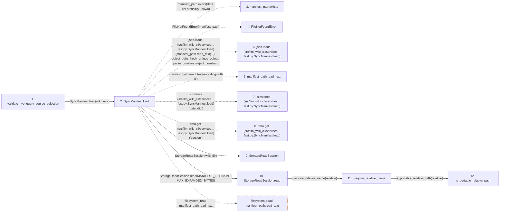

# validate_live_query_source_selection

**Entry point:** `validate_live_query_source_selection` (`api`)
**Source:** [documentation_query_builder](../modules/documentation_query_builder.md)
**Modules touched:** [canonical_json](../modules/canonical_json.md), [common](../modules/common.md), [documentation_queries](../modules/documentation_queries.md), and 10 more

**Complete modules touched:**

- [canonical_json](../modules/canonical_json.md)
- [common](../modules/common.md)
- [documentation_queries](../modules/documentation_queries.md)
- [documentation_query_builder](../modules/documentation_query_builder.md)
- [filesystem_guard](../modules/filesystem_guard.md)
- [knowledge_evidence](../modules/knowledge_evidence.md)
- [knowledge_storage](../modules/knowledge_storage.md)
- [knowledge_storage_io](../modules/knowledge_storage_io.md)
- [maintenance_state](../modules/maintenance_state.md)
- [manifest_storage](../modules/manifest_storage.md)
- [source_selection](../modules/source_selection.md)
- [sync_manifest](../modules/sync_manifest.md)
- [validation](../modules/validation.md)

## Call sequence

> Static overview in presentation order, not runtime execution order. Arrows retain captured callers; representative internal continuations and boundary examples precede repeated helper detail.

```mermaid
sequenceDiagram
    participant p0 as validate_live_query_source_selection
    participant p1 as SyncManifest.load
    participant p2 as validate_persisted_source_selection_identity
    participant p3 as _wiki_has_persisted_read_state
    participant p4 as DocumentationQueryError
    participant p5 as source_selection_identity_from_generation_inputs
    participant p6 as source_selection_inputs_from_generation_inputs
    participant p7 as StorageReadSession.read
    participant p8 as SyncManifest.from_payload
    participant p9 as StorageReadSession.recheck
    participant p10 as _require_relative_name
    participant p11 as _mapping_value
    participant p12 as StorageReadSession.phase
    participant p13 as _validated_identity
    participant p14 as _validated_selection_inputs
    participant p15 as StorageReadSession.read_ranges
    participant p16 as ManifestStoreReader.materialize
    participant p17 as StorageReadSession.read_range
    participant p18 as _copy_sources
    participant p19 as _legacy_operational_state
    participant p20 as _validate_exact_keys
    participant p21 as _copy_mapping
    participant p22 as ManifestPageSource.from_payload
    participant p23 as ManifestEvidenceBaseline.from_payload
    participant p24 as ManifestTombstone.from_payload
    participant p25 as ManifestArtifactHashes.from_payload
    participant p26 as is_portable_relative_path
    participant p27 as ManifestStoreReader.field
    participant p28 as range_batches
    participant p29 as str (src/llm_wiki_cli/services…ve_query_source_selection)
    participant p30 as manifest_path.exists
    p0->>p1: SyncManifest.load
    p0->>p2: validate_persisted_source_selection_identity
    p0->>p3: _wiki_has_persisted_read_state
    p0->>p4: DocumentationQueryError
    p2->>p5: source_selection_identity_from_generation_inputs
    p2->>p6: source_selection_inputs_from_generation_inputs
    p1->>p7: StorageReadSession.read
    p1->>p8: SyncManifest.from_payload
    p1->>p9: StorageReadSession.recheck
    p7->>p10: _require_relative_name
    p8->>p11: _mapping_value
    p9->>p12: StorageReadSession.phase
    p5->>p13: _validated_identity
    p6->>p14: _validated_selection_inputs
    p9->>p15: StorageReadSession.read_ranges
    p8->>p16: ManifestStoreReader.materialize
    p9->>p17: StorageReadSession.read_range
    p8->>p18: _copy_sources
    p8->>p19: _legacy_operational_state
    p8->>p20: _validate_exact_keys
    p8->>p21: _copy_mapping
    p8->>p22: ManifestPageSource.from_payload
    p8->>p23: ManifestEvidenceBaseline.from_payload
    p8->>p24: ManifestTombstone.from_payload
    p8->>p25: ManifestArtifactHashes.from_payload
    p10->>p26: is_portable_relative_path
    p16->>p27: ManifestStoreReader.field
    p15->>p28: range_batches
    p0-->>p29: str (src/llm_wiki_cli/services…ve_query_source_selection)(exc)
    p1-->>p30: manifest_path.exists
```

<!-- Auto-generated from static call edges. Dashed arrows are external or unresolved calls. Reviewed runtime conditions and side effects belong in Behavior. -->

> Call sequence diagram shows 30 of 491 interactions; 461 omitted to keep the visualization within the 30-interaction and generated-diagram limits, with uncertain identities omitted rather than inferred.

> Captured boundary calls: external 1 of 142 (141 omitted); unresolved 1 of 90 (89 omitted). These counts cover the captured static trace.

Omitted captured detail, grouped by actual caller occurrence and target module:

| Caller | Parent step | Target module | Kind | Omitted interactions |
| --- | --- | --- | --- | --- |
| `src/llm_wiki_cli/services/sync_manifest.py:SyncManifest.load` | 2 | - | external | 3 |
| `src/llm_wiki_cli/services/sync_manifest.py:SyncManifest.load` | 2 | - | unresolved | 2 |
| `src/llm_wiki_cli/services/sync_manifest.py:SyncManifest.load` | 2 | [src/llm_wiki_cli/services/knowledge_storage_io.py](../modules/knowledge_storage_io.md) | internal | 1 |
| `src/llm_wiki_cli/services/validation.py:is_portable_relative_path` | 12 | [src/llm_wiki_cli/services/validation.py](../modules/validation.md) | internal | 1 |
| `src/llm_wiki_cli/services/validation.py:require_portable_relative_path` | 13 | - | external | 4 |
| `src/llm_wiki_cli/services/validation.py:require_portable_relative_path` | 13 | [src/llm_wiki_cli/services/validation.py](../modules/validation.md) | internal | 13 |
| `src/llm_wiki_cli/services/validation.py:require_portable_relative_path` | 13 | - | unresolved | 9 |
| `src/llm_wiki_cli/services/knowledge_storage_io.py:_require_relative_name` | 11 | [src/llm_wiki_cli/services/knowledge_storage.py](../modules/knowledge_storage.md) | internal | 1 |
> Omission summary shows 8 of 146 groups; 138 further groups are not expanded here. Counts above include all omitted interactions.
> Detailed flow queries retain their own coverage and limits; omitted paths may execute at runtime.

> Trace truncated at the depth limit; deeper calls are omitted.

## Data flow

<!-- Auto-generated static analysis. Treat values and boundaries as best-effort hints, not runtime proof. -->

### Analysis coverage

**Effect analysis partially available.** Flow assembly and source effect analysis are separate; empty observations do not prove an empty handler body.

Source steps: 260; effect analysis evaluated: 134, partial: 10, unavailable: 116. Counts include steps omitted from the displayed trace.

Collector observations for 144 source steps with known totals: observed: 733, emitted: 692, omitted: 41. Unavailable totals are excluded.

- Callable record unavailable; the selected entry symbol has no represented callable body.
- Effect collector omitted observations before flow assembly; displayed effects are partial.
- Effect collector totals unavailable; observed counts cover captured records only.

| Step | Callable record | Effect analysis | Collector totals | Observed | Emitted | Omitted |
|---|---|---|---|---:|---:|---:|
| `validate_live_query_source_selection` | `available` | `evaluated` | `available` | `10` | `10` | `0` |
| `SyncManifest.load` | `available` | `evaluated` | `available` | `6` | `6` | `0` |
| `manifest_path.exists` | `not_applicable` | `not_applicable` | `not_applicable` | — | — | — |
| `FileNotFoundError` | `not_applicable` | `not_applicable` | `not_applicable` | — | — | — |
| `json.loads (src/llm_wiki_cli/services…fest.py:SyncManifest.load)` | `not_applicable` | `not_applicable` | `not_applicable` | — | — | — |
| `manifest_path.read_text` | `not_applicable` | `not_applicable` | `not_applicable` | — | — | — |
| `isinstance (src/llm_wiki_cli/services…fest.py:SyncManifest.load)` | `not_applicable` | `not_applicable` | `not_applicable` | — | — | — |
| `data.get (src/llm_wiki_cli/services…fest.py:SyncManifest.load)` | `not_applicable` | `not_applicable` | `not_applicable` | — | — | — |
| `StorageReadSession` | `unavailable` | `unavailable` | `unavailable` | — | — | — |
| `StorageReadSession.read` | `available` | `evaluated` | `available` | `10` | `10` | `0` |
| `_require_relative_name` | `available` | `evaluated` | `available` | `1` | `1` | `0` |
| `is_portable_relative_path` | `available` | `evaluated` | `available` | `5` | `5` | `0` |

### Step data

| Step | Inputs | Reads | Writes | Returns |
|---|---|---|---|---|
| `validate_live_query_source_selection` | `source_root: Path`, `wiki_root: Path`, `live_identity: Mapping[str, object] \| None`, `live_selection_inputs: Mapping[str, object] \| None \| object`, `operation: str`, `allow_empty_wiki: bool` | `SyncManifestError`, `_UNSET_LIVE_SELECTION_INPUTS`, `SourceSelectionError` | - | `none` |
| `SyncManifest.load` | `wiki_dir: Path` | `MANIFEST_FILENAME`, `MANIFEST_FILENAME` | - | `manifest`, `cls.from_payload(...)` |
| `manifest_path.exists` | - | - | - | - |
| `FileNotFoundError` | - | - | - | - |
| `json.loads (src/llm_wiki_cli/services…fest.py:SyncManifest.load)` | - | - | - | - |
| `manifest_path.read_text` | - | - | - | - |
| `isinstance (src/llm_wiki_cli/services…fest.py:SyncManifest.load)` | - | - | - | - |
| `data.get (src/llm_wiki_cli/services…fest.py:SyncManifest.load)` | - | - | - | - |
| `StorageReadSession` | - | - | - | - |
| `StorageReadSession.read` | `relative: str`, `maximum: int` | `self.maximum`, `self.bytes_read`, `self.root`, `KnowledgeStorageError` | `self.bytes_read`, `self.reads`, `self.observations[...]` | `observed.content` |
| `_require_relative_name` | `relative: str` | - | - | - |
| `is_portable_relative_path` | `value: object`, `normalize_backslashes: bool` | `SharedValidationError` | - | `False`, `True` |

### Call data

| From | To | Line | Call |
|---|---|---:|---|
| validate_live_query_source_selection | SyncManifest.load | 303 | `SyncManifest.load(wiki_root)` |
| SyncManifest.load | manifest_path.exists | 1160 | `manifest_path.exists(data not statically known)` |
| SyncManifest.load | FileNotFoundError | 1161 | `FileNotFoundError(manifest_path)` |
| SyncManifest.load | json.loads (src/llm_wiki_cli/services…fest.py:SyncManifest.load) | 1180 | `json.loads(manifest_path.read_text(...), object_pairs_hook=unique_object, parse_constant=reject_constant)` |
| SyncManifest.load | manifest_path.read_text | 1181 | `manifest_path.read_text(encoding='utf-8')` |
| SyncManifest.load | isinstance (src/llm_wiki_cli/services…fest.py:SyncManifest.load) | 1185 | `isinstance(data, dict)` |
| SyncManifest.load | data.get (src/llm_wiki_cli/services…fest.py:SyncManifest.load) | 1185 | `data.get('version')` |
| SyncManifest.load | StorageReadSession | 1188 | `StorageReadSession(wiki_dir)` |
| SyncManifest.load | StorageReadSession.read | 1189 | `session.read(MANIFEST_FILENAME, MAX_EXPANDED_BYTES)` |
| StorageReadSession.read | _require_relative_name | 354 | `_require_relative_name(relative)` |
| _require_relative_name | is_portable_relative_path | 44 | `is_portable_relative_path(relative)` |

### Boundary effects

| Kind | Target | Step | Line |
|---|---|---|---:|
| filesystem_read | `manifest_path.read_text` | `SyncManifest.load` | 1181 |

### Static analysis gaps

| Kind | Step | Target | Line |
|---|---|---|---:|
| unresolved_call | `SyncManifest.load` | `manifest_path.exists` | 1160 |
| external_call | `SyncManifest.load` | `FileNotFoundError` | 1161 |
| external_call | `SyncManifest.load` | `json.loads` | 1180 |
| external_call | `SyncManifest.load` | `isinstance` | 1185 |
| unresolved_call | `SyncManifest.load` | `data.get` | 1185 |
| step_limit | `validate_live_query_source_selection` | `first 12 steps` | 0 |
| truncated_flow | `validate_live_query_source_selection` | `depth limit` | 0 |

## Behavior

This flow starts at `validate_live_query_source_selection` and is classified as `api`. The generated call and data-flow sections are bounded static projections; runtime conditions and side effects require source-level confirmation.
