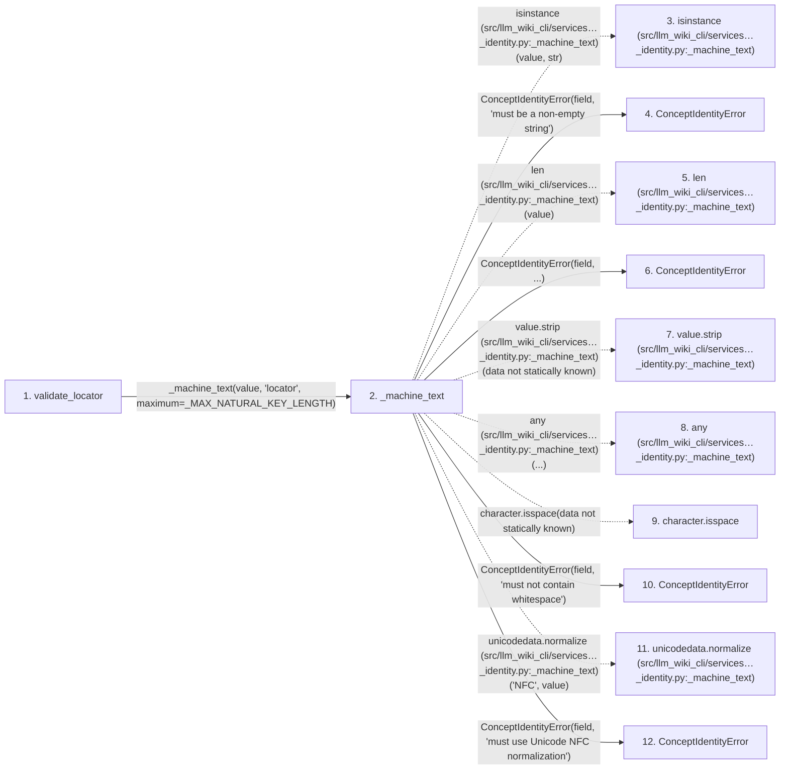

# validate_locator

**Entry point:** `validate_locator` (`api`)
**Source:** [concept_identity](../modules/concept_identity.md)
**Modules touched:** [concept_identity](../modules/concept_identity.md), [validation](../modules/validation.md), [wiki_surface](../modules/wiki_surface.md)

## Call sequence

> Static overview in presentation order, not runtime execution order. Arrows retain captured callers; representative internal continuations and boundary examples precede repeated helper detail.

```mermaid
sequenceDiagram
    participant p0 as validate_locator
    participant p1 as _machine_text
    participant p2 as validate_exact_page_coordinate
    participant p3 as _contains_uri_userinfo
    participant p4 as _looks_absolute_path
    participant p5 as ConceptIdentityError
    participant p6 as _matches_directory_path
    participant p7 as _matches_directory_uri
    participant p8 as is_safe_page_id
    participant p9 as canonical_path
    participant p10 as mcp_uri
    participant p11 as _entry_for
    participant p12 as _validate_page_id
    participant p13 as is_portable_path_component
    participant p14 as require_portable_path_component
    participant p15 as WikiSurfaceError
    participant p16 as PageKind
    participant p17 as SharedValidationError
    participant p18 as isinstance (src/llm_wiki_cli/services…_identity.py:_machine_text)
    participant p19 as value.startswith
    participant p20 as urlsplit
    participant p21 as isinstance (src/llm_wiki_cli/services…date_exact_page_coordinate)
    participant p22 as _WINDOWS_ABSOLUTE_RE.match
    participant p23 as value.strip (src/llm_wiki_cli/services…date_exact_page_coordinate)
    participant p24 as len (src/llm_wiki_cli/services…_identity.py:_machine_text)
    participant p25 as value.strip (src/llm_wiki_cli/services…_identity.py:_machine_text)
    participant p26 as any (src/llm_wiki_cli/services…date_exact_page_coordinate)
    participant p27 as any (src/llm_wiki_cli/services…_identity.py:_machine_text)
    participant p28 as ord (src/llm_wiki_cli/services…date_exact_page_coordinate)
    participant p29 as character.isspace
    p0->>p1: _machine_text
    p0->>p2: validate_exact_page_coordinate
    p0->>p3: _contains_uri_userinfo
    p0->>p4: _looks_absolute_path
    p0->>p5: ConceptIdentityError
    p2->>p6: _matches_directory_path
    p2->>p7: _matches_directory_uri
    p6->>p8: is_safe_page_id
    p6->>p9: canonical_path
    p7->>p10: mcp_uri
    p9->>p11: _entry_for
    p9->>p12: _validate_page_id
    p8->>p13: is_portable_path_component
    p13->>p14: require_portable_path_component
    p2->>p15: WikiSurfaceError
    p11->>p16: PageKind
    p14->>p17: SharedValidationError
    p1-->>p18: isinstance (src/llm_wiki_cli/services…_identity.py:_machine_text)(value, str)
    p4-->>p19: value.startswith((...))
    p3-->>p20: urlsplit(value)
    p2-->>p21: isinstance (src/llm_wiki_cli/services…date_exact_page_coordinate)(value, str)
    p4-->>p22: _WINDOWS_ABSOLUTE_RE.match(value)
    p2-->>p23: value.strip (src/llm_wiki_cli/services…date_exact_page_coordinate)
    p1-->>p24: len (src/llm_wiki_cli/services…_identity.py:_machine_text)(value)
    p2-->>p23: value.strip (src/llm_wiki_cli/services…date_exact_page_coordinate)
    p1-->>p25: value.strip (src/llm_wiki_cli/services…_identity.py:_machine_text)
    p2-->>p26: any (src/llm_wiki_cli/services…date_exact_page_coordinate)(...)
    p1-->>p27: any (src/llm_wiki_cli/services…_identity.py:_machine_text)(...)
    p2-->>p28: ord (src/llm_wiki_cli/services…date_exact_page_coordinate)(character)
    p1-->>p29: character.isspace
```

<!-- Auto-generated from static call edges. Dashed arrows are external or unresolved calls. Reviewed runtime conditions and side effects belong in Behavior. -->

> Call sequence diagram shows 30 of 87 interactions; 57 omitted to keep the visualization within the 30-interaction and generated-diagram limits, with uncertain identities omitted rather than inferred.

> Captured boundary calls: external 7 of 28 (21 omitted); unresolved 6 of 17 (11 omitted). These counts cover the captured static trace.

Omitted captured detail, grouped by actual caller occurrence and target module:

| Caller | Parent step | Target module | Kind | Omitted interactions |
| --- | --- | --- | --- | --- |
| `src/llm_wiki_cli/services/concept_identity.py:_machine_text` | 2 | [src/llm_wiki_cli/services/concept_identity.py](../modules/concept_identity.md) | internal | 5 |
| `src/llm_wiki_cli/services/concept_identity.py:_machine_text` | 2 | - | external | 3 |
| `src/llm_wiki_cli/services/concept_identity.py:_machine_text` | 2 | - | unresolved | 1 |
| `src/llm_wiki_cli/services/wiki_surface.py:validate_exact_page_coordinate` | 23 | - | external | 1 |
| `src/llm_wiki_cli/services/wiki_surface.py:validate_exact_page_coordinate` | 23 | [src/llm_wiki_cli/services/wiki_surface.py](../modules/wiki_surface.md) | internal | 4 |
| `src/llm_wiki_cli/services/wiki_surface.py:_matches_directory_path` | 32 | - | unresolved | 2 |
| `src/llm_wiki_cli/services/wiki_surface.py:_matches_directory_path` | 32 | - | external | 3 |
| `src/llm_wiki_cli/services/wiki_surface.py:is_safe_page_id` | 38 | - | external | 3 |
> Omission summary shows 8 of 23 groups; 15 further groups are not expanded here. Counts above include all omitted interactions.
> Detailed flow queries retain their own coverage and limits; omitted paths may execute at runtime.

## Data flow

<!-- Auto-generated static analysis. Treat values and boundaries as best-effort hints, not runtime proof. -->

### Analysis coverage

**Effect analysis partially available.** Flow assembly and source effect analysis are separate; empty observations do not prove an empty handler body.

Source steps: 43; effect analysis evaluated: 19, partial: 1, unavailable: 23. Counts include steps omitted from the displayed trace.

Collector observations for 20 source steps with known totals: observed: 86, emitted: 85, omitted: 1. Unavailable totals are excluded.

- Callable record unavailable; the selected entry symbol has no represented callable body.
- Effect collector omitted observations before flow assembly; displayed effects are partial.
- Effect collector totals unavailable; observed counts cover captured records only.

| Step | Callable record | Effect analysis | Collector totals | Observed | Emitted | Omitted |
|---|---|---|---|---:|---:|---:|
| `validate_locator` | `available` | `evaluated` | `available` | `4` | `4` | `0` |
| `_machine_text` | `available` | `evaluated` | `available` | `4` | `4` | `0` |
| `isinstance (src/llm_wiki_cli/services…_identity.py:_machine_text)` | `not_applicable` | `not_applicable` | `not_applicable` | — | — | — |
| `ConceptIdentityError` | `unavailable` | `unavailable` | `unavailable` | — | — | — |
| `len (src/llm_wiki_cli/services…_identity.py:_machine_text)` | `not_applicable` | `not_applicable` | `not_applicable` | — | — | — |
| `ConceptIdentityError` | `unavailable` | `unavailable` | `unavailable` | — | — | — |
| `value.strip (src/llm_wiki_cli/services…_identity.py:_machine_text)` | `not_applicable` | `not_applicable` | `not_applicable` | — | — | — |
| `any (src/llm_wiki_cli/services…_identity.py:_machine_text)` | `not_applicable` | `not_applicable` | `not_applicable` | — | — | — |
| `character.isspace` | `not_applicable` | `not_applicable` | `not_applicable` | — | — | — |
| `ConceptIdentityError` | `unavailable` | `unavailable` | `unavailable` | — | — | — |
| `unicodedata.normalize (src/llm_wiki_cli/services…_identity.py:_machine_text)` | `not_applicable` | `not_applicable` | `not_applicable` | — | — | — |
| `ConceptIdentityError` | `unavailable` | `unavailable` | `unavailable` | — | — | — |

### Step data

| Step | Inputs | Reads | Writes | Returns |
|---|---|---|---|---|
| `validate_locator` | `value: object` | `_MAX_NATURAL_KEY_LENGTH`, `WikiSurfaceError` | - | `normalized` |
| `_machine_text` | `value: object`, `field: str`, `maximum: int` | - | - | `value` |
| `isinstance (src/llm_wiki_cli/services…_identity.py:_machine_text)` | - | - | - | - |
| `ConceptIdentityError` | - | - | - | - |
| `len (src/llm_wiki_cli/services…_identity.py:_machine_text)` | - | - | - | - |
| `ConceptIdentityError` | - | - | - | - |
| `value.strip (src/llm_wiki_cli/services…_identity.py:_machine_text)` | - | - | - | - |
| `any (src/llm_wiki_cli/services…_identity.py:_machine_text)` | - | - | - | - |
| `character.isspace` | - | - | - | - |
| `ConceptIdentityError` | - | - | - | - |
| `unicodedata.normalize (src/llm_wiki_cli/services…_identity.py:_machine_text)` | - | - | - | - |
| `ConceptIdentityError` | - | - | - | - |

### Call data

| From | To | Line | Call |
|---|---|---:|---|
| validate_locator | _machine_text | 438 | `_machine_text(value, 'locator', maximum=_MAX_NATURAL_KEY_LENGTH)` |
| _machine_text | isinstance (src/llm_wiki_cli/services…_identity.py:_machine_text) | 942 | `isinstance(value, str)` |
| _machine_text | ConceptIdentityError | 943 | `ConceptIdentityError(field, 'must be a non-empty string')` |
| _machine_text | len (src/llm_wiki_cli/services…_identity.py:_machine_text) | 944 | `len(value)` |
| _machine_text | ConceptIdentityError | 945 | `ConceptIdentityError(field, ...)` |
| _machine_text | value.strip (src/llm_wiki_cli/services…_identity.py:_machine_text) | 946 | `value.strip(data not statically known)` |
| _machine_text | any (src/llm_wiki_cli/services…_identity.py:_machine_text) | 946 | `any(...)` |
| _machine_text | character.isspace | 946 | `character.isspace(data not statically known)` |
| _machine_text | ConceptIdentityError | 947 | `ConceptIdentityError(field, 'must not contain whitespace')` |
| _machine_text | unicodedata.normalize (src/llm_wiki_cli/services…_identity.py:_machine_text) | 948 | `unicodedata.normalize('NFC', value)` |
| _machine_text | ConceptIdentityError | 949 | `ConceptIdentityError(field, 'must use Unicode NFC normalization')` |

### Boundary effects

*No boundary-effect observations were captured in this static trace.*

### Static analysis gaps

| Kind | Step | Target | Line |
|---|---|---|---:|
| external_call | `_machine_text` | `isinstance` | 942 |
| unresolved_call | `_machine_text` | `value.strip` | 946 |
| external_call | `_machine_text` | `any` | 946 |
| unresolved_call | `_machine_text` | `character.isspace` | 946 |
| external_call | `_machine_text` | `unicodedata.normalize` | 948 |
| step_limit | `validate_locator` | `first 12 steps` | 0 |

## Behavior

This flow starts at `validate_locator` and is classified as `api`. The generated call and data-flow sections are bounded static projections; runtime conditions and side effects require source-level confirmation.
