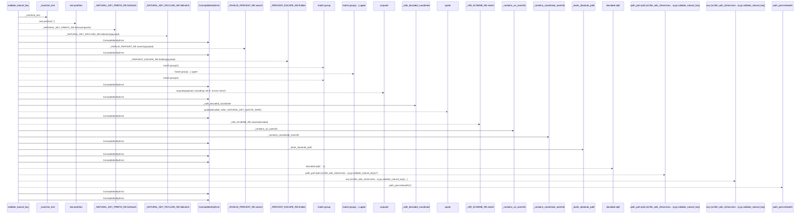
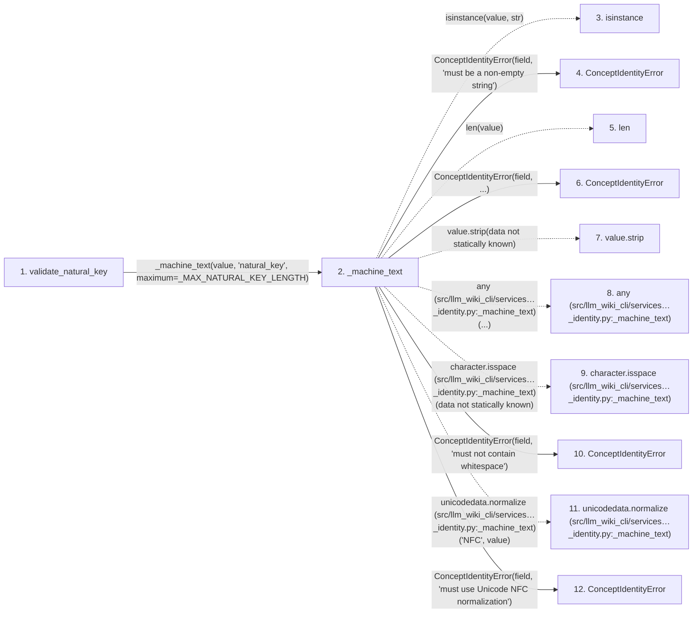

# validate_natural_key

**Entry point:** `validate_natural_key` (`api`)
**Source:** [concept_identity](../modules/concept_identity.md)
**Modules touched:** [concept_identity](../modules/concept_identity.md)

## Call sequence

> Static overview in presentation order, not runtime execution order. Arrows retain captured callers; siblings are shown before deeper helper detail.

<!-- Auto-generated from static call edges. Dashed arrows are external or unresolved calls. Reviewed runtime conditions and side effects belong in Behavior. -->

> Call sequence diagram shows 30 of 59 interactions; 29 omitted to keep the visualization within the 30-interaction and generated-diagram limits, with uncertain identities omitted rather than inferred.

> Captured boundary calls: external 3 of 14 (11 omitted); unresolved 12 of 22 (10 omitted). These counts cover the captured static trace.

Omitted captured detail, grouped by actual caller occurrence and target module:

| Caller | Parent step | Target module | Kind | Omitted interactions |
| --- | --- | --- | --- | --- |
| `src/llm_wiki_cli/services/concept_identity.py:_machine_text` | 2 | - | external | 6 |
| `src/llm_wiki_cli/services/concept_identity.py:_machine_text` | 2 | [src/llm_wiki_cli/services/concept_identity.py](../modules/concept_identity.md) | internal | 5 |
| `src/llm_wiki_cli/services/concept_identity.py:_machine_text` | 2 | - | unresolved | 3 |
| `src/llm_wiki_cli/services/concept_identity.py:_safe_decoded_coordinate` | 30 | [src/llm_wiki_cli/services/concept_identity.py](../modules/concept_identity.md) | internal | 3 |
| `src/llm_wiki_cli/services/concept_identity.py:_safe_decoded_coordinate` | 30 | - | external | 3 |
| `src/llm_wiki_cli/services/concept_identity.py:_safe_decoded_coordinate` | 30 | - | unresolved | 2 |
| `src/llm_wiki_cli/services/concept_identity.py:_contains_uri_userinfo` | 42 | - | external | 1 |
| `src/llm_wiki_cli/services/concept_identity.py:_contains_coordinate_userinfo` | 44 | - | unresolved | 3 |
> Omission summary shows 8 of 10 groups; 2 further groups are not expanded here. Counts above include all omitted interactions.
> Detailed flow queries retain their own coverage and limits; omitted paths may execute at runtime.

## Data flow

<!-- Auto-generated static analysis. Treat values and boundaries as best-effort hints, not runtime proof. -->

### Step data

| Step | Inputs | Reads | Writes | Returns |
|---|---|---|---|---|
| `validate_natural_key` | `value: object` | `_MAX_NATURAL_KEY_LENGTH`, `_NATURAL_KEY_QUOTE_SAFE` | - | `text` |
| `_machine_text` | `value: object`, `field: str`, `maximum: int` | - | - | `value` |
| `isinstance` | - | - | - | - |
| `ConceptIdentityError` | - | - | - | - |
| `len` | - | - | - | - |
| `ConceptIdentityError` | - | - | - | - |
| `value.strip` | - | - | - | - |
| `any (src/llm_wiki_cli/services…_identity.py:_machine_text)` | - | - | - | - |
| `character.isspace (src/llm_wiki_cli/services…_identity.py:_machine_text)` | - | - | - | - |
| `ConceptIdentityError` | - | - | - | - |
| `unicodedata.normalize (src/llm_wiki_cli/services…_identity.py:_machine_text)` | - | - | - | - |
| `ConceptIdentityError` | - | - | - | - |

### Call data

| From | To | Line | Call |
|---|---|---:|---|
| validate_natural_key | _machine_text | 358 | `_machine_text(value, 'natural_key', maximum=_MAX_NATURAL_KEY_LENGTH)` |
| _machine_text | isinstance | 942 | `isinstance(value, str)` |
| _machine_text | ConceptIdentityError | 943 | `ConceptIdentityError(field, 'must be a non-empty string')` |
| _machine_text | len | 944 | `len(value)` |
| _machine_text | ConceptIdentityError | 945 | `ConceptIdentityError(field, ...)` |
| _machine_text | value.strip | 946 | `value.strip(data not statically known)` |
| _machine_text | any (src/llm_wiki_cli/services…_identity.py:_machine_text) | 946 | `any(...)` |
| _machine_text | character.isspace (src/llm_wiki_cli/services…_identity.py:_machine_text) | 946 | `character.isspace(data not statically known)` |
| _machine_text | ConceptIdentityError | 947 | `ConceptIdentityError(field, 'must not contain whitespace')` |
| _machine_text | unicodedata.normalize (src/llm_wiki_cli/services…_identity.py:_machine_text) | 948 | `unicodedata.normalize('NFC', value)` |
| _machine_text | ConceptIdentityError | 949 | `ConceptIdentityError(field, 'must use Unicode NFC normalization')` |

### Boundary effects

*No boundary effects detected.*

### Static analysis gaps

| Kind | Step | Target | Line |
|---|---|---|---:|
| external_call | `_machine_text` | `isinstance` | 942 |
| unresolved_call | `_machine_text` | `value.strip` | 946 |
| external_call | `_machine_text` | `any` | 946 |
| unresolved_call | `_machine_text` | `character.isspace` | 946 |
| external_call | `_machine_text` | `unicodedata.normalize` | 948 |
| step_limit | `validate_natural_key` | `first 12 steps` | 0 |

## Behavior

This flow starts at `validate_natural_key` and is classified as `api`. The generated call and data-flow sections are bounded static projections; runtime conditions and side effects require source-level confirmation.
