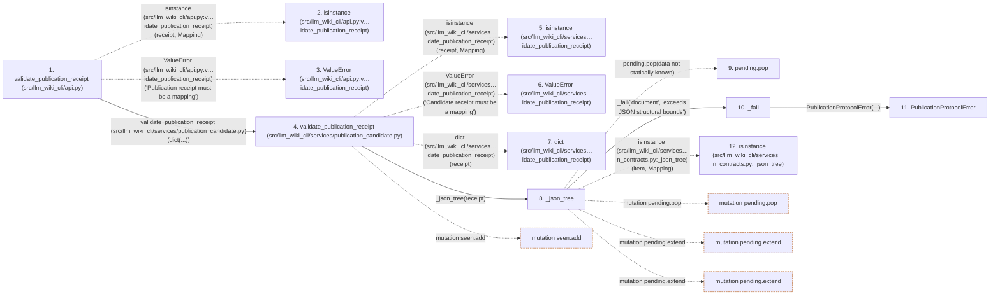

# validate_publication_receipt

**Entry point:** `validate_publication_receipt` (`api`)
**Source:** [api](../modules/api.md)
**Modules touched:** [api](../modules/api.md), [knowledge_evidence](../modules/knowledge_evidence.md), [publication_candidate](../modules/publication_candidate.md), [publication_contracts](../modules/publication_contracts.md), and 1 more

**Complete modules touched:**

- [api](../modules/api.md)
- [knowledge_evidence](../modules/knowledge_evidence.md)
- [publication_candidate](../modules/publication_candidate.md)
- [publication_contracts](../modules/publication_contracts.md)
- [validation](../modules/validation.md)

## Call sequence

> Static overview in presentation order, not runtime execution order. Arrows retain captured callers; representative internal continuations and boundary examples precede repeated helper detail.

```mermaid
sequenceDiagram
    participant p0 as validate_publication_receipt (src/llm_wiki_cli/api.py)
    participant p1 as validate_publication_receipt (src/llm_wiki_cli/services/publication_candidate.py)
    participant p2 as _json_tree
    participant p3 as hash_json
    participant p4 as validate_publication_basis
    participant p5 as validate_publication_report
    participant p6 as _hash_map
    participant p7 as _validate_review
    participant p8 as _proposal
    participant p9 as _guard
    participant p10 as _fail
    participant p11 as canonical_json_bytes
    participant p12 as _portable
    participant p13 as require_portable_relative_path
    participant p14 as _default_path_error
    participant p15 as _check_path_collision
    participant p16 as require_portable_path_component
    participant p17 as _check_hash
    participant p18 as sha256_bytes
    participant p19 as portable_path_key
    participant p20 as PublicationProtocolError
    participant p21 as canonical_json_text
    participant p22 as _syntax_key
    participant p23 as _known_syntax
    participant p24 as _remember_syntax
    participant p25 as SharedValidationError
    participant p26 as isinstance (src/llm_wiki_cli/api.py:v…idate_publication_receipt)
    participant p27 as json.dumps(…).encode
    participant p28 as ValueError (src/llm_wiki_cli/api.py:v…idate_publication_receipt)
    participant p29 as dict (src/llm_wiki_cli/api.py:v…idate_publication_receipt)
    participant p30 as isinstance (src/llm_wiki_cli/services…idate_publication_receipt)
    p0->>p1: validate_publication_receipt (src/llm_wiki_cli/services/publication_candidate.py)
    p1->>p2: _json_tree
    p1->>p3: hash_json
    p1->>p4: validate_publication_basis
    p1->>p5: validate_publication_report
    p1->>p6: _hash_map
    p1->>p7: _validate_review
    p1->>p8: _proposal
    p4->>p9: _guard
    p2->>p10: _fail
    p3->>p11: canonical_json_bytes
    p6->>p12: _portable
    p12->>p13: require_portable_relative_path
    p13->>p14: _default_path_error
    p13->>p15: _check_path_collision
    p13->>p16: require_portable_path_component
    p1->>p17: _check_hash
    p3->>p18: sha256_bytes
    p6->>p19: portable_path_key
    p10->>p20: PublicationProtocolError
    p11->>p21: canonical_json_text
    p13->>p22: _syntax_key
    p13->>p23: _known_syntax
    p13->>p24: _remember_syntax
    p14->>p25: SharedValidationError
    p0-->>p26: isinstance (src/llm_wiki_cli/api.py:v…idate_publication_receipt)(receipt, Mapping)
    p1-->>p27: json.dumps(…).encode('utf-8')
    p0-->>p28: ValueError (src/llm_wiki_cli/api.py:v…idate_publication_receipt)('Publication receipt must be a mapping')
    p0-->>p29: dict (src/llm_wiki_cli/api.py:v…idate_publication_receipt)(receipt)
    p1-->>p30: isinstance (src/llm_wiki_cli/services…idate_publication_receipt)(receipt, Mapping)
```

<!-- Auto-generated from static call edges. Dashed arrows are external or unresolved calls. Reviewed runtime conditions and side effects belong in Behavior. -->

> Call sequence diagram shows 30 of 253 interactions; 223 omitted to keep the visualization within the 30-interaction and generated-diagram limits, with uncertain identities omitted rather than inferred.

> Captured boundary calls: external 4 of 142 (138 omitted); unresolved 1 of 51 (50 omitted). These counts cover the captured static trace.

Omitted captured detail, grouped by actual caller occurrence and target module:

| Caller | Parent step | Target module | Kind | Omitted interactions |
| --- | --- | --- | --- | --- |
| `src/llm_wiki_cli/services/publication_candidate.py:validate_publication_receipt` | 4 | - | external | 91 |
| `src/llm_wiki_cli/services/publication_contracts.py:_json_tree` | 8 | - | unresolved | 4 |
| `src/llm_wiki_cli/services/publication_contracts.py:_json_tree` | 8 | - | external | 7 |
| `src/llm_wiki_cli/services/publication_contracts.py:_json_tree` | 8 | [src/llm_wiki_cli/services/publication_contracts.py](../modules/publication_contracts.md) | internal | 3 |
| `src/llm_wiki_cli/services/publication_candidate.py:_check_hash` | 32 | - | external | 2 |
| `src/llm_wiki_cli/services/publication_candidate.py:_check_hash` | 32 | - | unresolved | 1 |
| `src/llm_wiki_cli/services/knowledge_evidence.py:sha256_bytes` | 37 | - | unresolved | 1 |
| `src/llm_wiki_cli/services/knowledge_evidence.py:sha256_bytes` | 37 | - | external | 1 |
> Omission summary shows 8 of 37 groups; 29 further groups are not expanded here. Counts above include all omitted interactions.
> Detailed flow queries retain their own coverage and limits; omitted paths may execute at runtime.

> Trace truncated at the depth limit; deeper calls are omitted.

## Data flow

<!-- Auto-generated static analysis. Treat values and boundaries as best-effort hints, not runtime proof. -->

### Analysis coverage

**Effect analysis partially available.** Flow assembly and source effect analysis are separate; empty observations do not prove an empty handler body.

Source steps: 61; effect analysis evaluated: 50, partial: 2, unavailable: 9. Counts include steps omitted from the displayed trace.

Collector observations for 52 source steps with known totals: observed: 160, emitted: 149, omitted: 11. Unavailable totals are excluded.

- Callable record unavailable for one or more source steps; those steps have no represented callable body.
- Effect collector omitted observations before flow assembly; displayed effects are partial.
- Effect collector totals unavailable; observed counts cover captured records only.

| Step | Callable record | Effect analysis | Collector totals | Observed | Emitted | Omitted |
|---|---|---|---|---:|---:|---:|
| `validate_publication_receipt (src/llm_wiki_cli/api.py)` | `available` | `evaluated` | `available` | `2` | `2` | `0` |
| `isinstance (src/llm_wiki_cli/api.py:v…idate_publication_receipt)` | `not_applicable` | `not_applicable` | `not_applicable` | — | — | — |
| `ValueError (src/llm_wiki_cli/api.py:v…idate_publication_receipt)` | `not_applicable` | `not_applicable` | `not_applicable` | — | — | — |
| `validate_publication_receipt (src/llm_wiki_cli/services/publication_candidate.py)` | `available` | `evaluated` | `available` | `8` | `8` | `0` |
| `isinstance (src/llm_wiki_cli/services…idate_publication_receipt)` | `not_applicable` | `not_applicable` | `not_applicable` | — | — | — |
| `ValueError (src/llm_wiki_cli/services…idate_publication_receipt)` | `not_applicable` | `not_applicable` | `not_applicable` | — | — | — |
| `dict (src/llm_wiki_cli/services…idate_publication_receipt)` | `not_applicable` | `not_applicable` | `not_applicable` | — | — | — |
| `_json_tree` | `available` | `evaluated` | `available` | `6` | `6` | `0` |
| `pending.pop` | `not_applicable` | `not_applicable` | `not_applicable` | — | — | — |
| `_fail` | `available` | `evaluated` | `available` | `2` | `2` | `0` |
| `PublicationProtocolError` | `unavailable` | `unavailable` | `unavailable` | — | — | — |
| `isinstance (src/llm_wiki_cli/services…n_contracts.py:_json_tree)` | `not_applicable` | `not_applicable` | `not_applicable` | — | — | — |

### Step data

| Step | Inputs | Reads | Writes | Returns |
|---|---|---|---|---|
| `validate_publication_receipt (src/llm_wiki_cli/api.py)` | `receipt: Mapping[str, Any]` | `Mapping` | - | - |
| `isinstance (src/llm_wiki_cli/api.py:v…idate_publication_receipt)` | - | - | - | - |
| `ValueError (src/llm_wiki_cli/api.py:v…idate_publication_receipt)` | - | - | - | - |
| `validate_publication_receipt (src/llm_wiki_cli/services/publication_candidate.py)` | `receipt: Mapping[str, Any]` | `Mapping`, `MAX_TREE_BYTES`, `Mapping`, `_RECEIPT_FIELDS`, `RECEIPT_SCHEMA`, `MAX_FILES` | - | - |
| `isinstance (src/llm_wiki_cli/services…idate_publication_receipt)` | - | - | - | - |
| `ValueError (src/llm_wiki_cli/services…idate_publication_receipt)` | - | - | - | - |
| `dict (src/llm_wiki_cli/services…idate_publication_receipt)` | - | - | - | - |
| `_json_tree` | `value: object` | `_MAX_JSON_NODES`, `Mapping` | - | - |
| `pending.pop` | - | - | - | - |
| `_fail` | `field: str`, `message: str` | - | - | - |
| `PublicationProtocolError` | - | - | - | - |
| `isinstance (src/llm_wiki_cli/services…n_contracts.py:_json_tree)` | - | - | - | - |

### Call data

| From | To | Line | Call |
|---|---|---:|---|
| validate_publication_receipt (src/llm_wiki_cli/api.py) | isinstance (src/llm_wiki_cli/api.py:v…idate_publication_receipt) | 3699 | `isinstance(receipt, Mapping)` |
| validate_publication_receipt (src/llm_wiki_cli/api.py) | ValueError (src/llm_wiki_cli/api.py:v…idate_publication_receipt) | 3700 | `ValueError('Publication receipt must be a mapping')` |
| validate_publication_receipt (src/llm_wiki_cli/api.py) | validate_publication_receipt (src/llm_wiki_cli/services/publication_candidate.py) | 3701 | `validate(dict(...))` |
| validate_publication_receipt (src/llm_wiki_cli/services/publication_candidate.py) | isinstance (src/llm_wiki_cli/services…idate_publication_receipt) | 313 | `isinstance(receipt, Mapping)` |
| validate_publication_receipt (src/llm_wiki_cli/services/publication_candidate.py) | ValueError (src/llm_wiki_cli/services…idate_publication_receipt) | 314 | `ValueError('Candidate receipt must be a mapping')` |
| validate_publication_receipt (src/llm_wiki_cli/services/publication_candidate.py) | dict (src/llm_wiki_cli/services…idate_publication_receipt) | 315 | `dict(receipt)` |
| validate_publication_receipt (src/llm_wiki_cli/services/publication_candidate.py) | _json_tree | 316 | `_json_tree(receipt)` |
| _json_tree | pending.pop | 135 | `pending.pop(data not statically known)` |
| _json_tree | _fail | 138 | `_fail('document', 'exceeds JSON structural bounds')` |
| _fail | PublicationProtocolError | 43 | `PublicationProtocolError(...)` |
| _json_tree | isinstance (src/llm_wiki_cli/services…n_contracts.py:_json_tree) | 139 | `isinstance(item, Mapping)` |

### Boundary effects

| Kind | Target | Step | Line |
|---|---|---|---:|
| mutation | `seen.add` | `validate_publication_receipt` | 464 |
| mutation | `pending.pop` | `_json_tree` | 135 |
| mutation | `pending.extend` | `_json_tree` | 142 |
| mutation | `pending.extend` | `_json_tree` | 144 |

### Static analysis gaps

| Kind | Step | Target | Line |
|---|---|---|---:|
| external_call | `validate_publication_receipt` | `isinstance` | 3699 |
| external_call | `validate_publication_receipt` | `ValueError` | 3700 |
| external_call | `validate_publication_receipt` | `isinstance` | 313 |
| external_call | `validate_publication_receipt` | `ValueError` | 314 |
| external_call | `_json_tree` | `isinstance` | 139 |
| step_limit | `validate_publication_receipt` | `first 12 steps` | 0 |
| truncated_flow | `validate_publication_receipt` | `depth limit` | 0 |

## Behavior

This flow starts at `validate_publication_receipt` and is classified as `api`. The generated call and data-flow sections are bounded static projections; runtime conditions and side effects require source-level confirmation.
