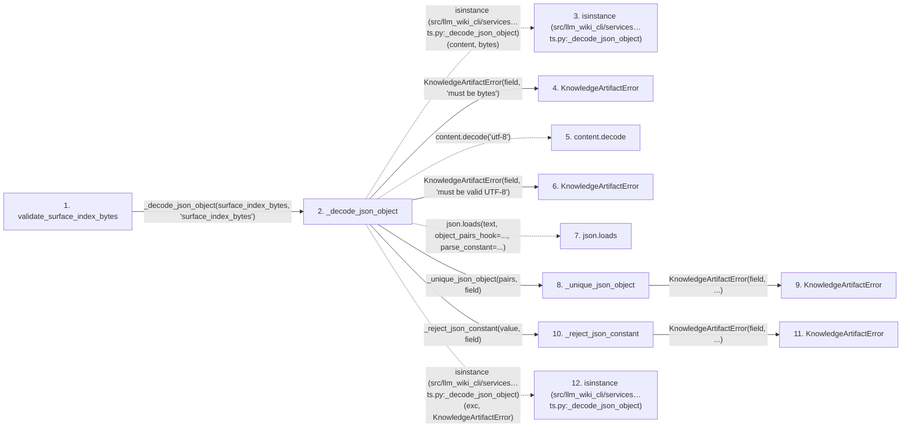

# validate_surface_index_bytes

**Entry point:** `validate_surface_index_bytes` (`api`)
**Source:** [knowledge_artifacts](../modules/knowledge_artifacts.md)
**Modules touched:** [knowledge_artifacts](../modules/knowledge_artifacts.md), [knowledge_evidence](../modules/knowledge_evidence.md), [validation](../modules/validation.md), [wiki_surface](../modules/wiki_surface.md)

## Call sequence

> Static overview in presentation order, not runtime execution order. Arrows retain captured callers; siblings are shown before deeper helper detail.

```mermaid
sequenceDiagram
    participant p0 as validate_surface_index_bytes
    participant p1 as _decode_json_object
    participant p2 as _validate_surface_payload
    participant p3 as _surface_page_index
    participant p4 as (…).encode
    participant p5 as json.dumps
    participant p6 as KnowledgeArtifactError
    participant p7 as isinstance (src/llm_wiki_cli/services…ts.py:_decode_json_object)
    participant p8 as _validate_utf8_json
    participant p9 as isinstance (src/llm_wiki_cli/services…ts.py:_surface_page_index)
    participant p10 as payload.get
    participant p11 as iter_page_kinds
    participant p12 as content.decode
    participant p13 as enumerate (src/llm_wiki_cli/services…ts.py:_surface_page_index)
    participant p14 as _is_future_schema_version
    participant p15 as json.loads
    participant p16 as set (src/llm_wiki_cli/services…_validate_surface_payload)
    participant p17 as _unique_json_object
    participant p18 as min (src/llm_wiki_cli/services…_validate_surface_payload)
    participant p19 as set (src/llm_wiki_cli/services…ts.py:_surface_page_index)
    participant p20 as _reject_json_constant
    participant p21 as min (src/llm_wiki_cli/services…ts.py:_surface_page_index)
    p0->>p1: _decode_json_object
    p0->>p2: _validate_surface_payload
    p0->>p3: _surface_page_index
    p0-->>p4: (…).encode('utf-8')
    p0-->>p5: json.dumps(surface_payload, indent=2, sort_keys=True, allow_nan=False)
    p0->>p6: KnowledgeArtifactError
    p1-->>p7: isinstance (src/llm_wiki_cli/services…ts.py:_decode_json_object)(content, bytes)
    p2->>p8: _validate_utf8_json
    p3-->>p9: isinstance (src/llm_wiki_cli/services…ts.py:_surface_page_index)(raw_pages, list)
    p1->>p6: KnowledgeArtifactError
    p2-->>p10: payload.get('schema_version')
    p3->>p11: iter_page_kinds
    p1-->>p12: content.decode('utf-8')
    p2->>p6: KnowledgeArtifactError
    p3-->>p13: enumerate (src/llm_wiki_cli/services…ts.py:_surface_page_index)(raw_pages)
    p1->>p6: KnowledgeArtifactError
    p2->>p14: _is_future_schema_version
    p3-->>p9: isinstance (src/llm_wiki_cli/services…ts.py:_surface_page_index)(value, Mapping)
    p1-->>p15: json.loads(text, object_pairs_hook=..., parse_constant=...)
    p2-->>p16: set (src/llm_wiki_cli/services…_validate_surface_payload)(payload)
    p3->>p6: KnowledgeArtifactError
    p1->>p17: _unique_json_object
    p2-->>p18: min (src/llm_wiki_cli/services…_validate_surface_payload)(missing)
    p3-->>p19: set (src/llm_wiki_cli/services…ts.py:_surface_page_index)(value)
    p1->>p20: _reject_json_constant
    p2->>p6: KnowledgeArtifactError
    p3-->>p21: min (src/llm_wiki_cli/services…ts.py:_surface_page_index)(missing)
    p1-->>p7: isinstance (src/llm_wiki_cli/services…ts.py:_decode_json_object)(exc, KnowledgeArtifactError)
    p2-->>p10: payload.get('pages')
    p3->>p6: KnowledgeArtifactError
```

<!-- Auto-generated from static call edges. Dashed arrows are external or unresolved calls. Reviewed runtime conditions and side effects belong in Behavior. -->

> Call sequence diagram shows 30 of 348 interactions; 318 omitted to keep the visualization within the 30-interaction and generated-diagram limits, with uncertain identities omitted rather than inferred.

> Captured boundary calls: external 11 of 124 (113 omitted); unresolved 4 of 51 (47 omitted). These counts cover the captured static trace.

Omitted captured detail, grouped by actual caller occurrence and target module:

| Caller | Parent step | Target module | Kind | Omitted interactions |
| --- | --- | --- | --- | --- |
| `src/llm_wiki_cli/services/knowledge_artifacts.py:_unique_json_object` | 8 | [src/llm_wiki_cli/services/knowledge_artifacts.py](../modules/knowledge_artifacts.md) | internal | 1 |
| `src/llm_wiki_cli/services/knowledge_artifacts.py:_reject_json_constant` | 10 | [src/llm_wiki_cli/services/knowledge_artifacts.py](../modules/knowledge_artifacts.md) | internal | 1 |
| `src/llm_wiki_cli/services/knowledge_artifacts.py:_decode_json_object` | 2 | [src/llm_wiki_cli/services/knowledge_artifacts.py](../modules/knowledge_artifacts.md) | internal | 2 |
| `src/llm_wiki_cli/services/knowledge_artifacts.py:_decode_json_object` | 2 | - | external | 1 |
| `src/llm_wiki_cli/services/knowledge_artifacts.py:_validate_utf8_json` | 17 | - | external | 5 |
| `src/llm_wiki_cli/services/knowledge_artifacts.py:_validate_utf8_json` | 17 | - | unresolved | 2 |
| `src/llm_wiki_cli/services/knowledge_artifacts.py:_validate_utf8_json` | 17 | [src/llm_wiki_cli/services/knowledge_artifacts.py](../modules/knowledge_artifacts.md) | internal | 5 |
| `src/llm_wiki_cli/services/knowledge_artifacts.py:_is_future_schema_version` | 32 | - | external | 5 |
> Omission summary shows 8 of 79 groups; 71 further groups are not expanded here. Counts above include all omitted interactions.
> Detailed flow queries retain their own coverage and limits; omitted paths may execute at runtime.

> Trace truncated at the depth limit; deeper calls are omitted.

## Data flow

<!-- Auto-generated static analysis. Treat values and boundaries as best-effort hints, not runtime proof. -->

### Step data

| Step | Inputs | Reads | Writes | Returns |
|---|---|---|---|---|
| `validate_surface_index_bytes` | `surface_index_bytes: bytes` | - | - | `surface_payload` |
| `_decode_json_object` | `content: bytes`, `field: str` | `KnowledgeArtifactError`, `Mapping` | - | `value` |
| `isinstance (src/llm_wiki_cli/services…ts.py:_decode_json_object)` | - | - | - | - |
| `KnowledgeArtifactError` | - | - | - | - |
| `content.decode` | - | - | - | - |
| `KnowledgeArtifactError` | - | - | - | - |
| `json.loads` | - | - | - | - |
| `_unique_json_object` | `pairs: list[tuple[str, Any]]`, `field: str` | - | `result[...]` | `result` |
| `KnowledgeArtifactError` | - | - | - | - |
| `_reject_json_constant` | `value: str`, `field: str` | - | - | - |
| `KnowledgeArtifactError` | - | - | - | - |
| `isinstance (src/llm_wiki_cli/services…ts.py:_decode_json_object)` | - | - | - | - |

### Call data

| From | To | Line | Call |
|---|---|---:|---|
| validate_surface_index_bytes | _decode_json_object | 257 | `_decode_json_object(surface_index_bytes, 'surface_index_bytes')` |
| _decode_json_object | isinstance (src/llm_wiki_cli/services…ts.py:_decode_json_object) | 896 | `isinstance(content, bytes)` |
| _decode_json_object | KnowledgeArtifactError | 897 | `KnowledgeArtifactError(field, 'must be bytes')` |
| _decode_json_object | content.decode | 899 | `content.decode('utf-8')` |
| _decode_json_object | KnowledgeArtifactError | 901 | `KnowledgeArtifactError(field, 'must be valid UTF-8')` |
| _decode_json_object | json.loads | 903 | `json.loads(text, object_pairs_hook=..., parse_constant=...)` |
| _decode_json_object | _unique_json_object | 905 | `_unique_json_object(pairs, field)` |
| _unique_json_object | KnowledgeArtifactError | 924 | `KnowledgeArtifactError(field, ...)` |
| _decode_json_object | _reject_json_constant | 906 | `_reject_json_constant(value, field)` |
| _reject_json_constant | KnowledgeArtifactError | 930 | `KnowledgeArtifactError(field, ...)` |
| _decode_json_object | isinstance (src/llm_wiki_cli/services…ts.py:_decode_json_object) | 909 | `isinstance(exc, KnowledgeArtifactError)` |

### Boundary effects

*No boundary effects detected.*

### Static analysis gaps

| Kind | Step | Target | Line |
|---|---|---|---:|
| external_call | `_decode_json_object` | `isinstance` | 896 |
| unresolved_call | `_decode_json_object` | `content.decode` | 899 |
| external_call | `_decode_json_object` | `json.loads` | 903 |
| external_call | `_decode_json_object` | `isinstance` | 909 |
| step_limit | `validate_surface_index_bytes` | `first 12 steps` | 0 |
| truncated_flow | `validate_surface_index_bytes` | `depth limit` | 0 |

## Behavior

This flow starts at `validate_surface_index_bytes` and is classified as `api`. The generated call and data-flow sections are bounded static projections; runtime conditions and side effects require source-level confirmation.
