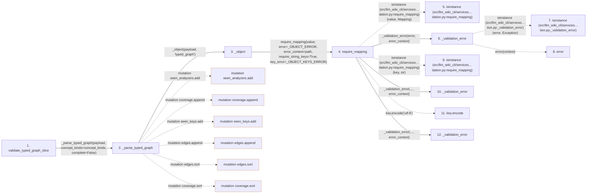

# validate_typed_graph_slice

**Entry point:** `validate_typed_graph_slice` (`api`)
**Source:** [knowledge_graph](../modules/knowledge_graph.md)
**Modules touched:** [knowledge_evidence](../modules/knowledge_evidence.md), [knowledge_graph](../modules/knowledge_graph.md), [validation](../modules/validation.md), [wiki_media](../modules/wiki_media.md), and 1 more

**Complete modules touched:**

- [knowledge_evidence](../modules/knowledge_evidence.md)
- [knowledge_graph](../modules/knowledge_graph.md)
- [validation](../modules/validation.md)
- [wiki_media](../modules/wiki_media.md)
- [wiki_surface](../modules/wiki_surface.md)

## Call sequence

> Static overview in presentation order, not runtime execution order. Arrows retain captured callers; representative internal continuations and boundary examples precede repeated helper detail.

```mermaid
sequenceDiagram
    participant p0 as validate_typed_graph_slice
    participant p1 as _parse_typed_graph
    participant p2 as _object
    participant p3 as _only_fields
    participant p4 as _normalise_input_hashes
    participant p5 as _array
    participant p6 as _name
    participant p7 as _normalise_coverage
    participant p8 as _locator
    participant p9 as _normalise_edge
    participant p10 as _validate_graph_bindings
    participant p11 as require_mapping
    participant p12 as require_exact_fields
    participant p13 as require_list
    participant p14 as validate_exact_page_coordinate
    participant p15 as _nonnegative_int
    participant p16 as _hash
    participant p17 as _relationship_kind
    participant p18 as _normalise_endpoint
    participant p19 as _aggregate_input_hash
    participant p20 as _positive_int
    participant p21 as _limitation
    participant p22 as _validate_resolution_target
    participant p23 as _normalise_evidence
    participant p24 as _validate_edge_concept_references
    participant p25 as relationship_edge_key
    participant p26 as _validate_core_direction
    participant p27 as require_sha256
    participant p28 as require_nonnegative_int
    participant p29 as set (src/llm_wiki_cli/services…aph.py:_parse_typed_graph)
    participant p30 as seen_analyzers.add
    p0->>p1: _parse_typed_graph
    p1->>p2: _object
    p1->>p3: _only_fields
    p1->>p4: _normalise_input_hashes
    p1->>p5: _array
    p1->>p6: _name
    p1->>p7: _normalise_coverage
    p1->>p8: _locator
    p1->>p9: _normalise_edge
    p1->>p10: _validate_graph_bindings
    p2->>p11: require_mapping
    p3->>p12: require_exact_fields
    p5->>p13: require_list
    p8->>p14: validate_exact_page_coordinate
    p7->>p15: _nonnegative_int
    p4->>p16: _hash
    p9->>p17: _relationship_kind
    p9->>p18: _normalise_endpoint
    p4->>p19: _aggregate_input_hash
    p7->>p20: _positive_int
    p7->>p21: _limitation
    p9->>p22: _validate_resolution_target
    p9->>p23: _normalise_evidence
    p9->>p24: _validate_edge_concept_references
    p9->>p25: relationship_edge_key
    p9->>p26: _validate_core_direction
    p16->>p27: require_sha256
    p15->>p28: require_nonnegative_int
    p1-->>p29: set (src/llm_wiki_cli/services…aph.py:_parse_typed_graph)
    p1-->>p30: seen_analyzers.add(analyzer)
```

<!-- Auto-generated from static call edges. Dashed arrows are external or unresolved calls. Reviewed runtime conditions and side effects belong in Behavior. -->

> Call sequence diagram shows 30 of 425 interactions; 395 omitted to keep the visualization within the 30-interaction and generated-diagram limits, with uncertain identities omitted rather than inferred.

> Captured boundary calls: external 1 of 100 (99 omitted); unresolved 1 of 77 (76 omitted). These counts cover the captured static trace.

Omitted captured detail, grouped by actual caller occurrence and target module:

| Caller | Parent step | Target module | Kind | Omitted interactions |
| --- | --- | --- | --- | --- |
| `src/llm_wiki_cli/services/validation.py:require_mapping` | 4 | - | external | 2 |
| `src/llm_wiki_cli/services/validation.py:require_mapping` | 4 | [src/llm_wiki_cli/services/validation.py](../modules/validation.md) | internal | 3 |
| `src/llm_wiki_cli/services/validation.py:_validation_error` | 6 | - | external | 1 |
| `src/llm_wiki_cli/services/validation.py:_validation_error` | 6 | - | unresolved | 1 |
| `src/llm_wiki_cli/services/validation.py:require_mapping` | 4 | - | unresolved | 1 |
| `src/llm_wiki_cli/services/knowledge_graph.py:_object` | 3 | - | external | 1 |
| `src/llm_wiki_cli/services/validation.py:require_exact_fields` | 15 | - | external | 9 |
| `src/llm_wiki_cli/services/validation.py:require_exact_fields` | 15 | [src/llm_wiki_cli/services/validation.py](../modules/validation.md) | internal | 1 |
> Omission summary shows 8 of 122 groups; 114 further groups are not expanded here. Counts above include all omitted interactions.
> Detailed flow queries retain their own coverage and limits; omitted paths may execute at runtime.

> Trace truncated at the depth limit; deeper calls are omitted.

## Data flow

<!-- Auto-generated static analysis. Treat values and boundaries as best-effort hints, not runtime proof. -->

### Analysis coverage

**Effect analysis partially available.** Flow assembly and source effect analysis are separate; empty observations do not prove an empty handler body.

Source steps: 249; effect analysis evaluated: 180, partial: 3, unavailable: 66. Counts include steps omitted from the displayed trace.

Collector observations for 183 source steps with known totals: observed: 893, emitted: 877, omitted: 16. Unavailable totals are excluded.

- Callable record unavailable for one or more source steps; those steps have no represented callable body.
- Effect collector omitted observations before flow assembly; displayed effects are partial.
- Effect collector totals unavailable; observed counts cover captured records only.

| Step | Callable record | Effect analysis | Collector totals | Observed | Emitted | Omitted |
|---|---|---|---|---:|---:|---:|
| `validate_typed_graph_slice` | `available` | `evaluated` | `available` | `3` | `3` | `0` |
| `_parse_typed_graph` | `available` | `evaluated` | `available` | `13` | `13` | `0` |
| `_object` | `available` | `evaluated` | `available` | `5` | `5` | `0` |
| `require_mapping` | `available` | `evaluated` | `available` | `9` | `9` | `0` |
| `isinstance (src/llm_wiki_cli/services…dation.py:require_mapping)` | `not_applicable` | `not_applicable` | `not_applicable` | — | — | — |
| `_validation_error` | `available` | `evaluated` | `available` | `3` | `3` | `0` |
| `isinstance (src/llm_wiki_cli/services…tion.py:_validation_error)` | `not_applicable` | `not_applicable` | `not_applicable` | — | — | — |
| `error` | `not_applicable` | `not_applicable` | `not_applicable` | — | — | — |
| `isinstance (src/llm_wiki_cli/services…dation.py:require_mapping)` | `not_applicable` | `not_applicable` | `not_applicable` | — | — | — |
| `_validation_error` | `available` | `evaluated` | `available` | `3` | `3` | `0` |
| `key.encode` | `not_applicable` | `not_applicable` | `not_applicable` | — | — | — |
| `_validation_error` | `available` | `evaluated` | `available` | `3` | `3` | `0` |

### Step data

| Step | Inputs | Reads | Writes | Returns |
|---|---|---|---|---|
| `validate_typed_graph_slice` | `payload: object`, `concept_kinds: Mapping[str, str] \| None` | - | - | `_parse_typed_graph(...)` |
| `_parse_typed_graph` | `payload: object`, `concept_kinds: Mapping[str, str] \| None`, `complete: bool` | `TYPED_GRAPH_SCHEMA_VERSION`, `TYPED_GRAPH_SCHEMA_VERSION`, `TYPED_GRAPH_SCHEMA_VERSION` | - | `{...}` |
| `_object` | `value: object`, `path: str` | `_OBJECT_ERROR`, `_OBJECT_KEYS_ERROR` | - | `dict(...)` |
| `require_mapping` | `value: object`, `error: _ValidationError`, `error_context: str`, `require_string_keys: bool`, `key_error: _ValidationError \| None`, `require_utf8_keys: bool`, `utf8_key_error: _ValidationError \| None` | `Mapping` | - | `value` |
| `isinstance (src/llm_wiki_cli/services…dation.py:require_mapping)` | - | - | - | - |
| `_validation_error` | `error: _ValidationError`, `context: str` | - | - | `...` |
| `isinstance (src/llm_wiki_cli/services…tion.py:_validation_error)` | - | - | - | - |
| `error` | - | - | - | - |
| `isinstance (src/llm_wiki_cli/services…dation.py:require_mapping)` | - | - | - | - |
| `_validation_error` | `error: _ValidationError`, `context: str` | - | - | `...` |
| `key.encode` | - | - | - | - |
| `_validation_error` | `error: _ValidationError`, `context: str` | - | - | `...` |

### Call data

| From | To | Line | Call |
|---|---|---:|---|
| validate_typed_graph_slice | _parse_typed_graph | 427 | `_parse_typed_graph(payload, concept_kinds=concept_kinds, complete=False)` |
| _parse_typed_graph | _object | 434 | `_object(payload, 'typed_graph')` |
| _object | require_mapping | 2342 | `require_mapping(value, error=_OBJECT_ERROR, error_context=path, require_string_keys=True, key_error=_OBJECT_KEYS_ERROR)` |
| require_mapping | isinstance (src/llm_wiki_cli/services…dation.py:require_mapping) | 783 | `isinstance(value, Mapping)` |
| require_mapping | _validation_error | 784 | `_validation_error(error, error_context)` |
| _validation_error | isinstance (src/llm_wiki_cli/services…tion.py:_validation_error) | 95 | `isinstance(error, Exception)` |
| _validation_error | error | 95 | `error(context)` |
| require_mapping | isinstance (src/llm_wiki_cli/services…dation.py:require_mapping) | 787 | `isinstance(key, str)` |
| require_mapping | _validation_error | 788 | `_validation_error(..., error_context)` |
| require_mapping | key.encode | 792 | `key.encode('utf-8')` |
| require_mapping | _validation_error | 794 | `_validation_error(..., error_context)` |

### Boundary effects

| Kind | Target | Step | Line |
|---|---|---|---:|
| mutation | `seen_analyzers.add` | `_parse_typed_graph` | 480 |
| mutation | `coverage.append` | `_parse_typed_graph` | 481 |
| mutation | `seen_keys.add` | `_parse_typed_graph` | 505 |
| mutation | `edges.append` | `_parse_typed_graph` | 506 |
| mutation | `edges.sort` | `_parse_typed_graph` | 507 |
| mutation | `coverage.sort` | `_parse_typed_graph` | 508 |

### Static analysis gaps

| Kind | Step | Target | Line |
|---|---|---|---:|
| external_call | `require_mapping` | `isinstance` | 783 |
| external_call | `_validation_error` | `isinstance` | 95 |
| unresolved_call | `_validation_error` | `error` | 95 |
| external_call | `require_mapping` | `isinstance` | 787 |
| unresolved_call | `require_mapping` | `key.encode` | 792 |
| step_limit | `validate_typed_graph_slice` | `first 12 steps` | 0 |
| truncated_flow | `validate_typed_graph_slice` | `depth limit` | 0 |

## Behavior

Validates the graph header, consumed edge shapes and their input-basis bindings. Selected observations may not exceed declared analyzer totals, but unconsumed observations are not checked. Full graph validation keeps its exact-total requirement; a slice never establishes whole-graph completeness.
