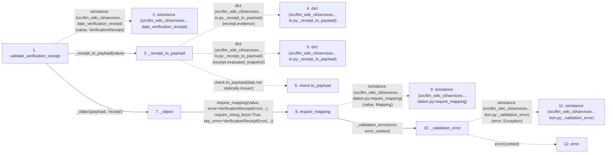

# validate_verification_receipt

**Entry point:** `validate_verification_receipt` (`api`)
**Source:** [verification_contracts](../modules/verification_contracts.md)
**Modules touched:** [knowledge_evidence](../modules/knowledge_evidence.md), [validation](../modules/validation.md), [verification_contracts](../modules/verification_contracts.md)

## Call sequence

> Static overview in presentation order, not runtime execution order. Arrows retain captured callers; representative internal continuations and boundary examples precede repeated helper detail.

```mermaid
sequenceDiagram
    participant p0 as validate_verification_receipt
    participant p1 as _object
    participant p2 as _exact_fields
    participant p3 as _string
    participant p4 as _receipt_hash
    participant p5 as _scope_uid
    participant p6 as _receipt_anchor_mapping
    participant p7 as hash_json
    participant p8 as _parse_check
    participant p9 as _receipt_to_payload
    participant p10 as VerificationReceiptError
    participant p11 as VerificationResult
    participant p12 as VerificationReceipt
    participant p13 as require_mapping
    participant p14 as require_string
    participant p15 as _sha256
    participant p16 as _checker_id
    participant p17 as require_exact_fields
    participant p18 as _normalized_anchor_mapping
    participant p19 as canonical_json_bytes
    participant p20 as _checker_version
    participant p21 as _array
    participant p22 as _parse_diagnostic
    participant p23 as _parse_coverage
    participant p24 as require_sha256
    participant p25 as require_list
    participant p26 as _nonnegative_int
    participant p27 as require_nonnegative_int
    participant p28 as require_trimmed_text
    participant p29 as isinstance (src/llm_wiki_cli/services…date_verification_receipt)
    participant p30 as raw_checks.items
    p0->>p1: _object
    p0->>p2: _exact_fields
    p0->>p3: _string
    p0->>p4: _receipt_hash
    p0->>p5: _scope_uid
    p0->>p6: _receipt_anchor_mapping
    p0->>p7: hash_json
    p0->>p8: _parse_check
    p0->>p9: _receipt_to_payload
    p0->>p10: VerificationReceiptError
    p0->>p11: VerificationResult
    p0->>p12: VerificationReceipt
    p1->>p13: require_mapping
    p3->>p14: require_string
    p4->>p15: _sha256
    p8->>p16: _checker_id
    p2->>p17: require_exact_fields
    p6->>p18: _normalized_anchor_mapping
    p7->>p19: canonical_json_bytes
    p8->>p20: _checker_version
    p8->>p21: _array
    p8->>p22: _parse_diagnostic
    p8->>p23: _parse_coverage
    p15->>p24: require_sha256
    p21->>p25: require_list
    p23->>p26: _nonnegative_int
    p26->>p27: require_nonnegative_int
    p24->>p28: require_trimmed_text
    p0-->>p29: isinstance (src/llm_wiki_cli/services…date_verification_receipt)(value, VerificationReceipt)
    p0-->>p30: raw_checks.items
```

<!-- Auto-generated from static call edges. Dashed arrows are external or unresolved calls. Reviewed runtime conditions and side effects belong in Behavior. -->

> Call sequence diagram shows 30 of 184 interactions; 154 omitted to keep the visualization within the 30-interaction and generated-diagram limits, with uncertain identities omitted rather than inferred.

> Captured boundary calls: external 1 of 52 (51 omitted); unresolved 1 of 20 (19 omitted). These counts cover the captured static trace.

Omitted captured detail, grouped by actual caller occurrence and target module:

| Caller | Parent step | Target module | Kind | Omitted interactions |
| --- | --- | --- | --- | --- |
| `src/llm_wiki_cli/services/verification_contracts.py:_receipt_to_payload` | 3 | - | external | 2 |
| `src/llm_wiki_cli/services/verification_contracts.py:_receipt_to_payload` | 3 | - | unresolved | 1 |
| `src/llm_wiki_cli/services/validation.py:require_mapping` | 8 | - | external | 2 |
| `src/llm_wiki_cli/services/validation.py:require_mapping` | 8 | [src/llm_wiki_cli/services/validation.py](../modules/validation.md) | internal | 3 |
| `src/llm_wiki_cli/services/validation.py:_validation_error` | 10 | - | external | 1 |
| `src/llm_wiki_cli/services/validation.py:_validation_error` | 10 | - | unresolved | 1 |
| `src/llm_wiki_cli/services/validation.py:require_mapping` | 8 | - | unresolved | 1 |
| `src/llm_wiki_cli/services/verification_contracts.py:_object` | 7 | [src/llm_wiki_cli/services/verification_contracts.py](../modules/verification_contracts.md) | internal | 2 |
> Omission summary shows 8 of 63 groups; 55 further groups are not expanded here. Counts above include all omitted interactions.
> Detailed flow queries retain their own coverage and limits; omitted paths may execute at runtime.

> Trace truncated at the depth limit; deeper calls are omitted.

## Data flow

<!-- Auto-generated static analysis. Treat values and boundaries as best-effort hints, not runtime proof. -->

### Analysis coverage

**Effect analysis partially available.** Flow assembly and source effect analysis are separate; empty observations do not prove an empty handler body.

Source steps: 113; effect analysis evaluated: 72, partial: 1, unavailable: 40. Counts include steps omitted from the displayed trace.

Collector observations for 73 source steps with known totals: observed: 279, emitted: 277, omitted: 2. Unavailable totals are excluded.

- Callable record unavailable for one or more source steps; those steps have no represented callable body.
- Effect collector omitted observations before flow assembly; displayed effects are partial.
- Effect collector totals unavailable; observed counts cover captured records only.

| Step | Callable record | Effect analysis | Collector totals | Observed | Emitted | Omitted |
|---|---|---|---|---:|---:|---:|
| `validate_verification_receipt` | `available` | `evaluated` | `available` | `7` | `7` | `0` |
| `isinstance (src/llm_wiki_cli/services…date_verification_receipt)` | `not_applicable` | `not_applicable` | `not_applicable` | — | — | — |
| `_receipt_to_payload` | `available` | `evaluated` | `available` | `2` | `2` | `0` |
| `dict (src/llm_wiki_cli/services…ts.py:_receipt_to_payload)` | `not_applicable` | `not_applicable` | `not_applicable` | — | — | — |
| `dict (src/llm_wiki_cli/services…ts.py:_receipt_to_payload)` | `not_applicable` | `not_applicable` | `not_applicable` | — | — | — |
| `check.to_payload` | `not_applicable` | `not_applicable` | `not_applicable` | — | — | — |
| `_object` | `available` | `evaluated` | `available` | `3` | `3` | `0` |
| `require_mapping` | `available` | `evaluated` | `available` | `9` | `9` | `0` |
| `isinstance (src/llm_wiki_cli/services…dation.py:require_mapping)` | `not_applicable` | `not_applicable` | `not_applicable` | — | — | — |
| `_validation_error` | `available` | `evaluated` | `available` | `3` | `3` | `0` |
| `isinstance (src/llm_wiki_cli/services…tion.py:_validation_error)` | `not_applicable` | `not_applicable` | `not_applicable` | — | — | — |
| `error` | `not_applicable` | `not_applicable` | `not_applicable` | — | — | — |

### Step data

| Step | Inputs | Reads | Writes | Returns |
|---|---|---|---|---|
| `validate_verification_receipt` | `value: VerificationReceipt \| object` | `VerificationReceipt`, `VERIFICATION_RECEIPT_SCHEMA_VERSION`, `VERIFICATION_RECEIPT_SCHEMA_VERSION`, `VerificationContractError`, `MAX_CHECKS_PER_RECEIPT` | - | `VerificationReceipt(...)` |
| `isinstance (src/llm_wiki_cli/services…date_verification_receipt)` | - | - | - | - |
| `_receipt_to_payload` | `receipt: VerificationReceipt` | - | - | `{...}` |
| `dict (src/llm_wiki_cli/services…ts.py:_receipt_to_payload)` | - | - | - | - |
| `dict (src/llm_wiki_cli/services…ts.py:_receipt_to_payload)` | - | - | - | - |
| `check.to_payload` | - | - | - | - |
| `_object` | `value: object`, `field_name: str` | - | - | `require_mapping(...)` |
| `require_mapping` | `value: object`, `error: _ValidationError`, `error_context: str`, `require_string_keys: bool`, `key_error: _ValidationError \| None`, `require_utf8_keys: bool`, `utf8_key_error: _ValidationError \| None` | `Mapping` | - | `value` |
| `isinstance (src/llm_wiki_cli/services…dation.py:require_mapping)` | - | - | - | - |
| `_validation_error` | `error: _ValidationError`, `context: str` | - | - | `...` |
| `isinstance (src/llm_wiki_cli/services…tion.py:_validation_error)` | - | - | - | - |
| `error` | - | - | - | - |

### Call data

| From | To | Line | Call |
|---|---|---:|---|
| validate_verification_receipt | isinstance (src/llm_wiki_cli/services…date_verification_receipt) | 835 | `isinstance(value, VerificationReceipt)` |
| validate_verification_receipt | _receipt_to_payload | 834 | `_receipt_to_payload(value)` |
| _receipt_to_payload | dict (src/llm_wiki_cli/services…ts.py:_receipt_to_payload) | 1130 | `dict(receipt.evidence)` |
| _receipt_to_payload | dict (src/llm_wiki_cli/services…ts.py:_receipt_to_payload) | 1132 | `dict(receipt.evaluated_snapshot)` |
| _receipt_to_payload | check.to_payload | 1136 | `check.to_payload(data not statically known)` |
| validate_verification_receipt | _object | 838 | `_object(payload, 'receipt')` |
| _object | require_mapping | 1470 | `require_mapping(value, error=VerificationReceiptError(...), require_string_keys=True, key_error=VerificationReceiptError(...))` |
| require_mapping | isinstance (src/llm_wiki_cli/services…dation.py:require_mapping) | 783 | `isinstance(value, Mapping)` |
| require_mapping | _validation_error | 784 | `_validation_error(error, error_context)` |
| _validation_error | isinstance (src/llm_wiki_cli/services…tion.py:_validation_error) | 95 | `isinstance(error, Exception)` |
| _validation_error | error | 95 | `error(context)` |

### Boundary effects

*No boundary-effect observations were captured in this static trace.*

### Static analysis gaps

| Kind | Step | Target | Line |
|---|---|---|---:|
| external_call | `validate_verification_receipt` | `isinstance` | 835 |
| unresolved_call | `_receipt_to_payload` | `check.to_payload` | 1136 |
| external_call | `require_mapping` | `isinstance` | 783 |
| external_call | `_validation_error` | `isinstance` | 95 |
| unresolved_call | `_validation_error` | `error` | 95 |
| step_limit | `validate_verification_receipt` | `first 12 steps` | 0 |
| truncated_flow | `validate_verification_receipt` | `depth limit` | 0 |

## Behavior

This flow starts at `validate_verification_receipt` and is classified as `api`. The generated call and data-flow sections are bounded static projections; runtime conditions and side effects require source-level confirmation.
