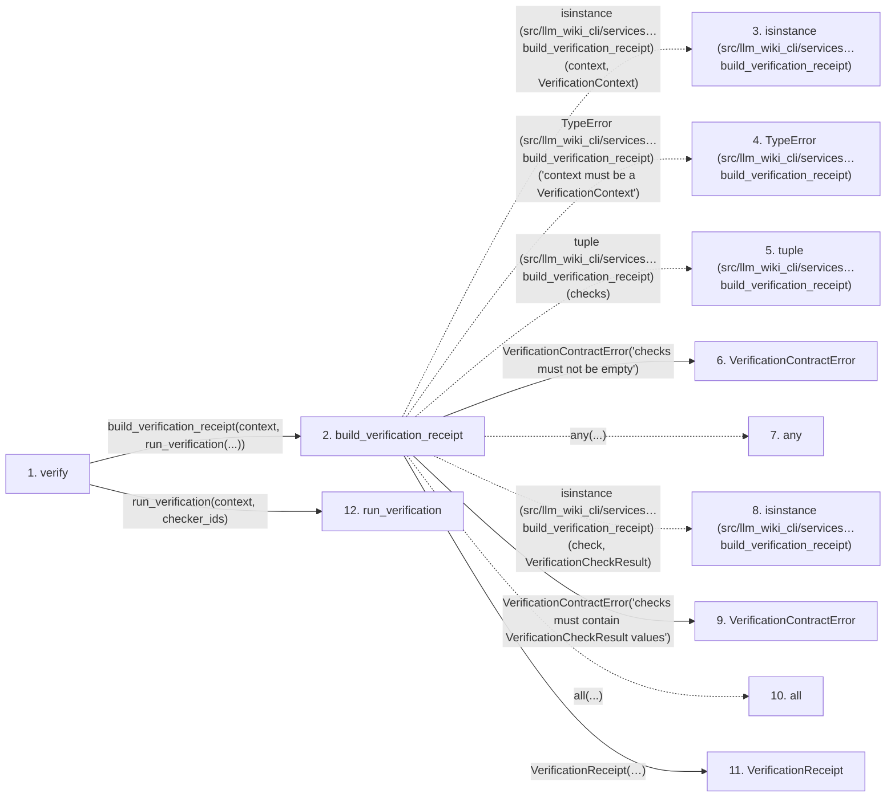

# verify

**Entry point:** `verify` (`api`)
**Source:** [verification_contracts](../modules/verification_contracts.md)
**Modules touched:** [verification_contracts](../modules/verification_contracts.md)

## Call sequence

> Static overview in presentation order, not runtime execution order. Arrows retain captured callers; representative internal continuations and boundary examples precede repeated helper detail.

```mermaid
sequenceDiagram
    participant p0 as verify
    participant p1 as build_verification_receipt
    participant p2 as run_verification
    participant p3 as _selected_contracts
    participant p4 as _checker_id
    participant p5 as VerificationContractError
    participant p6 as VerificationReceipt
    participant p7 as UnknownVerificationCheckerError
    participant p8 as isinstance (src/llm_wiki_cli/services…build_verification_receipt)
    participant p9 as contract.run
    participant p10 as isinstance (src/llm_wiki_cli/services…tracts.py:run_verification)
    participant p11 as TypeError (src/llm_wiki_cli/services…build_verification_receipt)
    participant p12 as TypeError (src/llm_wiki_cli/services…tracts.py:run_verification)
    participant p13 as tuple (src/llm_wiki_cli/services…build_verification_receipt)
    participant p14 as tuple (src/llm_wiki_cli/services…tracts.py:run_verification)
    participant p15 as any
    participant p16 as all
    participant p17 as isinstance (src/llm_wiki_cli/services…cts.py:_selected_contracts)
    participant p18 as tuple (src/llm_wiki_cli/services…cts.py:_selected_contracts)
    participant p19 as sorted
    participant p20 as len
    participant p21 as set
    participant p22 as contracts.append
    participant p23 as isinstance (src/llm_wiki_cli/services…n_contracts.py:_checker_id)
    p0->>p1: build_verification_receipt
    p0->>p2: run_verification
    p2->>p3: _selected_contracts
    p3->>p4: _checker_id
    p1->>p5: VerificationContractError
    p1->>p6: VerificationReceipt
    p3->>p7: UnknownVerificationCheckerError
    p1-->>p8: isinstance (src/llm_wiki_cli/services…build_verification_receipt)(context, VerificationContext)
    p2-->>p9: contract.run(context)
    p2-->>p10: isinstance (src/llm_wiki_cli/services…tracts.py:run_verification)(context, VerificationContext)
    p1-->>p11: TypeError (src/llm_wiki_cli/services…build_verification_receipt)('context must be a VerificationContext')
    p2-->>p12: TypeError (src/llm_wiki_cli/services…tracts.py:run_verification)('context must be a VerificationContext')
    p1-->>p13: tuple (src/llm_wiki_cli/services…build_verification_receipt)(checks)
    p2-->>p14: tuple (src/llm_wiki_cli/services…tracts.py:run_verification)(...)
    p1-->>p15: any(...)
    p1-->>p8: isinstance (src/llm_wiki_cli/services…build_verification_receipt)(check, VerificationCheckResult)
    p1-->>p16: all(...)
    p3-->>p17: isinstance (src/llm_wiki_cli/services…cts.py:_selected_contracts)(checker_ids, (...))
    p3-->>p18: tuple (src/llm_wiki_cli/services…cts.py:_selected_contracts)(sorted(...))
    p3-->>p19: sorted(_CHECKER_REGISTRY)
    p3-->>p18: tuple (src/llm_wiki_cli/services…cts.py:_selected_contracts)(checker_ids)
    p3-->>p20: len(selected)
    p3-->>p20: len(selected)
    p3-->>p20: len(set(...))
    p3-->>p21: set(selected)
    p3-->>p17: isinstance (src/llm_wiki_cli/services…cts.py:_selected_contracts)(checker_id, str)
    p3-->>p22: contracts.append(_CHECKER_REGISTRY[...])
    p3-->>p18: tuple (src/llm_wiki_cli/services…cts.py:_selected_contracts)(sorted(...))
    p3-->>p19: sorted(contracts, key=...)
    p4-->>p23: isinstance (src/llm_wiki_cli/services…n_contracts.py:_checker_id)(value, str)
```

<!-- Auto-generated from static call edges. Dashed arrows are external or unresolved calls. Reviewed runtime conditions and side effects belong in Behavior. -->

> Call sequence diagram shows 30 of 39 interactions; 9 omitted to keep the visualization within the 30-interaction and generated-diagram limits, with uncertain identities omitted rather than inferred.

> Captured boundary calls: external 21 of 21 (0 omitted); unresolved 2 of 3 (1 omitted). These counts cover the captured static trace.

Omitted captured detail, grouped by actual caller occurrence and target module:

| Caller | Parent step | Target module | Kind | Omitted interactions |
| --- | --- | --- | --- | --- |
| `src/llm_wiki_cli/services/verification_contracts.py:build_verification_receipt` | 2 | [src/llm_wiki_cli/services/verification_contracts.py](../modules/verification_contracts.md) | internal | 1 |
| `src/llm_wiki_cli/services/verification_contracts.py:_selected_contracts` | 15 | [src/llm_wiki_cli/services/verification_contracts.py](../modules/verification_contracts.md) | internal | 6 |
| `src/llm_wiki_cli/services/verification_contracts.py:_checker_id` | 30 | - | unresolved | 1 |
| `src/llm_wiki_cli/services/verification_contracts.py:_checker_id` | 30 | [src/llm_wiki_cli/services/verification_contracts.py](../modules/verification_contracts.md) | internal | 1 |
> Detailed flow queries retain their own coverage and limits; omitted paths may execute at runtime.

## Data flow

<!-- Auto-generated static analysis. Treat values and boundaries as best-effort hints, not runtime proof. -->

### Step data

| Step | Inputs | Reads | Writes | Returns |
|---|---|---|---|---|
| `verify` | `context: VerificationContext`, `checker_ids: Sequence[str] \| None` | - | - | `build_verification_receipt(...)` |
| `build_verification_receipt` | `context: VerificationContext`, `checks: Sequence[VerificationCheckResult]` | `VerificationContext`, `VerificationCheckResult`, `VerificationResult`, `VerificationResult`, `VerificationResult` | - | `VerificationReceipt(...)` |
| `isinstance (src/llm_wiki_cli/services…build_verification_receipt)` | - | - | - | - |
| `TypeError (src/llm_wiki_cli/services…build_verification_receipt)` | - | - | - | - |
| `tuple (src/llm_wiki_cli/services…build_verification_receipt)` | - | - | - | - |
| `VerificationContractError` | - | - | - | - |
| `any` | - | - | - | - |
| `isinstance (src/llm_wiki_cli/services…build_verification_receipt)` | - | - | - | - |
| `VerificationContractError` | - | - | - | - |
| `all` | - | - | - | - |
| `VerificationReceipt` | - | - | - | - |
| `run_verification` | `context: VerificationContext`, `checker_ids: Sequence[str] \| None` | `VerificationContext` | - | `tuple(...)` |

### Call data

| From | To | Line | Call |
|---|---|---:|---|
| verify | build_verification_receipt | 770 | `build_verification_receipt(context, run_verification(...))` |
| build_verification_receipt | isinstance (src/llm_wiki_cli/services…build_verification_receipt) | 731 | `isinstance(context, VerificationContext)` |
| build_verification_receipt | TypeError (src/llm_wiki_cli/services…build_verification_receipt) | 732 | `TypeError('context must be a VerificationContext')` |
| build_verification_receipt | tuple (src/llm_wiki_cli/services…build_verification_receipt) | 733 | `tuple(checks)` |
| build_verification_receipt | VerificationContractError | 735 | `VerificationContractError('checks must not be empty')` |
| build_verification_receipt | any | 736 | `any(...)` |
| build_verification_receipt | isinstance (src/llm_wiki_cli/services…build_verification_receipt) | 737 | `isinstance(check, VerificationCheckResult)` |
| build_verification_receipt | VerificationContractError | 740 | `VerificationContractError('checks must contain VerificationCheckResult values')` |
| build_verification_receipt | all | 745 | `all(...)` |
| build_verification_receipt | VerificationReceipt | 751 | `VerificationReceipt(knowledge_hash=context.knowledge_hash, scope_uid=context.scope_uid, scope_hash=context.scope_hash, evidence=context.evidence, evidence_hash=context.evidence_hash, evaluated_snapshot=context.evaluated_snapshot, snapshot_hash=context.snapshot_hash, result=result, checks=normalized_checks)` |
| verify | run_verification | 772 | `run_verification(context, checker_ids)` |

### Boundary effects

*No boundary effects detected.*

### Static analysis gaps

| Kind | Step | Target | Line |
|---|---|---|---:|
| external_call | `build_verification_receipt` | `isinstance` | 731 |
| external_call | `build_verification_receipt` | `TypeError` | 732 |
| external_call | `build_verification_receipt` | `any` | 736 |
| external_call | `build_verification_receipt` | `isinstance` | 737 |
| external_call | `build_verification_receipt` | `all` | 745 |
| step_limit | `verify` | `first 12 steps` | 0 |

## Behavior

This flow starts at `verify` and is classified as `api`. The generated call and data-flow sections are bounded static projections; runtime conditions and side effects require source-level confirmation.
