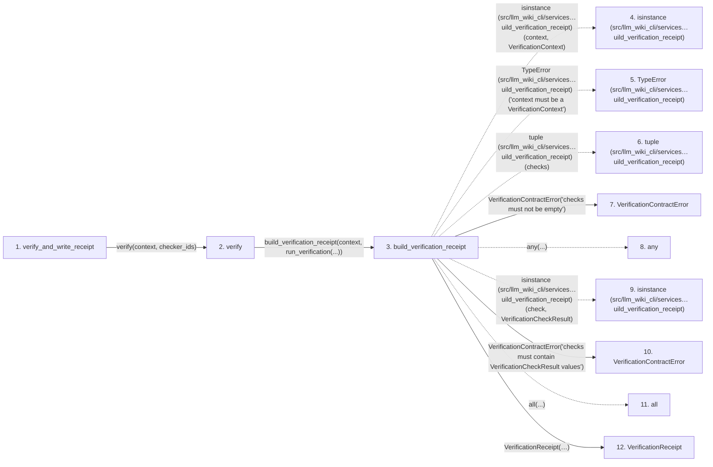

# verify_and_write_receipt

**Entry point:** `verify_and_write_receipt` (`api`)
**Source:** [verification_contracts](../modules/verification_contracts.md)
**Modules touched:** [io](../modules/io.md), [knowledge_evidence](../modules/knowledge_evidence.md), [validation](../modules/validation.md), [verification_contracts](../modules/verification_contracts.md), and 1 more

**Complete modules touched:**

- [io](../modules/io.md)
- [knowledge_evidence](../modules/knowledge_evidence.md)
- [validation](../modules/validation.md)
- [verification_contracts](../modules/verification_contracts.md)
- [wiki_write_basis](../modules/wiki_write_basis.md)

## Call sequence

> Static overview in presentation order, not runtime execution order. Arrows retain captured callers; siblings are shown before deeper helper detail.

```mermaid
sequenceDiagram
    participant p0 as verify_and_write_receipt
    participant p1 as verify
    participant p2 as write_verification_receipt
    participant p3 as build_verification_receipt
    participant p4 as serialize_verification_receipt
    participant p5 as run_verification
    participant p6 as Path (src/llm_wiki_cli/services…rite_verification_receipt)
    participant p7 as first_unsafe_path_component
    participant p8 as VerificationReceiptError
    participant p9 as root.is_symlink
    participant p10 as root.is_dir
    participant p11 as verification_receipt_path
    participant p12 as path.is_symlink
    participant p13 as path.exists
    participant p14 as path.is_file
    participant p15 as write_bytes_atomic
    participant p16 as isinstance (src/llm_wiki_cli/services…uild_verification_receipt)
    participant p17 as isinstance (src/llm_wiki_cli/services…racts.py:run_verification)
    participant p18 as formatted_json_bytes
    participant p19 as Path (src/llm_wiki_cli/services…rst_unsafe_path_component)
    participant p20 as Path (src/llm_wiki_cli/services…verification_receipt_path)
    participant p21 as isinstance (src/llm_wiki_cli/services/io.py:write_bytes_atomic)
    participant p22 as TypeError (src/llm_wiki_cli/services…uild_verification_receipt)
    participant p23 as TypeError (src/llm_wiki_cli/services…racts.py:run_verification)
    participant p24 as verification_receipt_to_payload
    participant p25 as os.fspath
    participant p26 as TypeError (src/llm_wiki_cli/services/io.py:write_bytes_atomic)
    p0->>p1: verify
    p0->>p2: write_verification_receipt
    p1->>p3: build_verification_receipt
    p2->>p4: serialize_verification_receipt
    p1->>p5: run_verification
    p2-->>p6: Path (src/llm_wiki_cli/services…rite_verification_receipt)(wiki_dir)
    p2->>p7: first_unsafe_path_component
    p2->>p8: VerificationReceiptError
    p2-->>p9: root.is_symlink
    p2->>p8: VerificationReceiptError
    p2-->>p10: root.is_dir
    p2->>p8: VerificationReceiptError
    p2->>p11: verification_receipt_path
    p2-->>p12: path.is_symlink
    p2->>p8: VerificationReceiptError
    p2-->>p13: path.exists
    p2-->>p14: path.is_file
    p2->>p8: VerificationReceiptError
    p2->>p15: write_bytes_atomic
    p3-->>p16: isinstance (src/llm_wiki_cli/services…uild_verification_receipt)(context, VerificationContext)
    p5-->>p17: isinstance (src/llm_wiki_cli/services…racts.py:run_verification)(context, VerificationContext)
    p4->>p18: formatted_json_bytes
    p7-->>p19: Path (src/llm_wiki_cli/services…rst_unsafe_path_component)(os.fspath(...))
    p11-->>p20: Path (src/llm_wiki_cli/services…verification_receipt_path)(wiki_dir)
    p15-->>p21: isinstance (src/llm_wiki_cli/services/io.py:write_bytes_atomic)(content, bytes)
    p3-->>p22: TypeError (src/llm_wiki_cli/services…uild_verification_receipt)('context must be a VerificationContext')
    p5-->>p23: TypeError (src/llm_wiki_cli/services…racts.py:run_verification)('context must be a VerificationContext')
    p4->>p24: verification_receipt_to_payload
    p7-->>p25: os.fspath(path)
    p15-->>p26: TypeError (src/llm_wiki_cli/services/io.py:write_bytes_atomic)('content must be bytes')
```

<!-- Auto-generated from static call edges. Dashed arrows are external or unresolved calls. Reviewed runtime conditions and side effects belong in Behavior. -->

> Call sequence diagram shows 30 of 199 interactions; 169 omitted to keep the visualization within the 30-interaction and generated-diagram limits, with uncertain identities omitted rather than inferred.

> Captured boundary calls: external 10 of 75 (65 omitted); unresolved 5 of 25 (20 omitted). These counts cover the captured static trace.

Omitted captured detail, grouped by actual caller occurrence and target module:

| Caller | Parent step | Target module | Kind | Omitted interactions |
| --- | --- | --- | --- | --- |
| `src/llm_wiki_cli/services/verification_contracts.py:build_verification_receipt` | 3 | - | external | 4 |
| `src/llm_wiki_cli/services/verification_contracts.py:build_verification_receipt` | 3 | [src/llm_wiki_cli/services/verification_contracts.py](../modules/verification_contracts.md) | internal | 3 |
| `src/llm_wiki_cli/services/verification_contracts.py:run_verification` | 13 | [src/llm_wiki_cli/services/verification_contracts.py](../modules/verification_contracts.md) | internal | 1 |
| `src/llm_wiki_cli/services/verification_contracts.py:_selected_contracts` | 16 | - | external | 11 |
| `src/llm_wiki_cli/services/verification_contracts.py:_selected_contracts` | 16 | [src/llm_wiki_cli/services/verification_contracts.py](../modules/verification_contracts.md) | internal | 8 |
| `src/llm_wiki_cli/services/verification_contracts.py:_checker_id` | 31 | - | external | 1 |
| `src/llm_wiki_cli/services/verification_contracts.py:_checker_id` | 31 | - | unresolved | 1 |
| `src/llm_wiki_cli/services/verification_contracts.py:_checker_id` | 31 | [src/llm_wiki_cli/services/verification_contracts.py](../modules/verification_contracts.md) | internal | 1 |
> Omission summary shows 8 of 49 groups; 41 further groups are not expanded here. Counts above include all omitted interactions.
> Detailed flow queries retain their own coverage and limits; omitted paths may execute at runtime.

> Trace truncated at the depth limit; deeper calls are omitted.

## Data flow

<!-- Auto-generated static analysis. Treat values and boundaries as best-effort hints, not runtime proof. -->

### Step data

| Step | Inputs | Reads | Writes | Returns |
|---|---|---|---|---|
| `verify_and_write_receipt` | `wiki_dir: str \| Path`, `context: VerificationContext`, `checker_ids: Sequence[str] \| None` | - | - | `receipt` |
| `verify` | `context: VerificationContext`, `checker_ids: Sequence[str] \| None` | - | - | `build_verification_receipt(...)` |
| `build_verification_receipt` | `context: VerificationContext`, `checks: Sequence[VerificationCheckResult]` | `VerificationContext`, `VerificationCheckResult`, `VerificationResult`, `VerificationResult`, `VerificationResult` | - | `VerificationReceipt(...)` |
| `isinstance (src/llm_wiki_cli/services…uild_verification_receipt)` | - | - | - | - |
| `TypeError (src/llm_wiki_cli/services…uild_verification_receipt)` | - | - | - | - |
| `tuple (src/llm_wiki_cli/services…uild_verification_receipt)` | - | - | - | - |
| `VerificationContractError` | - | - | - | - |
| `any` | - | - | - | - |
| `isinstance (src/llm_wiki_cli/services…uild_verification_receipt)` | - | - | - | - |
| `VerificationContractError` | - | - | - | - |
| `all` | - | - | - | - |
| `VerificationReceipt` | - | - | - | - |

### Call data

| From | To | Line | Call |
|---|---|---:|---|
| verify_and_write_receipt | verify | 1026 | `verify(context, checker_ids)` |
| verify | build_verification_receipt | 770 | `build_verification_receipt(context, run_verification(...))` |
| build_verification_receipt | isinstance (src/llm_wiki_cli/services…uild_verification_receipt) | 731 | `isinstance(context, VerificationContext)` |
| build_verification_receipt | TypeError (src/llm_wiki_cli/services…uild_verification_receipt) | 732 | `TypeError('context must be a VerificationContext')` |
| build_verification_receipt | tuple (src/llm_wiki_cli/services…uild_verification_receipt) | 733 | `tuple(checks)` |
| build_verification_receipt | VerificationContractError | 735 | `VerificationContractError('checks must not be empty')` |
| build_verification_receipt | any | 736 | `any(...)` |
| build_verification_receipt | isinstance (src/llm_wiki_cli/services…uild_verification_receipt) | 737 | `isinstance(check, VerificationCheckResult)` |
| build_verification_receipt | VerificationContractError | 740 | `VerificationContractError('checks must contain VerificationCheckResult values')` |
| build_verification_receipt | all | 745 | `all(...)` |
| build_verification_receipt | VerificationReceipt | 751 | `VerificationReceipt(knowledge_hash=context.knowledge_hash, scope_uid=context.scope_uid, scope_hash=context.scope_hash, evidence=context.evidence, evidence_hash=context.evidence_hash, evaluated_snapshot=context.evaluated_snapshot, snapshot_hash=context.snapshot_hash, result=result, checks=normalized_checks)` |

### Boundary effects

*No boundary effects detected.*

### Static analysis gaps

| Kind | Step | Target | Line |
|---|---|---|---:|
| external_call | `build_verification_receipt` | `isinstance` | 731 |
| external_call | `build_verification_receipt` | `TypeError` | 732 |
| external_call | `build_verification_receipt` | `any` | 736 |
| external_call | `build_verification_receipt` | `isinstance` | 737 |
| external_call | `build_verification_receipt` | `all` | 745 |
| step_limit | `verify_and_write_receipt` | `first 12 steps` | 0 |
| truncated_flow | `verify_and_write_receipt` | `depth limit` | 0 |

## Behavior

This flow starts at `verify_and_write_receipt` and is classified as `api`. The generated call and data-flow sections are bounded static projections; runtime conditions and side effects require source-level confirmation.
