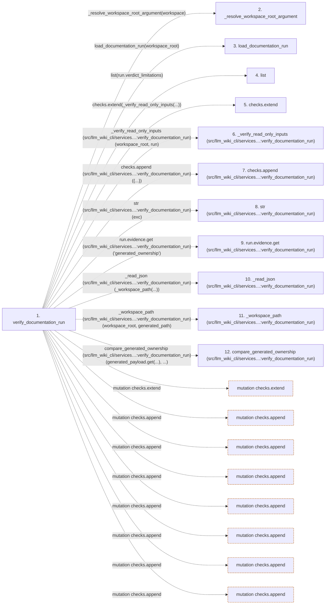

# verify_documentation_run

**Entry point:** `verify_documentation_run` (`api`)
**Source:** [verify](../modules/verify.md)
**Modules touched:** [documentation_policy](../modules/documentation_policy.md), [documentation_review](../modules/documentation_review.md), [documentation_run_contracts](../modules/documentation_run_contracts.md), and 13 more

**Complete modules touched:**

- [documentation_policy](../modules/documentation_policy.md)
- [documentation_review](../modules/documentation_review.md)
- [documentation_run_contracts](../modules/documentation_run_contracts.md)
- [documentation_wiki_input](../modules/documentation_wiki_input.md)
- [filesystem_guard](../modules/filesystem_guard.md)
- [integrity](../modules/integrity.md)
- [io](../modules/io.md)
- [knowledge_evidence](../modules/knowledge_evidence.md)
- [knowledge_storage](../modules/knowledge_storage.md)
- [knowledge_storage_io](../modules/knowledge_storage_io.md)
- [publication](../modules/publication.md)
- [publication_candidate](../modules/publication_candidate.md)
- [publication_delivery](../modules/publication_delivery.md)
- [validation](../modules/validation.md)
- [verify](../modules/verify.md)
- [workspace](../modules/workspace.md)

## Call sequence

> Static overview in presentation order, not runtime execution order. Arrows retain captured callers; representative internal continuations and boundary examples precede repeated helper detail.

```mermaid
sequenceDiagram
    participant p0 as verify_documentation_run
    participant p1 as reviewed_publication
    participant p2 as _verify_read_only_inputs (src/llm_wiki_cli/services…entation_run/integrity.py)
    participant p3 as capture_tree_baseline
    participant p4 as publication_packet
    participant p5 as DocumentationReviewLedger.from_dict (src/llm_wiki_cli/services/documentation_review.py)
    participant p6 as _documents
    participant p7 as _require_exact_fields (src/llm_wiki_cli/services/documentation_review.py)
    participant p8 as _verify_initial_integrity_anchors
    participant p9 as _hashes
    participant p10 as _required_bool
    participant p11 as _resolve_existing_directory
    participant p12 as _required_enum
    participant p13 as _walk_regular_files
    participant p14 as _hash_file
    participant p15 as _required_positive_int
    participant p16 as _required_non_negative_int
    participant p17 as DocumentationReviewFinding.from_dict
    participant p18 as _require_mapping
    participant p19 as DocumentationReviewPacket.from_dict
    participant p20 as SupervisorReconciliation.from_dict
    participant p21 as _validate_ledger
    participant p22 as _adopted_input_wiki_tree_hash
    participant p23 as fingerprint_documentation_wiki_input
    participant p24 as _read_tree
    participant p25 as require_exact_fields
    participant p26 as _required_json_text
    participant p27 as require_mapping
    participant p28 as require_positive_int
    participant p29 as isinstance (src/llm_wiki_cli/services….py:capture_tree_baseline)
    participant p30 as _resolve_workspace_root_argument
    p0->>p1: reviewed_publication
    p1->>p2: _verify_read_only_inputs (src/llm_wiki_cli/services…entation_run/integrity.py)
    p1->>p3: capture_tree_baseline
    p1->>p4: publication_packet
    p1->>p5: DocumentationReviewLedger.from_dict (src/llm_wiki_cli/services/documentation_review.py)
    p4->>p6: _documents
    p5->>p7: _require_exact_fields (src/llm_wiki_cli/services/documentation_review.py)
    p2->>p8: _verify_initial_integrity_anchors
    p4->>p9: _hashes
    p5->>p10: _required_bool
    p3->>p11: _resolve_existing_directory
    p5->>p12: _required_enum
    p3->>p13: _walk_regular_files
    p3->>p14: _hash_file
    p5->>p15: _required_positive_int
    p5->>p16: _required_non_negative_int
    p5->>p17: DocumentationReviewFinding.from_dict
    p5->>p18: _require_mapping
    p5->>p19: DocumentationReviewPacket.from_dict
    p5->>p20: SupervisorReconciliation.from_dict
    p5->>p21: _validate_ledger
    p2->>p22: _adopted_input_wiki_tree_hash
    p22->>p23: fingerprint_documentation_wiki_input
    p6->>p24: _read_tree
    p7->>p25: require_exact_fields
    p12->>p26: _required_json_text
    p18->>p27: require_mapping
    p15->>p28: require_positive_int
    p3-->>p29: isinstance (src/llm_wiki_cli/services….py:capture_tree_baseline)(value, bool)
    p0-->>p30: _resolve_workspace_root_argument(workspace)
```

<!-- Auto-generated from static call edges. Dashed arrows are external or unresolved calls. Reviewed runtime conditions and side effects belong in Behavior. -->

> Call sequence diagram shows 30 of 893 interactions; 863 omitted to keep the visualization within the 30-interaction and generated-diagram limits, with uncertain identities omitted rather than inferred.

> Captured boundary calls: external 1 of 189 (188 omitted); unresolved 1 of 342 (341 omitted). These counts cover the captured static trace.

Omitted captured detail, grouped by actual caller occurrence and target module:

| Caller | Parent step | Target module | Kind | Omitted interactions |
| --- | --- | --- | --- | --- |
| `src/llm_wiki_cli/services/documentation_run/verify.py:verify_documentation_run` | 1 | - | unresolved | 81 |
| `src/llm_wiki_cli/services/documentation_run/publication.py:reviewed_publication` | 35 | - | unresolved | 8 |
| `src/llm_wiki_cli/services/documentation_run/publication.py:reviewed_publication` | 35 | [src/llm_wiki_cli/services/documentation_run/contracts.py](../modules/documentation_run_contracts.md) | internal | 6 |
| `src/llm_wiki_cli/services/documentation_run/integrity.py:_verify_read_only_inputs` | 39 | - | unresolved | 37 |
| `src/llm_wiki_cli/services/documentation_run/integrity.py:_verify_initial_integrity_anchors` | 41 | - | unresolved | 82 |
| `src/llm_wiki_cli/services/documentation_run/integrity.py:_verify_initial_integrity_anchors` | 41 | [src/llm_wiki_cli/services/documentation_run/integrity.py](../modules/integrity.md) | internal | 3 |
| `src/llm_wiki_cli/services/documentation_run/integrity.py:_tree_hash_from_file_hashes` | 80 | - | unresolved | 13 |
| `src/llm_wiki_cli/services/documentation_run/integrity.py:compare_generated_ownership` | 133 | [src/llm_wiki_cli/services/documentation_run/integrity.py](../modules/integrity.md) | internal | 1 |
> Omission summary shows 8 of 172 groups; 164 further groups are not expanded here. Counts above include all omitted interactions.
> Detailed flow queries retain their own coverage and limits; omitted paths may execute at runtime.

> Trace truncated at the depth limit; deeper calls are omitted.

## Data flow

<!-- Auto-generated static analysis. Treat values and boundaries as best-effort hints, not runtime proof. -->

### Analysis coverage

**Effect analysis partially available.** Flow assembly and source effect analysis are separate; empty observations do not prove an empty handler body.

Source steps: 363; effect analysis evaluated: 240, partial: 4, unavailable: 119. Counts include steps omitted from the displayed trace.

Collector observations for 244 source steps with known totals: observed: 996, emitted: 987, omitted: 9. Unavailable totals are excluded.

- Callable record unavailable for one or more source steps; those steps have no represented callable body.
- Effect collector omitted observations before flow assembly; displayed effects are partial.
- Effect collector totals unavailable; observed counts cover captured records only.

| Step | Callable record | Effect analysis | Collector totals | Observed | Emitted | Omitted |
|---|---|---|---|---:|---:|---:|
| `verify_documentation_run` | `available` | `partial` | `available` | `18` | `13` | `5` |
| `_resolve_workspace_root_argument` | `not_applicable` | `not_applicable` | `not_applicable` | — | — | — |
| `load_documentation_run` | `not_applicable` | `not_applicable` | `not_applicable` | — | — | — |
| `list` | `not_applicable` | `not_applicable` | `not_applicable` | — | — | — |
| `checks.extend` | `not_applicable` | `not_applicable` | `not_applicable` | — | — | — |
| `_verify_read_only_inputs (src/llm_wiki_cli/services…:verify_documentation_run)` | `not_applicable` | `not_applicable` | `not_applicable` | — | — | — |
| `checks.append (src/llm_wiki_cli/services…:verify_documentation_run)` | `not_applicable` | `not_applicable` | `not_applicable` | — | — | — |
| `str (src/llm_wiki_cli/services…:verify_documentation_run)` | `not_applicable` | `not_applicable` | `not_applicable` | — | — | — |
| `run.evidence.get (src/llm_wiki_cli/services…:verify_documentation_run)` | `not_applicable` | `not_applicable` | `not_applicable` | — | — | — |
| `_read_json (src/llm_wiki_cli/services…:verify_documentation_run)` | `not_applicable` | `not_applicable` | `not_applicable` | — | — | — |
| `_workspace_path (src/llm_wiki_cli/services…:verify_documentation_run)` | `not_applicable` | `not_applicable` | `not_applicable` | — | — | — |
| `compare_generated_ownership (src/llm_wiki_cli/services…:verify_documentation_run)` | `not_applicable` | `not_applicable` | `not_applicable` | — | — | — |

### Step data

| Step | Inputs | Reads | Writes | Returns |
|---|---|---|---|---|
| `verify_documentation_run` | `workspace: str \| Path`, `advance: bool` | - | `run.evidence[...]`, `run.validation_results` | `report` |
| `_resolve_workspace_root_argument` | - | - | - | - |
| `load_documentation_run` | - | - | - | - |
| `list` | - | - | - | - |
| `checks.extend` | - | - | - | - |
| `_verify_read_only_inputs (src/llm_wiki_cli/services…:verify_documentation_run)` | - | - | - | - |
| `checks.append (src/llm_wiki_cli/services…:verify_documentation_run)` | - | - | - | - |
| `str (src/llm_wiki_cli/services…:verify_documentation_run)` | - | - | - | - |
| `run.evidence.get (src/llm_wiki_cli/services…:verify_documentation_run)` | - | - | - | - |
| `_read_json (src/llm_wiki_cli/services…:verify_documentation_run)` | - | - | - | - |
| `_workspace_path (src/llm_wiki_cli/services…:verify_documentation_run)` | - | - | - | - |
| `compare_generated_ownership (src/llm_wiki_cli/services…:verify_documentation_run)` | - | - | - | - |

### Call data

| From | To | Line | Call |
|---|---|---:|---|
| verify_documentation_run | _resolve_workspace_root_argument | 20 | `_resolve_workspace_root_argument(workspace)` |
| verify_documentation_run | load_documentation_run | 21 | `load_documentation_run(workspace_root)` |
| verify_documentation_run | list | 26 | `list(run.verdict_limitations)` |
| verify_documentation_run | checks.extend | 28 | `checks.extend(_verify_read_only_inputs(...))` |
| verify_documentation_run | _verify_read_only_inputs (src/llm_wiki_cli/services…:verify_documentation_run) | 28 | `_verify_read_only_inputs(workspace_root, run)` |
| verify_documentation_run | checks.append (src/llm_wiki_cli/services…:verify_documentation_run) | 30 | `checks.append({...})` |
| verify_documentation_run | str (src/llm_wiki_cli/services…:verify_documentation_run) | 30 | `str(exc)` |
| verify_documentation_run | run.evidence.get (src/llm_wiki_cli/services…:verify_documentation_run) | 32 | `run.evidence.get('generated_ownership')` |
| verify_documentation_run | _read_json (src/llm_wiki_cli/services…:verify_documentation_run) | 34 | `_read_json(_workspace_path(...))` |
| verify_documentation_run | _workspace_path (src/llm_wiki_cli/services…:verify_documentation_run) | 34 | `_workspace_path(workspace_root, generated_path)` |
| verify_documentation_run | compare_generated_ownership (src/llm_wiki_cli/services…:verify_documentation_run) | 35 | `compare_generated_ownership(generated_payload.get(...), ...)` |

### Boundary effects

| Kind | Target | Step | Line |
|---|---|---|---:|
| mutation | `checks.extend` | `verify_documentation_run` | 28 |
| mutation | `checks.append` | `verify_documentation_run` | 30 |
| mutation | `checks.append` | `verify_documentation_run` | 39 |
| mutation | `checks.append` | `verify_documentation_run` | 50 |
| mutation | `checks.append` | `verify_documentation_run` | 61 |
| mutation | `checks.append` | `verify_documentation_run` | 70 |
| mutation | `checks.append` | `verify_documentation_run` | 86 |
| mutation | `checks.append` | `verify_documentation_run` | 88 |

### Static analysis gaps

| Kind | Step | Target | Line |
|---|---|---|---:|
| unresolved_call | `verify_documentation_run` | `_resolve_workspace_root_argument` | 20 |
| unresolved_call | `verify_documentation_run` | `load_documentation_run` | 21 |
| unresolved_call | `verify_documentation_run` | `run.evidence.get` | 32 |
| unresolved_call | `verify_documentation_run` | `_read_json` | 34 |
| unresolved_call | `verify_documentation_run` | `_workspace_path` | 34 |
| unresolved_call | `verify_documentation_run` | `compare_generated_ownership` | 35 |
| step_limit | `verify_documentation_run` | `first 12 steps` | 0 |
| truncated_flow | `verify_documentation_run` | `depth limit` | 0 |

## Behavior

This flow starts at `verify_documentation_run` and is classified as `api`. The generated call and data-flow sections are bounded static projections; runtime conditions and side effects require source-level confirmation.
