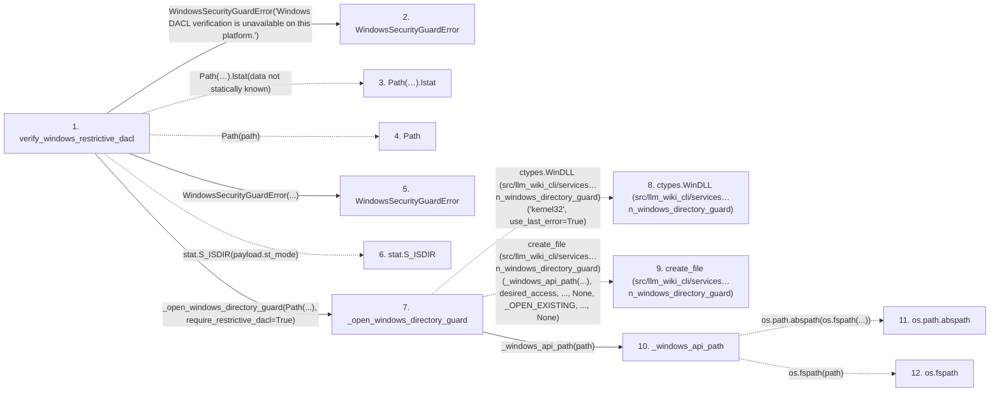

# verify_windows_restrictive_dacl

**Entry point:** `verify_windows_restrictive_dacl` (`api`)
**Source:** [filesystem_guard](../modules/filesystem_guard.md)
**Modules touched:** [filesystem_guard](../modules/filesystem_guard.md)

## Call sequence

> Static overview in presentation order, not runtime execution order. Arrows retain captured callers; siblings are shown before deeper helper detail.

```mermaid
sequenceDiagram
    participant p0 as verify_windows_restrictive_dacl
    participant p1 as WindowsSecurityGuardError
    participant p2 as Path(…).lstat
    participant p3 as Path
    participant p4 as stat.S_ISDIR
    participant p5 as _open_windows_directory_guard
    participant p6 as _close_windows_handle
    participant p7 as _open_windows_file_metadata_guard
    participant p8 as ctypes.WinDLL (src/llm_wiki_cli/services…n_windows_directory_guard)
    participant p9 as ctypes.WinDLL (src/llm_wiki_cli/services…ndows_file_metadata_guard)
    participant p10 as create_file (src/llm_wiki_cli/services…n_windows_directory_guard)
    participant p11 as create_file (src/llm_wiki_cli/services…ndows_file_metadata_guard)
    participant p12 as _windows_api_path
    participant p13 as wintypes.HANDLE (src/llm_wiki_cli/services…n_windows_directory_guard)
    participant p14 as wintypes.HANDLE (src/llm_wiki_cli/services…ndows_file_metadata_guard)
    participant p15 as ctypes.get_last_error (src/llm_wiki_cli/services…n_windows_directory_guard)
    participant p16 as ctypes.WinError (src/llm_wiki_cli/services…ndows_file_metadata_guard)
    participant p17 as ctypes.WinError (src/llm_wiki_cli/services…n_windows_directory_guard)
    participant p18 as ctypes.get_last_error (src/llm_wiki_cli/services…ndows_file_metadata_guard)
    participant p19 as _WindowsDirectoryGuardUnavailableError
    participant p20 as WindowsFileGuardError
    participant p21 as WindowsDirectoryGuardError
    participant p22 as int (src/llm_wiki_cli/services…ndows_file_metadata_guard)
    participant p23 as _ByHandleFileInformation (src/llm_wiki_cli/services…n_windows_directory_guard)
    participant p24 as _assert_windows_regular_file_handle
    participant p25 as get_information (src/llm_wiki_cli/services…n_windows_directory_guard)
    p0->>p1: WindowsSecurityGuardError
    p0-->>p2: Path(…).lstat
    p0-->>p3: Path(path)
    p0->>p1: WindowsSecurityGuardError
    p0-->>p4: stat.S_ISDIR(payload.st_mode)
    p0->>p5: _open_windows_directory_guard
    p0-->>p3: Path(path)
    p0->>p6: _close_windows_handle
    p0->>p7: _open_windows_file_metadata_guard
    p0-->>p3: Path(path)
    p0->>p6: _close_windows_handle
    p5-->>p8: ctypes.WinDLL (src/llm_wiki_cli/services…n_windows_directory_guard)('kernel32', use_last_error=True)
    p7-->>p9: ctypes.WinDLL (src/llm_wiki_cli/services…ndows_file_metadata_guard)('kernel32', use_last_error=True)
    p5-->>p10: create_file (src/llm_wiki_cli/services…n_windows_directory_guard)(_windows_api_path(...), desired_access, ..., None, _OPEN_EXISTING, ..., None)
    p7-->>p11: create_file (src/llm_wiki_cli/services…ndows_file_metadata_guard)(_windows_api_path(...), ..., ..., None, 3, 2097152, None)
    p5->>p12: _windows_api_path
    p7->>p12: _windows_api_path
    p5-->>p13: wintypes.HANDLE (src/llm_wiki_cli/services…n_windows_directory_guard)(...)
    p7-->>p14: wintypes.HANDLE (src/llm_wiki_cli/services…ndows_file_metadata_guard)(...)
    p5-->>p15: ctypes.get_last_error (src/llm_wiki_cli/services…n_windows_directory_guard)
    p7-->>p16: ctypes.WinError (src/llm_wiki_cli/services…ndows_file_metadata_guard)(ctypes.get_last_error(...))
    p5-->>p17: ctypes.WinError (src/llm_wiki_cli/services…n_windows_directory_guard)(error_number)
    p7-->>p18: ctypes.get_last_error (src/llm_wiki_cli/services…ndows_file_metadata_guard)
    p5->>p19: _WindowsDirectoryGuardUnavailableError
    p7->>p20: WindowsFileGuardError
    p5->>p21: WindowsDirectoryGuardError
    p7-->>p22: int (src/llm_wiki_cli/services…ndows_file_metadata_guard)(handle)
    p5-->>p23: _ByHandleFileInformation (src/llm_wiki_cli/services…n_windows_directory_guard)
    p7->>p24: _assert_windows_regular_file_handle
    p5-->>p25: get_information (src/llm_wiki_cli/services…n_windows_directory_guard)(handle, ctypes.byref(...))
```

<!-- Auto-generated from static call edges. Dashed arrows are external or unresolved calls. Reviewed runtime conditions and side effects belong in Behavior. -->

> Call sequence diagram shows 30 of 183 interactions; 153 omitted to keep the visualization within the 30-interaction and generated-diagram limits, with uncertain identities omitted rather than inferred.

> Captured boundary calls: external 13 of 114 (101 omitted); unresolved 5 of 22 (17 omitted). These counts cover the captured static trace.

Omitted captured detail, grouped by actual caller occurrence and target module:

| Caller | Parent step | Target module | Kind | Omitted interactions |
| --- | --- | --- | --- | --- |
| `src/llm_wiki_cli/services/filesystem_guard.py:_windows_api_path` | 10 | - | external | 2 |
| `src/llm_wiki_cli/services/filesystem_guard.py:_windows_api_path` | 10 | - | unresolved | 2 |
| `src/llm_wiki_cli/services/filesystem_guard.py:_open_windows_directory_guard` | 7 | - | external | 10 |
| `src/llm_wiki_cli/services/filesystem_guard.py:_open_windows_directory_guard` | 7 | [src/llm_wiki_cli/services/filesystem_guard.py](../modules/filesystem_guard.md) | internal | 6 |
| `src/llm_wiki_cli/services/filesystem_guard.py:_close_windows_handle` | 25 | - | external | 2 |
| `src/llm_wiki_cli/services/filesystem_guard.py:_close_windows_handle` | 25 | - | unresolved | 1 |
| `src/llm_wiki_cli/services/filesystem_guard.py:_verify_windows_handle_restrictive_dacl` | 35 | - | external | 50 |
| `src/llm_wiki_cli/services/filesystem_guard.py:_verify_windows_handle_restrictive_dacl` | 35 | - | unresolved | 5 |
> Omission summary shows 8 of 22 groups; 14 further groups are not expanded here. Counts above include all omitted interactions.
> Detailed flow queries retain their own coverage and limits; omitted paths may execute at runtime.

## Data flow

<!-- Auto-generated static analysis. Treat values and boundaries as best-effort hints, not runtime proof. -->

### Step data

| Step | Inputs | Reads | Writes | Returns |
|---|---|---|---|---|
| `verify_windows_restrictive_dacl` | `path: Path` | `os` | - | `none` |
| `WindowsSecurityGuardError` | - | - | - | - |
| `Path(…).lstat` | - | - | - | - |
| `Path` | - | - | - | - |
| `WindowsSecurityGuardError` | - | - | - | - |
| `stat.S_ISDIR` | - | - | - | - |
| `_open_windows_directory_guard` | `path: Path`, `require_restrictive_dacl: bool` | `_FILE_LIST_DIRECTORY`, `_FILE_READ_ATTRIBUTES`, `_READ_CONTROL`, `_FILE_SHARE_READ`, `_FILE_SHARE_WRITE`, `_OPEN_EXISTING`, `_FILE_FLAG_BACKUP_SEMANTICS`, `_FILE_FLAG_OPEN_REPARSE_POINT` | `create_file.argtypes`, `create_file.restype`, `get_information.argtypes`, `get_information.restype` | `int(...)` |
| `ctypes.WinDLL (src/llm_wiki_cli/services…n_windows_directory_guard)` | - | - | - | - |
| `create_file (src/llm_wiki_cli/services…n_windows_directory_guard)` | - | - | - | - |
| `_windows_api_path` | `path: Path` | - | - | `value`, `...`, `...` |
| `os.path.abspath` | - | - | - | - |
| `os.fspath` | - | - | - | - |

### Call data

| From | To | Line | Call |
|---|---|---:|---|
| verify_windows_restrictive_dacl | WindowsSecurityGuardError | 731 | `WindowsSecurityGuardError('Windows DACL verification is unavailable on this platform.')` |
| verify_windows_restrictive_dacl | Path(…).lstat | 734 | `Path(path).lstat(data not statically known)` |
| verify_windows_restrictive_dacl | Path | 734 | `Path(path)` |
| verify_windows_restrictive_dacl | WindowsSecurityGuardError | 736 | `WindowsSecurityGuardError(...)` |
| verify_windows_restrictive_dacl | stat.S_ISDIR | 739 | `stat.S_ISDIR(payload.st_mode)` |
| verify_windows_restrictive_dacl | _open_windows_directory_guard | 740 | `_open_windows_directory_guard(Path(...), require_restrictive_dacl=True)` |
| _open_windows_directory_guard | ctypes.WinDLL (src/llm_wiki_cli/services…n_windows_directory_guard) | 235 | `ctypes.WinDLL('kernel32', use_last_error=True)` |
| _open_windows_directory_guard | create_file (src/llm_wiki_cli/services…n_windows_directory_guard) | 259 | `create_file(_windows_api_path(...), desired_access, ..., None, _OPEN_EXISTING, ..., None)` |
| _open_windows_directory_guard | _windows_api_path | 260 | `_windows_api_path(path)` |
| _windows_api_path | os.path.abspath | 1310 | `os.path.abspath(os.fspath(...))` |
| _windows_api_path | os.fspath | 1310 | `os.fspath(path)` |

### Boundary effects

*No boundary effects detected.*

### Static analysis gaps

| Kind | Step | Target | Line |
|---|---|---|---:|
| unresolved_call | `verify_windows_restrictive_dacl` | `Path(path).lstat` | 734 |
| external_call | `verify_windows_restrictive_dacl` | `stat.S_ISDIR` | 739 |
| external_call | `_open_windows_directory_guard` | `ctypes.WinDLL` | 235 |
| unresolved_call | `_open_windows_directory_guard` | `create_file` | 259 |
| external_call | `_windows_api_path` | `os.path.abspath` | 1310 |
| external_call | `_windows_api_path` | `os.fspath` | 1310 |
| step_limit | `verify_windows_restrictive_dacl` | `first 12 steps` | 0 |

## Behavior

This flow starts at `verify_windows_restrictive_dacl` and is classified as `api`. The generated call and data-flow sections are bounded static projections; runtime conditions and side effects require source-level confirmation.
