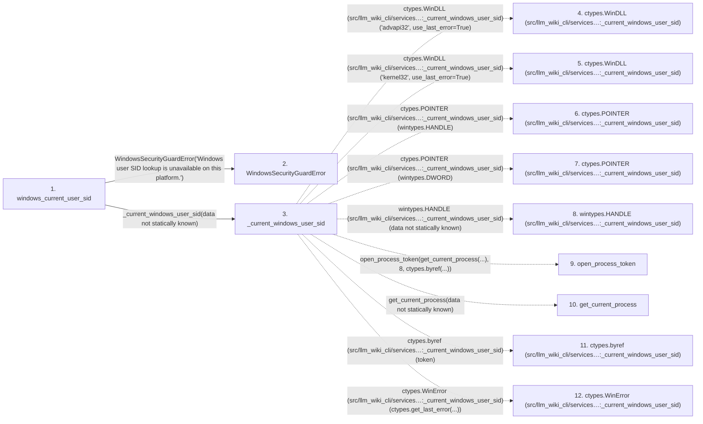

# windows_current_user_sid

**Entry point:** `windows_current_user_sid` (`api`)
**Source:** [filesystem_guard](../modules/filesystem_guard.md)
**Modules touched:** [filesystem_guard](../modules/filesystem_guard.md)

## Call sequence

> Static overview in presentation order, not runtime execution order. Arrows retain captured callers; representative internal continuations and boundary examples precede repeated helper detail.

```mermaid
sequenceDiagram
    participant p0 as windows_current_user_sid
    participant p1 as _current_windows_user_sid
    participant p2 as WindowsSecurityGuardError
    participant p3 as _windows_sid_string
    participant p4 as _close_windows_handle
    participant p5 as ctypes.WinDLL (src/llm_wiki_cli/services…:_current_windows_user_sid)
    participant p6 as open_process_token
    participant p7 as ctypes.POINTER (src/llm_wiki_cli/services…:_current_windows_user_sid)
    participant p8 as wintypes.HANDLE (src/llm_wiki_cli/services…:_current_windows_user_sid)
    participant p9 as get_current_process
    participant p10 as ctypes.byref (src/llm_wiki_cli/services…:_current_windows_user_sid)
    participant p11 as ctypes.WinError (src/llm_wiki_cli/services…:_current_windows_user_sid)
    participant p12 as ctypes.get_last_error (src/llm_wiki_cli/services…:_current_windows_user_sid)
    participant p13 as wintypes.DWORD
    participant p14 as get_token_information
    participant p15 as ctypes.create_string_buffer
    participant p16 as ctypes.cast (src/llm_wiki_cli/services…:_current_windows_user_sid)
    participant p17 as int
    participant p18 as ctypes.WinDLL (src/llm_wiki_cli/services…ard.py:_windows_sid_string)
    participant p19 as ctypes.WinDLL (src/llm_wiki_cli/services…d.py:_close_windows_handle)
    p0->>p1: _current_windows_user_sid
    p0->>p2: WindowsSecurityGuardError
    p1->>p3: _windows_sid_string
    p1->>p4: _close_windows_handle
    p1-->>p5: ctypes.WinDLL (src/llm_wiki_cli/services…:_current_windows_user_sid)('advapi32', use_last_error=True)
    p1-->>p6: open_process_token(get_current_process(...), 8, ctypes.byref(...))
    p1-->>p5: ctypes.WinDLL (src/llm_wiki_cli/services…:_current_windows_user_sid)('kernel32', use_last_error=True)
    p1-->>p7: ctypes.POINTER (src/llm_wiki_cli/services…:_current_windows_user_sid)(wintypes.HANDLE)
    p1-->>p7: ctypes.POINTER (src/llm_wiki_cli/services…:_current_windows_user_sid)(wintypes.DWORD)
    p1-->>p8: wintypes.HANDLE (src/llm_wiki_cli/services…:_current_windows_user_sid)
    p1-->>p9: get_current_process
    p1-->>p10: ctypes.byref (src/llm_wiki_cli/services…:_current_windows_user_sid)(token)
    p1-->>p11: ctypes.WinError (src/llm_wiki_cli/services…:_current_windows_user_sid)(ctypes.get_last_error(...))
    p1-->>p12: ctypes.get_last_error (src/llm_wiki_cli/services…:_current_windows_user_sid)
    p1-->>p13: wintypes.DWORD
    p1-->>p14: get_token_information(token, 1, None, 0, ctypes.byref(...))
    p1-->>p10: ctypes.byref (src/llm_wiki_cli/services…:_current_windows_user_sid)(required)
    p1-->>p11: ctypes.WinError (src/llm_wiki_cli/services…:_current_windows_user_sid)(ctypes.get_last_error(...))
    p1-->>p12: ctypes.get_last_error (src/llm_wiki_cli/services…:_current_windows_user_sid)
    p1-->>p15: ctypes.create_string_buffer(required.value)
    p1-->>p14: get_token_information(token, 1, buffer, required, ctypes.byref(...))
    p1-->>p10: ctypes.byref (src/llm_wiki_cli/services…:_current_windows_user_sid)(required)
    p1-->>p11: ctypes.WinError (src/llm_wiki_cli/services…:_current_windows_user_sid)(ctypes.get_last_error(...))
    p1-->>p12: ctypes.get_last_error (src/llm_wiki_cli/services…:_current_windows_user_sid)
    p1-->>p16: ctypes.cast (src/llm_wiki_cli/services…:_current_windows_user_sid)(buffer, ctypes.POINTER(...))
    p1-->>p7: ctypes.POINTER (src/llm_wiki_cli/services…:_current_windows_user_sid)(_TokenUser)
    p1-->>p17: int(token.value)
    p3-->>p18: ctypes.WinDLL (src/llm_wiki_cli/services…ard.py:_windows_sid_string)('advapi32', use_last_error=True)
    p4-->>p19: ctypes.WinDLL (src/llm_wiki_cli/services…d.py:_close_windows_handle)('kernel32', use_last_error=True)
    p3-->>p18: ctypes.WinDLL (src/llm_wiki_cli/services…ard.py:_windows_sid_string)('kernel32', use_last_error=True)
```

<!-- Auto-generated from static call edges. Dashed arrows are external or unresolved calls. Reviewed runtime conditions and side effects belong in Behavior. -->

> Call sequence diagram shows 30 of 45 interactions; 15 omitted to keep the visualization within the 30-interaction and generated-diagram limits, with uncertain identities omitted rather than inferred.

> Captured boundary calls: external 22 of 29 (7 omitted); unresolved 4 of 7 (3 omitted). These counts cover the captured static trace.

Omitted captured detail, grouped by actual caller occurrence and target module:

| Caller | Parent step | Target module | Kind | Omitted interactions |
| --- | --- | --- | --- | --- |
| `src/llm_wiki_cli/services/filesystem_guard.py:_current_windows_user_sid` | 3 | [src/llm_wiki_cli/services/filesystem_guard.py](../modules/filesystem_guard.md) | internal | 3 |
| `src/llm_wiki_cli/services/filesystem_guard.py:_windows_sid_string` | 29 | - | external | 6 |
| `src/llm_wiki_cli/services/filesystem_guard.py:_windows_sid_string` | 29 | - | unresolved | 2 |
| `src/llm_wiki_cli/services/filesystem_guard.py:_windows_sid_string` | 29 | [src/llm_wiki_cli/services/filesystem_guard.py](../modules/filesystem_guard.md) | internal | 2 |
| `src/llm_wiki_cli/services/filesystem_guard.py:_close_windows_handle` | 42 | - | unresolved | 1 |
| `src/llm_wiki_cli/services/filesystem_guard.py:_close_windows_handle` | 42 | - | external | 1 |
> Detailed flow queries retain their own coverage and limits; omitted paths may execute at runtime.

## Data flow

<!-- Auto-generated static analysis. Treat values and boundaries as best-effort hints, not runtime proof. -->

### Analysis coverage

**Effect analysis partially available.** Flow assembly and source effect analysis are separate; empty observations do not prove an empty handler body.

Source steps: 10; effect analysis evaluated: 4, partial: 0, unavailable: 6. Counts include steps omitted from the displayed trace.

Collector observations for 4 source steps with known totals: observed: 21, emitted: 21, omitted: 0. Unavailable totals are excluded.

- Callable record unavailable; the selected entry symbol has no represented callable body.
- Effect collector totals unavailable; observed counts cover captured records only.

| Step | Callable record | Effect analysis | Collector totals | Observed | Emitted | Omitted |
|---|---|---|---|---:|---:|---:|
| `windows_current_user_sid` | `available` | `evaluated` | `available` | `2` | `2` | `0` |
| `WindowsSecurityGuardError` | `unavailable` | `unavailable` | `unavailable` | — | — | — |
| `_current_windows_user_sid` | `available` | `evaluated` | `available` | `8` | `8` | `0` |
| `ctypes.WinDLL (src/llm_wiki_cli/services…:_current_windows_user_sid)` | `not_applicable` | `not_applicable` | `not_applicable` | — | — | — |
| `ctypes.WinDLL (src/llm_wiki_cli/services…:_current_windows_user_sid)` | `not_applicable` | `not_applicable` | `not_applicable` | — | — | — |
| `ctypes.POINTER (src/llm_wiki_cli/services…:_current_windows_user_sid)` | `not_applicable` | `not_applicable` | `not_applicable` | — | — | — |
| `ctypes.POINTER (src/llm_wiki_cli/services…:_current_windows_user_sid)` | `not_applicable` | `not_applicable` | `not_applicable` | — | — | — |
| `wintypes.HANDLE (src/llm_wiki_cli/services…:_current_windows_user_sid)` | `not_applicable` | `not_applicable` | `not_applicable` | — | — | — |
| `open_process_token` | `not_applicable` | `not_applicable` | `not_applicable` | — | — | — |
| `get_current_process` | `not_applicable` | `not_applicable` | `not_applicable` | — | — | — |
| `ctypes.byref (src/llm_wiki_cli/services…:_current_windows_user_sid)` | `not_applicable` | `not_applicable` | `not_applicable` | — | — | — |
| `ctypes.WinError (src/llm_wiki_cli/services…:_current_windows_user_sid)` | `not_applicable` | `not_applicable` | `not_applicable` | — | — | — |

### Step data

| Step | Inputs | Reads | Writes | Returns |
|---|---|---|---|---|
| `windows_current_user_sid` | - | `os` | - | `_current_windows_user_sid(...)` |
| `WindowsSecurityGuardError` | - | - | - | - |
| `_current_windows_user_sid` | - | `ctypes` | `open_process_token.argtypes`, `open_process_token.restype`, `get_token_information.argtypes`, `get_token_information.restype`, `get_current_process.argtypes`, `get_current_process.restype` | `_windows_sid_string(...)` |
| `ctypes.WinDLL (src/llm_wiki_cli/services…:_current_windows_user_sid)` | - | - | - | - |
| `ctypes.WinDLL (src/llm_wiki_cli/services…:_current_windows_user_sid)` | - | - | - | - |
| `ctypes.POINTER (src/llm_wiki_cli/services…:_current_windows_user_sid)` | - | - | - | - |
| `ctypes.POINTER (src/llm_wiki_cli/services…:_current_windows_user_sid)` | - | - | - | - |
| `wintypes.HANDLE (src/llm_wiki_cli/services…:_current_windows_user_sid)` | - | - | - | - |
| `open_process_token` | - | - | - | - |
| `get_current_process` | - | - | - | - |
| `ctypes.byref (src/llm_wiki_cli/services…:_current_windows_user_sid)` | - | - | - | - |
| `ctypes.WinError (src/llm_wiki_cli/services…:_current_windows_user_sid)` | - | - | - | - |

### Call data

| From | To | Line | Call |
|---|---|---:|---|
| windows_current_user_sid | WindowsSecurityGuardError | 754 | `WindowsSecurityGuardError('Windows user SID lookup is unavailable on this platform.')` |
| windows_current_user_sid | _current_windows_user_sid | 757 | `_current_windows_user_sid(data not statically known)` |
| _current_windows_user_sid | ctypes.WinDLL (src/llm_wiki_cli/services…:_current_windows_user_sid) | 1004 | `ctypes.WinDLL('advapi32', use_last_error=True)` |
| _current_windows_user_sid | ctypes.WinDLL (src/llm_wiki_cli/services…:_current_windows_user_sid) | 1005 | `ctypes.WinDLL('kernel32', use_last_error=True)` |
| _current_windows_user_sid | ctypes.POINTER (src/llm_wiki_cli/services…:_current_windows_user_sid) | 1010 | `ctypes.POINTER(wintypes.HANDLE)` |
| _current_windows_user_sid | ctypes.POINTER (src/llm_wiki_cli/services…:_current_windows_user_sid) | 1019 | `ctypes.POINTER(wintypes.DWORD)` |
| _current_windows_user_sid | wintypes.HANDLE (src/llm_wiki_cli/services…:_current_windows_user_sid) | 1026 | `wintypes.HANDLE(data not statically known)` |
| _current_windows_user_sid | open_process_token | 1027 | `open_process_token(get_current_process(...), 8, ctypes.byref(...))` |
| _current_windows_user_sid | get_current_process | 1028 | `get_current_process(data not statically known)` |
| _current_windows_user_sid | ctypes.byref (src/llm_wiki_cli/services…:_current_windows_user_sid) | 1030 | `ctypes.byref(token)` |
| _current_windows_user_sid | ctypes.WinError (src/llm_wiki_cli/services…:_current_windows_user_sid) | 1032 | `ctypes.WinError(ctypes.get_last_error(...))` |

### Boundary effects

*No boundary-effect observations were captured in this static trace.*

### Static analysis gaps

| Kind | Step | Target | Line |
|---|---|---|---:|
| external_call | `_current_windows_user_sid` | `ctypes.WinDLL` | 1004 |
| external_call | `_current_windows_user_sid` | `ctypes.WinDLL` | 1005 |
| external_call | `_current_windows_user_sid` | `ctypes.POINTER` | 1010 |
| external_call | `_current_windows_user_sid` | `ctypes.POINTER` | 1019 |
| external_call | `_current_windows_user_sid` | `wintypes.HANDLE` | 1026 |
| unresolved_call | `_current_windows_user_sid` | `open_process_token` | 1027 |
| unresolved_call | `_current_windows_user_sid` | `get_current_process` | 1028 |
| external_call | `_current_windows_user_sid` | `ctypes.byref` | 1030 |
| external_call | `_current_windows_user_sid` | `ctypes.WinError` | 1032 |
| step_limit | `windows_current_user_sid` | `first 12 steps` | 0 |

## Behavior

This flow starts at `windows_current_user_sid` and is classified as `api`. The generated call and data-flow sections are bounded static projections; runtime conditions and side effects require source-level confirmation.
