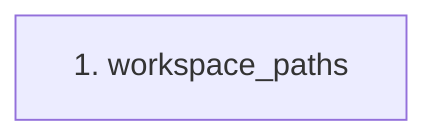

# workspace_paths

**Entry point:** `workspace_paths` (`api`)
**Source:** [documentation_run_contracts](../modules/documentation_run_contracts.md)
**Modules touched:** [documentation_run_contracts](../modules/documentation_run_contracts.md)

## Call sequence

> Static overview in presentation order, not runtime execution order. Arrows retain captured callers; representative internal continuations and boundary examples precede repeated helper detail.

<!-- Auto-generated from static call edges. Dashed arrows are external or unresolved calls. Reviewed runtime conditions and side effects belong in Behavior. -->
*No outbound call observations are available in this static trace.*

## Data flow

<!-- Auto-generated static analysis. Treat values and boundaries as best-effort hints, not runtime proof. -->

### Analysis coverage

**Effect analysis partially available.** Flow assembly and source effect analysis are separate; empty observations do not prove an empty handler body.

Source steps: 1; effect analysis evaluated: 0, partial: 1, unavailable: 0. Counts include steps omitted from the displayed trace.

Collector observations for 1 source steps with known totals: observed: 11, emitted: 9, omitted: 2. Unavailable totals are excluded.

- Effect collector omitted observations before flow assembly; displayed effects are partial.

| Step | Callable record | Effect analysis | Collector totals | Observed | Emitted | Omitted |
|---|---|---|---|---:|---:|---:|
| `workspace_paths` | `available` | `partial` | `available` | `11` | `9` | `2` |

### Step data

| Step | Inputs | Reads | Writes | Returns |
|---|---|---|---|---|
| `workspace_paths` | - | `RUN_CONTROL_DIR`, `RUN_CONTROL_DIR`, `RUN_FILENAME`, `RUN_CONTROL_DIR`, `POLICY_FILENAME`, `RUN_CONTROL_DIR`, `RUN_CONTROL_DIR`, `RUN_CONTROL_DIR` | - | `{...}` |

### Call data

*No call data transfers detected.*

### Boundary effects

*No boundary-effect observations were captured in this static trace.*

### Static analysis gaps

*No additional call-resolution gaps were captured; analysis coverage limitations above apply.*

## Behavior

This flow starts at `workspace_paths` and is classified as `api`. The generated call and data-flow sections are bounded static projections; runtime conditions and side effects require source-level confirmation.
