# write_verification_receipt

**Entry point:** `write_verification_receipt` (`api`)
**Source:** [verification_contracts](../modules/verification_contracts.md)
**Modules touched:** [io](../modules/io.md), [knowledge_evidence](../modules/knowledge_evidence.md), [validation](../modules/validation.md), [verification_contracts](../modules/verification_contracts.md), and 1 more

**Complete modules touched:**

- [io](../modules/io.md)
- [knowledge_evidence](../modules/knowledge_evidence.md)
- [validation](../modules/validation.md)
- [verification_contracts](../modules/verification_contracts.md)
- [wiki_write_basis](../modules/wiki_write_basis.md)

## Call sequence

> Static overview in presentation order, not runtime execution order. Arrows retain captured callers; siblings are shown before deeper helper detail.

```mermaid
sequenceDiagram
    participant p0 as write_verification_receipt
    participant p1 as serialize_verification_receipt
    participant p2 as Path (src/llm_wiki_cli/services…rite_verification_receipt)
    participant p3 as first_unsafe_path_component
    participant p4 as VerificationReceiptError
    participant p5 as root.is_symlink
    participant p6 as root.is_dir
    participant p7 as verification_receipt_path
    participant p8 as path.is_symlink
    participant p9 as path.exists
    participant p10 as path.is_file
    participant p11 as write_bytes_atomic
    participant p12 as formatted_json_bytes
    participant p13 as Path (src/llm_wiki_cli/services…rst_unsafe_path_component)
    participant p14 as Path (src/llm_wiki_cli/services…verification_receipt_path)
    participant p15 as isinstance (src/llm_wiki_cli/services/io.py:write_bytes_atomic)
    participant p16 as verification_receipt_to_payload
    participant p17 as os.fspath
    participant p18 as TypeError
    participant p19 as len (src/llm_wiki_cli/services…lize_verification_receipt)
    participant p20 as Path (src/llm_wiki_cli/services/io.py:write_bytes_atomic)
    participant p21 as os.path.abspath
    participant p22 as before_wiki_write
    participant p23 as lexical.is_absolute
    participant p24 as target.parent.mkdir
    p0->>p1: serialize_verification_receipt
    p0-->>p2: Path (src/llm_wiki_cli/services…rite_verification_receipt)(wiki_dir)
    p0->>p3: first_unsafe_path_component
    p0->>p4: VerificationReceiptError
    p0-->>p5: root.is_symlink
    p0->>p4: VerificationReceiptError
    p0-->>p6: root.is_dir
    p0->>p4: VerificationReceiptError
    p0->>p7: verification_receipt_path
    p0-->>p8: path.is_symlink
    p0->>p4: VerificationReceiptError
    p0-->>p9: path.exists
    p0-->>p10: path.is_file
    p0->>p4: VerificationReceiptError
    p0->>p11: write_bytes_atomic
    p1->>p12: formatted_json_bytes
    p3-->>p13: Path (src/llm_wiki_cli/services…rst_unsafe_path_component)(os.fspath(...))
    p7-->>p14: Path (src/llm_wiki_cli/services…verification_receipt_path)(wiki_dir)
    p11-->>p15: isinstance (src/llm_wiki_cli/services/io.py:write_bytes_atomic)(content, bytes)
    p1->>p16: verification_receipt_to_payload
    p3-->>p17: os.fspath(path)
    p11-->>p18: TypeError('content must be bytes')
    p1-->>p19: len (src/llm_wiki_cli/services…lize_verification_receipt)(content)
    p3-->>p13: Path (src/llm_wiki_cli/services…rst_unsafe_path_component)(os.path.abspath(...))
    p11-->>p20: Path (src/llm_wiki_cli/services/io.py:write_bytes_atomic)(path)
    p1->>p4: VerificationReceiptError
    p3-->>p21: os.path.abspath(lexical)
    p11->>p22: before_wiki_write
    p3-->>p23: lexical.is_absolute
    p11-->>p24: target.parent.mkdir(parents=True, exist_ok=True)
```

<!-- Auto-generated from static call edges. Dashed arrows are external or unresolved calls. Reviewed runtime conditions and side effects belong in Behavior. -->

> Call sequence diagram shows 30 of 220 interactions; 190 omitted to keep the visualization within the 30-interaction and generated-diagram limits, with uncertain identities omitted rather than inferred.

> Captured boundary calls: external 10 of 78 (68 omitted); unresolved 7 of 34 (27 omitted). These counts cover the captured static trace.

Omitted captured detail, grouped by actual caller occurrence and target module:

| Caller | Parent step | Target module | Kind | Omitted interactions |
| --- | --- | --- | --- | --- |
| `src/llm_wiki_cli/services/knowledge_evidence.py:formatted_json_bytes` | 3 | - | unresolved | 1 |
| `src/llm_wiki_cli/services/knowledge_evidence.py:formatted_json_bytes` | 3 | [src/llm_wiki_cli/services/knowledge_evidence.py](../modules/knowledge_evidence.md) | internal | 1 |
| `src/llm_wiki_cli/services/knowledge_evidence.py:formatted_json_text` | 5 | - | external | 1 |
| `src/llm_wiki_cli/services/verification_contracts.py:verification_receipt_to_payload` | 7 | [src/llm_wiki_cli/services/verification_contracts.py](../modules/verification_contracts.md) | internal | 2 |
| `src/llm_wiki_cli/services/verification_contracts.py:validate_verification_receipt` | 8 | - | external | 7 |
| `src/llm_wiki_cli/services/verification_contracts.py:validate_verification_receipt` | 8 | [src/llm_wiki_cli/services/verification_contracts.py](../modules/verification_contracts.md) | internal | 25 |
| `src/llm_wiki_cli/services/verification_contracts.py:_receipt_to_payload` | 10 | - | external | 2 |
| `src/llm_wiki_cli/services/verification_contracts.py:_receipt_to_payload` | 10 | - | unresolved | 1 |
> Omission summary shows 8 of 63 groups; 55 further groups are not expanded here. Counts above include all omitted interactions.
> Detailed flow queries retain their own coverage and limits; omitted paths may execute at runtime.

> Trace truncated at the depth limit; deeper calls are omitted.

## Data flow

```mermaid
flowchart LR
    s1["1. write_verification_receipt"]
    s2["2. serialize_verification_receipt"]
    s3["3. formatted_json_bytes"]
    s4["4. formatted_json_text(…).encode"]
    s5["5. formatted_json_text"]
    s6["6. json.dumps"]
    s7["7. verification_receipt_to_payload"]
    s8["8. validate_verification_receipt"]
    s9["9. isinstance (src/llm_wiki_cli/services…date_verification_receipt)"]
    s10["10. _receipt_to_payload"]
    s11["11. dict (src/llm_wiki_cli/services…ts.py:_receipt_to_payload)"]
    s12["12. dict (src/llm_wiki_cli/services…ts.py:_receipt_to_payload)"]
    s1 -->|"serialize_verification_receipt(receipt)"| s2
    s2 -->|"formatted_json_bytes(verification_receipt_to_payload(...))"| s3
    s3 -. "formatted_json_text(…).encode('utf-8')" .-> s4
    s3 -->|"formatted_json_text(value)"| s5
    s5 -. "json.dumps(value, ensure_ascii=False, indent=2, sort_keys=True, allow_nan=False)" .-> s6
    s2 -->|"verification_receipt_to_payload(value)"| s7
    s7 -->|"validate_verification_receipt(value)"| s8
    s8 -. "isinstance (src/llm_wiki_cli/services…date_verification_receipt)(value, VerificationReceipt)" .-> s9
    s8 -->|"_receipt_to_payload(value)"| s10
    s10 -. "dict (src/llm_wiki_cli/services…ts.py:_receipt_to_payload)(receipt.evidence)" .-> s11
    s10 -. "dict (src/llm_wiki_cli/services…ts.py:_receipt_to_payload)(receipt.evaluated_snapshot)" .-> s12
    click s1 "../modules/verification_contracts.md"
    click s2 "../modules/verification_contracts.md"
    click s3 "../modules/knowledge_evidence.md"
    click s5 "../modules/knowledge_evidence.md"
    click s7 "../modules/verification_contracts.md"
    click s8 "../modules/verification_contracts.md"
    click s10 "../modules/verification_contracts.md"
```

<!-- Auto-generated static analysis. Treat values and boundaries as best-effort hints, not runtime proof. -->

### Step data

| Step | Inputs | Reads | Writes | Returns |
|---|---|---|---|---|
| `write_verification_receipt` | `wiki_dir: str \| Path`, `receipt: VerificationReceipt \| object` | `VERIFICATION_RECEIPT_FILENAME`, `VERIFICATION_RECEIPT_FILENAME` | - | `path` |
| `serialize_verification_receipt` | `value: VerificationReceipt \| object` | `MAX_RECEIPT_BYTES` | - | `content` |
| `formatted_json_bytes` | `value: Any` | - | - | `...` |
| `formatted_json_text(…).encode` | - | - | - | - |
| `formatted_json_text` | `value: Any` | - | - | `...` |
| `json.dumps` | - | - | - | - |
| `verification_receipt_to_payload` | `value: VerificationReceipt \| object` | - | - | `_receipt_to_payload(...)` |
| `validate_verification_receipt` | `value: VerificationReceipt \| object` | `VerificationReceipt`, `VERIFICATION_RECEIPT_SCHEMA_VERSION`, `VERIFICATION_RECEIPT_SCHEMA_VERSION`, `VerificationContractError`, `MAX_CHECKS_PER_RECEIPT` | - | `VerificationReceipt(...)` |
| `isinstance (src/llm_wiki_cli/services…date_verification_receipt)` | - | - | - | - |
| `_receipt_to_payload` | `receipt: VerificationReceipt` | - | - | `{...}` |
| `dict (src/llm_wiki_cli/services…ts.py:_receipt_to_payload)` | - | - | - | - |
| `dict (src/llm_wiki_cli/services…ts.py:_receipt_to_payload)` | - | - | - | - |

### Call data

| From | To | Line | Call |
|---|---|---:|---|
| write_verification_receipt | serialize_verification_receipt | 981 | `serialize_verification_receipt(receipt)` |
| serialize_verification_receipt | formatted_json_bytes | 790 | `formatted_json_bytes(verification_receipt_to_payload(...))` |
| formatted_json_bytes | formatted_json_text(…).encode | 193 | `formatted_json_text(value).encode('utf-8')` |
| formatted_json_bytes | formatted_json_text | 193 | `formatted_json_text(value)` |
| formatted_json_text | json.dumps | 179 | `json.dumps(value, ensure_ascii=False, indent=2, sort_keys=True, allow_nan=False)` |
| serialize_verification_receipt | verification_receipt_to_payload | 790 | `verification_receipt_to_payload(value)` |
| verification_receipt_to_payload | validate_verification_receipt | 781 | `validate_verification_receipt(value)` |
| validate_verification_receipt | isinstance (src/llm_wiki_cli/services…date_verification_receipt) | 806 | `isinstance(value, VerificationReceipt)` |
| validate_verification_receipt | _receipt_to_payload | 805 | `_receipt_to_payload(value)` |
| _receipt_to_payload | dict (src/llm_wiki_cli/services…ts.py:_receipt_to_payload) | 1101 | `dict(receipt.evidence)` |
| _receipt_to_payload | dict (src/llm_wiki_cli/services…ts.py:_receipt_to_payload) | 1103 | `dict(receipt.evaluated_snapshot)` |

### Boundary effects

*No boundary effects detected.*

### Static analysis gaps

| Kind | Step | Target | Line |
|---|---|---|---:|
| unresolved_call | `formatted_json_bytes` | `formatted_json_text(value).encode` | 193 |
| external_call | `formatted_json_text` | `json.dumps` | 179 |
| external_call | `validate_verification_receipt` | `isinstance` | 806 |
| step_limit | `write_verification_receipt` | `first 12 steps` | 0 |
| truncated_flow | `write_verification_receipt` | `depth limit` | 0 |

## Behavior

This flow starts at `write_verification_receipt` and is classified as `api`. The generated call and data-flow sections are bounded static projections; runtime conditions and side effects require source-level confirmation.
