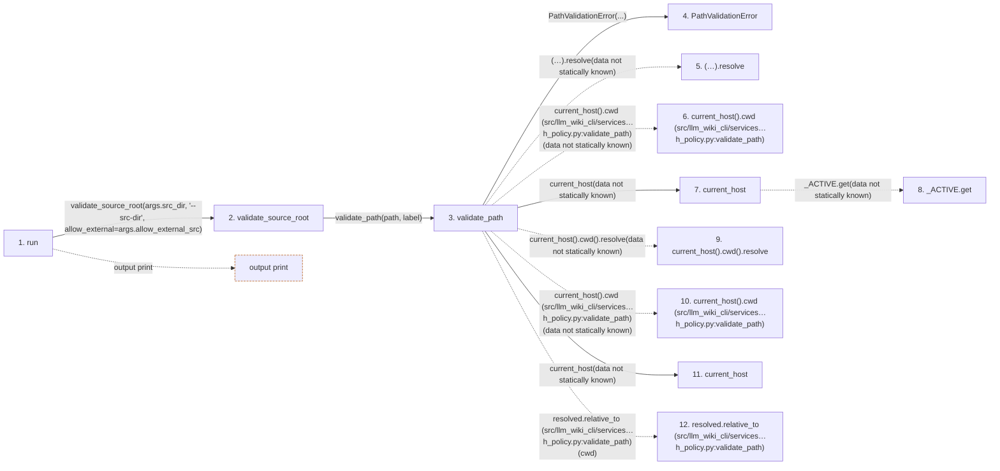

# api-diff

**Entry point:** `run` (`cli`)
**Source:** [api_diff_cmd](../modules/api_diff_cmd.md)
**Modules touched:** [api_contracts](../modules/api_contracts.md), [api_diff](../modules/api_diff.md), [api_diff_cmd](../modules/api_diff_cmd.md), [filesystem_guard](../modules/filesystem_guard.md), and 4 more

**Complete modules touched:**

- [api_contracts](../modules/api_contracts.md)
- [api_diff](../modules/api_diff.md)
- [api_diff_cmd](../modules/api_diff_cmd.md)
- [filesystem_guard](../modules/filesystem_guard.md)
- [host](../modules/host.md)
- [io](../modules/io.md)
- [path_policy](../modules/path_policy.md)
- [source_selection](../modules/source_selection.md)

## Call sequence

> Static overview in presentation order, not runtime execution order. Arrows retain captured callers; representative internal continuations and boundary examples precede repeated helper detail.

```mermaid
sequenceDiagram
    participant p0 as run
    participant p1 as validate_source_root
    participant p2 as compare_openapi
    participant p3 as render_markdown
    participant p4 as validate_path
    participant p5 as compare_exports
    participant p6 as load_openapi_document
    participant p7 as windows_current_user_sid
    participant p8 as first_unsafe_path_component
    participant p9 as _openapi_operations
    participant p10 as _resolve_openapi_path
    participant p11 as _current_windows_user_sid
    participant p12 as _normalization_diagnostics
    participant p13 as _key
    participant p14 as _body_requirements
    participant p15 as compare_exports.<locals>.identity
    participant p16 as _raw_operation
    participant p17 as _dereference
    participant p18 as _requirements
    participant p19 as _openapi_parameter
    participant p20 as path_is_selected
    participant p21 as _path_contains_link_or_reparse
    participant p22 as _windows_sid_string
    participant p23 as _openapi_request_body
    participant p24 as _openapi_responses
    participant p25 as _selection_path
    participant p26 as path_is_link_or_reparse
    participant p27 as _schema_name
    participant p28 as ApiContractError
    participant p29 as print
    participant p30 as html.escape(…).replace
    p0->>p1: validate_source_root
    p0->>p2: compare_openapi
    p0->>p3: render_markdown
    p1->>p4: validate_path
    p2->>p5: compare_exports
    p2->>p6: load_openapi_document
    p1->>p7: windows_current_user_sid
    p1->>p8: first_unsafe_path_component
    p5->>p9: _openapi_operations
    p6->>p10: _resolve_openapi_path
    p7->>p11: _current_windows_user_sid
    p5->>p12: _normalization_diagnostics
    p5->>p13: _key
    p5->>p14: _body_requirements
    p5->>p15: compare_exports.<locals>.identity
    p14->>p16: _raw_operation
    p9->>p17: _dereference
    p14->>p18: _requirements
    p9->>p19: _openapi_parameter
    p10->>p20: path_is_selected
    p10->>p21: _path_contains_link_or_reparse
    p11->>p22: _windows_sid_string
    p9->>p23: _openapi_request_body
    p9->>p24: _openapi_responses
    p20->>p25: _selection_path
    p21->>p26: path_is_link_or_reparse
    p19->>p27: _schema_name
    p2->>p28: ApiContractError
    p0-->>p29: print(..., end=...)
    p3-->>p30: html.escape(…).replace('\n', ' ')
```

<!-- Auto-generated from static call edges. Dashed arrows are external or unresolved calls. Reviewed runtime conditions and side effects belong in Behavior. -->

> Call sequence diagram shows 30 of 505 interactions; 475 omitted to keep the visualization within the 30-interaction and generated-diagram limits, with uncertain identities omitted rather than inferred.

> Captured boundary calls: external 1 of 204 (203 omitted); unresolved 1 of 188 (187 omitted). These counts cover the captured static trace.

Omitted captured detail, grouped by actual caller occurrence and target module:

| Caller | Parent step | Target module | Kind | Omitted interactions |
| --- | --- | --- | --- | --- |
| `src/llm_wiki_cli/services/path_policy.py:validate_path` | 3 | [src/llm_wiki_cli/services/path_policy.py](../modules/path_policy.md) | internal | 2 |
| `src/llm_wiki_cli/services/path_policy.py:validate_path` | 3 | - | unresolved | 5 |
| `src/llm_wiki_cli/services/path_policy.py:validate_path` | 3 | [src/llm_wiki_engine/host.py](../modules/host.md) | internal | 2 |
| `src/llm_wiki_engine/host.py:current_host` | 7 | - | unresolved | 1 |
| `src/llm_wiki_cli/services/path_policy.py:validate_source_root` | 2 | - | unresolved | 6 |
| `src/llm_wiki_cli/services/path_policy.py:validate_source_root` | 2 | - | external | 10 |
| `src/llm_wiki_cli/services/path_policy.py:validate_source_root` | 2 | [src/llm_wiki_engine/host.py](../modules/host.md) | internal | 1 |
| `src/llm_wiki_cli/services/path_policy.py:validate_source_root` | 2 | [src/llm_wiki_cli/services/path_policy.py](../modules/path_policy.md) | internal | 6 |
> Omission summary shows 8 of 89 groups; 81 further groups are not expanded here. Counts above include all omitted interactions.
> Detailed flow queries retain their own coverage and limits; omitted paths may execute at runtime.

> Trace truncated at the depth limit; deeper calls are omitted.

## Data flow

<!-- Auto-generated static analysis. Treat values and boundaries as best-effort hints, not runtime proof. -->

### Analysis coverage

**Effect analysis partially available.** Flow assembly and source effect analysis are separate; empty observations do not prove an empty handler body.

Source steps: 114; effect analysis evaluated: 77, partial: 3, unavailable: 34. Counts include steps omitted from the displayed trace.

Collector observations for 80 source steps with known totals: observed: 621, emitted: 618, omitted: 3. Unavailable totals are excluded.

- Callable record unavailable for one or more source steps; those steps have no represented callable body.
- Effect collector omitted observations before flow assembly; displayed effects are partial.
- Effect collector totals unavailable; observed counts cover captured records only.

| Step | Callable record | Effect analysis | Collector totals | Observed | Emitted | Omitted |
|---|---|---|---|---:|---:|---:|
| `run` | `available` | `evaluated` | `available` | `2` | `2` | `0` |
| `validate_source_root` | `available` | `evaluated` | `available` | `9` | `9` | `0` |
| `validate_path` | `available` | `evaluated` | `available` | `3` | `3` | `0` |
| `PathValidationError` | `unavailable` | `unavailable` | `unavailable` | — | — | — |
| `(…).resolve` | `not_applicable` | `not_applicable` | `not_applicable` | — | — | — |
| `current_host().cwd (src/llm_wiki_cli/services…h_policy.py:validate_path)` | `not_applicable` | `not_applicable` | `not_applicable` | — | — | — |
| `current_host` | `available` | `evaluated` | `available` | `2` | `2` | `0` |
| `_ACTIVE.get` | `not_applicable` | `not_applicable` | `not_applicable` | — | — | — |
| `current_host().cwd().resolve` | `not_applicable` | `not_applicable` | `not_applicable` | — | — | — |
| `current_host().cwd (src/llm_wiki_cli/services…h_policy.py:validate_path)` | `not_applicable` | `not_applicable` | `not_applicable` | — | — | — |
| `current_host` | `available` | `evaluated` | `available` | `2` | `2` | `0` |
| `resolved.relative_to (src/llm_wiki_cli/services…h_policy.py:validate_path)` | `not_applicable` | `not_applicable` | `not_applicable` | — | — | — |

### Step data

| Step | Inputs | Reads | Writes | Returns |
|---|---|---|---|---|
| `run` | `args` | - | - | - |
| `validate_source_root` | `path: str`, `label: str`, `allow_external: bool` | `sys`, `os`, `WindowsSecurityGuardError`, `sys` | - | `validate_path(...)`, `resolved` |
| `validate_path` | `path: str`, `label: str` | - | - | `resolved` |
| `PathValidationError` | - | - | - | - |
| `(…).resolve` | - | - | - | - |
| `current_host().cwd (src/llm_wiki_cli/services…h_policy.py:validate_path)` | - | - | - | - |
| `current_host` | - | `_DEFAULT` | - | `...` |
| `_ACTIVE.get` | - | - | - | - |
| `current_host().cwd().resolve` | - | - | - | - |
| `current_host().cwd (src/llm_wiki_cli/services…h_policy.py:validate_path)` | - | - | - | - |
| `current_host` | - | `_DEFAULT` | - | `...` |
| `resolved.relative_to (src/llm_wiki_cli/services…h_policy.py:validate_path)` | - | - | - | - |

### Call data

| From | To | Line | Call |
|---|---|---:|---|
| run | validate_source_root | 10 | `validate_source_root(args.src_dir, '--src-dir', allow_external=args.allow_external_src)` |
| validate_source_root | validate_path | 125 | `validate_path(path, label)` |
| validate_path | PathValidationError | 100 | `PathValidationError(...)` |
| validate_path | (…).resolve | 101 | `(current_host().cwd() / path).resolve(data not statically known)` |
| validate_path | current_host().cwd (src/llm_wiki_cli/services…h_policy.py:validate_path) | 101 | `current_host().cwd(data not statically known)` |
| validate_path | current_host | 101 | `current_host(data not statically known)` |
| current_host | _ACTIVE.get | 166 | `_ACTIVE.get(data not statically known)` |
| validate_path | current_host().cwd().resolve | 102 | `current_host().cwd().resolve(data not statically known)` |
| validate_path | current_host().cwd (src/llm_wiki_cli/services…h_policy.py:validate_path) | 102 | `current_host().cwd(data not statically known)` |
| validate_path | current_host | 102 | `current_host(data not statically known)` |
| validate_path | resolved.relative_to (src/llm_wiki_cli/services…h_policy.py:validate_path) | 104 | `resolved.relative_to(cwd)` |

### Boundary effects

| Kind | Target | Step | Line |
|---|---|---|---:|
| output | `print` | `run` | 14 |

### Static analysis gaps

| Kind | Step | Target | Line |
|---|---|---|---:|
| unresolved_call | `validate_path` | `(current_host().cwd() / path).resolve` | 101 |
| unresolved_call | `validate_path` | `current_host().cwd` | 101 |
| unresolved_call | `current_host` | `_ACTIVE.get` | 166 |
| unresolved_call | `validate_path` | `current_host().cwd().resolve` | 102 |
| unresolved_call | `validate_path` | `current_host().cwd` | 102 |
| unresolved_call | `validate_path` | `resolved.relative_to` | 104 |
| step_limit | `run` | `first 12 steps` | 0 |
| truncated_flow | `run` | `depth limit` | 0 |

## Behavior

This flow starts at `run` and is classified as `cli`. The generated call and data-flow sections are bounded static projections; runtime conditions and side effects require source-level confirmation.
