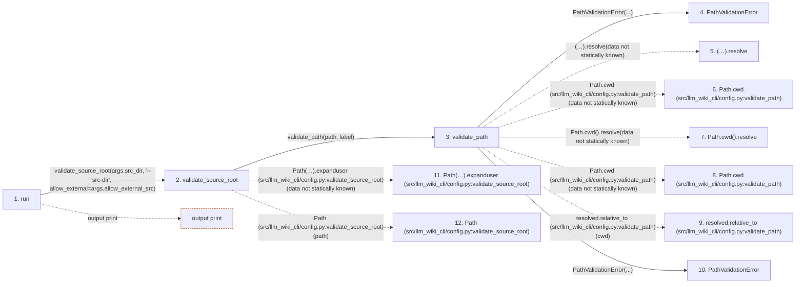

# api-diff

**Entry point:** `run` (`cli`)
**Source:** [api_diff_cmd](../modules/api_diff_cmd.md)
**Modules touched:** [api_contracts](../modules/api_contracts.md), [api_diff](../modules/api_diff.md), [api_diff_cmd](../modules/api_diff_cmd.md), [config](../modules/config.md), and 3 more

**Complete modules touched:**

- [api_contracts](../modules/api_contracts.md)
- [api_diff](../modules/api_diff.md)
- [api_diff_cmd](../modules/api_diff_cmd.md)
- [config](../modules/config.md)
- [filesystem_guard](../modules/filesystem_guard.md)
- [io](../modules/io.md)
- [source_selection](../modules/source_selection.md)

## Call sequence

> Static overview in presentation order, not runtime execution order. Arrows retain captured callers; representative internal continuations and boundary examples precede repeated helper detail.

```mermaid
sequenceDiagram
    participant p0 as run
    participant p1 as validate_source_root
    participant p2 as compare_openapi
    participant p3 as render_markdown
    participant p4 as validate_path
    participant p5 as compare_exports
    participant p6 as load_openapi_document
    participant p7 as windows_current_user_sid
    participant p8 as _openapi_operations
    participant p9 as _resolve_openapi_path
    participant p10 as _current_windows_user_sid
    participant p11 as _normalization_diagnostics
    participant p12 as _key
    participant p13 as _body_requirements
    participant p14 as compare_exports.<locals>.identity
    participant p15 as _raw_operation
    participant p16 as _dereference
    participant p17 as _requirements
    participant p18 as _openapi_parameter
    participant p19 as path_is_selected
    participant p20 as _path_contains_link_or_reparse
    participant p21 as _windows_sid_string
    participant p22 as _openapi_request_body
    participant p23 as _openapi_responses
    participant p24 as _selection_path
    participant p25 as path_is_link_or_reparse
    participant p26 as _schema_name
    participant p27 as ApiContractError
    participant p28 as PathValidationError
    participant p29 as print
    participant p30 as html.escape(…).replace
    p0->>p1: validate_source_root
    p0->>p2: compare_openapi
    p0->>p3: render_markdown
    p1->>p4: validate_path
    p2->>p5: compare_exports
    p2->>p6: load_openapi_document
    p1->>p7: windows_current_user_sid
    p5->>p8: _openapi_operations
    p6->>p9: _resolve_openapi_path
    p7->>p10: _current_windows_user_sid
    p5->>p11: _normalization_diagnostics
    p5->>p12: _key
    p5->>p13: _body_requirements
    p5->>p14: compare_exports.<locals>.identity
    p13->>p15: _raw_operation
    p8->>p16: _dereference
    p13->>p17: _requirements
    p8->>p18: _openapi_parameter
    p9->>p19: path_is_selected
    p9->>p20: _path_contains_link_or_reparse
    p10->>p21: _windows_sid_string
    p8->>p22: _openapi_request_body
    p8->>p23: _openapi_responses
    p19->>p24: _selection_path
    p20->>p25: path_is_link_or_reparse
    p18->>p26: _schema_name
    p2->>p27: ApiContractError
    p1->>p28: PathValidationError
    p0-->>p29: print(..., end=...)
    p3-->>p30: html.escape(…).replace('\n', ' ')
```

<!-- Auto-generated from static call edges. Dashed arrows are external or unresolved calls. Reviewed runtime conditions and side effects belong in Behavior. -->

> Call sequence diagram shows 30 of 500 interactions; 470 omitted to keep the visualization within the 30-interaction and generated-diagram limits, with uncertain identities omitted rather than inferred.

> Captured boundary calls: external 1 of 208 (207 omitted); unresolved 1 of 183 (182 omitted). These counts cover the captured static trace.

Omitted captured detail, grouped by actual caller occurrence and target module:

| Caller | Parent step | Target module | Kind | Omitted interactions |
| --- | --- | --- | --- | --- |
| `src/llm_wiki_cli/config.py:validate_path` | 3 | [src/llm_wiki_cli/config.py](../modules/config.md) | internal | 2 |
| `src/llm_wiki_cli/config.py:validate_path` | 3 | - | unresolved | 3 |
| `src/llm_wiki_cli/config.py:validate_path` | 3 | - | external | 2 |
| `src/llm_wiki_cli/config.py:validate_source_root` | 2 | - | unresolved | 5 |
| `src/llm_wiki_cli/config.py:validate_source_root` | 2 | - | external | 11 |
| `src/llm_wiki_cli/config.py:validate_source_root` | 2 | [src/llm_wiki_cli/config.py](../modules/config.md) | internal | 5 |
| `src/llm_wiki_cli/services/filesystem_guard.py:windows_current_user_sid` | 21 | [src/llm_wiki_cli/services/filesystem_guard.py](../modules/filesystem_guard.md) | internal | 1 |
| `src/llm_wiki_cli/services/filesystem_guard.py:_current_windows_user_sid` | 23 | - | external | 19 |
> Omission summary shows 8 of 87 groups; 79 further groups are not expanded here. Counts above include all omitted interactions.
> Detailed flow queries retain their own coverage and limits; omitted paths may execute at runtime.

> Trace truncated at the depth limit; deeper calls are omitted.

## Data flow

<!-- Auto-generated static analysis. Treat values and boundaries as best-effort hints, not runtime proof. -->

### Analysis coverage

**Effect analysis partially available.** Flow assembly and source effect analysis are separate; empty observations do not prove an empty handler body.

Source steps: 110; effect analysis evaluated: 73, partial: 3, unavailable: 34. Counts include steps omitted from the displayed trace.

Collector observations for 76 source steps with known totals: observed: 613, emitted: 610, omitted: 3. Unavailable totals are excluded.

- Callable record unavailable for one or more source steps; those steps have no represented callable body.
- Effect collector omitted observations before flow assembly; displayed effects are partial.
- Effect collector totals unavailable; observed counts cover captured records only.

| Step | Callable record | Effect analysis | Collector totals | Observed | Emitted | Omitted |
|---|---|---|---|---:|---:|---:|
| `run` | `available` | `evaluated` | `available` | `2` | `2` | `0` |
| `validate_source_root` | `available` | `evaluated` | `available` | `9` | `9` | `0` |
| `validate_path` | `available` | `evaluated` | `available` | `3` | `3` | `0` |
| `PathValidationError` | `unavailable` | `unavailable` | `unavailable` | — | — | — |
| `(…).resolve` | `not_applicable` | `not_applicable` | `not_applicable` | — | — | — |
| `Path.cwd (src/llm_wiki_cli/config.py:validate_path)` | `not_applicable` | `not_applicable` | `not_applicable` | — | — | — |
| `Path.cwd().resolve` | `not_applicable` | `not_applicable` | `not_applicable` | — | — | — |
| `Path.cwd (src/llm_wiki_cli/config.py:validate_path)` | `not_applicable` | `not_applicable` | `not_applicable` | — | — | — |
| `resolved.relative_to (src/llm_wiki_cli/config.py:validate_path)` | `not_applicable` | `not_applicable` | `not_applicable` | — | — | — |
| `PathValidationError` | `unavailable` | `unavailable` | `unavailable` | — | — | — |
| `Path(…).expanduser (src/llm_wiki_cli/config.py:validate_source_root)` | `not_applicable` | `not_applicable` | `not_applicable` | — | — | — |
| `Path (src/llm_wiki_cli/config.py:validate_source_root)` | `not_applicable` | `not_applicable` | `not_applicable` | — | — | — |

### Step data

| Step | Inputs | Reads | Writes | Returns |
|---|---|---|---|---|
| `run` | `args` | - | - | - |
| `validate_source_root` | `path: str`, `label: str`, `allow_external: bool` | `sys`, `os`, `WindowsSecurityGuardError`, `sys` | - | `validate_path(...)`, `resolved` |
| `validate_path` | `path: str`, `label: str` | - | - | `resolved` |
| `PathValidationError` | - | - | - | - |
| `(…).resolve` | - | - | - | - |
| `Path.cwd (src/llm_wiki_cli/config.py:validate_path)` | - | - | - | - |
| `Path.cwd().resolve` | - | - | - | - |
| `Path.cwd (src/llm_wiki_cli/config.py:validate_path)` | - | - | - | - |
| `resolved.relative_to (src/llm_wiki_cli/config.py:validate_path)` | - | - | - | - |
| `PathValidationError` | - | - | - | - |
| `Path(…).expanduser (src/llm_wiki_cli/config.py:validate_source_root)` | - | - | - | - |
| `Path (src/llm_wiki_cli/config.py:validate_source_root)` | - | - | - | - |

### Call data

| From | To | Line | Call |
|---|---|---:|---|
| run | validate_source_root | 10 | `validate_source_root(args.src_dir, '--src-dir', allow_external=args.allow_external_src)` |
| validate_source_root | validate_path | 160 | `validate_path(path, label)` |
| validate_path | PathValidationError | 134 | `PathValidationError(...)` |
| validate_path | (…).resolve | 135 | `(Path.cwd() / path).resolve(data not statically known)` |
| validate_path | Path.cwd (src/llm_wiki_cli/config.py:validate_path) | 135 | `Path.cwd(data not statically known)` |
| validate_path | Path.cwd().resolve | 136 | `Path.cwd().resolve(data not statically known)` |
| validate_path | Path.cwd (src/llm_wiki_cli/config.py:validate_path) | 136 | `Path.cwd(data not statically known)` |
| validate_path | resolved.relative_to (src/llm_wiki_cli/config.py:validate_path) | 138 | `resolved.relative_to(cwd)` |
| validate_path | PathValidationError | 140 | `PathValidationError(...)` |
| validate_source_root | Path(…).expanduser (src/llm_wiki_cli/config.py:validate_source_root) | 163 | `Path(path).expanduser(data not statically known)` |
| validate_source_root | Path (src/llm_wiki_cli/config.py:validate_source_root) | 163 | `Path(path)` |

### Boundary effects

| Kind | Target | Step | Line |
|---|---|---|---:|
| output | `print` | `run` | 14 |

### Static analysis gaps

| Kind | Step | Target | Line |
|---|---|---|---:|
| unresolved_call | `validate_path` | `(Path.cwd() / path).resolve` | 135 |
| external_call | `validate_path` | `Path.cwd` | 135 |
| unresolved_call | `validate_path` | `Path.cwd().resolve` | 136 |
| external_call | `validate_path` | `Path.cwd` | 136 |
| unresolved_call | `validate_path` | `resolved.relative_to` | 138 |
| unresolved_call | `validate_source_root` | `Path(path).expanduser` | 163 |
| step_limit | `run` | `first 12 steps` | 0 |
| truncated_flow | `run` | `depth limit` | 0 |

## Behavior

This flow starts at `run` and is classified as `cli`. The generated call and data-flow sections are bounded static projections; runtime conditions and side effects require source-level confirmation.
