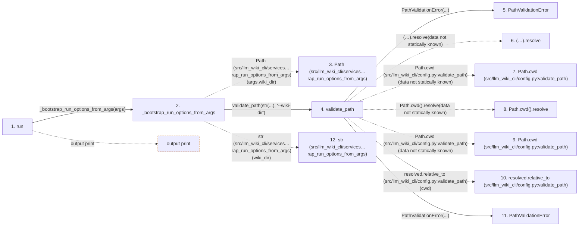

# bootstrap

**Entry point:** `run` (`cli`)
**Source:** [bootstrap_runtime](../modules/bootstrap_runtime.md)
**Modules touched:** [api_contracts](../modules/api_contracts.md), [bootstrap_recovery](../modules/bootstrap_recovery.md), [bootstrap_runtime](../modules/bootstrap_runtime.md), and 52 more

**Complete modules touched:**

- [api_contracts](../modules/api_contracts.md)
- [bootstrap_recovery](../modules/bootstrap_recovery.md)
- [bootstrap_runtime](../modules/bootstrap_runtime.md)
- [bootstrap_service](../modules/bootstrap_service.md)
- [common](../modules/common.md)
- [config](../modules/config.md)
- [current_contracts](../modules/current_contracts.md)
- [data_flow](../modules/data_flow.md)
- [entrypoints](../modules/entrypoints.md)
- [extraction_service](../modules/extraction_service.md)
- [filesystem_guard](../modules/filesystem_guard.md)
- [flow_overview](../modules/flow_overview.md)
- [imports](../modules/imports.md)
- [infrastructure_inventory](../modules/infrastructure_inventory.md)
- [infrastructure_sync](../modules/infrastructure_sync.md)
- [io](../modules/io.md)
- [knowledge_artifacts](../modules/knowledge_artifacts.md)
- [knowledge_consumption](../modules/knowledge_consumption.md)
- [knowledge_envelope](../modules/knowledge_envelope.md)
- [knowledge_evidence](../modules/knowledge_evidence.md)
- [knowledge_governance](../modules/knowledge_governance.md)
- [knowledge_loader](../modules/knowledge_loader.md)
- [knowledge_orchestration](../modules/knowledge_orchestration.md)
- [knowledge_packs](../modules/knowledge_packs.md)
- [knowledge_reuse](../modules/knowledge_reuse.md)
- [knowledge_storage](../modules/knowledge_storage.md)
- [knowledge_storage_io](../modules/knowledge_storage_io.md)
- [knowledge_storage_lifecycle](../modules/knowledge_storage_lifecycle.md)
- [knowledge_verification](../modules/knowledge_verification.md)
- [maintenance_evidence](../modules/maintenance_evidence.md)
- [maintenance_projection](../modules/maintenance_projection.md)
- [maintenance_protocol](../modules/maintenance_protocol.md)
- [maintenance_service](../modules/maintenance_service.md)
- [maintenance_shapes](../modules/maintenance_shapes.md)
- [maintenance_state](../modules/maintenance_state.md)
- [manifest_storage](../modules/manifest_storage.md)
- [markdown_sections](../modules/markdown_sections.md)
- [module_maps](../modules/module_maps.md)
- [paths](../modules/paths.md)
- [python_calls](../modules/python_calls.md)
- [python_imports](../modules/python_imports.md)
- [relationships](../modules/relationships.md)
- [services_dependencies](../modules/services_dependencies.md)
- [services_schema](../modules/services_schema.md)
- [source_selection](../modules/source_selection.md)
- [source_snapshot](../modules/source_snapshot.md)
- [sync_manifest](../modules/sync_manifest.md)
- [validation](../modules/validation.md)
- [wiki_lifecycle](../modules/wiki_lifecycle.md)
- [wiki_media](../modules/wiki_media.md)
- [wiki_surface](../modules/wiki_surface.md)
- [wiki_surface_index](../modules/wiki_surface_index.md)
- [wiki_write_basis](../modules/wiki_write_basis.md)
- [yaml_formats](../modules/yaml_formats.md)
- [yaml_syntax](../modules/yaml_syntax.md)

## Call sequence

> Static overview in presentation order, not runtime execution order. Arrows retain captured callers; representative internal continuations and boundary examples precede repeated helper detail.

```mermaid
sequenceDiagram
    participant p0 as run
    participant p1 as _bootstrap_run_options_from_args
    participant p2 as _execute_bootstrap_options
    participant p3 as pending_bootstrap
    participant p4 as validate_path
    participant p5 as guard_maintenance_owner
    participant p6 as _preflight_public_bootstrap
    participant p7 as validate_source_root
    participant p8 as maintenance_write_operation
    participant p9 as bootstrap_write_operation
    participant p10 as _preflight_bootstrap_source_selection
    participant p11 as _execute_bootstrap_options_locked
    participant p12 as _load_record
    participant p13 as _preflight_bootstrap_governance
    participant p14 as _first_use_guidance
    participant p15 as guard_incomplete_bootstrap
    participant p16 as _is_pristine_bootstrap_target
    participant p17 as resolve_source_selection
    participant p18 as load_adoption_marker
    participant p19 as governance_writer_lock
    participant p20 as validate_persisted_source_selection_identity
    participant p21 as _start_bootstrap
    participant p22 as SyncManifest.load
    participant p23 as storage_writer_lock
    participant p24 as _extract_bootstrap_inventory
    participant p25 as _recover
    participant p26 as snapshot_wiki
    participant p27 as _finish_if_empty_bootstrap_inventory
    participant p28 as _bootstrap_result
    participant p29 as SystemExit
    participant p30 as (…).resolve
    p0->>p1: _bootstrap_run_options_from_args
    p0->>p2: _execute_bootstrap_options
    p2->>p3: pending_bootstrap
    p1->>p4: validate_path
    p2->>p5: guard_maintenance_owner
    p2->>p6: _preflight_public_bootstrap
    p1->>p7: validate_source_root
    p2->>p8: maintenance_write_operation
    p2->>p9: bootstrap_write_operation
    p2->>p10: _preflight_bootstrap_source_selection
    p2->>p11: _execute_bootstrap_options_locked
    p3->>p12: _load_record
    p11->>p13: _preflight_bootstrap_governance
    p6->>p14: _first_use_guidance
    p5->>p15: guard_incomplete_bootstrap
    p6->>p16: _is_pristine_bootstrap_target
    p10->>p17: resolve_source_selection
    p5->>p18: load_adoption_marker
    p8->>p19: governance_writer_lock
    p10->>p20: validate_persisted_source_selection_identity
    p11->>p21: _start_bootstrap
    p5->>p22: SyncManifest.load
    p8->>p23: storage_writer_lock
    p11->>p24: _extract_bootstrap_inventory
    p9->>p25: _recover
    p8->>p26: snapshot_wiki
    p11->>p27: _finish_if_empty_bootstrap_inventory
    p11->>p28: _bootstrap_result
    p0-->>p29: SystemExit(1)
    p4-->>p30: (…).resolve
```

<!-- Auto-generated from static call edges. Dashed arrows are external or unresolved calls. Reviewed runtime conditions and side effects belong in Behavior. -->

> Call sequence diagram shows 30 of 3476 interactions; 3446 omitted to keep the visualization within the 30-interaction and generated-diagram limits, with uncertain identities omitted rather than inferred.

> Captured boundary calls: external 1 of 1181 (1180 omitted); unresolved 1 of 995 (994 omitted). These counts cover the captured static trace.

Omitted captured detail, grouped by actual caller occurrence and target module:

| Caller | Parent step | Target module | Kind | Omitted interactions |
| --- | --- | --- | --- | --- |
| `src/llm_wiki_cli/services/bootstrap_runtime.py:_bootstrap_run_options_from_args` | 2 | - | external | 19 |
| `src/llm_wiki_cli/config.py:validate_path` | 4 | [src/llm_wiki_cli/config.py](../modules/config.md) | internal | 2 |
| `src/llm_wiki_cli/config.py:validate_path` | 4 | - | external | 2 |
| `src/llm_wiki_cli/config.py:validate_path` | 4 | - | unresolved | 2 |
| `src/llm_wiki_cli/config.py:validate_source_root` | 13 | [src/llm_wiki_cli/config.py](../modules/config.md) | internal | 7 |
| `src/llm_wiki_cli/config.py:validate_source_root` | 13 | - | unresolved | 5 |
| `src/llm_wiki_cli/config.py:validate_source_root` | 13 | - | external | 11 |
| `src/llm_wiki_cli/config.py:validate_source_root` | 13 | [src/llm_wiki_cli/services/filesystem_guard.py](../modules/filesystem_guard.md) | internal | 1 |
> Omission summary shows 8 of 766 groups; 758 further groups are not expanded here. Counts above include all omitted interactions.
> Detailed flow queries retain their own coverage and limits; omitted paths may execute at runtime.

> Trace truncated at the depth limit; deeper calls are omitted.

## Data flow

<!-- Auto-generated static analysis. Treat values and boundaries as best-effort hints, not runtime proof. -->

### Step data

| Step | Inputs | Reads | Writes | Returns |
|---|---|---|---|---|
| `run` | `args` | `BootstrapExtractionError`, `BootstrapContractError`, `sys` | - | - |
| `_bootstrap_run_options_from_args` | `args` | `sys`, `sys` | - | `_BootstrapRunOptions(...)` |
| `Path (src/llm_wiki_cli/services…rap_run_options_from_args)` | - | - | - | - |
| `validate_path` | `path: str`, `label: str` | - | - | `resolved` |
| `PathValidationError` | - | - | - | - |
| `(…).resolve` | - | - | - | - |
| `Path.cwd (src/llm_wiki_cli/config.py:validate_path)` | - | - | - | - |
| `Path.cwd().resolve` | - | - | - | - |
| `Path.cwd (src/llm_wiki_cli/config.py:validate_path)` | - | - | - | - |
| `resolved.relative_to (src/llm_wiki_cli/config.py:validate_path)` | - | - | - | - |
| `PathValidationError` | - | - | - | - |
| `str (src/llm_wiki_cli/services…rap_run_options_from_args)` | - | - | - | - |

### Call data

| From | To | Line | Call |
|---|---|---:|---|
| run | _bootstrap_run_options_from_args | 6610 | `_bootstrap_run_options_from_args(args)` |
| _bootstrap_run_options_from_args | Path (src/llm_wiki_cli/services…rap_run_options_from_args) | 4620 | `Path(args.wiki_dir)` |
| _bootstrap_run_options_from_args | validate_path | 4621 | `validate_path(str(...), '--wiki-dir')` |
| validate_path | PathValidationError | 134 | `PathValidationError(...)` |
| validate_path | (…).resolve | 135 | `(Path.cwd() / path).resolve(data not statically known)` |
| validate_path | Path.cwd (src/llm_wiki_cli/config.py:validate_path) | 135 | `Path.cwd(data not statically known)` |
| validate_path | Path.cwd().resolve | 136 | `Path.cwd().resolve(data not statically known)` |
| validate_path | Path.cwd (src/llm_wiki_cli/config.py:validate_path) | 136 | `Path.cwd(data not statically known)` |
| validate_path | resolved.relative_to (src/llm_wiki_cli/config.py:validate_path) | 138 | `resolved.relative_to(cwd)` |
| validate_path | PathValidationError | 140 | `PathValidationError(...)` |
| _bootstrap_run_options_from_args | str (src/llm_wiki_cli/services…rap_run_options_from_args) | 4621 | `str(wiki_dir)` |

### Boundary effects

| Kind | Target | Step | Line |
|---|---|---|---:|
| output | `print` | `run` | 6616 |

### Static analysis gaps

| Kind | Step | Target | Line |
|---|---|---|---:|
| unresolved_call | `validate_path` | `(Path.cwd() / path).resolve` | 135 |
| external_call | `validate_path` | `Path.cwd` | 135 |
| unresolved_call | `validate_path` | `Path.cwd().resolve` | 136 |
| external_call | `validate_path` | `Path.cwd` | 136 |
| unresolved_call | `validate_path` | `resolved.relative_to` | 138 |
| step_limit | `run` | `first 12 steps` | 0 |
| truncated_flow | `run` | `depth limit` | 0 |

## Behavior

Validates first-use options and the source/wiki boundaries, then delegates to
the deterministic bootstrap service. The target must be empty or the untouched
init scaffold; existing managed or custom content is rejected before
extraction. A successful run writes the selected wiki surfaces and consistent
generated artifacts, then prints either progress text or the structured
bootstrap result.
