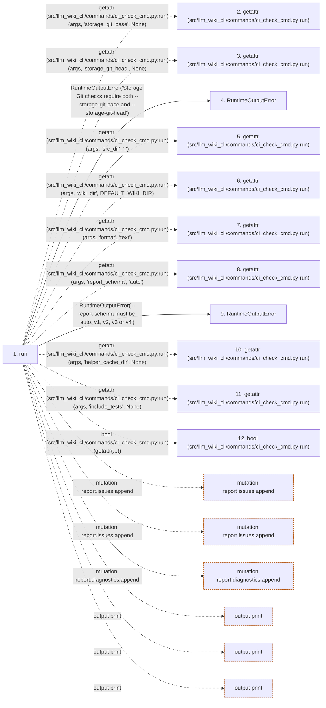

# ci-check

**Entry point:** `run` (`cli`)
**Source:** [ci_check_cmd](../modules/ci_check_cmd.md)
**Modules touched:** [analysis_capture](../modules/analysis_capture.md), [analysis_compatibility](../modules/analysis_compatibility.md), [bootstrap_recovery](../modules/bootstrap_recovery.md), and 80 more

**Complete modules touched:**

- [analysis_capture](../modules/analysis_capture.md)
- [analysis_compatibility](../modules/analysis_compatibility.md)
- [bootstrap_recovery](../modules/bootstrap_recovery.md)
- [bootstrap_runtime](../modules/bootstrap_runtime.md)
- [canonical_pages](../modules/canonical_pages.md)
- [ci_check_cmd](../modules/ci_check_cmd.md)
- [ci_report](../modules/ci_report.md)
- [common](../modules/common.md)
- [config](../modules/config.md)
- [current_contracts](../modules/current_contracts.md)
- [data_flow](../modules/data_flow.md)
- [dependency_versions](../modules/dependency_versions.md)
- [dockerfile_parser](../modules/dockerfile_parser.md)
- [doctor_service](../modules/doctor_service.md)
- [documentation_queries](../modules/documentation_queries.md)
- [entrypoints](../modules/entrypoints.md)
- [evidence_diagnostics](../modules/evidence_diagnostics.md)
- [extraction_jobs](../modules/extraction_jobs.md)
- [extraction_service](../modules/extraction_service.md)
- [filesystem_guard](../modules/filesystem_guard.md)
- [flow_followup](../modules/flow_followup.md)
- [go_calls](../modules/go_calls.md)
- [health_contract](../modules/health_contract.md)
- [health_details](../modules/health_details.md)
- [health_policy](../modules/health_policy.md)
- [health_summary](../modules/health_summary.md)
- [immutable](../modules/immutable.md)
- [implementation_evidence](../modules/implementation_evidence.md)
- [imports](../modules/imports.md)
- [infrastructure_inventory](../modules/infrastructure_inventory.md)
- [infrastructure_sync](../modules/infrastructure_sync.md)
- [inventory_cache](../modules/inventory_cache.md)
- [io](../modules/io.md)
- [knowledge_artifacts](../modules/knowledge_artifacts.md)
- [knowledge_consumption](../modules/knowledge_consumption.md)
- [knowledge_envelope](../modules/knowledge_envelope.md)
- [knowledge_evidence](../modules/knowledge_evidence.md)
- [knowledge_freshness](../modules/knowledge_freshness.md)
- [knowledge_generation](../modules/knowledge_generation.md)
- [knowledge_governance](../modules/knowledge_governance.md)
- [knowledge_graph](../modules/knowledge_graph.md)
- [knowledge_loader](../modules/knowledge_loader.md)
- [knowledge_model](../modules/knowledge_model.md)
- [knowledge_observability](../modules/knowledge_observability.md)
- [knowledge_orchestration](../modules/knowledge_orchestration.md)
- [knowledge_packs](../modules/knowledge_packs.md)
- [knowledge_storage](../modules/knowledge_storage.md)
- [knowledge_storage_diagnostics](../modules/knowledge_storage_diagnostics.md)
- [knowledge_storage_io](../modules/knowledge_storage_io.md)
- [knowledge_storage_lifecycle](../modules/knowledge_storage_lifecycle.md)
- [knowledge_verification](../modules/knowledge_verification.md)
- [lint_service](../modules/lint_service.md)
- [maintenance_protocol](../modules/maintenance_protocol.md)
- [maintenance_state](../modules/maintenance_state.md)
- [maintenance_status](../modules/maintenance_status.md)
- [manifest_storage](../modules/manifest_storage.md)
- [metrics](../modules/metrics.md)
- [module_coverage](../modules/module_coverage.md)
- [packages](../modules/packages.md)
- [plugins](../modules/plugins.md)
- [progress](../modules/progress.md)
- [python_calls](../modules/python_calls.md)
- [python_contracts](../modules/python_contracts.md)
- [python_extractor](../modules/python_extractor.md)
- [python_implementation](../modules/python_implementation.md)
- [python_imports](../modules/python_imports.md)
- [python_observations](../modules/python_observations.md)
- [runtime_output](../modules/runtime_output.md)
- [services_dependencies](../modules/services_dependencies.md)
- [source_retirement](../modules/source_retirement.md)
- [source_selection](../modules/source_selection.md)
- [source_snapshot](../modules/source_snapshot.md)
- [sync_analysis](../modules/sync_analysis.md)
- [sync_manifest](../modules/sync_manifest.md)
- [team](../modules/team.md)
- [validation](../modules/validation.md)
- [verification_contracts](../modules/verification_contracts.md)
- [wiki_lifecycle](../modules/wiki_lifecycle.md)
- [wiki_media](../modules/wiki_media.md)
- [wiki_surface](../modules/wiki_surface.md)
- [wiki_write_basis](../modules/wiki_write_basis.md)
- [yaml_formats](../modules/yaml_formats.md)
- [yaml_syntax](../modules/yaml_syntax.md)

## Call sequence

> Static overview in presentation order, not runtime execution order. Arrows retain captured callers; representative internal continuations and boundary examples precede repeated helper detail.

```mermaid
sequenceDiagram
    participant p0 as run
    participant p1 as validate_source_root
    participant p2 as cache_options_from_args
    participant p3 as _report_destination
    participant p4 as prepare_cache_options
    participant p5 as extraction_job_request_from_args
    participant p6 as build_report
    participant p7 as storage_report
    participant p8 as _persist_report
    participant p9 as record_validation_event
    participant p10 as RuntimeOutputError
    participant p11 as validate_path
    participant p12 as LintIssue
    participant p13 as InventoryCacheStats
    participant p14 as _render_console
    participant p15 as format_cache_stats
    participant p16 as write_bytes_atomic
    participant p17 as _safe_knowledge_summary
    participant p18 as record_event
    participant p19 as resolve_inventory_cache_path
    participant p20 as _new_lint_report
    participant p21 as _storage_report
    participant p22 as _preflight_lint_inputs
    participant p23 as _finalize_lint_report
    participant p24 as _collect_lint_inputs
    participant p25 as prepare_destination
    participant p26 as _run_report_checks
    participant p27 as windows_current_user_sid
    participant p28 as resolve_team_policy
    participant p29 as getattr (src/llm_wiki_cli/commands/ci_check_cmd.py:run)
    participant p30 as storage.get
    p0->>p1: validate_source_root
    p0->>p2: cache_options_from_args
    p0->>p3: _report_destination
    p0->>p4: prepare_cache_options
    p0->>p5: extraction_job_request_from_args
    p0->>p6: build_report
    p0->>p7: storage_report
    p0->>p8: _persist_report
    p0->>p9: record_validation_event
    p0->>p10: RuntimeOutputError
    p0->>p11: validate_path
    p0->>p12: LintIssue
    p0->>p13: InventoryCacheStats
    p0->>p14: _render_console
    p0->>p15: format_cache_stats
    p8->>p16: write_bytes_atomic
    p9->>p17: _safe_knowledge_summary
    p9->>p18: record_event
    p4->>p19: resolve_inventory_cache_path
    p6->>p20: _new_lint_report
    p7->>p21: _storage_report
    p6->>p22: _preflight_lint_inputs
    p6->>p23: _finalize_lint_report
    p6->>p24: _collect_lint_inputs
    p3->>p25: prepare_destination
    p6->>p26: _run_report_checks
    p1->>p27: windows_current_user_sid
    p22->>p28: resolve_team_policy
    p0-->>p29: getattr (src/llm_wiki_cli/commands/ci_check_cmd.py:run)(args, 'storage_git_base', None)
    p0-->>p30: storage.get('failures', [...])
```

<!-- Auto-generated from static call edges. Dashed arrows are external or unresolved calls. Reviewed runtime conditions and side effects belong in Behavior. -->

> Call sequence diagram shows 30 of 4584 interactions; 4554 omitted to keep the visualization within the 30-interaction and generated-diagram limits, with uncertain identities omitted rather than inferred.

> Captured boundary calls: external 1 of 1397 (1396 omitted); unresolved 1 of 1402 (1401 omitted). These counts cover the captured static trace.

Omitted captured detail, grouped by actual caller occurrence and target module:

| Caller | Parent step | Target module | Kind | Omitted interactions |
| --- | --- | --- | --- | --- |
| `src/llm_wiki_cli/commands/ci_check_cmd.py:run` | 1 | - | external | 30 |
| `src/llm_wiki_cli/commands/ci_check_cmd.py:run` | 1 | [src/llm_wiki_cli/services/runtime_output.py](../modules/runtime_output.md) | internal | 1 |
| `src/llm_wiki_cli/config.py:validate_source_root` | 15 | [src/llm_wiki_cli/config.py](../modules/config.md) | internal | 7 |
| `src/llm_wiki_cli/config.py:validate_path` | 16 | [src/llm_wiki_cli/config.py](../modules/config.md) | internal | 2 |
| `src/llm_wiki_cli/config.py:validate_path` | 16 | - | unresolved | 3 |
| `src/llm_wiki_cli/config.py:validate_path` | 16 | - | external | 2 |
| `src/llm_wiki_cli/config.py:validate_source_root` | 15 | - | unresolved | 5 |
| `src/llm_wiki_cli/config.py:validate_source_root` | 15 | - | external | 11 |
> Omission summary shows 8 of 1152 groups; 1144 further groups are not expanded here. Counts above include all omitted interactions.
> Detailed flow queries retain their own coverage and limits; omitted paths may execute at runtime.

> Trace truncated at the depth limit; deeper calls are omitted.

## Data flow

<!-- Auto-generated static analysis. Treat values and boundaries as best-effort hints, not runtime proof. -->

### Analysis coverage

**Effect analysis partially available.** Flow assembly and source effect analysis are separate; empty observations do not prove an empty handler body.

Source steps: 1786; effect analysis evaluated: 1336, partial: 64, unavailable: 386. Counts include steps omitted from the displayed trace.

Collector observations for 1400 source steps with known totals: observed: 7961, emitted: 7629, omitted: 332. Unavailable totals are excluded.

- Callable record unavailable for one or more source steps; those steps have no represented callable body.
- Effect collector omitted observations before flow assembly; displayed effects are partial.
- Effect collector totals unavailable; observed counts cover captured records only.

| Step | Callable record | Effect analysis | Collector totals | Observed | Emitted | Omitted |
|---|---|---|---|---:|---:|---:|
| `run` | `available` | `evaluated` | `available` | `11` | `11` | `0` |
| `getattr (src/llm_wiki_cli/commands/ci_check_cmd.py:run)` | `not_applicable` | `not_applicable` | `not_applicable` | — | — | — |
| `getattr (src/llm_wiki_cli/commands/ci_check_cmd.py:run)` | `not_applicable` | `not_applicable` | `not_applicable` | — | — | — |
| `RuntimeOutputError` | `unavailable` | `unavailable` | `unavailable` | — | — | — |
| `getattr (src/llm_wiki_cli/commands/ci_check_cmd.py:run)` | `not_applicable` | `not_applicable` | `not_applicable` | — | — | — |
| `getattr (src/llm_wiki_cli/commands/ci_check_cmd.py:run)` | `not_applicable` | `not_applicable` | `not_applicable` | — | — | — |
| `getattr (src/llm_wiki_cli/commands/ci_check_cmd.py:run)` | `not_applicable` | `not_applicable` | `not_applicable` | — | — | — |
| `getattr (src/llm_wiki_cli/commands/ci_check_cmd.py:run)` | `not_applicable` | `not_applicable` | `not_applicable` | — | — | — |
| `RuntimeOutputError` | `unavailable` | `unavailable` | `unavailable` | — | — | — |
| `getattr (src/llm_wiki_cli/commands/ci_check_cmd.py:run)` | `not_applicable` | `not_applicable` | `not_applicable` | — | — | — |
| `getattr (src/llm_wiki_cli/commands/ci_check_cmd.py:run)` | `not_applicable` | `not_applicable` | `not_applicable` | — | — | — |
| `bool (src/llm_wiki_cli/commands/ci_check_cmd.py:run)` | `not_applicable` | `not_applicable` | `not_applicable` | — | — | — |

### Step data

| Step | Inputs | Reads | Writes | Returns |
|---|---|---|---|---|
| `run` | `args` | `DEFAULT_WIKI_DIR`, `print_extraction_job_plan`, `sys`, `sys` | - | - |
| `getattr (src/llm_wiki_cli/commands/ci_check_cmd.py:run)` | - | - | - | - |
| `getattr (src/llm_wiki_cli/commands/ci_check_cmd.py:run)` | - | - | - | - |
| `RuntimeOutputError` | - | - | - | - |
| `getattr (src/llm_wiki_cli/commands/ci_check_cmd.py:run)` | - | - | - | - |
| `getattr (src/llm_wiki_cli/commands/ci_check_cmd.py:run)` | - | - | - | - |
| `getattr (src/llm_wiki_cli/commands/ci_check_cmd.py:run)` | - | - | - | - |
| `getattr (src/llm_wiki_cli/commands/ci_check_cmd.py:run)` | - | - | - | - |
| `RuntimeOutputError` | - | - | - | - |
| `getattr (src/llm_wiki_cli/commands/ci_check_cmd.py:run)` | - | - | - | - |
| `getattr (src/llm_wiki_cli/commands/ci_check_cmd.py:run)` | - | - | - | - |
| `bool (src/llm_wiki_cli/commands/ci_check_cmd.py:run)` | - | - | - | - |

### Call data

| From | To | Line | Call |
|---|---|---:|---|
| run | getattr (src/llm_wiki_cli/commands/ci_check_cmd.py:run) | 120 | `getattr(args, 'storage_git_base', None)` |
| run | getattr (src/llm_wiki_cli/commands/ci_check_cmd.py:run) | 121 | `getattr(args, 'storage_git_head', None)` |
| run | RuntimeOutputError | 123 | `RuntimeOutputError('Storage Git checks require both --storage-git-base and --storage-git-head')` |
| run | getattr (src/llm_wiki_cli/commands/ci_check_cmd.py:run) | 124 | `getattr(args, 'src_dir', '.')` |
| run | getattr (src/llm_wiki_cli/commands/ci_check_cmd.py:run) | 125 | `getattr(args, 'wiki_dir', DEFAULT_WIKI_DIR)` |
| run | getattr (src/llm_wiki_cli/commands/ci_check_cmd.py:run) | 126 | `getattr(args, 'format', 'text')` |
| run | getattr (src/llm_wiki_cli/commands/ci_check_cmd.py:run) | 127 | `getattr(args, 'report_schema', 'auto')` |
| run | RuntimeOutputError | 129 | `RuntimeOutputError('--report-schema must be auto, v1, v2, v3 or v4')` |
| run | getattr (src/llm_wiki_cli/commands/ci_check_cmd.py:run) | 130 | `getattr(args, 'helper_cache_dir', None)` |
| run | getattr (src/llm_wiki_cli/commands/ci_check_cmd.py:run) | 131 | `getattr(args, 'include_tests', None)` |
| run | bool (src/llm_wiki_cli/commands/ci_check_cmd.py:run) | 132 | `bool(getattr(...))` |

### Boundary effects

| Kind | Target | Step | Line |
|---|---|---|---:|
| mutation | `report.issues.append` | `run` | 174 |
| mutation | `report.issues.append` | `run` | 177 |
| mutation | `report.diagnostics.append` | `run` | 180 |
| output | `print` | `run` | 205 |
| output | `print` | `run` | 219 |
| output | `print` | `run` | 226 |

### Static analysis gaps

| Kind | Step | Target | Line |
|---|---|---|---:|
| external_call | `run` | `getattr` | 120 |
| external_call | `run` | `getattr` | 121 |
| external_call | `run` | `getattr` | 124 |
| external_call | `run` | `getattr` | 125 |
| external_call | `run` | `getattr` | 126 |
| external_call | `run` | `getattr` | 127 |
| external_call | `run` | `getattr` | 130 |
| external_call | `run` | `getattr` | 131 |
| step_limit | `run` | `first 12 steps` | 0 |
| truncated_flow | `run` | `depth limit` | 0 |

## Behavior

Runs strict validation unconditionally and emits text, Markdown or JSON to the console. By default it attempts a Markdown report, or uses an explicit `--report` destination; `--no-report` suppresses that artifact without disabling checks. A selected report is attempted even when validation finds issues. Blocking check findings or a required explicit report-write failure cause a nonzero exit; local metrics remain best effort.

For console-only JSON, the maintenance recipe selects report schema v4. It
supports flat and migrated native snapshots, retaining the chosen comparison
policy and separate check/command exits. Automatic schema selection follows the
comparison metadata; physical layout alone cannot qualify a legacy schema.
Older envelopes do not provide a reason to replace the chosen native policy.

Normalization diagnostics are carried in existing finding messages as bounded,
versioned JSON text, preserving the outer CI contract and its strict check result.
Current native comparison metadata continues to use the compatible current
envelope; old decoder compatibility does not authorize a downgrade. Missing
historical detail remains a gap. No diagnostic path changes report persistence
authority, source selection, helper setup or committed wiki state.
