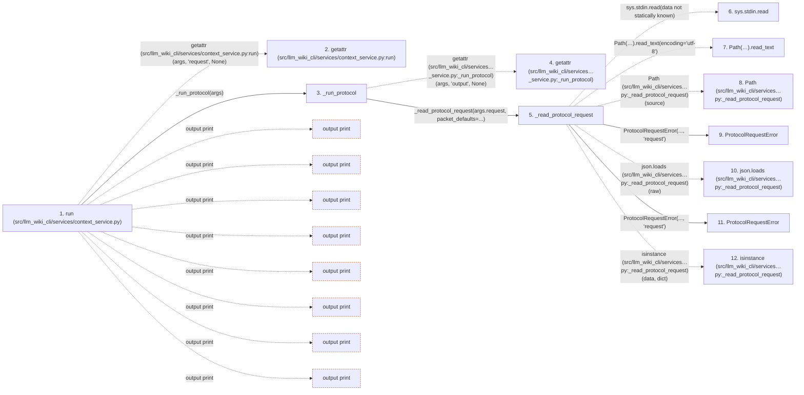

# context

**Entry point:** `run` (`cli`)
**Source:** [context_service](../modules/context_service.md)
**Modules touched:** [bootstrap_recovery](../modules/bootstrap_recovery.md), [bootstrap_runtime](../modules/bootstrap_runtime.md), [change_selection](../modules/change_selection.md), [common](../modules/common.md), and 37 more

**Complete modules touched:**

- [bootstrap_recovery](../modules/bootstrap_recovery.md)
- [bootstrap_runtime](../modules/bootstrap_runtime.md)
- [change_selection](../modules/change_selection.md)
- [common](../modules/common.md)
- [config](../modules/config.md)
- [context_budget](../modules/context_budget.md)
- [context_packet](../modules/context_packet.md)
- [context_service](../modules/context_service.md)
- [data_flow](../modules/data_flow.md)
- [documentation_queries](../modules/documentation_queries.md)
- [documentation_query_builder](../modules/documentation_query_builder.md)
- [entrypoints](../modules/entrypoints.md)
- [extraction_jobs](../modules/extraction_jobs.md)
- [extraction_service](../modules/extraction_service.md)
- [filesystem_guard](../modules/filesystem_guard.md)
- [imports](../modules/imports.md)
- [infrastructure_inventory](../modules/infrastructure_inventory.md)
- [io](../modules/io.md)
- [knowledge_consumption](../modules/knowledge_consumption.md)
- [knowledge_governance](../modules/knowledge_governance.md)
- [knowledge_loader](../modules/knowledge_loader.md)
- [knowledge_orchestration](../modules/knowledge_orchestration.md)
- [knowledge_storage](../modules/knowledge_storage.md)
- [knowledge_storage_io](../modules/knowledge_storage_io.md)
- [knowledge_verification](../modules/knowledge_verification.md)
- [maintenance_protocol](../modules/maintenance_protocol.md)
- [maintenance_service](../modules/maintenance_service.md)
- [maintenance_state](../modules/maintenance_state.md)
- [maintenance_status](../modules/maintenance_status.md)
- [plugins](../modules/plugins.md)
- [progress](../modules/progress.md)
- [services_dependencies](../modules/services_dependencies.md)
- [source_retirement](../modules/source_retirement.md)
- [source_selection](../modules/source_selection.md)
- [source_snapshot](../modules/source_snapshot.md)
- [sync_manifest](../modules/sync_manifest.md)
- [token_counting](../modules/token_counting.md)
- [wiki_media](../modules/wiki_media.md)
- [wiki_surface](../modules/wiki_surface.md)
- [wiki_surface_index](../modules/wiki_surface_index.md)
- [wiki_write_basis](../modules/wiki_write_basis.md)

## Call sequence

> Static overview in presentation order, not runtime execution order. Arrows retain captured callers; representative internal continuations and boundary examples precede repeated helper detail.

```mermaid
sequenceDiagram
    participant p0 as run (src/llm_wiki_cli/services/context_service.py)
    participant p1 as _run_protocol
    participant p2 as changes_from_args
    participant p3 as run (src/llm_wiki_cli/services/context_budget.py)
    participant p4 as _run_packet_output
    participant p5 as _build_context
    participant p6 as ExtractionJobRequest.resolved
    participant p7 as write_text_output
    participant p8 as _render_markdown
    participant p9 as _read_protocol_request
    participant p10 as _validate_request_cli_options
    participant p11 as _emit_protocol_error
    participant p12 as _build_context_impl
    participant p13 as build_qualified_context
    participant p14 as _normalized_request
    participant p15 as _packet_helper_diagnostics
    participant p16 as build_budgeted_context
    participant p17 as _packet_contract_for_request
    participant p18 as _emit_packet_error
    participant p19 as _write_utf8_text
    participant p20 as _validate_protocol_request
    participant p21 as validate_changes
    participant p22 as capture_context_read
    participant p23 as _protocol_success_payload
    participant p24 as select_changes
    participant p25 as affected_page_map
    participant p26 as _fit_knowledge_packet_response
    participant p27 as packet_from_captured_response
    participant p28 as build_context_from_captured_read
    participant p29 as getattr (src/llm_wiki_cli/services/context_service.py:run)
    participant p30 as request.get (src/llm_wiki_cli/services…_service.py:_run_protocol)
    p0->>p1: _run_protocol
    p0->>p2: changes_from_args
    p0->>p3: run (src/llm_wiki_cli/services/context_budget.py)
    p0->>p4: _run_packet_output
    p0->>p5: _build_context
    p0->>p6: ExtractionJobRequest.resolved
    p0->>p7: write_text_output
    p0->>p8: _render_markdown
    p1->>p9: _read_protocol_request
    p1->>p10: _validate_request_cli_options
    p1->>p11: _emit_protocol_error
    p5->>p12: _build_context_impl
    p4->>p13: build_qualified_context
    p9->>p14: _normalized_request
    p3->>p15: _packet_helper_diagnostics
    p3->>p16: build_budgeted_context
    p13->>p17: _packet_contract_for_request
    p15->>p18: _emit_packet_error
    p7->>p19: _write_utf8_text
    p14->>p20: _validate_protocol_request
    p2->>p21: validate_changes
    p16->>p22: capture_context_read
    p13->>p23: _protocol_success_payload
    p16->>p24: select_changes
    p16->>p25: affected_page_map
    p13->>p26: _fit_knowledge_packet_response
    p13->>p27: packet_from_captured_response
    p16->>p28: build_context_from_captured_read
    p0-->>p29: getattr (src/llm_wiki_cli/services/context_service.py:run)(args, 'request', None)
    p1-->>p30: request.get (src/llm_wiki_cli/services…_service.py:_run_protocol)('knowledge_mode')
```

<!-- Auto-generated from static call edges. Dashed arrows are external or unresolved calls. Reviewed runtime conditions and side effects belong in Behavior. -->

> Call sequence diagram shows 30 of 1519 interactions; 1489 omitted to keep the visualization within the 30-interaction and generated-diagram limits, with uncertain identities omitted rather than inferred.

> Captured boundary calls: external 1 of 520 (519 omitted); unresolved 1 of 461 (460 omitted). These counts cover the captured static trace.

Omitted captured detail, grouped by actual caller occurrence and target module:

| Caller | Parent step | Target module | Kind | Omitted interactions |
| --- | --- | --- | --- | --- |
| `src/llm_wiki_cli/services/context_service.py:_run_protocol` | 3 | - | external | 22 |
| `src/llm_wiki_cli/services/context_service.py:_read_protocol_request` | 5 | - | external | 4 |
| `src/llm_wiki_cli/services/context_service.py:_read_protocol_request` | 5 | - | unresolved | 1 |
| `src/llm_wiki_cli/services/context_service.py:_read_protocol_request` | 5 | [src/llm_wiki_cli/services/context_service.py](../modules/context_service.md) | internal | 3 |
| `src/llm_wiki_cli/services/context_packet.py:_normalized_request` | 13 | - | external | 3 |
| `src/llm_wiki_cli/services/context_packet.py:_normalized_request` | 13 | [src/llm_wiki_cli/services/context_service.py](../modules/context_service.md) | internal | 1 |
| `src/llm_wiki_cli/services/context_packet.py:_normalized_request` | 13 | - | unresolved | 2 |
| `src/llm_wiki_cli/services/context_service.py:_validate_protocol_request` | 20 | - | external | 2 |
> Omission summary shows 8 of 291 groups; 283 further groups are not expanded here. Counts above include all omitted interactions.
> Detailed flow queries retain their own coverage and limits; omitted paths may execute at runtime.

> Trace truncated at the depth limit; deeper calls are omitted.

## Data flow

<!-- Auto-generated static analysis. Treat values and boundaries as best-effort hints, not runtime proof. -->

### Analysis coverage

**Effect analysis partially available.** Flow assembly and source effect analysis are separate; empty observations do not prove an empty handler body.

Source steps: 539; effect analysis evaluated: 377, partial: 31, unavailable: 131. Counts include steps omitted from the displayed trace.

Collector observations for 408 source steps with known totals: observed: 2935, emitted: 2648, omitted: 287. Unavailable totals are excluded.

- Callable record unavailable for one or more source steps; those steps have no represented callable body.
- Effect collector omitted observations before flow assembly; displayed effects are partial.
- Effect collector totals unavailable; observed counts cover captured records only.

| Step | Callable record | Effect analysis | Collector totals | Observed | Emitted | Omitted |
|---|---|---|---|---:|---:|---:|
| `run (src/llm_wiki_cli/services/context_service.py)` | `available` | `partial` | `available` | `23` | `21` | `2` |
| `getattr (src/llm_wiki_cli/services/context_service.py:run)` | `not_applicable` | `not_applicable` | `not_applicable` | — | — | — |
| `_run_protocol` | `available` | `partial` | `available` | `17` | `16` | `1` |
| `getattr (src/llm_wiki_cli/services…_service.py:_run_protocol)` | `not_applicable` | `not_applicable` | `not_applicable` | — | — | — |
| `_read_protocol_request` | `available` | `evaluated` | `available` | `5` | `5` | `0` |
| `sys.stdin.read` | `not_applicable` | `not_applicable` | `not_applicable` | — | — | — |
| `Path(…).read_text` | `not_applicable` | `not_applicable` | `not_applicable` | — | — | — |
| `Path (src/llm_wiki_cli/services…py:_read_protocol_request)` | `not_applicable` | `not_applicable` | `not_applicable` | — | — | — |
| `ProtocolRequestError` | `unavailable` | `unavailable` | `unavailable` | — | — | — |
| `json.loads (src/llm_wiki_cli/services…py:_read_protocol_request)` | `not_applicable` | `not_applicable` | `not_applicable` | — | — | — |
| `ProtocolRequestError` | `unavailable` | `unavailable` | `unavailable` | — | — | — |
| `isinstance (src/llm_wiki_cli/services…py:_read_protocol_request)` | `not_applicable` | `not_applicable` | `not_applicable` | — | — | — |

### Step data

| Step | Inputs | Reads | Writes | Returns |
|---|---|---|---|---|
| `run (src/llm_wiki_cli/services/context_service.py)` | `args` | `DEFAULT_WIKI_DIR`, `sys`, `sys`, `print_extraction_job_plan`, `ProtocolRequestError`, `sys`, `KnowledgeRequiredUnavailableError`, `sys` | - | `none`, `none`, `none`, `none` |
| `getattr (src/llm_wiki_cli/services/context_service.py:run)` | - | - | - | - |
| `_run_protocol` | `args` | `CONTEXT_BUDGET_PROTOCOL_VERSION`, `CONTEXT_BUDGET_PROTOCOL_VERSION`, `DEFAULT_WIKI_DIR`, `DEFAULT_WIKI_DIR`, `KNOWLEDGE_PROTOCOL_VERSION`, `print_extraction_job_plan`, `ProtocolRequestError`, `KnowledgeRequiredUnavailableError` | `exc.protocol` | `none`, `none`, `none` |
| `getattr (src/llm_wiki_cli/services…_service.py:_run_protocol)` | - | - | - | - |
| `_read_protocol_request` | `source: str`, `packet_defaults: bool` | `json` | - | `_normalized_request(...)`, `_validate_protocol_request(...)` |
| `sys.stdin.read` | - | - | - | - |
| `Path(…).read_text` | - | - | - | - |
| `Path (src/llm_wiki_cli/services…py:_read_protocol_request)` | - | - | - | - |
| `ProtocolRequestError` | - | - | - | - |
| `json.loads (src/llm_wiki_cli/services…py:_read_protocol_request)` | - | - | - | - |
| `ProtocolRequestError` | - | - | - | - |
| `isinstance (src/llm_wiki_cli/services…py:_read_protocol_request)` | - | - | - | - |

### Call data

| From | To | Line | Call |
|---|---|---:|---|
| run (src/llm_wiki_cli/services/context_service.py) | getattr (src/llm_wiki_cli/services/context_service.py:run) | 3670 | `getattr(args, 'request', None)` |
| run (src/llm_wiki_cli/services/context_service.py) | _run_protocol | 3671 | `_run_protocol(args)` |
| _run_protocol | getattr (src/llm_wiki_cli/services…_service.py:_run_protocol) | 3497 | `getattr(args, 'output', None)` |
| _run_protocol | _read_protocol_request | 3500 | `_read_protocol_request(args.request, packet_defaults=...)` |
| _read_protocol_request | sys.stdin.read | 1104 | `sys.stdin.read(data not statically known)` |
| _read_protocol_request | Path(…).read_text | 1106 | `Path(source).read_text(encoding='utf-8')` |
| _read_protocol_request | Path (src/llm_wiki_cli/services…py:_read_protocol_request) | 1106 | `Path(source)` |
| _read_protocol_request | ProtocolRequestError | 1109 | `ProtocolRequestError(..., 'request')` |
| _read_protocol_request | json.loads (src/llm_wiki_cli/services…py:_read_protocol_request) | 1112 | `json.loads(raw)` |
| _read_protocol_request | ProtocolRequestError | 1114 | `ProtocolRequestError(..., 'request')` |
| _read_protocol_request | isinstance (src/llm_wiki_cli/services…py:_read_protocol_request) | 1116 | `isinstance(data, dict)` |

### Boundary effects

| Kind | Target | Step | Line |
|---|---|---|---:|
| output | `print` | `run` | 3687 |
| output | `print` | `run` | 3690 |
| output | `print` | `run` | 3734 |
| output | `print` | `run` | 3737 |
| output | `print` | `run` | 3744 |
| output | `print` | `run` | 3746 |
| output | `print` | `run` | 3755 |
| output | `print` | `run` | 3757 |

### Static analysis gaps

| Kind | Step | Target | Line |
|---|---|---|---:|
| external_call | `run` | `getattr` | 3670 |
| external_call | `_run_protocol` | `getattr` | 3497 |
| external_call | `_read_protocol_request` | `sys.stdin.read` | 1104 |
| unresolved_call | `_read_protocol_request` | `Path(source).read_text` | 1106 |
| external_call | `_read_protocol_request` | `json.loads` | 1112 |
| external_call | `_read_protocol_request` | `isinstance` | 1116 |
| step_limit | `run` | `first 12 steps` | 0 |
| truncated_flow | `run` | `depth limit` | 0 |

## Behavior

This flow starts at `run` and is classified as `cli`. The generated call and data-flow sections are bounded static projections; runtime conditions and side effects require source-level confirmation.

Declared ordinary maintenance authority is required to remain coherent. A damaged owner or immutable marker produces a bounded `maintenance-authority-unavailable` refusal, with a safe original cause and an explicit matching committed-recovery template. No native packet or promoted fallback is returned, and no backup, identity, setup or repair is chosen by the read. The caller must preserve recovery preconditions and the original source/wiki boundaries.
