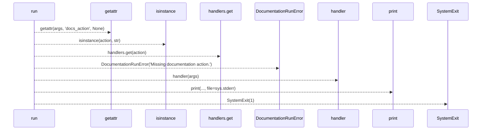
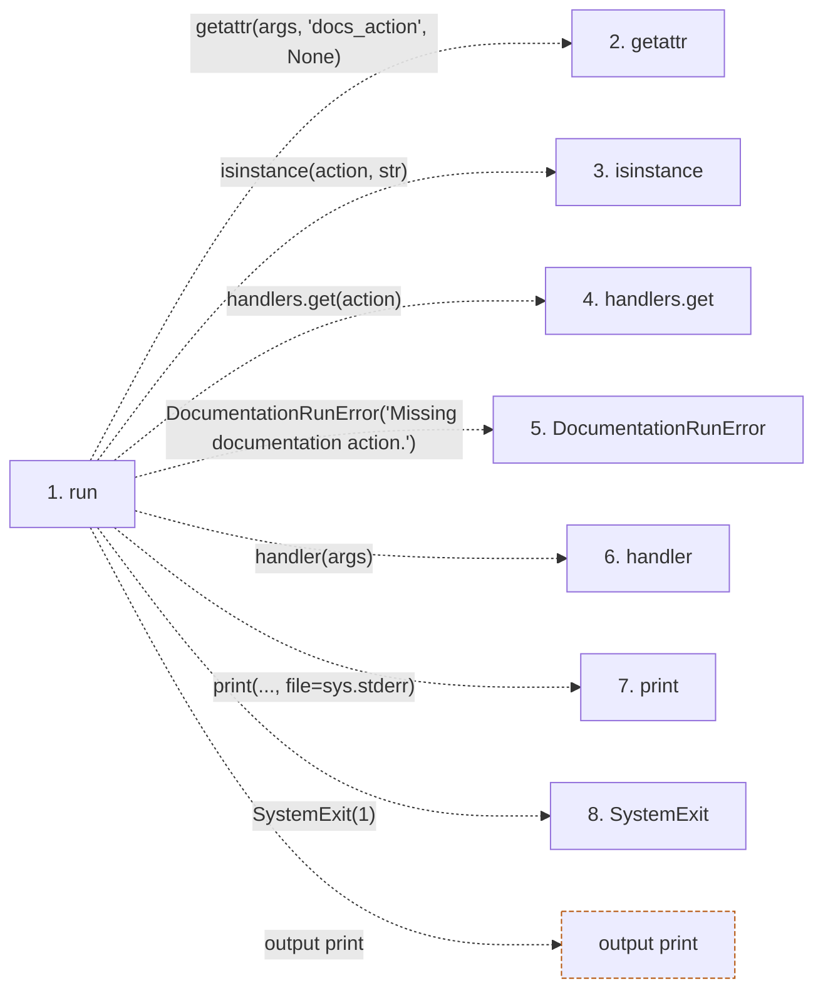

# docs

**Entry point:** `run` (`cli`)
**Source:** [docs_cmd](../modules/docs_cmd.md)
**Modules touched:** [docs_cmd](../modules/docs_cmd.md)

## Call sequence

> Static overview in presentation order, not runtime execution order. Arrows retain captured callers; representative internal continuations and boundary examples precede repeated helper detail.

<!-- Auto-generated from static call edges. Dashed arrows are external or unresolved calls. Reviewed runtime conditions and side effects belong in Behavior. -->

> Call sequence diagram shows 7 of 7 interactions; 0 omitted to keep the visualization within the 30-interaction and generated-diagram limits, with uncertain identities omitted rather than inferred.

> Captured boundary calls: external 4 of 4 (0 omitted); unresolved 3 of 3 (0 omitted). These counts cover the captured static trace.
> Detailed flow queries retain their own coverage and limits; omitted paths may execute at runtime.

## Data flow

<!-- Auto-generated static analysis. Treat values and boundaries as best-effort hints, not runtime proof. -->

### Analysis coverage

**Effect analysis partially available.** Flow assembly and source effect analysis are separate; empty observations do not prove an empty handler body.

Source steps: 1; effect analysis evaluated: 0, partial: 1, unavailable: 0. Counts include steps omitted from the displayed trace.

Collector observations for 1 source steps with known totals: observed: 14, emitted: 10, omitted: 4. Unavailable totals are excluded.

- Effect collector omitted observations before flow assembly; displayed effects are partial.

| Step | Callable record | Effect analysis | Collector totals | Observed | Emitted | Omitted |
|---|---|---|---|---:|---:|---:|
| `run` | `available` | `partial` | `available` | `14` | `10` | `4` |
| `getattr` | `not_applicable` | `not_applicable` | `not_applicable` | — | — | — |
| `isinstance` | `not_applicable` | `not_applicable` | `not_applicable` | — | — | — |
| `handlers.get` | `not_applicable` | `not_applicable` | `not_applicable` | — | — | — |
| `DocumentationRunError` | `not_applicable` | `not_applicable` | `not_applicable` | — | — | — |
| `handler` | `not_applicable` | `not_applicable` | `not_applicable` | — | — | — |
| `print` | `not_applicable` | `not_applicable` | `not_applicable` | — | — | — |
| `SystemExit` | `not_applicable` | `not_applicable` | `not_applicable` | — | — | — |

### Step data

| Step | Inputs | Reads | Writes | Returns |
|---|---|---|---|---|
| `run` | `args` | `publication_cmd`, `publication_candidate_cmd`, `_prepare`, `_status`, `_packet`, `_record_result`, `_verify`, `_export` | - | - |
| `getattr` | - | - | - | - |
| `isinstance` | - | - | - | - |
| `handlers.get` | - | - | - | - |
| `DocumentationRunError` | - | - | - | - |
| `handler` | - | - | - | - |
| `print` | - | - | - | - |
| `SystemExit` | - | - | - | - |

### Call data

| From | To | Line | Call |
|---|---|---:|---|
| run | getattr | 660 | `getattr(args, 'docs_action', None)` |
| run | isinstance | 672 | `isinstance(action, str)` |
| run | handlers.get | 672 | `handlers.get(action)` |
| run | DocumentationRunError | 674 | `DocumentationRunError('Missing documentation action.')` |
| run | handler | 676 | `handler(args)` |
| run | print | 680 | `print(..., file=sys.stderr)` |
| run | SystemExit | 681 | `SystemExit(1)` |

### Boundary effects

| Kind | Target | Step | Line |
|---|---|---|---:|
| output | `print` | `run` | 680 |

### Static analysis gaps

| Kind | Step | Target | Line |
|---|---|---|---:|
| external_call | `run` | `getattr` | 660 |
| external_call | `run` | `isinstance` | 672 |
| unresolved_call | `run` | `handlers.get` | 672 |
| unresolved_call | `run` | `DocumentationRunError` | 674 |
| unresolved_call | `run` | `handler` | 676 |
| external_call | `run` | `SystemExit` | 681 |

## Behavior

This flow starts at `run` and is classified as `cli`. The generated call and data-flow sections are bounded static projections; runtime conditions and side effects require source-level confirmation.
