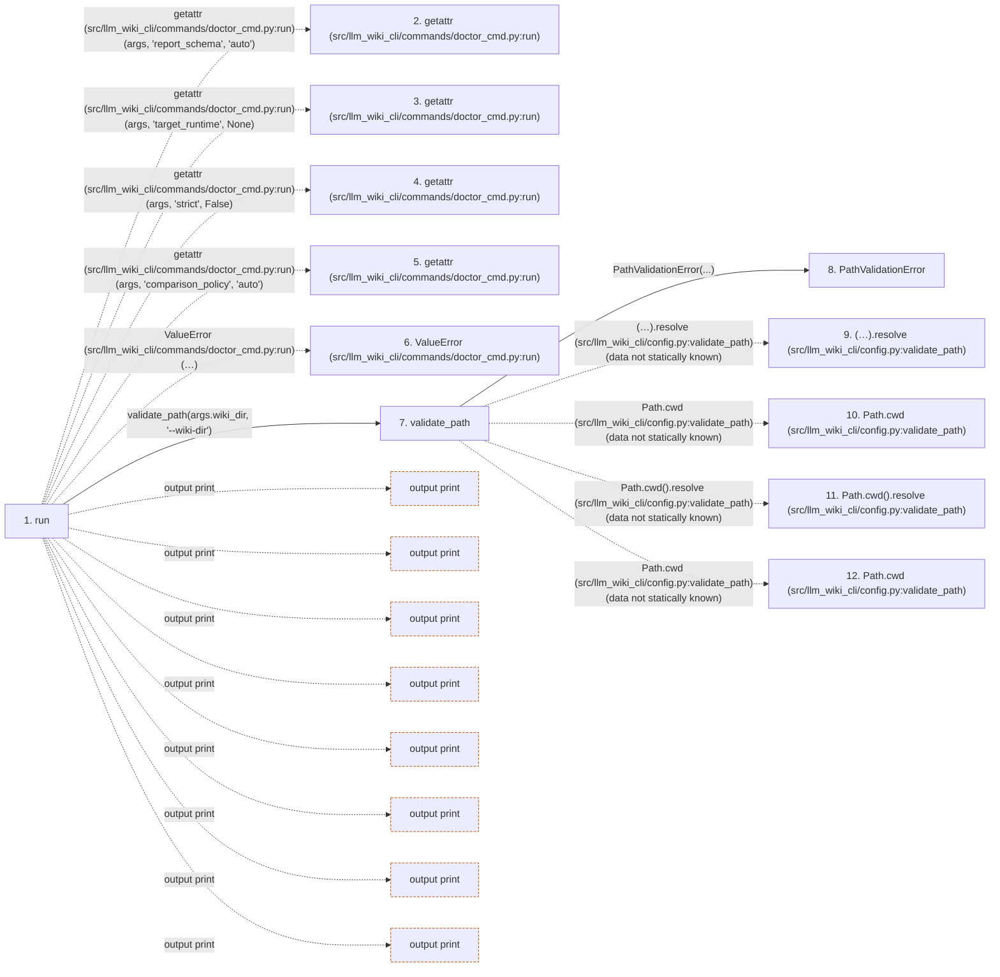

# doctor

**Entry point:** `run` (`cli`)
**Source:** [doctor_cmd](../modules/doctor_cmd.md)
**Modules touched:** [analysis_capture](../modules/analysis_capture.md), [analysis_compatibility](../modules/analysis_compatibility.md), [analysis_targets](../modules/analysis_targets.md), [api](../modules/api.md), and 66 more

**Complete modules touched:**

- [analysis_capture](../modules/analysis_capture.md)
- [analysis_compatibility](../modules/analysis_compatibility.md)
- [analysis_targets](../modules/analysis_targets.md)
- [api](../modules/api.md)
- [capability_diagnostics](../modules/capability_diagnostics.md)
- [common](../modules/common.md)
- [concept_identity](../modules/concept_identity.md)
- [config](../modules/config.md)
- [data_flow](../modules/data_flow.md)
- [doctor_cmd](../modules/doctor_cmd.md)
- [doctor_service](../modules/doctor_service.md)
- [entrypoints](../modules/entrypoints.md)
- [extraction_jobs](../modules/extraction_jobs.md)
- [extraction_service](../modules/extraction_service.md)
- [extractor_helpers](../modules/extractor_helpers.md)
- [filesystem_guard](../modules/filesystem_guard.md)
- [flow_followup](../modules/flow_followup.md)
- [health_contract](../modules/health_contract.md)
- [health_details](../modules/health_details.md)
- [health_policy](../modules/health_policy.md)
- [health_summary](../modules/health_summary.md)
- [immutable](../modules/immutable.md)
- [implementation_evidence](../modules/implementation_evidence.md)
- [infrastructure_inventory](../modules/infrastructure_inventory.md)
- [inventory_cache](../modules/inventory_cache.md)
- [io](../modules/io.md)
- [knowledge_artifacts](../modules/knowledge_artifacts.md)
- [knowledge_consumption](../modules/knowledge_consumption.md)
- [knowledge_envelope](../modules/knowledge_envelope.md)
- [knowledge_evidence](../modules/knowledge_evidence.md)
- [knowledge_freshness](../modules/knowledge_freshness.md)
- [knowledge_governance](../modules/knowledge_governance.md)
- [knowledge_graph](../modules/knowledge_graph.md)
- [knowledge_loader](../modules/knowledge_loader.md)
- [knowledge_model](../modules/knowledge_model.md)
- [knowledge_observability](../modules/knowledge_observability.md)
- [knowledge_orchestration](../modules/knowledge_orchestration.md)
- [knowledge_packs](../modules/knowledge_packs.md)
- [knowledge_reuse](../modules/knowledge_reuse.md)
- [knowledge_storage](../modules/knowledge_storage.md)
- [knowledge_storage_io](../modules/knowledge_storage_io.md)
- [knowledge_verification](../modules/knowledge_verification.md)
- [lint_service](../modules/lint_service.md)
- [maintenance_evidence](../modules/maintenance_evidence.md)
- [maintenance_projection](../modules/maintenance_projection.md)
- [maintenance_shapes](../modules/maintenance_shapes.md)
- [maintenance_state](../modules/maintenance_state.md)
- [manifest_storage](../modules/manifest_storage.md)
- [markdown_sections](../modules/markdown_sections.md)
- [module_coverage](../modules/module_coverage.md)
- [paths](../modules/paths.md)
- [plugins](../modules/plugins.md)
- [progress](../modules/progress.md)
- [python_implementation](../modules/python_implementation.md)
- [runtime_output](../modules/runtime_output.md)
- [section_ownership](../modules/section_ownership.md)
- [services_dependencies](../modules/services_dependencies.md)
- [source_retirement](../modules/source_retirement.md)
- [source_selection](../modules/source_selection.md)
- [source_snapshot](../modules/source_snapshot.md)
- [sync_analysis](../modules/sync_analysis.md)
- [sync_manifest](../modules/sync_manifest.md)
- [team](../modules/team.md)
- [typescript_helper_identity](../modules/typescript_helper_identity.md)
- [validation](../modules/validation.md)
- [wiki_lifecycle](../modules/wiki_lifecycle.md)
- [wiki_media](../modules/wiki_media.md)
- [wiki_surface](../modules/wiki_surface.md)
- [yaml_formats](../modules/yaml_formats.md)
- [yaml_syntax](../modules/yaml_syntax.md)

## Call sequence

> Static overview in presentation order, not runtime execution order. Arrows retain captured callers; representative internal continuations and boundary examples precede repeated helper detail.

```mermaid
sequenceDiagram
    participant p0 as run
    participant p1 as validate_path
    participant p2 as inspect_targets
    participant p3 as load_targets
    participant p4 as get_analysis_input_status
    participant p5 as build_capability_doctor
    participant p6 as extraction_job_request_from_args
    participant p7 as render_capability_doctor
    participant p8 as render_doctor_text
    participant p9 as _render_analysis_input_text
    participant p10 as build_doctor_report
    participant p11 as analysis_input_status
    participant p12 as build_capability_diagnostics
    participant p13 as read_guarded
    participant p14 as StorageReadSession.read
    participant p15 as _parse_bundle
    participant p16 as parse_packed_root
    participant p17 as parse_knowledge_index
    participant p18 as SyncManifest.load
    participant p19 as render_capability_doctor.<locals>.command
    participant p20 as _render_doctor_payload
    participant p21 as compare_targets
    participant p22 as _require_relative_name
    participant p23 as _record
    participant p24 as decode_bytes
    participant p25 as validate_source_root
    participant p26 as _fields (src/llm_wiki_cli/services/knowledge_storage.py)
    participant p27 as _absolute_path
    participant p28 as _parse_repository
    participant p29 as getattr (src/llm_wiki_cli/commands/doctor_cmd.py:run)
    participant p30 as report.to_payload (src/llm_wiki_cli/commands/doctor_cmd.py:run)
    p0->>p1: validate_path
    p0->>p2: inspect_targets
    p0->>p3: load_targets
    p0->>p4: get_analysis_input_status
    p0->>p5: build_capability_doctor
    p0->>p6: extraction_job_request_from_args
    p0->>p7: render_capability_doctor
    p0->>p8: render_doctor_text
    p0->>p9: _render_analysis_input_text
    p0->>p10: build_doctor_report
    p4->>p11: analysis_input_status
    p5->>p12: build_capability_diagnostics
    p3->>p13: read_guarded
    p2->>p14: StorageReadSession.read
    p2->>p15: _parse_bundle
    p2->>p16: parse_packed_root
    p2->>p17: parse_knowledge_index
    p2->>p18: SyncManifest.load
    p7->>p19: render_capability_doctor.<locals>.command
    p7->>p20: _render_doctor_payload
    p2->>p21: compare_targets
    p14->>p22: _require_relative_name
    p15->>p23: _record
    p16->>p24: decode_bytes
    p12->>p25: validate_source_root
    p16->>p26: _fields (src/llm_wiki_cli/services/knowledge_storage.py)
    p13->>p27: _absolute_path
    p15->>p28: _parse_repository
    p0-->>p29: getattr (src/llm_wiki_cli/commands/doctor_cmd.py:run)(args, 'report_schema', 'auto')
    p0-->>p30: report.to_payload (src/llm_wiki_cli/commands/doctor_cmd.py:run)(report_schema=report_schema)
```

<!-- Auto-generated from static call edges. Dashed arrows are external or unresolved calls. Reviewed runtime conditions and side effects belong in Behavior. -->

> Call sequence diagram shows 30 of 3678 interactions; 3648 omitted to keep the visualization within the 30-interaction and generated-diagram limits, with uncertain identities omitted rather than inferred.

> Captured boundary calls: external 1 of 1135 (1134 omitted); unresolved 1 of 874 (873 omitted). These counts cover the captured static trace.

Omitted captured detail, grouped by actual caller occurrence and target module:

| Caller | Parent step | Target module | Kind | Omitted interactions |
| --- | --- | --- | --- | --- |
| `src/llm_wiki_cli/commands/doctor_cmd.py:run` | 1 | - | external | 40 |
| `src/llm_wiki_cli/config.py:validate_path` | 7 | [src/llm_wiki_cli/config.py](../modules/config.md) | internal | 2 |
| `src/llm_wiki_cli/config.py:validate_path` | 7 | - | unresolved | 3 |
| `src/llm_wiki_cli/config.py:validate_path` | 7 | - | external | 2 |
| `src/llm_wiki_cli/commands/doctor_cmd.py:run` | 1 | [src/llm_wiki_cli/config.py](../modules/config.md) | internal | 1 |
| `src/llm_wiki_cli/services/analysis_targets.py:inspect_targets` | 16 | [src/llm_wiki_cli/services/knowledge_storage_io.py](../modules/knowledge_storage_io.md) | internal | 4 |
| `src/llm_wiki_cli/services/analysis_targets.py:inspect_targets` | 16 | - | external | 7 |
| `src/llm_wiki_cli/services/knowledge_storage_io.py:_require_relative_name` | 20 | [src/llm_wiki_cli/services/validation.py](../modules/validation.md) | internal | 1 |
> Omission summary shows 8 of 893 groups; 885 further groups are not expanded here. Counts above include all omitted interactions.
> Detailed flow queries retain their own coverage and limits; omitted paths may execute at runtime.

> Trace truncated at the depth limit; deeper calls are omitted.

## Data flow

<!-- Auto-generated static analysis. Treat values and boundaries as best-effort hints, not runtime proof. -->

### Analysis coverage

**Effect analysis partially available.** Flow assembly and source effect analysis are separate; empty observations do not prove an empty handler body.

Source steps: 1670; effect analysis evaluated: 1130, partial: 57, unavailable: 483. Counts include steps omitted from the displayed trace.

Collector observations for 1187 source steps with known totals: observed: 6575, emitted: 6272, omitted: 303. Unavailable totals are excluded.

- Callable record unavailable for one or more source steps; those steps have no represented callable body.
- Effect collector omitted observations before flow assembly; displayed effects are partial.
- Effect collector totals unavailable; observed counts cover captured records only.

| Step | Callable record | Effect analysis | Collector totals | Observed | Emitted | Omitted |
|---|---|---|---|---:|---:|---:|
| `run` | `available` | `partial` | `available` | `14` | `13` | `1` |
| `getattr (src/llm_wiki_cli/commands/doctor_cmd.py:run)` | `not_applicable` | `not_applicable` | `not_applicable` | — | — | — |
| `getattr (src/llm_wiki_cli/commands/doctor_cmd.py:run)` | `not_applicable` | `not_applicable` | `not_applicable` | — | — | — |
| `getattr (src/llm_wiki_cli/commands/doctor_cmd.py:run)` | `not_applicable` | `not_applicable` | `not_applicable` | — | — | — |
| `getattr (src/llm_wiki_cli/commands/doctor_cmd.py:run)` | `not_applicable` | `not_applicable` | `not_applicable` | — | — | — |
| `ValueError (src/llm_wiki_cli/commands/doctor_cmd.py:run)` | `not_applicable` | `not_applicable` | `not_applicable` | — | — | — |
| `validate_path` | `available` | `evaluated` | `available` | `3` | `3` | `0` |
| `PathValidationError` | `unavailable` | `unavailable` | `unavailable` | — | — | — |
| `(…).resolve (src/llm_wiki_cli/config.py:validate_path)` | `not_applicable` | `not_applicable` | `not_applicable` | — | — | — |
| `Path.cwd (src/llm_wiki_cli/config.py:validate_path)` | `not_applicable` | `not_applicable` | `not_applicable` | — | — | — |
| `Path.cwd().resolve (src/llm_wiki_cli/config.py:validate_path)` | `not_applicable` | `not_applicable` | `not_applicable` | — | — | — |
| `Path.cwd (src/llm_wiki_cli/config.py:validate_path)` | `not_applicable` | `not_applicable` | `not_applicable` | — | — | — |

### Step data

| Step | Inputs | Reads | Writes | Returns |
|---|---|---|---|---|
| `run` | `args` | `DEFAULT_WIKI_DIR` | - | `none`, `none`, `none` |
| `getattr (src/llm_wiki_cli/commands/doctor_cmd.py:run)` | - | - | - | - |
| `getattr (src/llm_wiki_cli/commands/doctor_cmd.py:run)` | - | - | - | - |
| `getattr (src/llm_wiki_cli/commands/doctor_cmd.py:run)` | - | - | - | - |
| `getattr (src/llm_wiki_cli/commands/doctor_cmd.py:run)` | - | - | - | - |
| `ValueError (src/llm_wiki_cli/commands/doctor_cmd.py:run)` | - | - | - | - |
| `validate_path` | `path: str`, `label: str` | - | - | `resolved` |
| `PathValidationError` | - | - | - | - |
| `(…).resolve (src/llm_wiki_cli/config.py:validate_path)` | - | - | - | - |
| `Path.cwd (src/llm_wiki_cli/config.py:validate_path)` | - | - | - | - |
| `Path.cwd().resolve (src/llm_wiki_cli/config.py:validate_path)` | - | - | - | - |
| `Path.cwd (src/llm_wiki_cli/config.py:validate_path)` | - | - | - | - |

### Call data

| From | To | Line | Call |
|---|---|---:|---|
| run | getattr (src/llm_wiki_cli/commands/doctor_cmd.py:run) | 34 | `getattr(args, 'report_schema', 'auto')` |
| run | getattr (src/llm_wiki_cli/commands/doctor_cmd.py:run) | 35 | `getattr(args, 'target_runtime', None)` |
| run | getattr (src/llm_wiki_cli/commands/doctor_cmd.py:run) | 37 | `getattr(args, 'strict', False)` |
| run | getattr (src/llm_wiki_cli/commands/doctor_cmd.py:run) | 38 | `getattr(args, 'comparison_policy', 'auto')` |
| run | ValueError (src/llm_wiki_cli/commands/doctor_cmd.py:run) | 40 | `ValueError('--target-runtime checks declared prerequisites only; run strict health and comparison-policy checks separately')` |
| run | validate_path | 46 | `validate_path(args.wiki_dir, '--wiki-dir')` |
| validate_path | PathValidationError | 134 | `PathValidationError(...)` |
| validate_path | (…).resolve (src/llm_wiki_cli/config.py:validate_path) | 135 | `(Path.cwd() / path).resolve(data not statically known)` |
| validate_path | Path.cwd (src/llm_wiki_cli/config.py:validate_path) | 135 | `Path.cwd(data not statically known)` |
| validate_path | Path.cwd().resolve (src/llm_wiki_cli/config.py:validate_path) | 136 | `Path.cwd().resolve(data not statically known)` |
| validate_path | Path.cwd (src/llm_wiki_cli/config.py:validate_path) | 136 | `Path.cwd(data not statically known)` |

### Boundary effects

| Kind | Target | Step | Line |
|---|---|---|---:|
| output | `print` | `run` | 50 |
| output | `print` | `run` | 52 |
| output | `print` | `run` | 54 |
| output | `print` | `run` | 60 |
| output | `print` | `run` | 61 |
| output | `print` | `run` | 73 |
| output | `print` | `run` | 104 |
| output | `print` | `run` | 127 |

### Static analysis gaps

| Kind | Step | Target | Line |
|---|---|---|---:|
| external_call | `run` | `getattr` | 34 |
| external_call | `run` | `getattr` | 35 |
| external_call | `run` | `getattr` | 37 |
| external_call | `run` | `getattr` | 38 |
| external_call | `run` | `ValueError` | 40 |
| unresolved_call | `validate_path` | `(Path.cwd() / path).resolve` | 135 |
| external_call | `validate_path` | `Path.cwd` | 135 |
| unresolved_call | `validate_path` | `Path.cwd().resolve` | 136 |
| external_call | `validate_path` | `Path.cwd` | 136 |
| step_limit | `run` | `first 12 steps` | 0 |
| truncated_flow | `run` | `depth limit` | 0 |

## Behavior

This flow starts at `run` and is classified as `cli`. The generated call and data-flow sections are bounded static projections; runtime conditions and side effects require source-level confirmation.

With `--target-runtime`, the command validates the local declaration/wiki paths and reads the target file and committed metadata. It reports matching declared provenance, registered portability, capture-required mismatches or unknown prerequisites without source inventory, extraction, helper setup or target execution. Aggregate qualification includes omitted rows. Exit 0 only establishes declared prerequisite alignment; exit 2 retains unresolved/capture requirements. Strict health and explicit comparison-policy requests must run separately. The diagnostic cannot replace fresh target-native proof or authorize a writer.
