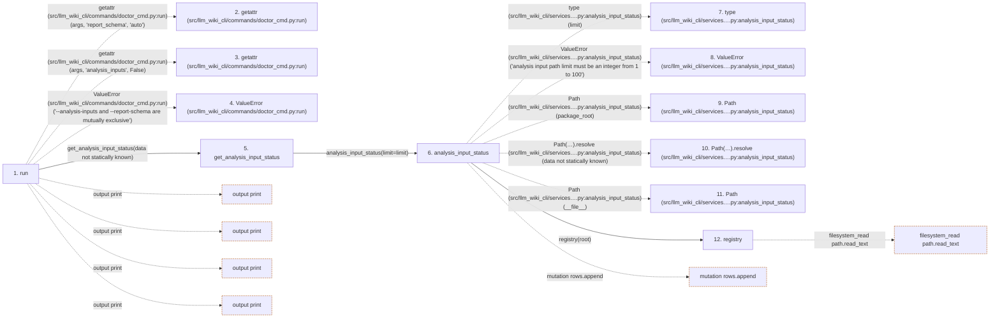

# doctor

**Entry point:** `run` (`cli`)
**Source:** [doctor_cmd](../modules/doctor_cmd.md)
**Modules touched:** [analysis_capture](../modules/analysis_capture.md), [analysis_compatibility](../modules/analysis_compatibility.md), [api](../modules/api.md), [capability_diagnostics](../modules/capability_diagnostics.md), and 40 more

**Complete modules touched:**

- [analysis_capture](../modules/analysis_capture.md)
- [analysis_compatibility](../modules/analysis_compatibility.md)
- [api](../modules/api.md)
- [capability_diagnostics](../modules/capability_diagnostics.md)
- [common](../modules/common.md)
- [config](../modules/config.md)
- [data_flow](../modules/data_flow.md)
- [doctor_cmd](../modules/doctor_cmd.md)
- [doctor_service](../modules/doctor_service.md)
- [entrypoints](../modules/entrypoints.md)
- [extraction_jobs](../modules/extraction_jobs.md)
- [extraction_service](../modules/extraction_service.md)
- [extractor_helpers](../modules/extractor_helpers.md)
- [filesystem_guard](../modules/filesystem_guard.md)
- [health_contract](../modules/health_contract.md)
- [health_details](../modules/health_details.md)
- [health_policy](../modules/health_policy.md)
- [health_summary](../modules/health_summary.md)
- [immutable](../modules/immutable.md)
- [infrastructure_inventory](../modules/infrastructure_inventory.md)
- [inventory_cache](../modules/inventory_cache.md)
- [io](../modules/io.md)
- [knowledge_artifacts](../modules/knowledge_artifacts.md)
- [knowledge_consumption](../modules/knowledge_consumption.md)
- [knowledge_envelope](../modules/knowledge_envelope.md)
- [knowledge_evidence](../modules/knowledge_evidence.md)
- [knowledge_freshness](../modules/knowledge_freshness.md)
- [knowledge_loader](../modules/knowledge_loader.md)
- [knowledge_observability](../modules/knowledge_observability.md)
- [knowledge_orchestration](../modules/knowledge_orchestration.md)
- [knowledge_verification](../modules/knowledge_verification.md)
- [lint_service](../modules/lint_service.md)
- [plugins](../modules/plugins.md)
- [progress](../modules/progress.md)
- [runtime_output](../modules/runtime_output.md)
- [services_dependencies](../modules/services_dependencies.md)
- [source_selection](../modules/source_selection.md)
- [source_snapshot](../modules/source_snapshot.md)
- [sync_analysis](../modules/sync_analysis.md)
- [sync_manifest](../modules/sync_manifest.md)
- [team](../modules/team.md)
- [validation](../modules/validation.md)
- [wiki_lifecycle](../modules/wiki_lifecycle.md)
- [wiki_media](../modules/wiki_media.md)

## Call sequence

> Static overview in presentation order, not runtime execution order. Arrows retain captured callers; representative internal continuations and boundary examples precede repeated helper detail.

```mermaid
sequenceDiagram
    participant p0 as run
    participant p1 as get_analysis_input_status
    participant p2 as build_capability_doctor
    participant p3 as extraction_job_request_from_args
    participant p4 as render_capability_doctor
    participant p5 as render_doctor_text
    participant p6 as build_doctor_report
    participant p7 as analysis_input_status
    participant p8 as build_capability_diagnostics
    participant p9 as _render_doctor_payload
    participant p10 as validate_source_root
    participant p11 as build_source_snapshot
    participant p12 as resolve_helper_cache_root
    participant p13 as get_prepared_typescript_root
    participant p14 as get_prepared_binary
    participant p15 as helper_preparation_argv
    participant p16 as build_report
    participant p17 as detailed_health_rows
    participant p18 as compose_doctor_report
    participant p19 as read_lock
    participant p20 as validate_plugin
    participant p21 as plugin_store
    participant p22 as validate_path
    participant p23 as _validate_capture_options
    participant p24 as lock_path
    participant p25 as _manifest_root
    participant p26 as _manifest_current
    participant p27 as _ensure_no_reserved_plugin_sources
    participant p28 as _resolve_snapshot_selection
    participant p29 as getattr (src/llm_wiki_cli/commands/doctor_cmd.py:run)
    participant p30 as report.to_payload (src/llm_wiki_cli/commands/doctor_cmd.py:run)
    p0->>p1: get_analysis_input_status
    p0->>p2: build_capability_doctor
    p0->>p3: extraction_job_request_from_args
    p0->>p4: render_capability_doctor
    p0->>p5: render_doctor_text
    p0->>p6: build_doctor_report
    p1->>p7: analysis_input_status
    p2->>p8: build_capability_diagnostics
    p4->>p9: _render_doctor_payload
    p8->>p10: validate_source_root
    p8->>p11: build_source_snapshot
    p8->>p12: resolve_helper_cache_root
    p8->>p13: get_prepared_typescript_root
    p8->>p14: get_prepared_binary
    p8->>p15: helper_preparation_argv
    p6->>p16: build_report
    p9->>p17: detailed_health_rows
    p6->>p18: compose_doctor_report
    p8->>p19: read_lock
    p8->>p20: validate_plugin
    p8->>p21: plugin_store
    p10->>p22: validate_path
    p11->>p23: _validate_capture_options
    p19->>p24: lock_path
    p20->>p25: _manifest_root
    p13->>p26: _manifest_current
    p20->>p27: _ensure_no_reserved_plugin_sources
    p11->>p28: _resolve_snapshot_selection
    p0-->>p29: getattr (src/llm_wiki_cli/commands/doctor_cmd.py:run)(args, 'report_schema', 'auto')
    p0-->>p30: report.to_payload (src/llm_wiki_cli/commands/doctor_cmd.py:run)(report_schema=report_schema)
```

<!-- Auto-generated from static call edges. Dashed arrows are external or unresolved calls. Reviewed runtime conditions and side effects belong in Behavior. -->

> Call sequence diagram shows 30 of 1411 interactions; 1381 omitted to keep the visualization within the 30-interaction and generated-diagram limits, with uncertain identities omitted rather than inferred.

> Captured boundary calls: external 1 of 435 (434 omitted); unresolved 1 of 437 (436 omitted). These counts cover the captured static trace.

Omitted captured detail, grouped by actual caller occurrence and target module:

| Caller | Parent step | Target module | Kind | Omitted interactions |
| --- | --- | --- | --- | --- |
| `src/llm_wiki_cli/commands/doctor_cmd.py:run` | 1 | - | external | 27 |
| `src/llm_wiki_cli/services/analysis_capture.py:analysis_input_status` | 6 | - | external | 8 |
| `src/llm_wiki_cli/services/analysis_capture.py:analysis_input_status` | 6 | - | unresolved | 7 |
| `src/llm_wiki_cli/services/analysis_capture.py:analysis_input_status` | 6 | [src/llm_wiki_cli/services/analysis_capture.py](../modules/analysis_capture.md) | internal | 5 |
| `src/llm_wiki_cli/services/analysis_capture.py:registry` | 12 | - | external | 2 |
| `src/llm_wiki_cli/services/analysis_capture.py:registry` | 12 | - | unresolved | 2 |
| `src/llm_wiki_cli/services/analysis_capture.py:_input_rows` | 17 | - | unresolved | 12 |
| `src/llm_wiki_cli/services/analysis_capture.py:_input_rows` | 17 | - | external | 6 |
> Omission summary shows 8 of 374 groups; 366 further groups are not expanded here. Counts above include all omitted interactions.
> Detailed flow queries retain their own coverage and limits; omitted paths may execute at runtime.

> Trace truncated at the depth limit; deeper calls are omitted.

## Data flow

<!-- Auto-generated static analysis. Treat values and boundaries as best-effort hints, not runtime proof. -->

### Step data

| Step | Inputs | Reads | Writes | Returns |
|---|---|---|---|---|
| `run` | `args` | `DEFAULT_WIKI_DIR` | - | `none`, `none` |
| `getattr (src/llm_wiki_cli/commands/doctor_cmd.py:run)` | - | - | - | - |
| `getattr (src/llm_wiki_cli/commands/doctor_cmd.py:run)` | - | - | - | - |
| `ValueError (src/llm_wiki_cli/commands/doctor_cmd.py:run)` | - | - | - | - |
| `get_analysis_input_status` | `limit: int` | - | - | `analysis_input_status(...)` |
| `analysis_input_status` | `package_root`, `limit` | - | - | `_status(...)`, `_status(...)`, `_status(...)` |
| `type (src/llm_wiki_cli/services….py:analysis_input_status)` | - | - | - | - |
| `ValueError (src/llm_wiki_cli/services….py:analysis_input_status)` | - | - | - | - |
| `Path (src/llm_wiki_cli/services….py:analysis_input_status)` | - | - | - | - |
| `Path(…).resolve (src/llm_wiki_cli/services….py:analysis_input_status)` | - | - | - | - |
| `Path (src/llm_wiki_cli/services….py:analysis_input_status)` | - | - | - | - |
| `registry` | `root: Path \| None` | `REGISTRY_PATH` | - | `value` |

### Call data

| From | To | Line | Call |
|---|---|---:|---|
| run | getattr (src/llm_wiki_cli/commands/doctor_cmd.py:run) | 13 | `getattr(args, 'report_schema', 'auto')` |
| run | getattr (src/llm_wiki_cli/commands/doctor_cmd.py:run) | 14 | `getattr(args, 'analysis_inputs', False)` |
| run | ValueError (src/llm_wiki_cli/commands/doctor_cmd.py:run) | 16 | `ValueError('--analysis-inputs and --report-schema are mutually exclusive')` |
| run | get_analysis_input_status | 19 | `get_analysis_input_status(data not statically known)` |
| get_analysis_input_status | analysis_input_status | 1844 | `analysis_input_status(limit=limit)` |
| analysis_input_status | type (src/llm_wiki_cli/services….py:analysis_input_status) | 97 | `type(limit)` |
| analysis_input_status | ValueError (src/llm_wiki_cli/services….py:analysis_input_status) | 98 | `ValueError('analysis input path limit must be an integer from 1 to 100')` |
| analysis_input_status | Path (src/llm_wiki_cli/services….py:analysis_input_status) | 99 | `Path(package_root)` |
| analysis_input_status | Path(…).resolve (src/llm_wiki_cli/services….py:analysis_input_status) | 99 | `Path(__file__).resolve(data not statically known)` |
| analysis_input_status | Path (src/llm_wiki_cli/services….py:analysis_input_status) | 99 | `Path(__file__)` |
| analysis_input_status | registry | 101 | `registry(root)` |

### Boundary effects

| Kind | Target | Step | Line |
|---|---|---|---:|
| output | `print` | `run` | 20 |
| output | `print` | `run` | 36 |
| output | `print` | `run` | 55 |
| output | `print` | `run` | 57 |
| mutation | `rows.append` | `analysis_input_status` | 110 |
| filesystem_read | `path.read_text` | `registry` | 170 |

### Static analysis gaps

| Kind | Step | Target | Line |
|---|---|---|---:|
| external_call | `run` | `getattr` | 13 |
| external_call | `run` | `getattr` | 14 |
| external_call | `run` | `ValueError` | 16 |
| external_call | `analysis_input_status` | `type` | 97 |
| external_call | `analysis_input_status` | `ValueError` | 98 |
| unresolved_call | `analysis_input_status` | `Path(__file__).resolve` | 99 |
| step_limit | `run` | `first 12 steps` | 0 |
| truncated_flow | `run` | `depth limit` | 0 |

## Behavior

This flow starts at `run` and is classified as `cli`. The generated call and data-flow sections are bounded static projections; runtime conditions and side effects require source-level confirmation.
