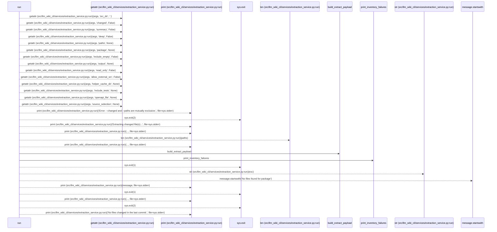
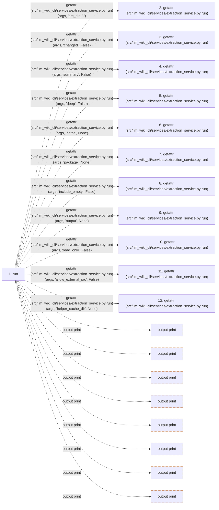

# extract

**Entry point:** `run` (`cli`)
**Source:** [extraction_service](../modules/extraction_service.md)
**Modules touched:** [analysis_capture](../modules/analysis_capture.md), [analysis_compatibility](../modules/analysis_compatibility.md), [api_contracts](../modules/api_contracts.md), [common](../modules/common.md), and 28 more

**Complete modules touched:**

- [analysis_capture](../modules/analysis_capture.md)
- [analysis_compatibility](../modules/analysis_compatibility.md)
- [api_contracts](../modules/api_contracts.md)
- [common](../modules/common.md)
- [config](../modules/config.md)
- [data_flow](../modules/data_flow.md)
- [dependency_versions](../modules/dependency_versions.md)
- [entrypoints](../modules/entrypoints.md)
- [extraction_jobs](../modules/extraction_jobs.md)
- [extraction_service](../modules/extraction_service.md)
- [extractor_helpers](../modules/extractor_helpers.md)
- [filesystem_guard](../modules/filesystem_guard.md)
- [go_calls](../modules/go_calls.md)
- [imports](../modules/imports.md)
- [inventory_cache](../modules/inventory_cache.md)
- [io](../modules/io.md)
- [packages](../modules/packages.md)
- [paths](../modules/paths.md)
- [plugins](../modules/plugins.md)
- [progress](../modules/progress.md)
- [python_bindings](../modules/python_bindings.md)
- [python_calls](../modules/python_calls.md)
- [python_contracts](../modules/python_contracts.md)
- [python_implementation](../modules/python_implementation.md)
- [python_imports](../modules/python_imports.md)
- [python_observations](../modules/python_observations.md)
- [resource_diagnostics](../modules/resource_diagnostics.md)
- [services_dependencies](../modules/services_dependencies.md)
- [source_selection](../modules/source_selection.md)
- [source_snapshot](../modules/source_snapshot.md)
- [validation](../modules/validation.md)
- [wiki_write_basis](../modules/wiki_write_basis.md)

## Call sequence

> Static overview in presentation order, not runtime execution order. Arrows retain captured callers; siblings are shown before deeper helper detail.

<!-- Auto-generated from static call edges. Dashed arrows are external or unresolved calls. Reviewed runtime conditions and side effects belong in Behavior. -->

> Call sequence diagram shows 30 of 3111 interactions; 3081 omitted to keep the visualization within the 30-interaction and generated-diagram limits, with uncertain identities omitted rather than inferred.

> Captured boundary calls: external 27 of 1030 (1003 omitted); unresolved 1 of 1315 (1314 omitted). These counts cover the captured static trace.

Omitted captured detail, grouped by actual caller occurrence and target module:

| Caller | Parent step | Target module | Kind | Omitted interactions |
| --- | --- | --- | --- | --- |
| `src/llm_wiki_cli/services/extraction_service.py:build_extract_payload` | 22 | [src/llm_wiki_cli/config.py](../modules/config.md) | internal | 2 |
| `src/llm_wiki_cli/config.py:validate_source_root` | 23 | [src/llm_wiki_cli/config.py](../modules/config.md) | internal | 7 |
| `src/llm_wiki_cli/config.py:validate_path` | 24 | [src/llm_wiki_cli/config.py](../modules/config.md) | internal | 2 |
| `src/llm_wiki_cli/config.py:validate_path` | 24 | - | unresolved | 3 |
| `src/llm_wiki_cli/config.py:validate_path` | 24 | - | external | 2 |
| `src/llm_wiki_cli/config.py:validate_source_root` | 23 | - | unresolved | 5 |
| `src/llm_wiki_cli/config.py:validate_source_root` | 23 | - | external | 11 |
| `src/llm_wiki_cli/config.py:validate_source_root` | 23 | [src/llm_wiki_cli/services/filesystem_guard.py](../modules/filesystem_guard.md) | internal | 1 |
> Omission summary shows 8 of 705 groups; 697 further groups are not expanded here. Counts above include all omitted interactions.
> Detailed flow queries retain their own coverage and limits; omitted paths may execute at runtime.

> Trace truncated at the depth limit; deeper calls are omitted.

## Data flow

<!-- Auto-generated static analysis. Treat values and boundaries as best-effort hints, not runtime proof. -->

### Step data

| Step | Inputs | Reads | Writes | Returns |
|---|---|---|---|---|
| `run` | `args` | `sys`, `sys`, `sys`, `sys`, `ExtractorFailureError`, `PathValidationError`, `sys`, `sys` | - | `none` |
| `getattr (src/llm_wiki_cli/services/extraction_service.py:run)` | - | - | - | - |
| `getattr (src/llm_wiki_cli/services/extraction_service.py:run)` | - | - | - | - |
| `getattr (src/llm_wiki_cli/services/extraction_service.py:run)` | - | - | - | - |
| `getattr (src/llm_wiki_cli/services/extraction_service.py:run)` | - | - | - | - |
| `getattr (src/llm_wiki_cli/services/extraction_service.py:run)` | - | - | - | - |
| `getattr (src/llm_wiki_cli/services/extraction_service.py:run)` | - | - | - | - |
| `getattr (src/llm_wiki_cli/services/extraction_service.py:run)` | - | - | - | - |
| `getattr (src/llm_wiki_cli/services/extraction_service.py:run)` | - | - | - | - |
| `getattr (src/llm_wiki_cli/services/extraction_service.py:run)` | - | - | - | - |
| `getattr (src/llm_wiki_cli/services/extraction_service.py:run)` | - | - | - | - |
| `getattr (src/llm_wiki_cli/services/extraction_service.py:run)` | - | - | - | - |

### Call data

| From | To | Line | Call |
|---|---|---:|---|
| run | getattr (src/llm_wiki_cli/services/extraction_service.py:run) | 2388 | `getattr(args, 'src_dir', '.')` |
| run | getattr (src/llm_wiki_cli/services/extraction_service.py:run) | 2389 | `getattr(args, 'changed', False)` |
| run | getattr (src/llm_wiki_cli/services/extraction_service.py:run) | 2390 | `getattr(args, 'summary', False)` |
| run | getattr (src/llm_wiki_cli/services/extraction_service.py:run) | 2391 | `getattr(args, 'deep', False)` |
| run | getattr (src/llm_wiki_cli/services/extraction_service.py:run) | 2392 | `getattr(args, 'paths', None)` |
| run | getattr (src/llm_wiki_cli/services/extraction_service.py:run) | 2393 | `getattr(args, 'package', None)` |
| run | getattr (src/llm_wiki_cli/services/extraction_service.py:run) | 2394 | `getattr(args, 'include_empty', False)` |
| run | getattr (src/llm_wiki_cli/services/extraction_service.py:run) | 2395 | `getattr(args, 'output', None)` |
| run | getattr (src/llm_wiki_cli/services/extraction_service.py:run) | 2396 | `getattr(args, 'read_only', False)` |
| run | getattr (src/llm_wiki_cli/services/extraction_service.py:run) | 2397 | `getattr(args, 'allow_external_src', False)` |
| run | getattr (src/llm_wiki_cli/services/extraction_service.py:run) | 2398 | `getattr(args, 'helper_cache_dir', None)` |

### Boundary effects

| Kind | Target | Step | Line |
|---|---|---|---:|
| output | `print` | `run` | 2404 |
| output | `print` | `run` | 2408 |
| output | `print` | `run` | 2410 |
| output | `print` | `run` | 2412 |
| output | `print` | `run` | 2438 |
| output | `print` | `run` | 2440 |
| output | `print` | `run` | 2445 |
| output | `print` | `run` | 2449 |

### Static analysis gaps

| Kind | Step | Target | Line |
|---|---|---|---:|
| external_call | `run` | `getattr` | 2388 |
| external_call | `run` | `getattr` | 2389 |
| external_call | `run` | `getattr` | 2390 |
| external_call | `run` | `getattr` | 2391 |
| external_call | `run` | `getattr` | 2392 |
| external_call | `run` | `getattr` | 2393 |
| external_call | `run` | `getattr` | 2394 |
| external_call | `run` | `getattr` | 2395 |
| external_call | `run` | `getattr` | 2396 |
| external_call | `run` | `getattr` | 2397 |
| external_call | `run` | `getattr` | 2398 |
| step_limit | `run` | `first 12 steps` | 0 |

## Behavior

Builds the stable extraction payload for the requested source boundary and
writes JSON to stdout or an explicitly selected output. Changed, path, package,
summary, and deep modes narrow or enrich that payload without importing the
target application. Extractor failures are reported on stderr and return a
nonzero status; successful output retains the source-relative inventory
contract.
