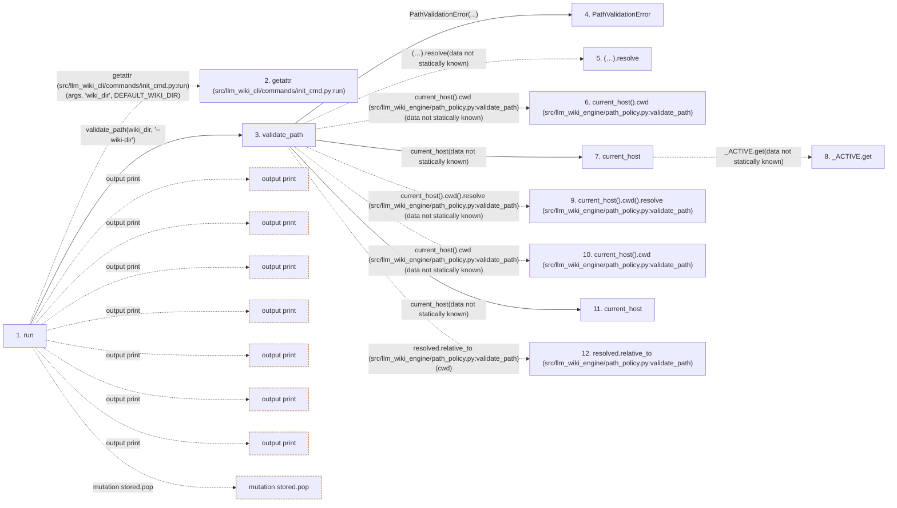

# init

**Entry point:** `run` (`cli`)
**Source:** [init_cmd](../modules/init_cmd.md)
**Modules touched:** [canonical_json](../modules/canonical_json.md), [common](../modules/common.md), [config](../modules/config.md), [context_packet](../modules/context_packet.md), and 71 more

**Complete modules touched:**

- [canonical_json](../modules/canonical_json.md)
- [common](../modules/common.md)
- [config](../modules/config.md)
- [context_packet](../modules/context_packet.md)
- [context_packet_builder](../modules/context_packet_builder.md)
- [context_request_format](../modules/context_request_format.md)
- [context_service](../modules/context_service.md)
- [current_contracts](../modules/current_contracts.md)
- [data_flow](../modules/data_flow.md)
- [domain_pack](../modules/domain_pack.md)
- [entrypoints](../modules/entrypoints.md)
- [extraction_service](../modules/extraction_service.md)
- [extractor_helpers](../modules/extractor_helpers.md)
- [filesystem_guard](../modules/filesystem_guard.md)
- [gitignore](../modules/gitignore.md)
- [helper_cache](../modules/helper_cache.md)
- [helper_preparation](../modules/helper_preparation.md)
- [helper_runtime](../modules/helper_runtime.md)
- [host](../modules/host.md)
- [immutable](../modules/immutable.md)
- [imports](../modules/imports.md)
- [infrastructure_inventory](../modules/infrastructure_inventory.md)
- [init_cmd](../modules/init_cmd.md)
- [integrations](../modules/integrations.md)
- [io](../modules/io.md)
- [knowledge_artifacts](../modules/knowledge_artifacts.md)
- [knowledge_consumption](../modules/knowledge_consumption.md)
- [knowledge_envelope](../modules/knowledge_envelope.md)
- [knowledge_evidence](../modules/knowledge_evidence.md)
- [knowledge_freshness](../modules/knowledge_freshness.md)
- [knowledge_governance](../modules/knowledge_governance.md)
- [knowledge_graph](../modules/knowledge_graph.md)
- [knowledge_index](../modules/knowledge_index.md)
- [knowledge_loader](../modules/knowledge_loader.md)
- [knowledge_model](../modules/knowledge_model.md)
- [knowledge_orchestration](../modules/knowledge_orchestration.md)
- [knowledge_packs](../modules/knowledge_packs.md)
- [knowledge_storage](../modules/knowledge_storage.md)
- [knowledge_storage_io](../modules/knowledge_storage_io.md)
- [knowledge_storage_lifecycle](../modules/knowledge_storage_lifecycle.md)
- [knowledge_verification](../modules/knowledge_verification.md)
- [maintenance_evidence](../modules/maintenance_evidence.md)
- [maintenance_projection](../modules/maintenance_projection.md)
- [maintenance_protocol](../modules/maintenance_protocol.md)
- [maintenance_recovery](../modules/maintenance_recovery.md)
- [maintenance_service](../modules/maintenance_service.md)
- [maintenance_shapes](../modules/maintenance_shapes.md)
- [maintenance_state](../modules/maintenance_state.md)
- [maintenance_status](../modules/maintenance_status.md)
- [manifest_storage](../modules/manifest_storage.md)
- [markdown_sections](../modules/markdown_sections.md)
- [pack_interfaces](../modules/pack_interfaces.md)
- [path_policy](../modules/path_policy.md)
- [paths](../modules/paths.md)
- [plugins](../modules/plugins.md)
- [python_implementation](../modules/python_implementation.md)
- [query_request_format](../modules/query_request_format.md)
- [rendering_lifecycle](../modules/rendering_lifecycle.md)
- [section_ownership](../modules/section_ownership.md)
- [services_dependencies](../modules/services_dependencies.md)
- [services_schema](../modules/services_schema.md)
- [skills](../modules/skills.md)
- [source_retirement](../modules/source_retirement.md)
- [source_selection](../modules/source_selection.md)
- [source_snapshot](../modules/source_snapshot.md)
- [storage_spool](../modules/storage_spool.md)
- [sync_manifest](../modules/sync_manifest.md)
- [typescript_helper_identity](../modules/typescript_helper_identity.md)
- [validation](../modules/validation.md)
- [verification_contracts](../modules/verification_contracts.md)
- [wiki_lifecycle](../modules/wiki_lifecycle.md)
- [wiki_media](../modules/wiki_media.md)
- [wiki_surface](../modules/wiki_surface.md)
- [wiki_surface_index](../modules/wiki_surface_index.md)
- [wiki_write_basis](../modules/wiki_write_basis.md)

## Call sequence

> Static overview in presentation order, not runtime execution order. Arrows retain captured callers; representative internal continuations and boundary examples precede repeated helper detail.

```mermaid
sequenceDiagram
    participant p0 as run
    participant p1 as validate_path
    participant p2 as require_safe_wiki_scaffold
    participant p3 as require_safe_config_path
    participant p4 as inspect_config
    participant p5 as resolve_source_selection
    participant p6 as _managed_schema_agents
    participant p7 as require_replaceable_managed_schema
    participant p8 as ensure_source_helpers
    participant p9 as upgrade_current_knowledge
    participant p10 as provision_wiki_scaffold
    participant p11 as require_config_inspection_unchanged
    participant p12 as _provision_reference_skill_guarded
    participant p13 as select_render_profile
    participant p14 as build_schema_content
    participant p15 as replace_schema_block_content
    participant p16 as require_managed_schema_profile
    participant p17 as write_config
    participant p18 as require_committed_config
    participant p19 as get_agent_config_path
    participant p20 as config_requires_manual_recovery
    participant p21 as require_safe_schema_path
    participant p22 as decode_managed_document_bytes
    participant p23 as ManagedSchemaPathError
    participant p24 as ManagedSchemaBlockError
    participant p25 as helper_preparation_failure_hint
    participant p26 as reference_recovery_command
    participant p27 as skills_install_dir
    participant p28 as list_bundled_skills
    participant p29 as getattr (src/llm_wiki_cli/commands/init_cmd.py:run)
    participant p30 as stored.get
    p0->>p1: validate_path
    p0->>p2: require_safe_wiki_scaffold
    p0->>p3: require_safe_config_path
    p0->>p4: inspect_config
    p0->>p5: resolve_source_selection
    p0->>p6: _managed_schema_agents
    p0->>p7: require_replaceable_managed_schema
    p0->>p8: ensure_source_helpers
    p0->>p9: upgrade_current_knowledge
    p0->>p10: provision_wiki_scaffold
    p0->>p11: require_config_inspection_unchanged
    p0->>p12: _provision_reference_skill_guarded
    p0->>p13: select_render_profile
    p0->>p14: build_schema_content
    p0->>p15: replace_schema_block_content
    p0->>p16: require_managed_schema_profile
    p0->>p17: write_config
    p0->>p18: require_committed_config
    p0->>p19: get_agent_config_path
    p0->>p20: config_requires_manual_recovery
    p0->>p21: require_safe_schema_path
    p0->>p22: decode_managed_document_bytes
    p0->>p23: ManagedSchemaPathError
    p0->>p24: ManagedSchemaBlockError
    p0->>p25: helper_preparation_failure_hint
    p0->>p26: reference_recovery_command
    p0->>p27: skills_install_dir
    p0->>p28: list_bundled_skills
    p0-->>p29: getattr (src/llm_wiki_cli/commands/init_cmd.py:run)(args, 'wiki_dir', DEFAULT_WIKI_DIR)
    p0-->>p30: stored.get('pending_cleanup_agent')
```

<!-- Auto-generated from static call edges. Dashed arrows are external or unresolved calls. Reviewed runtime conditions and side effects belong in Behavior. -->

> Call sequence diagram shows 30 of 4296 interactions; 4266 omitted to keep the visualization within the 30-interaction and generated-diagram limits, with uncertain identities omitted rather than inferred.

> Captured boundary calls: external 1 of 1444 (1443 omitted); unresolved 1 of 1008 (1007 omitted). These counts cover the captured static trace.

Omitted captured detail, grouped by actual caller occurrence and target module:

| Caller | Parent step | Target module | Kind | Omitted interactions |
| --- | --- | --- | --- | --- |
| `src/llm_wiki_engine/path_policy.py:validate_path` | 3 | [src/llm_wiki_engine/path_policy.py](../modules/path_policy.md) | internal | 2 |
| `src/llm_wiki_engine/path_policy.py:validate_path` | 3 | - | unresolved | 5 |
| `src/llm_wiki_engine/path_policy.py:validate_path` | 3 | [src/llm_wiki_engine/host.py](../modules/host.md) | internal | 2 |
| `src/llm_wiki_engine/host.py:current_host` | 7 | - | unresolved | 1 |
| `src/llm_wiki_cli/commands/init_cmd.py:run` | 1 | - | external | 105 |
| `src/llm_wiki_cli/services/wiki_lifecycle.py:require_safe_wiki_scaffold` | 19 | - | external | 3 |
| `src/llm_wiki_cli/services/wiki_lifecycle.py:require_safe_wiki_scaffold` | 19 | [src/llm_wiki_engine/wiki_surface.py](../modules/wiki_surface.md) | internal | 1 |
| `src/llm_wiki_engine/wiki_surface.py:iter_directory_kinds` | 22 | - | external | 1 |
> Omission summary shows 8 of 1108 groups; 1100 further groups are not expanded here. Counts above include all omitted interactions.
> Detailed flow queries retain their own coverage and limits; omitted paths may execute at runtime.

> Trace truncated at the depth limit; deeper calls are omitted.

## Data flow

<!-- Auto-generated static analysis. Treat values and boundaries as best-effort hints, not runtime proof. -->

### Analysis coverage

**Effect analysis partially available.** Flow assembly and source effect analysis are separate; empty observations do not prove an empty handler body.

Source steps: 1845; effect analysis evaluated: 1216, partial: 84, unavailable: 545. Counts include steps omitted from the displayed trace.

Collector observations for 1300 source steps with known totals: observed: 8297, emitted: 7745, omitted: 552. Unavailable totals are excluded.

- Callable record unavailable for one or more source steps; those steps have no represented callable body.
- Effect collector omitted observations before flow assembly; displayed effects are partial.
- Effect collector totals unavailable; observed counts cover captured records only.

| Step | Callable record | Effect analysis | Collector totals | Observed | Emitted | Omitted |
|---|---|---|---|---:|---:|---:|
| `run` | `available` | `partial` | `available` | `118` | `18` | `100` |
| `getattr (src/llm_wiki_cli/commands/init_cmd.py:run)` | `not_applicable` | `not_applicable` | `not_applicable` | — | — | — |
| `validate_path` | `available` | `evaluated` | `available` | `3` | `3` | `0` |
| `PathValidationError` | `unavailable` | `unavailable` | `unavailable` | — | — | — |
| `(…).resolve` | `not_applicable` | `not_applicable` | `not_applicable` | — | — | — |
| `current_host().cwd (src/llm_wiki_engine/path_policy.py:validate_path)` | `not_applicable` | `not_applicable` | `not_applicable` | — | — | — |
| `current_host` | `available` | `evaluated` | `available` | `2` | `2` | `0` |
| `_ACTIVE.get` | `not_applicable` | `not_applicable` | `not_applicable` | — | — | — |
| `current_host().cwd().resolve (src/llm_wiki_engine/path_policy.py:validate_path)` | `not_applicable` | `not_applicable` | `not_applicable` | — | — | — |
| `current_host().cwd (src/llm_wiki_engine/path_policy.py:validate_path)` | `not_applicable` | `not_applicable` | `not_applicable` | — | — | — |
| `current_host` | `available` | `evaluated` | `available` | `2` | `2` | `0` |
| `resolved.relative_to (src/llm_wiki_engine/path_policy.py:validate_path)` | `not_applicable` | `not_applicable` | `not_applicable` | — | — | — |

### Step data

| Step | Inputs | Reads | Writes | Returns |
|---|---|---|---|---|
| `run` | `args` | `DEFAULT_WIKI_DIR`, `sys`, `WikiScaffoldPathError`, `sys`, `AgentConfigState`, `sys`, `AgentConfigState`, `AgentConfigState` | `config[...]` | - |
| `getattr (src/llm_wiki_cli/commands/init_cmd.py:run)` | - | - | - | - |
| `validate_path` | `path: str`, `label: str` | - | - | `resolved` |
| `PathValidationError` | - | - | - | - |
| `(…).resolve` | - | - | - | - |
| `current_host().cwd (src/llm_wiki_engine/path_policy.py:validate_path)` | - | - | - | - |
| `current_host` | - | `_DEFAULT` | - | `...` |
| `_ACTIVE.get` | - | - | - | - |
| `current_host().cwd().resolve (src/llm_wiki_engine/path_policy.py:validate_path)` | - | - | - | - |
| `current_host().cwd (src/llm_wiki_engine/path_policy.py:validate_path)` | - | - | - | - |
| `current_host` | - | `_DEFAULT` | - | `...` |
| `resolved.relative_to (src/llm_wiki_engine/path_policy.py:validate_path)` | - | - | - | - |

### Call data

| From | To | Line | Call |
|---|---|---:|---|
| run | getattr (src/llm_wiki_cli/commands/init_cmd.py:run) | 96 | `getattr(args, 'wiki_dir', DEFAULT_WIKI_DIR)` |
| run | validate_path | 97 | `validate_path(wiki_dir, '--wiki-dir')` |
| validate_path | PathValidationError | 100 | `PathValidationError(...)` |
| validate_path | (…).resolve | 101 | `(current_host().cwd() / path).resolve(data not statically known)` |
| validate_path | current_host().cwd (src/llm_wiki_engine/path_policy.py:validate_path) | 101 | `current_host().cwd(data not statically known)` |
| validate_path | current_host | 101 | `current_host(data not statically known)` |
| current_host | _ACTIVE.get | 166 | `_ACTIVE.get(data not statically known)` |
| validate_path | current_host().cwd().resolve (src/llm_wiki_engine/path_policy.py:validate_path) | 102 | `current_host().cwd().resolve(data not statically known)` |
| validate_path | current_host().cwd (src/llm_wiki_engine/path_policy.py:validate_path) | 102 | `current_host().cwd(data not statically known)` |
| validate_path | current_host | 102 | `current_host(data not statically known)` |
| validate_path | resolved.relative_to (src/llm_wiki_engine/path_policy.py:validate_path) | 104 | `resolved.relative_to(cwd)` |

### Boundary effects

| Kind | Target | Step | Line |
|---|---|---|---:|
| output | `print` | `run` | 101 |
| output | `print` | `run` | 110 |
| output | `print` | `run` | 123 |
| output | `print` | `run` | 135 |
| output | `print` | `run` | 146 |
| output | `print` | `run` | 154 |
| output | `print` | `run` | 163 |
| mutation | `stored.pop` | `run` | 171 |

### Static analysis gaps

| Kind | Step | Target | Line |
|---|---|---|---:|
| external_call | `run` | `getattr` | 96 |
| unresolved_call | `validate_path` | `(current_host().cwd() / path).resolve` | 101 |
| unresolved_call | `validate_path` | `current_host().cwd` | 101 |
| unresolved_call | `current_host` | `_ACTIVE.get` | 166 |
| unresolved_call | `validate_path` | `current_host().cwd().resolve` | 102 |
| unresolved_call | `validate_path` | `current_host().cwd` | 102 |
| unresolved_call | `validate_path` | `resolved.relative_to` | 104 |
| step_limit | `run` | `first 12 steps` | 0 |
| truncated_flow | `run` | `depth limit` | 0 |

## Behavior

Initialization validates existing workspace and agent state before creating or
refreshing the wiki scaffold and managed instructions. With
`--prepare-extractors`, it first detects selected helper languages and prepares
missing or stale artifacts in the helper cache. A preparation failure reports
the prerequisite and stops before scaffold or configuration changes. A retry
reuses helpers already prepared successfully. Preparation is opt-in for each
invocation and may download dependencies or compile bundled helpers.

The installed defaults provide the same recovery route through a focused managed
reference or the complete inline fallback when skills are disabled. Command
examples retain configured wiki/selection bindings and require the original
helper cache and source scope. Initialization alone is a scaffold, not captured
native evidence; reads never bootstrap a missing evidence store. User-authored
instructions outside the managed block remain intact.
