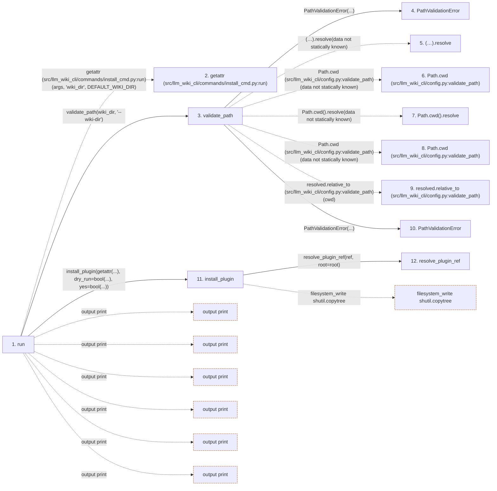

# install

**Entry point:** `run` (`cli`)
**Source:** [install_cmd](../modules/install_cmd.md)
**Modules touched:** [config](../modules/config.md), [install_cmd](../modules/install_cmd.md), [io](../modules/io.md), [plugins](../modules/plugins.md), and 3 more

**Complete modules touched:**

- [config](../modules/config.md)
- [install_cmd](../modules/install_cmd.md)
- [io](../modules/io.md)
- [plugins](../modules/plugins.md)
- [services_schema](../modules/services_schema.md)
- [validation](../modules/validation.md)
- [wiki_write_basis](../modules/wiki_write_basis.md)

## Call sequence

> Static overview in presentation order, not runtime execution order. Arrows retain captured callers; representative internal continuations and boundary examples precede repeated helper detail.

```mermaid
sequenceDiagram
    participant p0 as run
    participant p1 as validate_path
    participant p2 as install_plugin
    participant p3 as read_config
    participant p4 as refresh_skill_blocks
    participant p5 as _component_summary
    participant p6 as resolve_plugin_ref
    participant p7 as validate_plugin
    participant p8 as require_safe_schema_path
    participant p9 as read_lock
    participant p10 as installed_skill_block_contents
    participant p11 as _check_install_collisions
    participant p12 as refresh_skill_blocks_content
    participant p13 as write_bytes_atomic
    participant p14 as plugin_store
    participant p15 as write_lock
    participant p16 as _manifest_root
    participant p17 as lock_path
    participant p18 as _ensure_no_reserved_plugin_sources
    participant p19 as replace_skill_block_content
    participant p20 as iter_components
    participant p21 as _ensure_id
    participant p22 as _load_catalog
    participant p23 as _version_satisfies
    participant p24 as _normalize_component
    participant p25 as build_skill_block
    participant p26 as _ensure_entry_point
    participant p27 as _safe_component_path
    participant p28 as _validate_prompt_template_vcs_boundary
    participant p29 as getattr (src/llm_wiki_cli/commands/install_cmd.py:run)
    participant p30 as config.get
    p0->>p1: validate_path
    p0->>p2: install_plugin
    p0->>p3: read_config
    p0->>p4: refresh_skill_blocks
    p0->>p5: _component_summary
    p2->>p6: resolve_plugin_ref
    p2->>p7: validate_plugin
    p4->>p8: require_safe_schema_path
    p2->>p9: read_lock
    p4->>p10: installed_skill_block_contents
    p2->>p11: _check_install_collisions
    p4->>p12: refresh_skill_blocks_content
    p4->>p13: write_bytes_atomic
    p2->>p14: plugin_store
    p2->>p15: write_lock
    p7->>p16: _manifest_root
    p9->>p17: lock_path
    p7->>p18: _ensure_no_reserved_plugin_sources
    p12->>p19: replace_skill_block_content
    p10->>p20: iter_components
    p7->>p21: _ensure_id
    p6->>p22: _load_catalog
    p7->>p23: _version_satisfies
    p7->>p24: _normalize_component
    p19->>p25: build_skill_block
    p24->>p26: _ensure_entry_point
    p24->>p27: _safe_component_path
    p24->>p28: _validate_prompt_template_vcs_boundary
    p0-->>p29: getattr (src/llm_wiki_cli/commands/install_cmd.py:run)(args, 'wiki_dir', DEFAULT_WIKI_DIR)
    p0-->>p30: config.get('agent', 'generic')
```

<!-- Auto-generated from static call edges. Dashed arrows are external or unresolved calls. Reviewed runtime conditions and side effects belong in Behavior. -->

> Call sequence diagram shows 30 of 397 interactions; 367 omitted to keep the visualization within the 30-interaction and generated-diagram limits, with uncertain identities omitted rather than inferred.

> Captured boundary calls: external 1 of 129 (128 omitted); unresolved 1 of 159 (158 omitted). These counts cover the captured static trace.

Omitted captured detail, grouped by actual caller occurrence and target module:

| Caller | Parent step | Target module | Kind | Omitted interactions |
| --- | --- | --- | --- | --- |
| `src/llm_wiki_cli/config.py:validate_path` | 3 | [src/llm_wiki_cli/config.py](../modules/config.md) | internal | 2 |
| `src/llm_wiki_cli/config.py:validate_path` | 3 | - | unresolved | 3 |
| `src/llm_wiki_cli/config.py:validate_path` | 3 | - | external | 2 |
| `src/llm_wiki_cli/services/plugins.py:resolve_plugin_ref` | 12 | - | unresolved | 9 |
| `src/llm_wiki_cli/services/plugins.py:resolve_plugin_ref` | 12 | - | external | 5 |
| `src/llm_wiki_cli/services/plugins.py:resolve_plugin_ref` | 12 | [src/llm_wiki_cli/services/plugins.py](../modules/plugins.md) | internal | 3 |
| `src/llm_wiki_cli/services/plugins.py:_load_catalog` | 23 | - | unresolved | 5 |
| `src/llm_wiki_cli/services/plugins.py:_load_catalog` | 23 | - | external | 9 |
> Omission summary shows 8 of 106 groups; 98 further groups are not expanded here. Counts above include all omitted interactions.
> Detailed flow queries retain their own coverage and limits; omitted paths may execute at runtime.

> Trace truncated at the depth limit; deeper calls are omitted.

## Data flow

<!-- Auto-generated static analysis. Treat values and boundaries as best-effort hints, not runtime proof. -->

### Analysis coverage

**Effect analysis partially available.** Flow assembly and source effect analysis are separate; empty observations do not prove an empty handler body.

Source steps: 110; effect analysis evaluated: 69, partial: 1, unavailable: 40. Counts include steps omitted from the displayed trace.

Collector observations for 70 source steps with known totals: observed: 337, emitted: 327, omitted: 10. Unavailable totals are excluded.

- Callable record unavailable for one or more source steps; those steps have no represented callable body.
- Effect collector omitted observations before flow assembly; displayed effects are partial.
- Effect collector totals unavailable; observed counts cover captured records only.

| Step | Callable record | Effect analysis | Collector totals | Observed | Emitted | Omitted |
|---|---|---|---|---:|---:|---:|
| `run` | `available` | `evaluated` | `available` | `11` | `11` | `0` |
| `getattr (src/llm_wiki_cli/commands/install_cmd.py:run)` | `not_applicable` | `not_applicable` | `not_applicable` | — | — | — |
| `validate_path` | `available` | `evaluated` | `available` | `3` | `3` | `0` |
| `PathValidationError` | `unavailable` | `unavailable` | `unavailable` | — | — | — |
| `(…).resolve` | `not_applicable` | `not_applicable` | `not_applicable` | — | — | — |
| `Path.cwd (src/llm_wiki_cli/config.py:validate_path)` | `not_applicable` | `not_applicable` | `not_applicable` | — | — | — |
| `Path.cwd().resolve` | `not_applicable` | `not_applicable` | `not_applicable` | — | — | — |
| `Path.cwd (src/llm_wiki_cli/config.py:validate_path)` | `not_applicable` | `not_applicable` | `not_applicable` | — | — | — |
| `resolved.relative_to (src/llm_wiki_cli/config.py:validate_path)` | `not_applicable` | `not_applicable` | `not_applicable` | — | — | — |
| `PathValidationError` | `unavailable` | `unavailable` | `unavailable` | — | — | — |
| `install_plugin` | `available` | `evaluated` | `available` | `8` | `8` | `0` |
| `resolve_plugin_ref` | `available` | `evaluated` | `available` | `6` | `6` | `0` |

### Step data

| Step | Inputs | Reads | Writes | Returns |
|---|---|---|---|---|
| `run` | `args` | `DEFAULT_WIKI_DIR`, `PluginError`, `sys` | - | `none` |
| `getattr (src/llm_wiki_cli/commands/install_cmd.py:run)` | - | - | - | - |
| `validate_path` | `path: str`, `label: str` | - | - | `resolved` |
| `PathValidationError` | - | - | - | - |
| `(…).resolve` | - | - | - | - |
| `Path.cwd (src/llm_wiki_cli/config.py:validate_path)` | - | - | - | - |
| `Path.cwd().resolve` | - | - | - | - |
| `Path.cwd (src/llm_wiki_cli/config.py:validate_path)` | - | - | - | - |
| `resolved.relative_to (src/llm_wiki_cli/config.py:validate_path)` | - | - | - | - |
| `PathValidationError` | - | - | - | - |
| `install_plugin` | `ref: str`, `root: str \| Path`, `dry_run: bool`, `yes: bool` | `_copy_ignore` | - | `entry`, `entry` |
| `resolve_plugin_ref` | `ref: str`, `root: str \| Path` | `PROJECT_CATALOG`, `USER_CATALOG` | - | `resolved`, `configured.resolve(...)` |

### Call data

| From | To | Line | Call |
|---|---|---:|---|
| run | getattr (src/llm_wiki_cli/commands/install_cmd.py:run) | 20 | `getattr(args, 'wiki_dir', DEFAULT_WIKI_DIR)` |
| run | validate_path | 21 | `validate_path(wiki_dir, '--wiki-dir')` |
| validate_path | PathValidationError | 134 | `PathValidationError(...)` |
| validate_path | (…).resolve | 135 | `(Path.cwd() / path).resolve(data not statically known)` |
| validate_path | Path.cwd (src/llm_wiki_cli/config.py:validate_path) | 135 | `Path.cwd(data not statically known)` |
| validate_path | Path.cwd().resolve | 136 | `Path.cwd().resolve(data not statically known)` |
| validate_path | Path.cwd (src/llm_wiki_cli/config.py:validate_path) | 136 | `Path.cwd(data not statically known)` |
| validate_path | resolved.relative_to (src/llm_wiki_cli/config.py:validate_path) | 138 | `resolved.relative_to(cwd)` |
| validate_path | PathValidationError | 140 | `PathValidationError(...)` |
| run | install_plugin | 24 | `install_plugin(getattr(...), dry_run=bool(...), yes=bool(...))` |
| install_plugin | resolve_plugin_ref | 449 | `resolve_plugin_ref(ref, root=root)` |

### Boundary effects

| Kind | Target | Step | Line |
|---|---|---|---:|
| output | `print` | `run` | 30 |
| output | `print` | `run` | 34 |
| output | `print` | `run` | 37 |
| output | `print` | `run` | 42 |
| output | `print` | `run` | 43 |
| output | `print` | `run` | 45 |
| filesystem_write | `shutil.copytree` | `install_plugin` | 479 |

### Static analysis gaps

| Kind | Step | Target | Line |
|---|---|---|---:|
| external_call | `run` | `getattr` | 20 |
| unresolved_call | `validate_path` | `(Path.cwd() / path).resolve` | 135 |
| external_call | `validate_path` | `Path.cwd` | 135 |
| unresolved_call | `validate_path` | `Path.cwd().resolve` | 136 |
| external_call | `validate_path` | `Path.cwd` | 136 |
| unresolved_call | `validate_path` | `resolved.relative_to` | 138 |
| step_limit | `run` | `first 12 steps` | 0 |
| truncated_flow | `run` | `depth limit` | 0 |

## Behavior

This flow starts at `run` and is classified as `cli`. The generated call and data-flow sections are bounded static projections; runtime conditions and side effects require source-level confirmation.
