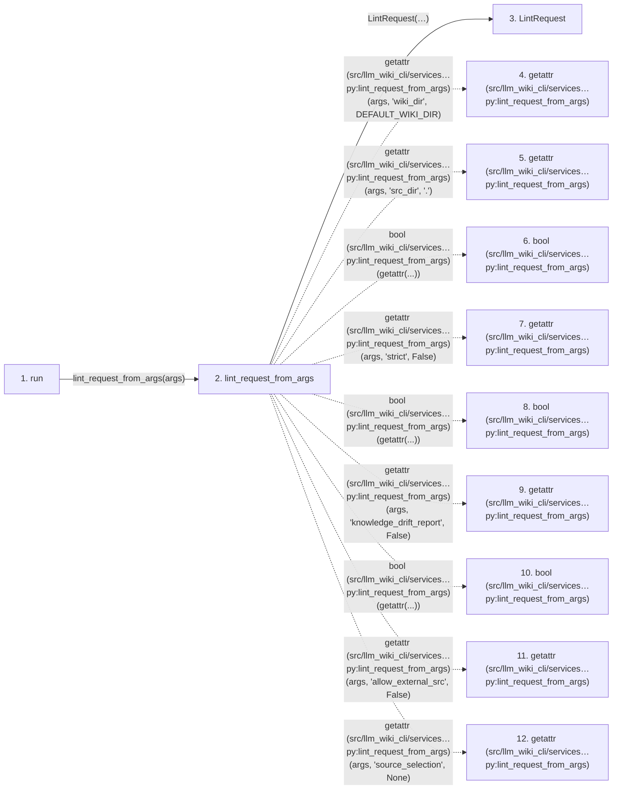

# lint

**Entry point:** `run` (`cli`)
**Source:** [lint_service](../modules/lint_service.md)
**Modules touched:** [analysis_compatibility](../modules/analysis_compatibility.md), [bootstrap_runtime](../modules/bootstrap_runtime.md), [canonical_json](../modules/canonical_json.md), [common](../modules/common.md), and 59 more

**Complete modules touched:**

- [analysis_compatibility](../modules/analysis_compatibility.md)
- [bootstrap_runtime](../modules/bootstrap_runtime.md)
- [canonical_json](../modules/canonical_json.md)
- [common](../modules/common.md)
- [data_flow](../modules/data_flow.md)
- [dockerfile_parser](../modules/dockerfile_parser.md)
- [domain_pack](../modules/domain_pack.md)
- [engine_events](../modules/engine_events.md)
- [entrypoints](../modules/entrypoints.md)
- [evidence_diagnostics](../modules/evidence_diagnostics.md)
- [extraction_jobs](../modules/extraction_jobs.md)
- [extraction_service](../modules/extraction_service.md)
- [filesystem_guard](../modules/filesystem_guard.md)
- [flow_followup](../modules/flow_followup.md)
- [gitignore](../modules/gitignore.md)
- [health_contract](../modules/health_contract.md)
- [health_details](../modules/health_details.md)
- [host](../modules/host.md)
- [immutable](../modules/immutable.md)
- [imports](../modules/imports.md)
- [infrastructure_inventory](../modules/infrastructure_inventory.md)
- [infrastructure_sync](../modules/infrastructure_sync.md)
- [inventory_cache](../modules/inventory_cache.md)
- [io](../modules/io.md)
- [knowledge_artifacts](../modules/knowledge_artifacts.md)
- [knowledge_consumption](../modules/knowledge_consumption.md)
- [knowledge_envelope](../modules/knowledge_envelope.md)
- [knowledge_evidence](../modules/knowledge_evidence.md)
- [knowledge_freshness](../modules/knowledge_freshness.md)
- [knowledge_governance](../modules/knowledge_governance.md)
- [knowledge_loader](../modules/knowledge_loader.md)
- [knowledge_observability](../modules/knowledge_observability.md)
- [knowledge_orchestration](../modules/knowledge_orchestration.md)
- [knowledge_storage](../modules/knowledge_storage.md)
- [knowledge_storage_io](../modules/knowledge_storage_io.md)
- [knowledge_verification](../modules/knowledge_verification.md)
- [lint_request](../modules/lint_request.md)
- [lint_service](../modules/lint_service.md)
- [maintenance_protocol](../modules/maintenance_protocol.md)
- [metrics](../modules/metrics.md)
- [module_coverage](../modules/module_coverage.md)
- [path_policy](../modules/path_policy.md)
- [plugins](../modules/plugins.md)
- [progress](../modules/progress.md)
- [python_extractor](../modules/python_extractor.md)
- [python_implementation](../modules/python_implementation.md)
- [python_imports](../modules/python_imports.md)
- [query_request_format](../modules/query_request_format.md)
- [runtime_output](../modules/runtime_output.md)
- [services_dependencies](../modules/services_dependencies.md)
- [source_retirement](../modules/source_retirement.md)
- [source_selection](../modules/source_selection.md)
- [source_snapshot](../modules/source_snapshot.md)
- [sync_analysis](../modules/sync_analysis.md)
- [sync_manifest](../modules/sync_manifest.md)
- [team](../modules/team.md)
- [validation](../modules/validation.md)
- [verification_contracts](../modules/verification_contracts.md)
- [wiki_lifecycle](../modules/wiki_lifecycle.md)
- [wiki_media](../modules/wiki_media.md)
- [wiki_surface](../modules/wiki_surface.md)
- [yaml_formats](../modules/yaml_formats.md)
- [yaml_syntax](../modules/yaml_syntax.md)

## Call sequence

> Static overview in presentation order, not runtime execution order. Arrows retain captured callers; representative internal continuations and boundary examples precede repeated helper detail.

```mermaid
sequenceDiagram
    participant p0 as run
    participant p1 as lint_request_from_args
    participant p2 as _build_requested_report
    participant p3 as emit
    participant p4 as _profile_report_to_dict
    participant p5 as render_text
    participant p6 as record_validation_event
    participant p7 as _LintProfiler
    participant p8 as report_to_dict
    participant p9 as _safe_knowledge_summary
    participant p10 as record_event
    participant p11 as validate_path
    participant p12 as validate_source_root
    participant p13 as build_report
    participant p14 as _publish_message
    participant p15 as cache_options_for
    participant p16 as extraction_job_request_for
    participant p17 as _sanitize_metrics_value
    participant p18 as _iso_now
    participant p19 as _new_lint_report
    participant p20 as _preflight_lint_inputs
    participant p21 as _finalize_lint_report
    participant p22 as prepare_cache_options
    participant p23 as _collect_lint_inputs
    participant p24 as _run_report_checks
    participant p25 as windows_current_user_sid
    participant p26 as first_unsafe_path_component
    participant p27 as resolve_team_policy
    participant p28 as capture_health_details
    participant p29 as bool (src/llm_wiki_cli/services/lint_service.py:run)
    participant p30 as report.count (src/llm_wiki_cli/services/lint_service.py:run)
    p0->>p1: lint_request_from_args
    p0->>p2: _build_requested_report
    p0->>p3: emit
    p0->>p4: _profile_report_to_dict
    p0->>p5: render_text
    p0->>p6: record_validation_event
    p0->>p7: _LintProfiler
    p4->>p8: report_to_dict
    p6->>p9: _safe_knowledge_summary
    p6->>p10: record_event
    p2->>p11: validate_path
    p2->>p12: validate_source_root
    p2->>p13: build_report
    p3->>p14: _publish_message
    p2->>p15: cache_options_for
    p2->>p16: extraction_job_request_for
    p9->>p17: _sanitize_metrics_value
    p10->>p18: _iso_now
    p13->>p19: _new_lint_report
    p13->>p20: _preflight_lint_inputs
    p13->>p21: _finalize_lint_report
    p13->>p22: prepare_cache_options
    p13->>p23: _collect_lint_inputs
    p13->>p24: _run_report_checks
    p12->>p25: windows_current_user_sid
    p12->>p26: first_unsafe_path_component
    p20->>p27: resolve_team_policy
    p21->>p28: capture_health_details
    p0-->>p29: bool (src/llm_wiki_cli/services/lint_service.py:run)(...)
    p0-->>p30: report.count (src/llm_wiki_cli/services/lint_service.py:run)('extractor_failure')
```

<!-- Auto-generated from static call edges. Dashed arrows are external or unresolved calls. Reviewed runtime conditions and side effects belong in Behavior. -->

> Call sequence diagram shows 30 of 1877 interactions; 1847 omitted to keep the visualization within the 30-interaction and generated-diagram limits, with uncertain identities omitted rather than inferred.

> Captured boundary calls: external 1 of 587 (586 omitted); unresolved 1 of 598 (597 omitted). These counts cover the captured static trace.

Omitted captured detail, grouped by actual caller occurrence and target module:

| Caller | Parent step | Target module | Kind | Omitted interactions |
| --- | --- | --- | --- | --- |
| `src/llm_wiki_cli/services/lint_service.py:lint_request_from_args` | 2 | [src/llm_wiki_cli/services/lint_request.py](../modules/lint_request.md) | internal | 1 |
| `src/llm_wiki_cli/services/lint_service.py:lint_request_from_args` | 2 | - | external | 21 |
| `src/llm_wiki_cli/services/lint_service.py:run` | 1 | - | external | 7 |
| `src/llm_wiki_cli/services/lint_service.py:_build_requested_report` | 29 | - | external | 7 |
| `src/llm_wiki_engine/path_policy.py:validate_path` | 32 | [src/llm_wiki_engine/path_policy.py](../modules/path_policy.md) | internal | 2 |
| `src/llm_wiki_engine/path_policy.py:validate_path` | 32 | - | unresolved | 5 |
| `src/llm_wiki_engine/path_policy.py:validate_path` | 32 | [src/llm_wiki_engine/host.py](../modules/host.md) | internal | 2 |
| `src/llm_wiki_engine/host.py:current_host` | 36 | - | unresolved | 1 |
> Omission summary shows 8 of 527 groups; 519 further groups are not expanded here. Counts above include all omitted interactions.
> Detailed flow queries retain their own coverage and limits; omitted paths may execute at runtime.

> Trace truncated at the depth limit; deeper calls are omitted.

## Data flow

<!-- Auto-generated static analysis. Treat values and boundaries as best-effort hints, not runtime proof. -->

### Analysis coverage

**Effect analysis partially available.** Flow assembly and source effect analysis are separate; empty observations do not prove an empty handler body.

Source steps: 693; effect analysis evaluated: 557, partial: 29, unavailable: 107. Counts include steps omitted from the displayed trace.

Collector observations for 586 source steps with known totals: observed: 3789, emitted: 3616, omitted: 173. Unavailable totals are excluded.

- Callable record unavailable for one or more source steps; those steps have no represented callable body.
- Effect collector omitted observations before flow assembly; displayed effects are partial.
- Effect collector totals unavailable; observed counts cover captured records only.

| Step | Callable record | Effect analysis | Collector totals | Observed | Emitted | Omitted |
|---|---|---|---|---:|---:|---:|
| `run` | `available` | `evaluated` | `available` | `1` | `1` | `0` |
| `lint_request_from_args` | `available` | `evaluated` | `available` | `3` | `3` | `0` |
| `LintRequest` | `unavailable` | `unavailable` | `unavailable` | — | — | — |
| `getattr (src/llm_wiki_cli/services…py:lint_request_from_args)` | `not_applicable` | `not_applicable` | `not_applicable` | — | — | — |
| `getattr (src/llm_wiki_cli/services…py:lint_request_from_args)` | `not_applicable` | `not_applicable` | `not_applicable` | — | — | — |
| `bool (src/llm_wiki_cli/services…py:lint_request_from_args)` | `not_applicable` | `not_applicable` | `not_applicable` | — | — | — |
| `getattr (src/llm_wiki_cli/services…py:lint_request_from_args)` | `not_applicable` | `not_applicable` | `not_applicable` | — | — | — |
| `bool (src/llm_wiki_cli/services…py:lint_request_from_args)` | `not_applicable` | `not_applicable` | `not_applicable` | — | — | — |
| `getattr (src/llm_wiki_cli/services…py:lint_request_from_args)` | `not_applicable` | `not_applicable` | `not_applicable` | — | — | — |
| `bool (src/llm_wiki_cli/services…py:lint_request_from_args)` | `not_applicable` | `not_applicable` | `not_applicable` | — | — | — |
| `getattr (src/llm_wiki_cli/services…py:lint_request_from_args)` | `not_applicable` | `not_applicable` | `not_applicable` | — | — | — |
| `getattr (src/llm_wiki_cli/services…py:lint_request_from_args)` | `not_applicable` | `not_applicable` | `not_applicable` | — | — | — |

### Step data

| Step | Inputs | Reads | Writes | Returns |
|---|---|---|---|---|
| `run` | `args` | - | - | - |
| `lint_request_from_args` | `args` | `DEFAULT_WIKI_DIR` | - | `LintRequest(...)` |
| `LintRequest` | - | - | - | - |
| `getattr (src/llm_wiki_cli/services…py:lint_request_from_args)` | - | - | - | - |
| `getattr (src/llm_wiki_cli/services…py:lint_request_from_args)` | - | - | - | - |
| `bool (src/llm_wiki_cli/services…py:lint_request_from_args)` | - | - | - | - |
| `getattr (src/llm_wiki_cli/services…py:lint_request_from_args)` | - | - | - | - |
| `bool (src/llm_wiki_cli/services…py:lint_request_from_args)` | - | - | - | - |
| `getattr (src/llm_wiki_cli/services…py:lint_request_from_args)` | - | - | - | - |
| `bool (src/llm_wiki_cli/services…py:lint_request_from_args)` | - | - | - | - |
| `getattr (src/llm_wiki_cli/services…py:lint_request_from_args)` | - | - | - | - |
| `getattr (src/llm_wiki_cli/services…py:lint_request_from_args)` | - | - | - | - |

### Call data

| From | To | Line | Call |
|---|---|---:|---|
| run | lint_request_from_args | 3418 | `lint_request_from_args(args)` |
| lint_request_from_args | LintRequest | 3345 | `LintRequest(wiki_root=getattr(...), source_root=getattr(...), strict=bool(...), knowledge_drift_report=bool(...), allow_external_source=bool(...), source_selection=getattr(...), include_tests=getattr(...), helper_cache_dir=getattr(...), media_size_warn_bytes=getattr(...), jobs=getattr(...), requested_jobs=getattr(...), cache=..., rebuild_cache=bool(...), cache_dir=getattr(...), cache_stats=bool(...))` |
| lint_request_from_args | getattr (src/llm_wiki_cli/services…py:lint_request_from_args) | 3346 | `getattr(args, 'wiki_dir', DEFAULT_WIKI_DIR)` |
| lint_request_from_args | getattr (src/llm_wiki_cli/services…py:lint_request_from_args) | 3347 | `getattr(args, 'src_dir', '.')` |
| lint_request_from_args | bool (src/llm_wiki_cli/services…py:lint_request_from_args) | 3348 | `bool(getattr(...))` |
| lint_request_from_args | getattr (src/llm_wiki_cli/services…py:lint_request_from_args) | 3348 | `getattr(args, 'strict', False)` |
| lint_request_from_args | bool (src/llm_wiki_cli/services…py:lint_request_from_args) | 3349 | `bool(getattr(...))` |
| lint_request_from_args | getattr (src/llm_wiki_cli/services…py:lint_request_from_args) | 3349 | `getattr(args, 'knowledge_drift_report', False)` |
| lint_request_from_args | bool (src/llm_wiki_cli/services…py:lint_request_from_args) | 3350 | `bool(getattr(...))` |
| lint_request_from_args | getattr (src/llm_wiki_cli/services…py:lint_request_from_args) | 3350 | `getattr(args, 'allow_external_src', False)` |
| lint_request_from_args | getattr (src/llm_wiki_cli/services…py:lint_request_from_args) | 3351 | `getattr(args, 'source_selection', None)` |

### Boundary effects

*No boundary-effect observations were captured in this static trace.*

### Static analysis gaps

| Kind | Step | Target | Line |
|---|---|---|---:|
| external_call | `lint_request_from_args` | `getattr` | 3346 |
| external_call | `lint_request_from_args` | `getattr` | 3347 |
| external_call | `lint_request_from_args` | `getattr` | 3348 |
| external_call | `lint_request_from_args` | `getattr` | 3349 |
| external_call | `lint_request_from_args` | `getattr` | 3350 |
| external_call | `lint_request_from_args` | `getattr` | 3351 |
| step_limit | `run` | `first 12 steps` | 0 |
| truncated_flow | `run` | `depth limit` | 0 |

## Behavior

Validates the source root and wiki, builds one extraction-backed lint report,
and renders human text or profiling data. Strict mode requires a complete,
consistent managed wiki in addition to link and surface checks. Local metrics
are best effort and never replace the report outcome; blocking findings produce
a nonzero exit status.

Captured unknown evidence remains a strict error even when current normalization
succeeds. Its existing message and hint distinguish a captured failure, an
untested/unavailable fresh result, and fresh normalization that is valid or still
malformed. Reading never commits a repair; valid fresh results lead to owning
sync, while a refused broad update needs its separate preview and review.

Text discloses data-flow and unfamiliar advisory categories with at most five escaped examples per category and explicit preview omissions. Full profile JSON and CI JSON/Markdown retain complete emitted records. Advisory gaps leave integrity exits unchanged and require source inspection when a task depends on missing observations; success reports no blocking issues rather than complete analysis.

When fresh normalization rejects an observation, a structural evidence finding
can retain bounded record/rule/shape detail in its existing message. The detail
is explicitly fresh and versioned, with redacted values and qualified pointers;
older snapshots never gain inferred rejection locations. Profile JSON retains
the same report fields, strict structural failures remain blocking, and live
freshness/drift retains its existing report-only policy. Reading diagnostics
does not repair the committed basis or install an extractor.
