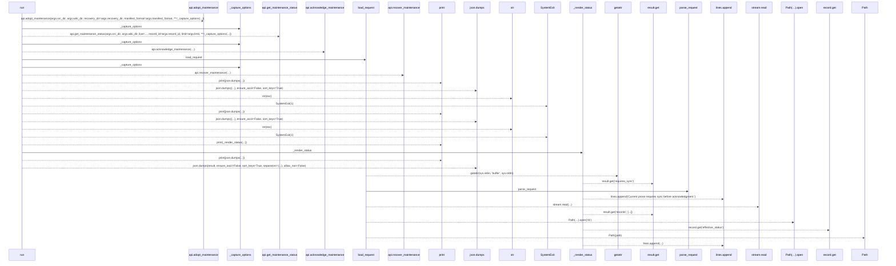
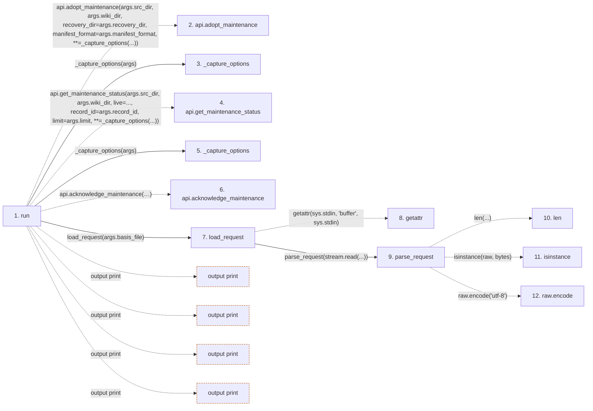

# maintenance

**Entry point:** `run` (`cli`)
**Source:** [maintenance_cmd](../modules/maintenance_cmd.md)
**Modules touched:** [maintenance_cmd](../modules/maintenance_cmd.md), [request_json](../modules/request_json.md)

## Call sequence

> Static overview in presentation order, not runtime execution order. Arrows retain captured callers; siblings are shown before deeper helper detail.

<!-- Auto-generated from static call edges. Dashed arrows are external or unresolved calls. Reviewed runtime conditions and side effects belong in Behavior. -->

> Call sequence diagram shows 30 of 54 interactions; 24 omitted to keep the visualization within the 30-interaction and generated-diagram limits, with uncertain identities omitted rather than inferred.

> Captured boundary calls: external 13 of 21 (8 omitted); unresolved 11 of 26 (15 omitted). These counts cover the captured static trace.

Omitted captured detail, grouped by actual caller occurrence and target module:

| Caller | Parent step | Target module | Kind | Omitted interactions |
| --- | --- | --- | --- | --- |
| `src/llm_wiki_cli/services/request_json.py:parse_request` | 9 | - | external | 8 |
| `src/llm_wiki_cli/services/request_json.py:parse_request` | 9 | - | unresolved | 2 |
| `src/llm_wiki_cli/services/request_json.py:load_request` | 7 | [src/llm_wiki_cli/services/request_json.py](../modules/request_json.md) | internal | 1 |
| `src/llm_wiki_cli/services/request_json.py:load_request` | 7 | - | unresolved | 1 |
| `src/llm_wiki_cli/commands/maintenance_cmd.py:_render_status` | 36 | - | unresolved | 12 |
> Detailed flow queries retain their own coverage and limits; omitted paths may execute at runtime.

## Data flow

<!-- Auto-generated static analysis. Treat values and boundaries as best-effort hints, not runtime proof. -->

### Step data

| Step | Inputs | Reads | Writes | Returns |
|---|---|---|---|---|
| `run` | `args` | - | - | - |
| `api.adopt_maintenance` | - | - | - | - |
| `_capture_options` | `args` | - | - | `{...}` |
| `api.get_maintenance_status` | - | - | - | - |
| `_capture_options` | `args` | - | - | `{...}` |
| `api.acknowledge_maintenance` | - | - | - | - |
| `load_request` | `path: str` | `sys`, `MAX_REQUEST_BYTES`, `MAX_REQUEST_BYTES` | - | `parse_request(...)`, `parse_request(...)` |
| `getattr` | - | - | - | - |
| `parse_request` | `raw: bytes \| str` | `MAX_REQUEST_BYTES`, `_pairs`, `_constant`, `json` | - | `value` |
| `len` | - | - | - | - |
| `isinstance` | - | - | - | - |
| `raw.encode` | - | - | - | - |

### Call data

| From | To | Line | Call |
|---|---|---:|---|
| run | api.adopt_maintenance | 58 | `api.adopt_maintenance(args.src_dir, args.wiki_dir, recovery_dir=args.recovery_dir, manifest_format=args.manifest_format, **=_capture_options(...))` |
| run | _capture_options | 63 | `_capture_options(args)` |
| run | api.get_maintenance_status | 66 | `api.get_maintenance_status(args.src_dir, args.wiki_dir, live=..., record_id=args.record_id, limit=args.limit, **=_capture_options(...))` |
| run | _capture_options | 72 | `_capture_options(args)` |
| run | api.acknowledge_maintenance | 75 | `api.acknowledge_maintenance(args.src_dir, args.wiki_dir, record_id=args.record_id, expected_state_hash=args.expected_state_hash, expected_basis=load_request(...), actor_kind=args.actor_kind, actor_id=args.actor_id, recovery_dir=args.recovery_dir, **=_capture_options(...))` |
| run | load_request | 80 | `load_request(args.basis_file)` |
| load_request | getattr | 41 | `getattr(sys.stdin, 'buffer', sys.stdin)` |
| load_request | parse_request | 42 | `parse_request(stream.read(...))` |
| parse_request | len | 27 | `len(...)` |
| parse_request | isinstance | 27 | `isinstance(raw, bytes)` |
| parse_request | raw.encode | 27 | `raw.encode('utf-8')` |

### Boundary effects

| Kind | Target | Step | Line |
|---|---|---|---:|
| output | `print` | `run` | 96 |
| output | `print` | `run` | 112 |
| output | `print` | `run` | 124 |
| output | `print` | `run` | 126 |

### Static analysis gaps

| Kind | Step | Target | Line |
|---|---|---|---:|
| unresolved_call | `run` | `api.adopt_maintenance` | 58 |
| unresolved_call | `run` | `api.get_maintenance_status` | 66 |
| unresolved_call | `run` | `api.acknowledge_maintenance` | 75 |
| external_call | `load_request` | `getattr` | 41 |
| external_call | `parse_request` | `isinstance` | 27 |
| unresolved_call | `parse_request` | `raw.encode` | 27 |
| step_limit | `run` | `first 12 steps` | 0 |

## Behavior

This flow starts at `run` and is classified as `cli`. The generated call and data-flow sections are bounded static projections; runtime conditions and side effects require source-level confirmation.
