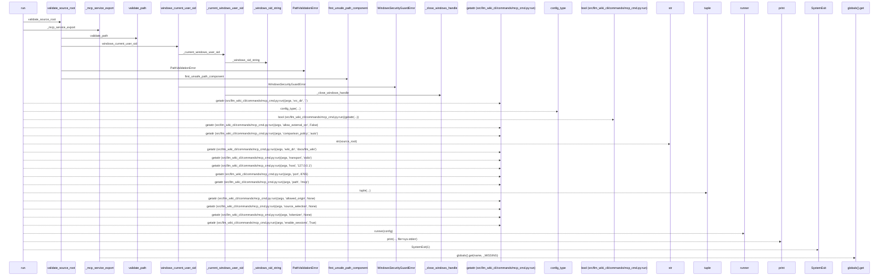
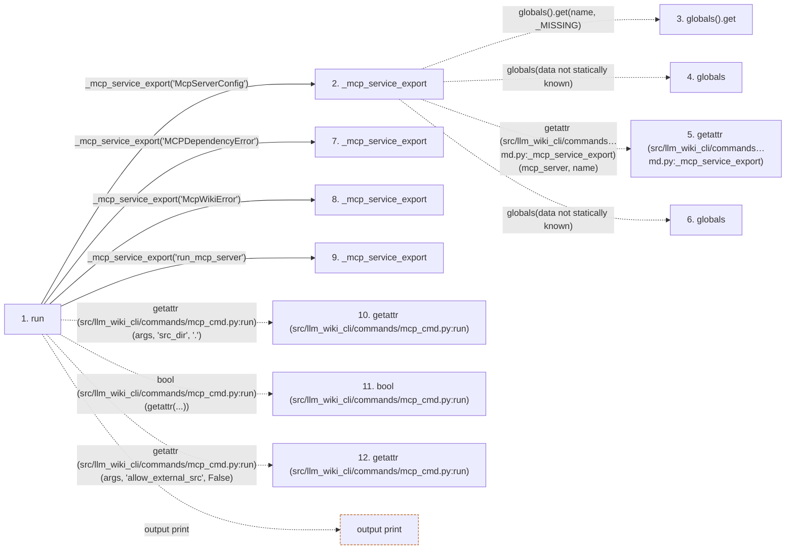

# mcp

**Entry point:** `run` (`cli`)
**Source:** [mcp_cmd](../modules/mcp_cmd.md)
**Modules touched:** [config](../modules/config.md), [filesystem_guard](../modules/filesystem_guard.md), [io](../modules/io.md), [mcp_cmd](../modules/mcp_cmd.md)

## Call sequence

> Static overview in presentation order, not runtime execution order. Arrows retain captured callers; representative internal continuations and boundary examples precede repeated helper detail.

<!-- Auto-generated from static call edges. Dashed arrows are external or unresolved calls. Reviewed runtime conditions and side effects belong in Behavior. -->

> Call sequence diagram shows 30 of 130 interactions; 100 omitted to keep the visualization within the 30-interaction and generated-diagram limits, with uncertain identities omitted rather than inferred.

> Captured boundary calls: external 17 of 82 (65 omitted); unresolved 3 of 23 (20 omitted). These counts cover the captured static trace.

Omitted captured detail, grouped by actual caller occurrence and target module:

| Caller | Parent step | Target module | Kind | Omitted interactions |
| --- | --- | --- | --- | --- |
| `src/llm_wiki_cli/commands/mcp_cmd.py:_mcp_service_export` | 2 | - | external | 3 |
| `src/llm_wiki_cli/commands/mcp_cmd.py:run` | 1 | [src/llm_wiki_cli/commands/mcp_cmd.py](../modules/mcp_cmd.md) | internal | 3 |
| `src/llm_wiki_cli/config.py:validate_path` | 14 | [src/llm_wiki_cli/config.py](../modules/config.md) | internal | 2 |
| `src/llm_wiki_cli/config.py:validate_path` | 14 | - | unresolved | 3 |
| `src/llm_wiki_cli/config.py:validate_path` | 14 | - | external | 2 |
| `src/llm_wiki_cli/config.py:validate_source_root` | 13 | - | unresolved | 5 |
| `src/llm_wiki_cli/config.py:validate_source_root` | 13 | - | external | 11 |
| `src/llm_wiki_cli/config.py:validate_source_root` | 13 | [src/llm_wiki_cli/config.py](../modules/config.md) | internal | 5 |
> Omission summary shows 8 of 18 groups; 10 further groups are not expanded here. Counts above include all omitted interactions.
> Detailed flow queries retain their own coverage and limits; omitted paths may execute at runtime.

## Data flow

<!-- Auto-generated static analysis. Treat values and boundaries as best-effort hints, not runtime proof. -->

### Analysis coverage

**Effect analysis partially available.** Flow assembly and source effect analysis are separate; empty observations do not prove an empty handler body.

Source steps: 26; effect analysis evaluated: 12, partial: 0, unavailable: 14. Counts include steps omitted from the displayed trace.

- Callable record unavailable; the selected entry symbol has no represented callable body.
- Effect collector totals unavailable; observed counts cover captured records only.

| Step | Callable record | Effect analysis | Collector totals |
|---|---|---|---|
| `run` | `available` | `evaluated` | `available` |
| `_mcp_service_export` | `available` | `evaluated` | `available` |
| `globals().get` | `not_applicable` | `not_applicable` | `not_applicable` |
| `globals` | `not_applicable` | `not_applicable` | `not_applicable` |
| `getattr (src/llm_wiki_cli/commands…md.py:_mcp_service_export)` | `not_applicable` | `not_applicable` | `not_applicable` |
| `globals` | `not_applicable` | `not_applicable` | `not_applicable` |
| `_mcp_service_export` | `available` | `evaluated` | `available` |
| `_mcp_service_export` | `available` | `evaluated` | `available` |
| `_mcp_service_export` | `available` | `evaluated` | `available` |
| `getattr (src/llm_wiki_cli/commands/mcp_cmd.py:run)` | `not_applicable` | `not_applicable` | `not_applicable` |
| `bool (src/llm_wiki_cli/commands/mcp_cmd.py:run)` | `not_applicable` | `not_applicable` | `not_applicable` |
| `getattr (src/llm_wiki_cli/commands/mcp_cmd.py:run)` | `not_applicable` | `not_applicable` | `not_applicable` |

### Step data

| Step | Inputs | Reads | Writes | Returns |
|---|---|---|---|---|
| `run` | `args` | `sys` | - | - |
| `_mcp_service_export` | `name: str` | `_MISSING`, `_MISSING` | - | `value`, `value` |
| `globals().get` | - | - | - | - |
| `globals` | - | - | - | - |
| `getattr (src/llm_wiki_cli/commands…md.py:_mcp_service_export)` | - | - | - | - |
| `globals` | - | - | - | - |
| `_mcp_service_export` | `name: str` | `_MISSING`, `_MISSING` | - | `value`, `value` |
| `_mcp_service_export` | `name: str` | `_MISSING`, `_MISSING` | - | `value`, `value` |
| `_mcp_service_export` | `name: str` | `_MISSING`, `_MISSING` | - | `value`, `value` |
| `getattr (src/llm_wiki_cli/commands/mcp_cmd.py:run)` | - | - | - | - |
| `bool (src/llm_wiki_cli/commands/mcp_cmd.py:run)` | - | - | - | - |
| `getattr (src/llm_wiki_cli/commands/mcp_cmd.py:run)` | - | - | - | - |

### Call data

| From | To | Line | Call |
|---|---|---:|---|
| run | _mcp_service_export | 45 | `_mcp_service_export('McpServerConfig')` |
| _mcp_service_export | globals().get | 23 | `globals().get(name, _MISSING)` |
| _mcp_service_export | globals | 23 | `globals(data not statically known)` |
| _mcp_service_export | getattr (src/llm_wiki_cli/commands…md.py:_mcp_service_export) | 28 | `getattr(mcp_server, name)` |
| _mcp_service_export | globals | 29 | `globals(data not statically known)` |
| run | _mcp_service_export | 46 | `_mcp_service_export('MCPDependencyError')` |
| run | _mcp_service_export | 47 | `_mcp_service_export('McpWikiError')` |
| run | _mcp_service_export | 48 | `_mcp_service_export('run_mcp_server')` |
| run | getattr (src/llm_wiki_cli/commands/mcp_cmd.py:run) | 50 | `getattr(args, 'src_dir', '.')` |
| run | bool (src/llm_wiki_cli/commands/mcp_cmd.py:run) | 51 | `bool(getattr(...))` |
| run | getattr (src/llm_wiki_cli/commands/mcp_cmd.py:run) | 51 | `getattr(args, 'allow_external_src', False)` |

### Boundary effects

| Kind | Target | Step | Line |
|---|---|---|---:|
| output | `print` | `run` | 75 |

### Static analysis gaps

| Kind | Step | Target | Line |
|---|---|---|---:|
| unresolved_call | `_mcp_service_export` | `globals().get` | 23 |
| external_call | `_mcp_service_export` | `globals` | 23 |
| external_call | `_mcp_service_export` | `getattr` | 28 |
| external_call | `_mcp_service_export` | `globals` | 29 |
| external_call | `run` | `getattr` | 50 |
| external_call | `run` | `getattr` | 51 |
| step_limit | `run` | `first 12 steps` | 0 |

## Behavior

Loads the optional MCP service only after command dispatch, validates the
source root, and constructs the server configuration. Stdio is the default;
HTTP configuration is checked again by the service for loopback host, port,
path, and origin safety. Missing optional packages and invalid wiki or
transport state are reported as command errors without changing the wiki.
