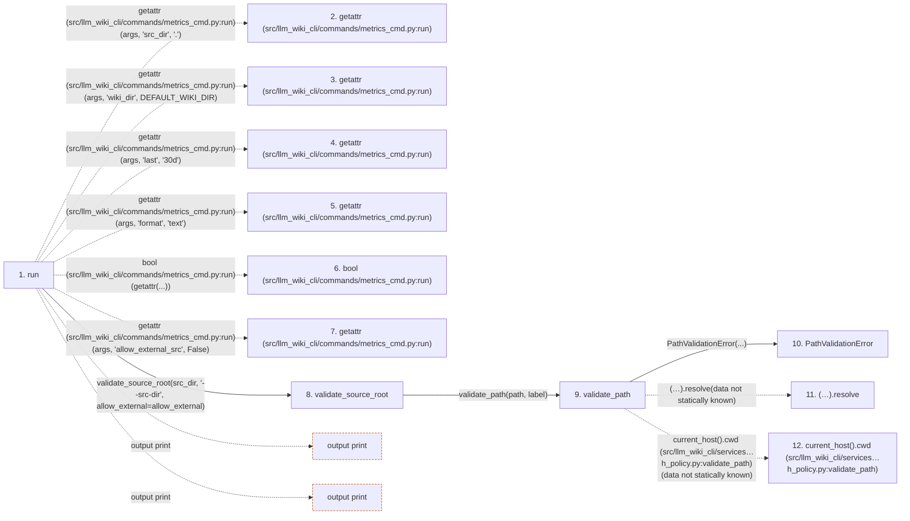

# metrics

**Entry point:** `run` (`cli`)
**Source:** [metrics_cmd](../modules/metrics_cmd.md)
**Modules touched:** [analysis_capture](../modules/analysis_capture.md), [bootstrap_runtime](../modules/bootstrap_runtime.md), [common](../modules/common.md), [documentation_queries](../modules/documentation_queries.md), and 31 more

**Complete modules touched:**

- [analysis_capture](../modules/analysis_capture.md)
- [bootstrap_runtime](../modules/bootstrap_runtime.md)
- [common](../modules/common.md)
- [documentation_queries](../modules/documentation_queries.md)
- [documentation_query_builder](../modules/documentation_query_builder.md)
- [domain_pack](../modules/domain_pack.md)
- [extraction_jobs](../modules/extraction_jobs.md)
- [extraction_service](../modules/extraction_service.md)
- [filesystem_guard](../modules/filesystem_guard.md)
- [gitignore](../modules/gitignore.md)
- [go_calls](../modules/go_calls.md)
- [host](../modules/host.md)
- [imports](../modules/imports.md)
- [inventory_cache](../modules/inventory_cache.md)
- [io](../modules/io.md)
- [knowledge_artifacts](../modules/knowledge_artifacts.md)
- [knowledge_observability](../modules/knowledge_observability.md)
- [knowledge_storage](../modules/knowledge_storage.md)
- [knowledge_storage_io](../modules/knowledge_storage_io.md)
- [lint_service](../modules/lint_service.md)
- [maintenance_state](../modules/maintenance_state.md)
- [manifest_storage](../modules/manifest_storage.md)
- [metrics](../modules/metrics.md)
- [metrics_cmd](../modules/metrics_cmd.md)
- [packages](../modules/packages.md)
- [path_policy](../modules/path_policy.md)
- [plugins](../modules/plugins.md)
- [progress](../modules/progress.md)
- [python_contracts](../modules/python_contracts.md)
- [python_implementation](../modules/python_implementation.md)
- [python_observations](../modules/python_observations.md)
- [source_selection](../modules/source_selection.md)
- [source_snapshot](../modules/source_snapshot.md)
- [sync_manifest](../modules/sync_manifest.md)
- [validation](../modules/validation.md)

## Call sequence

> Static overview in presentation order, not runtime execution order. Arrows retain captured callers; representative internal continuations and boundary examples precede repeated helper detail.

```mermaid
sequenceDiagram
    participant p0 as run
    participant p1 as validate_source_root
    participant p2 as load_events
    participant p3 as summarize_events
    participant p4 as render_text
    participant p5 as validate_path
    participant p6 as _sanitize_metrics_value
    participant p7 as windows_current_user_sid
    participant p8 as first_unsafe_path_component
    participant p9 as _fmt_phase_durations
    participant p10 as current_coverage
    participant p11 as _current_windows_user_sid
    participant p12 as resolve_source_selection
    participant p13 as capture_source_selection_inputs
    participant p14 as validate_live_query_source_selection
    participant p15 as _safe_knowledge_summary
    participant p16 as build_source_snapshot
    participant p17 as get_inventory_result
    participant p18 as build_entity_occurrence_page_map
    participant p19 as SyncManifest.load
    participant p20 as _validate_capture_options
    participant p21 as _build_inventory_result
    participant p22 as _coerce_inventory_request
    participant p23 as build_module_page_map
    participant p24 as _resolve_snapshot_selection
    participant p25 as _override_text
    participant p26 as _new_snapshot_buckets
    participant p27 as _normalize_only_files
    participant p28 as _collect_source_selection_controls
    participant p29 as getattr (src/llm_wiki_cli/commands/metrics_cmd.py:run)
    participant p30 as event.get (src/llm_wiki_cli/services…trics.py:summarize_events)
    p0->>p1: validate_source_root
    p0->>p2: load_events
    p0->>p3: summarize_events
    p0->>p4: render_text
    p0->>p5: validate_path
    p2->>p6: _sanitize_metrics_value
    p1->>p7: windows_current_user_sid
    p1->>p8: first_unsafe_path_component
    p4->>p9: _fmt_phase_durations
    p3->>p10: current_coverage
    p7->>p11: _current_windows_user_sid
    p10->>p12: resolve_source_selection
    p10->>p13: capture_source_selection_inputs
    p10->>p14: validate_live_query_source_selection
    p6->>p15: _safe_knowledge_summary
    p10->>p16: build_source_snapshot
    p10->>p17: get_inventory_result
    p10->>p18: build_entity_occurrence_page_map
    p14->>p19: SyncManifest.load
    p16->>p20: _validate_capture_options
    p17->>p21: _build_inventory_result
    p17->>p22: _coerce_inventory_request
    p18->>p23: build_module_page_map
    p13->>p24: _resolve_snapshot_selection
    p12->>p25: _override_text
    p13->>p26: _new_snapshot_buckets
    p16->>p27: _normalize_only_files
    p13->>p28: _collect_source_selection_controls
    p0-->>p29: getattr (src/llm_wiki_cli/commands/metrics_cmd.py:run)(args, 'src_dir', '.')
    p3-->>p30: event.get (src/llm_wiki_cli/services…trics.py:summarize_events)('event')
```

<!-- Auto-generated from static call edges. Dashed arrows are external or unresolved calls. Reviewed runtime conditions and side effects belong in Behavior. -->

> Call sequence diagram shows 30 of 1010 interactions; 980 omitted to keep the visualization within the 30-interaction and generated-diagram limits, with uncertain identities omitted rather than inferred.

> Captured boundary calls: external 1 of 363 (362 omitted); unresolved 1 of 266 (265 omitted). These counts cover the captured static trace.

Omitted captured detail, grouped by actual caller occurrence and target module:

| Caller | Parent step | Target module | Kind | Omitted interactions |
| --- | --- | --- | --- | --- |
| `src/llm_wiki_cli/commands/metrics_cmd.py:run` | 1 | - | external | 10 |
| `src/llm_wiki_cli/services/path_policy.py:validate_source_root` | 8 | [src/llm_wiki_cli/services/path_policy.py](../modules/path_policy.md) | internal | 7 |
| `src/llm_wiki_cli/services/path_policy.py:validate_path` | 9 | [src/llm_wiki_cli/services/path_policy.py](../modules/path_policy.md) | internal | 2 |
| `src/llm_wiki_cli/services/path_policy.py:validate_path` | 9 | - | unresolved | 5 |
| `src/llm_wiki_cli/services/path_policy.py:validate_path` | 9 | [src/llm_wiki_engine/host.py](../modules/host.md) | internal | 2 |
| `src/llm_wiki_engine/host.py:current_host` | 13 | - | unresolved | 1 |
| `src/llm_wiki_cli/services/path_policy.py:validate_source_root` | 8 | - | unresolved | 6 |
| `src/llm_wiki_cli/services/path_policy.py:validate_source_root` | 8 | - | external | 10 |
> Omission summary shows 8 of 272 groups; 264 further groups are not expanded here. Counts above include all omitted interactions.
> Detailed flow queries retain their own coverage and limits; omitted paths may execute at runtime.

> Trace truncated at the depth limit; deeper calls are omitted.

## Data flow

<!-- Auto-generated static analysis. Treat values and boundaries as best-effort hints, not runtime proof. -->

### Analysis coverage

**Effect analysis partially available.** Flow assembly and source effect analysis are separate; empty observations do not prove an empty handler body.

Source steps: 382; effect analysis evaluated: 260, partial: 8, unavailable: 114. Counts include steps omitted from the displayed trace.

Collector observations for 268 source steps with known totals: observed: 1537, emitted: 1517, omitted: 20. Unavailable totals are excluded.

- Callable record unavailable for one or more source steps; those steps have no represented callable body.
- Effect collector omitted observations before flow assembly; displayed effects are partial.
- Effect collector totals unavailable; observed counts cover captured records only.

| Step | Callable record | Effect analysis | Collector totals | Observed | Emitted | Omitted |
|---|---|---|---|---:|---:|---:|
| `run` | `available` | `evaluated` | `available` | `4` | `4` | `0` |
| `getattr (src/llm_wiki_cli/commands/metrics_cmd.py:run)` | `not_applicable` | `not_applicable` | `not_applicable` | — | — | — |
| `getattr (src/llm_wiki_cli/commands/metrics_cmd.py:run)` | `not_applicable` | `not_applicable` | `not_applicable` | — | — | — |
| `getattr (src/llm_wiki_cli/commands/metrics_cmd.py:run)` | `not_applicable` | `not_applicable` | `not_applicable` | — | — | — |
| `getattr (src/llm_wiki_cli/commands/metrics_cmd.py:run)` | `not_applicable` | `not_applicable` | `not_applicable` | — | — | — |
| `bool (src/llm_wiki_cli/commands/metrics_cmd.py:run)` | `not_applicable` | `not_applicable` | `not_applicable` | — | — | — |
| `getattr (src/llm_wiki_cli/commands/metrics_cmd.py:run)` | `not_applicable` | `not_applicable` | `not_applicable` | — | — | — |
| `validate_source_root` | `available` | `evaluated` | `available` | `9` | `9` | `0` |
| `validate_path` | `available` | `evaluated` | `available` | `3` | `3` | `0` |
| `PathValidationError` | `unavailable` | `unavailable` | `unavailable` | — | — | — |
| `(…).resolve` | `not_applicable` | `not_applicable` | `not_applicable` | — | — | — |
| `current_host().cwd (src/llm_wiki_cli/services…h_policy.py:validate_path)` | `not_applicable` | `not_applicable` | `not_applicable` | — | — | — |

### Step data

| Step | Inputs | Reads | Writes | Returns |
|---|---|---|---|---|
| `run` | `args` | `DEFAULT_WIKI_DIR` | - | - |
| `getattr (src/llm_wiki_cli/commands/metrics_cmd.py:run)` | - | - | - | - |
| `getattr (src/llm_wiki_cli/commands/metrics_cmd.py:run)` | - | - | - | - |
| `getattr (src/llm_wiki_cli/commands/metrics_cmd.py:run)` | - | - | - | - |
| `getattr (src/llm_wiki_cli/commands/metrics_cmd.py:run)` | - | - | - | - |
| `bool (src/llm_wiki_cli/commands/metrics_cmd.py:run)` | - | - | - | - |
| `getattr (src/llm_wiki_cli/commands/metrics_cmd.py:run)` | - | - | - | - |
| `validate_source_root` | `path: str`, `label: str`, `allow_external: bool` | `sys`, `os`, `WindowsSecurityGuardError`, `sys` | - | `validate_path(...)`, `resolved` |
| `validate_path` | `path: str`, `label: str` | - | - | `resolved` |
| `PathValidationError` | - | - | - | - |
| `(…).resolve` | - | - | - | - |
| `current_host().cwd (src/llm_wiki_cli/services…h_policy.py:validate_path)` | - | - | - | - |

### Call data

| From | To | Line | Call |
|---|---|---:|---|
| run | getattr (src/llm_wiki_cli/commands/metrics_cmd.py:run) | 110 | `getattr(args, 'src_dir', '.')` |
| run | getattr (src/llm_wiki_cli/commands/metrics_cmd.py:run) | 111 | `getattr(args, 'wiki_dir', DEFAULT_WIKI_DIR)` |
| run | getattr (src/llm_wiki_cli/commands/metrics_cmd.py:run) | 112 | `getattr(args, 'last', '30d')` |
| run | getattr (src/llm_wiki_cli/commands/metrics_cmd.py:run) | 113 | `getattr(args, 'format', 'text')` |
| run | bool (src/llm_wiki_cli/commands/metrics_cmd.py:run) | 115 | `bool(getattr(...))` |
| run | getattr (src/llm_wiki_cli/commands/metrics_cmd.py:run) | 115 | `getattr(args, 'allow_external_src', False)` |
| run | validate_source_root | 116 | `validate_source_root(src_dir, '--src-dir', allow_external=allow_external)` |
| validate_source_root | validate_path | 125 | `validate_path(path, label)` |
| validate_path | PathValidationError | 100 | `PathValidationError(...)` |
| validate_path | (…).resolve | 101 | `(current_host().cwd() / path).resolve(data not statically known)` |
| validate_path | current_host().cwd (src/llm_wiki_cli/services…h_policy.py:validate_path) | 101 | `current_host().cwd(data not statically known)` |

### Boundary effects

| Kind | Target | Step | Line |
|---|---|---|---:|
| output | `print` | `run` | 134 |
| output | `print` | `run` | 136 |

### Static analysis gaps

| Kind | Step | Target | Line |
|---|---|---|---:|
| external_call | `run` | `getattr` | 110 |
| external_call | `run` | `getattr` | 111 |
| external_call | `run` | `getattr` | 112 |
| external_call | `run` | `getattr` | 113 |
| external_call | `run` | `getattr` | 115 |
| unresolved_call | `validate_path` | `(current_host().cwd() / path).resolve` | 101 |
| unresolved_call | `validate_path` | `current_host().cwd` | 101 |
| step_limit | `run` | `first 12 steps` | 0 |
| truncated_flow | `run` | `depth limit` | 0 |

## Behavior

This flow starts at `run` and is classified as `cli`. The generated call and data-flow sections are bounded static projections; runtime conditions and side effects require source-level confirmation.
