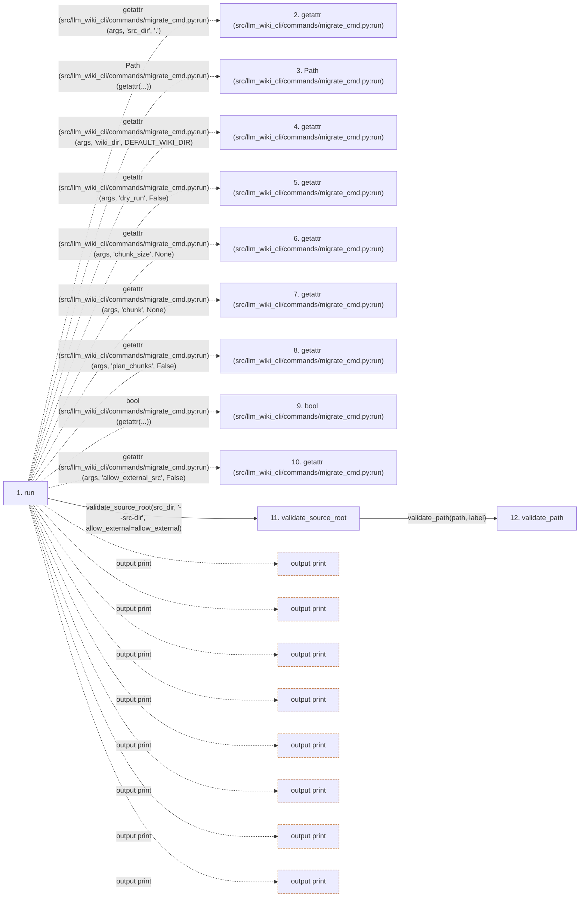

# migrate

**Entry point:** `run` (`cli`)
**Source:** [migrate_cmd](../modules/migrate_cmd.md)
**Modules touched:** [analysis_capture](../modules/analysis_capture.md), [analysis_compatibility](../modules/analysis_compatibility.md), [bootstrap_runtime](../modules/bootstrap_runtime.md), [common](../modules/common.md), and 43 more

**Complete modules touched:**

- [analysis_capture](../modules/analysis_capture.md)
- [analysis_compatibility](../modules/analysis_compatibility.md)
- [bootstrap_runtime](../modules/bootstrap_runtime.md)
- [common](../modules/common.md)
- [concept_identity](../modules/concept_identity.md)
- [config](../modules/config.md)
- [data_flow](../modules/data_flow.md)
- [extraction_jobs](../modules/extraction_jobs.md)
- [extraction_service](../modules/extraction_service.md)
- [extractor_helpers](../modules/extractor_helpers.md)
- [filesystem_guard](../modules/filesystem_guard.md)
- [go_calls](../modules/go_calls.md)
- [immutable](../modules/immutable.md)
- [imports](../modules/imports.md)
- [infrastructure_sync](../modules/infrastructure_sync.md)
- [inventory_cache](../modules/inventory_cache.md)
- [io](../modules/io.md)
- [knowledge_artifacts](../modules/knowledge_artifacts.md)
- [knowledge_envelope](../modules/knowledge_envelope.md)
- [knowledge_evidence](../modules/knowledge_evidence.md)
- [knowledge_generation](../modules/knowledge_generation.md)
- [knowledge_governance](../modules/knowledge_governance.md)
- [knowledge_index](../modules/knowledge_index.md)
- [knowledge_loader](../modules/knowledge_loader.md)
- [knowledge_model](../modules/knowledge_model.md)
- [knowledge_orchestration](../modules/knowledge_orchestration.md)
- [knowledge_storage](../modules/knowledge_storage.md)
- [knowledge_storage_io](../modules/knowledge_storage_io.md)
- [maintenance_protocol](../modules/maintenance_protocol.md)
- [maintenance_state](../modules/maintenance_state.md)
- [manifest_storage](../modules/manifest_storage.md)
- [migrate_cmd](../modules/migrate_cmd.md)
- [packages](../modules/packages.md)
- [paths](../modules/paths.md)
- [plugins](../modules/plugins.md)
- [progress](../modules/progress.md)
- [python_contracts](../modules/python_contracts.md)
- [python_implementation](../modules/python_implementation.md)
- [python_imports](../modules/python_imports.md)
- [python_observations](../modules/python_observations.md)
- [resource_diagnostics](../modules/resource_diagnostics.md)
- [source_selection](../modules/source_selection.md)
- [source_snapshot](../modules/source_snapshot.md)
- [sync_manifest](../modules/sync_manifest.md)
- [validation](../modules/validation.md)
- [wiki_surface](../modules/wiki_surface.md)
- [yaml_syntax](../modules/yaml_syntax.md)

## Call sequence

> Static overview in presentation order, not runtime execution order. Arrows retain captured callers; representative internal continuations and boundary examples precede repeated helper detail.

```mermaid
sequenceDiagram
    participant p0 as run
    participant p1 as validate_source_root
    participant p2 as _build_migration_plan
    participant p3 as _build_chunks
    participant p4 as _print_migration_artifact_preview
    participant p5 as validate_path
    participant p6 as _print_migration_governance_plan
    participant p7 as _print_chunk_plan
    participant p8 as _clear_migration_progress
    participant p9 as _apply_chunk
    participant p10 as _apply_plan
    participant p11 as _matched_archive_count
    participant p12 as SyncManifest.load
    participant p13 as _preview_migration_artifact_plan
    participant p14 as resolve_source_selection
    participant p15 as _pending_targets
    participant p16 as _finalizers_pending
    participant p17 as validate_persisted_source_selection_identity
    participant p18 as capture_source_selection_inputs
    participant p19 as build_source_snapshot
    participant p20 as get_inventory_result
    participant p21 as windows_current_user_sid
    participant p22 as get_docker_inventory
    participant p23 as build_module_page_map
    participant p24 as build_entity_occurrence_page_map
    participant p25 as _build_targets
    participant p26 as _build_workflow_link_maps
    participant p27 as collect_runtime_repository_evidence
    participant p28 as _active_managed_pages
    participant p29 as getattr (src/llm_wiki_cli/commands/migrate_cmd.py:run)
    participant p30 as wiki_dir.exists (src/llm_wiki_cli/commands/migrate_cmd.py:run)
    p0->>p1: validate_source_root
    p0->>p2: _build_migration_plan
    p0->>p3: _build_chunks
    p0->>p4: _print_migration_artifact_preview
    p0->>p5: validate_path
    p0->>p6: _print_migration_governance_plan
    p0->>p7: _print_chunk_plan
    p0->>p8: _clear_migration_progress
    p0->>p9: _apply_chunk
    p0->>p10: _apply_plan
    p0->>p11: _matched_archive_count
    p2->>p12: SyncManifest.load
    p4->>p13: _preview_migration_artifact_plan
    p2->>p14: resolve_source_selection
    p3->>p15: _pending_targets
    p3->>p16: _finalizers_pending
    p2->>p17: validate_persisted_source_selection_identity
    p2->>p18: capture_source_selection_inputs
    p2->>p19: build_source_snapshot
    p2->>p20: get_inventory_result
    p1->>p21: windows_current_user_sid
    p2->>p22: get_docker_inventory
    p2->>p23: build_module_page_map
    p2->>p24: build_entity_occurrence_page_map
    p2->>p25: _build_targets
    p2->>p26: _build_workflow_link_maps
    p2->>p27: collect_runtime_repository_evidence
    p2->>p28: _active_managed_pages
    p0-->>p29: getattr (src/llm_wiki_cli/commands/migrate_cmd.py:run)(args, 'src_dir', '.')
    p0-->>p30: wiki_dir.exists (src/llm_wiki_cli/commands/migrate_cmd.py:run)
```

<!-- Auto-generated from static call edges. Dashed arrows are external or unresolved calls. Reviewed runtime conditions and side effects belong in Behavior. -->

> Call sequence diagram shows 30 of 4017 interactions; 3987 omitted to keep the visualization within the 30-interaction and generated-diagram limits, with uncertain identities omitted rather than inferred.

> Captured boundary calls: external 1 of 1083 (1082 omitted); unresolved 1 of 1515 (1514 omitted). These counts cover the captured static trace.

Omitted captured detail, grouped by actual caller occurrence and target module:

| Caller | Parent step | Target module | Kind | Omitted interactions |
| --- | --- | --- | --- | --- |
| `src/llm_wiki_cli/commands/migrate_cmd.py:run` | 1 | - | external | 30 |
| `src/llm_wiki_cli/config.py:validate_source_root` | 11 | [src/llm_wiki_cli/config.py](../modules/config.md) | internal | 7 |
| `src/llm_wiki_cli/config.py:validate_path` | 12 | [src/llm_wiki_cli/config.py](../modules/config.md) | internal | 2 |
| `src/llm_wiki_cli/config.py:validate_path` | 12 | - | unresolved | 3 |
| `src/llm_wiki_cli/config.py:validate_path` | 12 | - | external | 2 |
| `src/llm_wiki_cli/config.py:validate_source_root` | 11 | - | unresolved | 5 |
| `src/llm_wiki_cli/config.py:validate_source_root` | 11 | - | external | 11 |
| `src/llm_wiki_cli/services/filesystem_guard.py:windows_current_user_sid` | 30 | [src/llm_wiki_cli/services/filesystem_guard.py](../modules/filesystem_guard.md) | internal | 2 |
> Omission summary shows 8 of 982 groups; 974 further groups are not expanded here. Counts above include all omitted interactions.
> Detailed flow queries retain their own coverage and limits; omitted paths may execute at runtime.

> Trace truncated at the depth limit; deeper calls are omitted.

## Data flow

<!-- Auto-generated static analysis. Treat values and boundaries as best-effort hints, not runtime proof. -->

### Step data

| Step | Inputs | Reads | Writes | Returns |
|---|---|---|---|---|
| `run` | `args` | `DEFAULT_WIKI_DIR`, `sys`, `sys`, `sys` | - | `none`, `none`, `none` |
| `getattr (src/llm_wiki_cli/commands/migrate_cmd.py:run)` | - | - | - | - |
| `Path (src/llm_wiki_cli/commands/migrate_cmd.py:run)` | - | - | - | - |
| `getattr (src/llm_wiki_cli/commands/migrate_cmd.py:run)` | - | - | - | - |
| `getattr (src/llm_wiki_cli/commands/migrate_cmd.py:run)` | - | - | - | - |
| `getattr (src/llm_wiki_cli/commands/migrate_cmd.py:run)` | - | - | - | - |
| `getattr (src/llm_wiki_cli/commands/migrate_cmd.py:run)` | - | - | - | - |
| `getattr (src/llm_wiki_cli/commands/migrate_cmd.py:run)` | - | - | - | - |
| `bool (src/llm_wiki_cli/commands/migrate_cmd.py:run)` | - | - | - | - |
| `getattr (src/llm_wiki_cli/commands/migrate_cmd.py:run)` | - | - | - | - |
| `validate_source_root` | `path: str`, `label: str`, `allow_external: bool` | `sys`, `os`, `WindowsSecurityGuardError`, `sys` | - | `validate_path(...)`, `resolved` |
| `validate_path` | `path: str`, `label: str` | - | - | `resolved` |

### Call data

| From | To | Line | Call |
|---|---|---:|---|
| run | getattr (src/llm_wiki_cli/commands/migrate_cmd.py:run) | 1733 | `getattr(args, 'src_dir', '.')` |
| run | Path (src/llm_wiki_cli/commands/migrate_cmd.py:run) | 1734 | `Path(getattr(...))` |
| run | getattr (src/llm_wiki_cli/commands/migrate_cmd.py:run) | 1734 | `getattr(args, 'wiki_dir', DEFAULT_WIKI_DIR)` |
| run | getattr (src/llm_wiki_cli/commands/migrate_cmd.py:run) | 1735 | `getattr(args, 'dry_run', False)` |
| run | getattr (src/llm_wiki_cli/commands/migrate_cmd.py:run) | 1736 | `getattr(args, 'chunk_size', None)` |
| run | getattr (src/llm_wiki_cli/commands/migrate_cmd.py:run) | 1737 | `getattr(args, 'chunk', None)` |
| run | getattr (src/llm_wiki_cli/commands/migrate_cmd.py:run) | 1738 | `getattr(args, 'plan_chunks', False)` |
| run | bool (src/llm_wiki_cli/commands/migrate_cmd.py:run) | 1739 | `bool(getattr(...))` |
| run | getattr (src/llm_wiki_cli/commands/migrate_cmd.py:run) | 1739 | `getattr(args, 'allow_external_src', False)` |
| run | validate_source_root | 1740 | `validate_source_root(src_dir, '--src-dir', allow_external=allow_external)` |
| validate_source_root | validate_path | 160 | `validate_path(path, label)` |

### Boundary effects

| Kind | Target | Step | Line |
|---|---|---|---:|
| output | `print` | `run` | 1750 |
| output | `print` | `run` | 1754 |
| output | `print` | `run` | 1757 |
| output | `print` | `run` | 1758 |
| output | `print` | `run` | 1767 |
| output | `print` | `run` | 1775 |
| output | `print` | `run` | 1781 |
| output | `print` | `run` | 1786 |

### Static analysis gaps

| Kind | Step | Target | Line |
|---|---|---|---:|
| external_call | `run` | `getattr` | 1733 |
| external_call | `run` | `getattr` | 1734 |
| external_call | `run` | `getattr` | 1735 |
| external_call | `run` | `getattr` | 1736 |
| external_call | `run` | `getattr` | 1737 |
| external_call | `run` | `getattr` | 1738 |
| external_call | `run` | `getattr` | 1739 |
| step_limit | `run` | `first 12 steps` | 0 |
| truncated_flow | `run` | `depth limit` | 0 |

## Behavior

This flow starts at `run` and is classified as `cli`. The generated call and data-flow sections are bounded static projections; runtime conditions and side effects require source-level confirmation.
