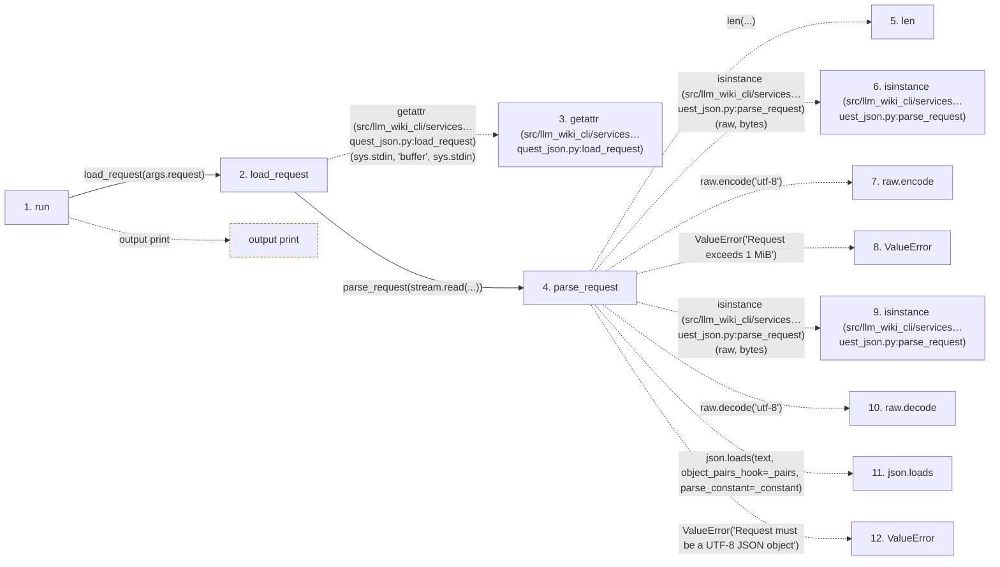

# query

**Entry point:** `run` (`cli`)
**Source:** [query_cmd](../modules/query_cmd.md)
**Modules touched:** [io](../modules/io.md), [query_cmd](../modules/query_cmd.md), [request_json](../modules/request_json.md), [wiki_write_basis](../modules/wiki_write_basis.md)

## Call sequence

> Static overview in presentation order, not runtime execution order. Arrows retain captured callers; siblings are shown before deeper helper detail.

```mermaid
sequenceDiagram
    participant p0 as run
    participant p1 as load_request
    participant p2 as api.query_documentation
    participant p3 as json.dumps
    participant p4 as write_text_output
    participant p5 as write_utf8_stdout
    participant p6 as isinstance (src/llm_wiki_cli/commands/query_cmd.py:run)
    participant p7 as print
    participant p8 as getattr (src/llm_wiki_cli/commands/query_cmd.py:run)
    participant p9 as SystemExit
    participant p10 as getattr (src/llm_wiki_cli/services…quest_json.py:load_request)
    participant p11 as Path(…).expanduser
    participant p12 as text.encode
    participant p13 as parse_request
    participant p14 as Path (src/llm_wiki_cli/services/io.py:write_text_output)
    participant p15 as getattr (src/llm_wiki_cli/services/io.py:write_utf8_stdout)
    participant p16 as stream.read
    participant p17 as _write_utf8_text
    participant p18 as stream.write
    participant p19 as Path(…).open
    participant p20 as stream.flush
    participant p21 as Path (src/llm_wiki_cli/services…quest_json.py:load_request)
    participant p22 as buffer.write
    participant p23 as buffer.flush
    participant p24 as len
    participant p25 as text.replace(…).replace
    participant p26 as isinstance (src/llm_wiki_cli/services…uest_json.py:parse_request)
    p0->>p1: load_request
    p0-->>p2: api.query_documentation(…)
    p0-->>p3: json.dumps(result, ensure_ascii=False, sort_keys=True, separators=(...), allow_nan=False)
    p0->>p4: write_text_output
    p0->>p5: write_utf8_stdout
    p0-->>p6: isinstance (src/llm_wiki_cli/commands/query_cmd.py:run)(exc, (...))
    p0-->>p7: print(json.dumps(...), file=sys.stderr)
    p0-->>p3: json.dumps({...}, sort_keys=True)
    p0-->>p8: getattr (src/llm_wiki_cli/commands/query_cmd.py:run)(exc, 'code', None)
    p0-->>p8: getattr (src/llm_wiki_cli/commands/query_cmd.py:run)(exc, 'details', None)
    p0-->>p9: SystemExit(...)
    p1-->>p10: getattr (src/llm_wiki_cli/services…quest_json.py:load_request)(sys.stdin, 'buffer', sys.stdin)
    p4-->>p11: Path(…).expanduser
    p5-->>p12: text.encode('utf-8')
    p1->>p13: parse_request
    p4-->>p14: Path (src/llm_wiki_cli/services/io.py:write_text_output)(path)
    p5-->>p15: getattr (src/llm_wiki_cli/services/io.py:write_utf8_stdout)(stream, 'buffer', None)
    p1-->>p16: stream.read(...)
    p4->>p17: _write_utf8_text
    p5-->>p18: stream.write(text)
    p1-->>p19: Path(…).open('rb')
    p5-->>p20: stream.flush
    p1-->>p21: Path (src/llm_wiki_cli/services…quest_json.py:load_request)(path)
    p5-->>p22: buffer.write(encoded)
    p1->>p13: parse_request
    p5-->>p23: buffer.flush
    p1-->>p16: stream.read(...)
    p13-->>p24: len(...)
    p17-->>p25: text.replace(…).replace('\r', '\n')
    p13-->>p26: isinstance (src/llm_wiki_cli/services…uest_json.py:parse_request)(raw, bytes)
```

<!-- Auto-generated from static call edges. Dashed arrows are external or unresolved calls. Reviewed runtime conditions and side effects belong in Behavior. -->

> Call sequence diagram shows 30 of 58 interactions; 28 omitted to keep the visualization within the 30-interaction and generated-diagram limits, with uncertain identities omitted rather than inferred.

> Captured boundary calls: external 13 of 28 (15 omitted); unresolved 11 of 21 (10 omitted). These counts cover the captured static trace.

Omitted captured detail, grouped by actual caller occurrence and target module:

| Caller | Parent step | Target module | Kind | Omitted interactions |
| --- | --- | --- | --- | --- |
| `src/llm_wiki_cli/services/request_json.py:parse_request` | 4 | - | unresolved | 2 |
| `src/llm_wiki_cli/services/request_json.py:parse_request` | 4 | - | external | 6 |
| `src/llm_wiki_cli/services/io.py:_write_utf8_text` | 25 | - | unresolved | 2 |
| `src/llm_wiki_cli/services/io.py:_write_utf8_text` | 25 | [src/llm_wiki_cli/services/io.py](../modules/io.md) | internal | 1 |
| `src/llm_wiki_cli/services/io.py:write_bytes_atomic` | 28 | - | external | 7 |
| `src/llm_wiki_cli/services/io.py:write_bytes_atomic` | 28 | [src/llm_wiki_cli/services/wiki_write_basis.py](../modules/wiki_write_basis.md) | internal | 2 |
| `src/llm_wiki_cli/services/wiki_write_basis.py:before_wiki_write` | 32 | - | unresolved | 2 |
| `src/llm_wiki_cli/services/wiki_write_basis.py:before_wiki_write` | 32 | - | external | 1 |
> Omission summary shows 8 of 11 groups; 3 further groups are not expanded here. Counts above include all omitted interactions.
> Detailed flow queries retain their own coverage and limits; omitted paths may execute at runtime.

## Data flow

<!-- Auto-generated static analysis. Treat values and boundaries as best-effort hints, not runtime proof. -->

### Step data

| Step | Inputs | Reads | Writes | Returns |
|---|---|---|---|---|
| `run` | `args` | `sys` | - | - |
| `load_request` | `path: str` | `sys`, `MAX_REQUEST_BYTES`, `MAX_REQUEST_BYTES` | - | `parse_request(...)`, `parse_request(...)` |
| `getattr (src/llm_wiki_cli/services…quest_json.py:load_request)` | - | - | - | - |
| `parse_request` | `raw: bytes \| str` | `MAX_REQUEST_BYTES`, `_pairs`, `_constant`, `json` | - | `value` |
| `len` | - | - | - | - |
| `isinstance (src/llm_wiki_cli/services…uest_json.py:parse_request)` | - | - | - | - |
| `raw.encode` | - | - | - | - |
| `ValueError` | - | - | - | - |
| `isinstance (src/llm_wiki_cli/services…uest_json.py:parse_request)` | - | - | - | - |
| `raw.decode` | - | - | - | - |
| `json.loads` | - | - | - | - |
| `ValueError` | - | - | - | - |

### Call data

| From | To | Line | Call |
|---|---|---:|---|
| run | load_request | 16 | `load_request(args.request)` |
| load_request | getattr (src/llm_wiki_cli/services…quest_json.py:load_request) | 41 | `getattr(sys.stdin, 'buffer', sys.stdin)` |
| load_request | parse_request | 42 | `parse_request(stream.read(...))` |
| parse_request | len | 27 | `len(...)` |
| parse_request | isinstance (src/llm_wiki_cli/services…uest_json.py:parse_request) | 27 | `isinstance(raw, bytes)` |
| parse_request | raw.encode | 27 | `raw.encode('utf-8')` |
| parse_request | ValueError | 28 | `ValueError('Request exceeds 1 MiB')` |
| parse_request | isinstance (src/llm_wiki_cli/services…uest_json.py:parse_request) | 30 | `isinstance(raw, bytes)` |
| parse_request | raw.decode | 30 | `raw.decode('utf-8')` |
| parse_request | json.loads | 31 | `json.loads(text, object_pairs_hook=_pairs, parse_constant=_constant)` |
| parse_request | ValueError | 33 | `ValueError('Request must be a UTF-8 JSON object')` |

### Boundary effects

| Kind | Target | Step | Line |
|---|---|---|---:|
| output | `print` | `run` | 28 |

### Static analysis gaps

| Kind | Step | Target | Line |
|---|---|---|---:|
| external_call | `load_request` | `getattr` | 41 |
| external_call | `parse_request` | `isinstance` | 27 |
| unresolved_call | `parse_request` | `raw.encode` | 27 |
| external_call | `parse_request` | `ValueError` | 28 |
| external_call | `parse_request` | `isinstance` | 30 |
| unresolved_call | `parse_request` | `raw.decode` | 30 |
| external_call | `parse_request` | `json.loads` | 31 |
| external_call | `parse_request` | `ValueError` | 33 |
| step_limit | `run` | `first 12 steps` | 0 |

## Behavior

Loads a bounded explicit JSON query from a file or stdin, delegates to the public exact-query API, and writes its canonical response to stdout or an explicitly chosen output file. Invalid request data is rejected before query state is loaded.
