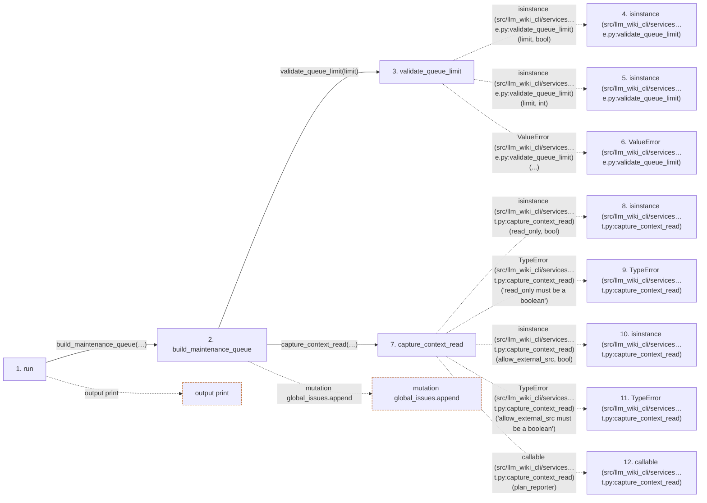

# queue

**Entry point:** `run` (`cli`)
**Source:** [queue_cmd](../modules/queue_cmd.md)
**Modules touched:** [analysis_capture](../modules/analysis_capture.md), [analysis_compatibility](../modules/analysis_compatibility.md), [bootstrap_recovery](../modules/bootstrap_recovery.md), and 76 more

**Complete modules touched:**

- [analysis_capture](../modules/analysis_capture.md)
- [analysis_compatibility](../modules/analysis_compatibility.md)
- [bootstrap_recovery](../modules/bootstrap_recovery.md)
- [bootstrap_runtime](../modules/bootstrap_runtime.md)
- [change_selection](../modules/change_selection.md)
- [common](../modules/common.md)
- [config](../modules/config.md)
- [context_packet](../modules/context_packet.md)
- [context_service](../modules/context_service.md)
- [data_flow](../modules/data_flow.md)
- [dependency_versions](../modules/dependency_versions.md)
- [dockerfile_parser](../modules/dockerfile_parser.md)
- [documentation_queries](../modules/documentation_queries.md)
- [documentation_query_builder](../modules/documentation_query_builder.md)
- [documentation_worklist](../modules/documentation_worklist.md)
- [entrypoints](../modules/entrypoints.md)
- [evidence_diagnostics](../modules/evidence_diagnostics.md)
- [extraction_service](../modules/extraction_service.md)
- [filesystem_guard](../modules/filesystem_guard.md)
- [flow_followup](../modules/flow_followup.md)
- [go_calls](../modules/go_calls.md)
- [health_contract](../modules/health_contract.md)
- [health_details](../modules/health_details.md)
- [immutable](../modules/immutable.md)
- [implementation_evidence](../modules/implementation_evidence.md)
- [imports](../modules/imports.md)
- [infrastructure_inventory](../modules/infrastructure_inventory.md)
- [infrastructure_sync](../modules/infrastructure_sync.md)
- [inventory_cache](../modules/inventory_cache.md)
- [io](../modules/io.md)
- [knowledge_artifacts](../modules/knowledge_artifacts.md)
- [knowledge_consumption](../modules/knowledge_consumption.md)
- [knowledge_envelope](../modules/knowledge_envelope.md)
- [knowledge_evidence](../modules/knowledge_evidence.md)
- [knowledge_freshness](../modules/knowledge_freshness.md)
- [knowledge_generation](../modules/knowledge_generation.md)
- [knowledge_governance](../modules/knowledge_governance.md)
- [knowledge_loader](../modules/knowledge_loader.md)
- [knowledge_model](../modules/knowledge_model.md)
- [knowledge_observability](../modules/knowledge_observability.md)
- [knowledge_orchestration](../modules/knowledge_orchestration.md)
- [knowledge_storage](../modules/knowledge_storage.md)
- [knowledge_storage_io](../modules/knowledge_storage_io.md)
- [knowledge_verification](../modules/knowledge_verification.md)
- [lint_service](../modules/lint_service.md)
- [maintenance_evidence](../modules/maintenance_evidence.md)
- [maintenance_protocol](../modules/maintenance_protocol.md)
- [maintenance_queue](../modules/maintenance_queue.md)
- [maintenance_service](../modules/maintenance_service.md)
- [maintenance_state](../modules/maintenance_state.md)
- [maintenance_status](../modules/maintenance_status.md)
- [manifest_storage](../modules/manifest_storage.md)
- [markdown_sections](../modules/markdown_sections.md)
- [module_coverage](../modules/module_coverage.md)
- [packages](../modules/packages.md)
- [plugins](../modules/plugins.md)
- [progress](../modules/progress.md)
- [python_bindings](../modules/python_bindings.md)
- [python_calls](../modules/python_calls.md)
- [python_extractor](../modules/python_extractor.md)
- [python_implementation](../modules/python_implementation.md)
- [python_imports](../modules/python_imports.md)
- [queue_cmd](../modules/queue_cmd.md)
- [runtime_output](../modules/runtime_output.md)
- [services_dependencies](../modules/services_dependencies.md)
- [source_retirement](../modules/source_retirement.md)
- [source_selection](../modules/source_selection.md)
- [source_snapshot](../modules/source_snapshot.md)
- [sync_analysis](../modules/sync_analysis.md)
- [sync_manifest](../modules/sync_manifest.md)
- [team](../modules/team.md)
- [validation](../modules/validation.md)
- [verification_contracts](../modules/verification_contracts.md)
- [wiki_lifecycle](../modules/wiki_lifecycle.md)
- [wiki_media](../modules/wiki_media.md)
- [wiki_surface](../modules/wiki_surface.md)
- [wiki_surface_index](../modules/wiki_surface_index.md)
- [yaml_formats](../modules/yaml_formats.md)
- [yaml_syntax](../modules/yaml_syntax.md)

## Call sequence

> Static overview in presentation order, not runtime execution order. Arrows retain captured callers; representative internal continuations and boundary examples precede repeated helper detail.

```mermaid
sequenceDiagram
    participant p0 as run
    participant p1 as build_maintenance_queue
    participant p2 as render_queue
    participant p3 as capture_context_read
    participant p4 as build_report
    participant p5 as build_documentation_worklist
    participant p6 as compose_queue
    participant p7 as _assert_selection_unchanged
    participant p8 as _require_non_negative_int
    participant p9 as _require_positive_int
    participant p10 as select_changes
    participant p11 as _new_lint_report
    participant p12 as _preflight_lint_inputs
    participant p13 as _finalize_lint_report
    participant p14 as prepare_cache_options
    participant p15 as _collect_lint_inputs
    participant p16 as _run_report_checks
    participant p17 as _surface_page_map
    participant p18 as validate_source_root
    participant p19 as _source_path_from_page
    participant p20 as _normalise_dependency_metrics
    participant p21 as guard_maintenance_owner
    participant p22 as _normalise_entrypoints
    participant p23 as resolve_source_selection
    participant p24 as capture_source_selection_inputs
    participant p25 as validate_live_query_source_selection
    participant p26 as _centrality_score
    participant p27 as _index_needs_context
    participant p28 as _add_page_candidate
    participant p29 as print
    participant p30 as lines.append
    p0->>p1: build_maintenance_queue
    p0->>p2: render_queue
    p1->>p3: capture_context_read
    p1->>p4: build_report
    p1->>p5: build_documentation_worklist
    p1->>p6: compose_queue
    p1->>p7: _assert_selection_unchanged
    p5->>p8: _require_non_negative_int
    p5->>p9: _require_positive_int
    p7->>p10: select_changes
    p4->>p11: _new_lint_report
    p4->>p12: _preflight_lint_inputs
    p4->>p13: _finalize_lint_report
    p4->>p14: prepare_cache_options
    p4->>p15: _collect_lint_inputs
    p4->>p16: _run_report_checks
    p5->>p17: _surface_page_map
    p3->>p18: validate_source_root
    p5->>p19: _source_path_from_page
    p5->>p20: _normalise_dependency_metrics
    p3->>p21: guard_maintenance_owner
    p5->>p22: _normalise_entrypoints
    p3->>p23: resolve_source_selection
    p3->>p24: capture_source_selection_inputs
    p3->>p25: validate_live_query_source_selection
    p5->>p26: _centrality_score
    p5->>p27: _index_needs_context
    p5->>p28: _add_page_candidate
    p0-->>p29: print(..., end=...)
    p2-->>p30: lines.append(...)
```

<!-- Auto-generated from static call edges. Dashed arrows are external or unresolved calls. Reviewed runtime conditions and side effects belong in Behavior. -->

> Call sequence diagram shows 30 of 4294 interactions; 4264 omitted to keep the visualization within the 30-interaction and generated-diagram limits, with uncertain identities omitted rather than inferred.

> Captured boundary calls: external 1 of 1352 (1351 omitted); unresolved 1 of 1460 (1459 omitted). These counts cover the captured static trace.

Omitted captured detail, grouped by actual caller occurrence and target module:

| Caller | Parent step | Target module | Kind | Omitted interactions |
| --- | --- | --- | --- | --- |
| `src/llm_wiki_cli/services/maintenance_queue.py:build_maintenance_queue` | 2 | [src/llm_wiki_cli/services/maintenance_queue.py](../modules/maintenance_queue.md) | internal | 1 |
| `src/llm_wiki_cli/services/maintenance_queue.py:validate_queue_limit` | 3 | - | external | 3 |
| `src/llm_wiki_cli/services/context_packet.py:capture_context_read` | 7 | - | external | 37 |
| `src/llm_wiki_cli/config.py:validate_source_root` | 20 | [src/llm_wiki_cli/config.py](../modules/config.md) | internal | 7 |
| `src/llm_wiki_cli/config.py:validate_path` | 21 | [src/llm_wiki_cli/config.py](../modules/config.md) | internal | 2 |
| `src/llm_wiki_cli/config.py:validate_path` | 21 | - | unresolved | 3 |
| `src/llm_wiki_cli/config.py:validate_path` | 21 | - | external | 2 |
| `src/llm_wiki_cli/config.py:validate_source_root` | 20 | - | unresolved | 5 |
> Omission summary shows 8 of 1115 groups; 1107 further groups are not expanded here. Counts above include all omitted interactions.
> Detailed flow queries retain their own coverage and limits; omitted paths may execute at runtime.

> Trace truncated at the depth limit; deeper calls are omitted.

## Data flow

<!-- Auto-generated static analysis. Treat values and boundaries as best-effort hints, not runtime proof. -->

### Analysis coverage

**Effect analysis partially available.** Flow assembly and source effect analysis are separate; empty observations do not prove an empty handler body.

Source steps: 1483; effect analysis evaluated: 1109, partial: 74, unavailable: 300. Counts include steps omitted from the displayed trace.

Collector observations for 1183 source steps with known totals: observed: 7447, emitted: 7082, omitted: 365. Unavailable totals are excluded.

- Callable record unavailable for one or more source steps; those steps have no represented callable body.
- Effect collector omitted observations before flow assembly; displayed effects are partial.
- Effect collector totals unavailable; observed counts cover captured records only.

| Step | Callable record | Effect analysis | Collector totals | Observed | Emitted | Omitted |
|---|---|---|---|---:|---:|---:|
| `run` | `available` | `evaluated` | `available` | `2` | `2` | `0` |
| `build_maintenance_queue` | `available` | `evaluated` | `available` | `11` | `11` | `0` |
| `validate_queue_limit` | `available` | `evaluated` | `available` | `6` | `6` | `0` |
| `isinstance (src/llm_wiki_cli/services…e.py:validate_queue_limit)` | `not_applicable` | `not_applicable` | `not_applicable` | — | — | — |
| `isinstance (src/llm_wiki_cli/services…e.py:validate_queue_limit)` | `not_applicable` | `not_applicable` | `not_applicable` | — | — | — |
| `ValueError (src/llm_wiki_cli/services…e.py:validate_queue_limit)` | `not_applicable` | `not_applicable` | `not_applicable` | — | — | — |
| `capture_context_read` | `available` | `partial` | `available` | `37` | `25` | `12` |
| `isinstance (src/llm_wiki_cli/services…t.py:capture_context_read)` | `not_applicable` | `not_applicable` | `not_applicable` | — | — | — |
| `TypeError (src/llm_wiki_cli/services…t.py:capture_context_read)` | `not_applicable` | `not_applicable` | `not_applicable` | — | — | — |
| `isinstance (src/llm_wiki_cli/services…t.py:capture_context_read)` | `not_applicable` | `not_applicable` | `not_applicable` | — | — | — |
| `TypeError (src/llm_wiki_cli/services…t.py:capture_context_read)` | `not_applicable` | `not_applicable` | `not_applicable` | — | — | — |
| `callable (src/llm_wiki_cli/services…t.py:capture_context_read)` | `not_applicable` | `not_applicable` | `not_applicable` | — | — | — |

### Step data

| Step | Inputs | Reads | Writes | Returns |
|---|---|---|---|---|
| `run` | `args` | - | - | - |
| `build_maintenance_queue` | `src_dir`, `wiki_dir`, `limit`, `allow_external_src`, `source_selection`, `helper_cache_dir` | - | `result[...]`, `result[...]`, `result[...]` | `result` |
| `validate_queue_limit` | `limit: object` | `MIN_QUEUE_LIMIT`, `MAX_QUEUE_LIMIT`, `MIN_QUEUE_LIMIT`, `MAX_QUEUE_LIMIT` | - | `limit` |
| `isinstance (src/llm_wiki_cli/services…e.py:validate_queue_limit)` | - | - | - | - |
| `isinstance (src/llm_wiki_cli/services…e.py:validate_queue_limit)` | - | - | - | - |
| `ValueError (src/llm_wiki_cli/services…e.py:validate_queue_limit)` | - | - | - | - |
| `capture_context_read` | `src_dir: str`, `wiki_dir: str`, `allow_external_src: bool`, `read_only: bool`, `job_request: ExtractionJobRequest \| None`, `plan_reporter: Callable[[ExtractionJobPlan], None] \| None`, `source_selection: str \| Path \| None`, `allow_selection_mismatch: bool` | `PathValidationError`, `DocumentationQueryError`, `context_service`, `os`, `InventoryResult`, `SourceSnapshot`, `DocumentationQueryError`, `DocumentationQueryError` | `capture_options[...]`, `capture_options[...]`, `capture_options[...]`, `capture_options[...]`, `capture_options[...]`, `helper_options[...]`, `wiki_options[...]`, `wiki_options[...]` | `captured` |
| `isinstance (src/llm_wiki_cli/services…t.py:capture_context_read)` | - | - | - | - |
| `TypeError (src/llm_wiki_cli/services…t.py:capture_context_read)` | - | - | - | - |
| `isinstance (src/llm_wiki_cli/services…t.py:capture_context_read)` | - | - | - | - |
| `TypeError (src/llm_wiki_cli/services…t.py:capture_context_read)` | - | - | - | - |
| `callable (src/llm_wiki_cli/services…t.py:capture_context_read)` | - | - | - | - |

### Call data

| From | To | Line | Call |
|---|---|---:|---|
| run | build_maintenance_queue | 9 | `build_maintenance_queue(args.src_dir, args.wiki_dir, limit=args.limit, allow_external_src=args.allow_external_src, source_selection=args.source_selection, helper_cache_dir=args.helper_cache_dir)` |
| build_maintenance_queue | validate_queue_limit | 478 | `validate_queue_limit(limit)` |
| validate_queue_limit | isinstance (src/llm_wiki_cli/services…e.py:validate_queue_limit) | 58 | `isinstance(limit, bool)` |
| validate_queue_limit | isinstance (src/llm_wiki_cli/services…e.py:validate_queue_limit) | 59 | `isinstance(limit, int)` |
| validate_queue_limit | ValueError (src/llm_wiki_cli/services…e.py:validate_queue_limit) | 62 | `ValueError(...)` |
| build_maintenance_queue | capture_context_read | 479 | `capture_context_read(src_dir, wiki_dir, allow_external_src=allow_external_src, read_only=True, strict_wiki_symlinks=True, allow_selection_mismatch=True, source_selection=source_selection, helper_cache_dir=helper_cache_dir)` |
| capture_context_read | isinstance (src/llm_wiki_cli/services…t.py:capture_context_read) | 800 | `isinstance(read_only, bool)` |
| capture_context_read | TypeError (src/llm_wiki_cli/services…t.py:capture_context_read) | 801 | `TypeError('read_only must be a boolean')` |
| capture_context_read | isinstance (src/llm_wiki_cli/services…t.py:capture_context_read) | 802 | `isinstance(allow_external_src, bool)` |
| capture_context_read | TypeError (src/llm_wiki_cli/services…t.py:capture_context_read) | 803 | `TypeError('allow_external_src must be a boolean')` |
| capture_context_read | callable (src/llm_wiki_cli/services…t.py:capture_context_read) | 804 | `callable(plan_reporter)` |

### Boundary effects

| Kind | Target | Step | Line |
|---|---|---|---:|
| output | `print` | `run` | 17 |
| mutation | `global_issues.append` | `build_maintenance_queue` | 537 |

### Static analysis gaps

| Kind | Step | Target | Line |
|---|---|---|---:|
| external_call | `validate_queue_limit` | `isinstance` | 58 |
| external_call | `validate_queue_limit` | `isinstance` | 59 |
| external_call | `validate_queue_limit` | `ValueError` | 62 |
| external_call | `capture_context_read` | `isinstance` | 800 |
| external_call | `capture_context_read` | `TypeError` | 801 |
| external_call | `capture_context_read` | `isinstance` | 802 |
| external_call | `capture_context_read` | `TypeError` | 803 |
| external_call | `capture_context_read` | `callable` | 804 |
| step_limit | `run` | `first 12 steps` | 0 |
| truncated_flow | `run` | `depth limit` | 0 |

## Behavior

This flow starts at `run` and is classified as `cli`. The generated call and data-flow sections are bounded static projections; runtime conditions and side effects require source-level confirmation.
