# reference

**Entry point:** `run` (`cli`)
**Source:** [reference_cmd](../modules/reference_cmd.md)
**Modules touched:** [behavior_reference](../modules/behavior_reference.md), [change_selection](../modules/change_selection.md), [cli](../modules/cli.md), [cli_reference](../modules/cli_reference.md), and 15 more

**Complete modules touched:**

- [behavior_reference](../modules/behavior_reference.md)
- [change_selection](../modules/change_selection.md)
- [cli](../modules/cli.md)
- [cli_reference](../modules/cli_reference.md)
- [current_contracts](../modules/current_contracts.md)
- [documentation_query_builder](../modules/documentation_query_builder.md)
- [filesystem_guard](../modules/filesystem_guard.md)
- [helper_runtime](../modules/helper_runtime.md)
- [io](../modules/io.md)
- [knowledge_evidence](../modules/knowledge_evidence.md)
- [knowledge_storage](../modules/knowledge_storage.md)
- [knowledge_storage_io](../modules/knowledge_storage_io.md)
- [llm_wiki_cli___init__](../modules/llm_wiki_cli___init__.md)
- [reference_cmd](../modules/reference_cmd.md)
- [skills](../modules/skills.md)
- [task_compact](../modules/task_compact.md)
- [task_contract](../modules/task_contract.md)
- [validation](../modules/validation.md)
- [workflow_profile](../modules/workflow_profile.md)

## Call sequence

> Static overview in presentation order, not runtime execution order. Arrows retain captured callers; representative internal continuations and boundary examples precede repeated helper detail.

```mermaid
sequenceDiagram
    participant p0 as run
    participant p1 as _reference
    participant p2 as ensure_guarded_directory
    participant p3 as atomic_write_private_bytes
    participant p4 as _absolute_path
    participant p5 as StorageReadSession
    participant p6 as get_behavior_facts
    participant p7 as load_behavior_facts
    participant p8 as load_cli_contract
    participant p9 as _atomic_write_private_bytes_windows
    participant p10 as _atomic_write_private_bytes_posix
    participant p11 as get_cli_contract
    participant p12 as parse_behavior_facts
    participant p13 as parse_cli_contract
    participant p14 as read_guarded
    participant p15 as open_windows_private_write_file
    participant p16 as _task_facts
    participant p17 as list_bundled_skills
    participant p18 as validate_behavior_facts
    participant p19 as replace_windows_file_write_through
    participant p20 as _commit_windows_absent_snapshot
    participant p21 as verify_windows_restrictive_dacl
    participant p22 as _restore_posix_quarantined_entry
    participant p23 as build_cli_contract
    participant p24 as normalize_task_request
    participant p25 as _validate_range
    participant p26 as build_cli_parser
    participant p27 as _provider_package_identity
    participant p28 as normalize_view_options
    participant p29 as json.dumps (src/llm_wiki_cli/commands/reference_cmd.py:run)
    participant p30 as content.encode
    p0->>p1: _reference
    p0->>p2: ensure_guarded_directory
    p0->>p3: atomic_write_private_bytes
    p0->>p4: _absolute_path
    p0->>p5: StorageReadSession
    p1->>p6: get_behavior_facts
    p1->>p7: load_behavior_facts
    p1->>p8: load_cli_contract
    p3->>p9: _atomic_write_private_bytes_windows
    p3->>p10: _atomic_write_private_bytes_posix
    p6->>p11: get_cli_contract
    p7->>p12: parse_behavior_facts
    p8->>p13: parse_cli_contract
    p7->>p14: read_guarded
    p9->>p15: open_windows_private_write_file
    p6->>p16: _task_facts
    p6->>p17: list_bundled_skills
    p6->>p18: validate_behavior_facts
    p9->>p19: replace_windows_file_write_through
    p9->>p20: _commit_windows_absent_snapshot
    p9->>p21: verify_windows_restrictive_dacl
    p10->>p22: _restore_posix_quarantined_entry
    p11->>p23: build_cli_contract
    p16->>p24: normalize_task_request
    p14->>p25: _validate_range
    p11->>p26: build_cli_parser
    p11->>p27: _provider_package_identity
    p16->>p28: normalize_view_options
    p0-->>p29: json.dumps (src/llm_wiki_cli/commands/reference_cmd.py:run)(contract, indent=2, sort_keys=True, ensure_ascii=False)
    p0-->>p30: content.encode('utf-8')
```

<!-- Auto-generated from static call edges. Dashed arrows are external or unresolved calls. Reviewed runtime conditions and side effects belong in Behavior. -->

> Call sequence diagram shows 30 of 863 interactions; 833 omitted to keep the visualization within the 30-interaction and generated-diagram limits, with uncertain identities omitted rather than inferred.

> Captured boundary calls: external 1 of 408 (407 omitted); unresolved 1 of 172 (171 omitted). These counts cover the captured static trace.

Omitted captured detail, grouped by actual caller occurrence and target module:

| Caller | Parent step | Target module | Kind | Omitted interactions |
| --- | --- | --- | --- | --- |
| `src/llm_wiki_cli/services/cli_reference.py:build_cli_contract` | 5 | - | external | 2 |
| `src/llm_wiki_cli/services/cli_reference.py:build_cli_contract` | 5 | [src/llm_wiki_cli/services/cli_reference.py](../modules/cli_reference.md) | internal | 4 |
| `src/llm_wiki_cli/services/cli_reference.py:_value` | 8 | [src/llm_wiki_cli/services/cli_reference.py](../modules/cli_reference.md) | internal | 5 |
| `src/llm_wiki_cli/services/cli_reference.py:_value` | 8 | - | external | 9 |
| `src/llm_wiki_cli/services/cli_reference.py:_value` | 8 | - | unresolved | 3 |
| `src/llm_wiki_cli/services/cli_reference.py:_command` | 27 | - | external | 24 |
| `src/llm_wiki_cli/services/cli_reference.py:_command` | 27 | [src/llm_wiki_cli/services/cli_reference.py](../modules/cli_reference.md) | internal | 10 |
| `src/llm_wiki_cli/services/cli_reference.py:_command` | 27 | - | unresolved | 14 |
> Omission summary shows 8 of 172 groups; 164 further groups are not expanded here. Counts above include all omitted interactions.
> Detailed flow queries retain their own coverage and limits; omitted paths may execute at runtime.

> Trace truncated at the depth limit; deeper calls are omitted.

## Data flow

<!-- Auto-generated static analysis. Treat values and boundaries as best-effort hints, not runtime proof. -->

### Analysis coverage

**Effect analysis partially available.** Flow assembly and source effect analysis are separate; empty observations do not prove an empty handler body.

Source steps: 284; effect analysis evaluated: 189, partial: 16, unavailable: 79. Counts include steps omitted from the displayed trace.

Collector observations for 205 source steps with known totals: observed: 1138, emitted: 1104, omitted: 34. Unavailable totals are excluded.

- Callable record unavailable for one or more source steps; those steps have no represented callable body.
- Effect collector omitted observations before flow assembly; displayed effects are partial.
- Effect collector totals unavailable; observed counts cover captured records only.

| Step | Callable record | Effect analysis | Collector totals | Observed | Emitted | Omitted |
|---|---|---|---|---:|---:|---:|
| `run` | `available` | `evaluated` | `available` | `5` | `5` | `0` |
| `_reference` | `available` | `evaluated` | `available` | `3` | `3` | `0` |
| `get_behavior_facts` | `available` | `evaluated` | `available` | `6` | `6` | `0` |
| `get_cli_contract` | `available` | `evaluated` | `available` | `1` | `1` | `0` |
| `build_cli_contract` | `available` | `evaluated` | `available` | `6` | `6` | `0` |
| `isinstance (src/llm_wiki_cli/services…nce.py:build_cli_contract)` | `not_applicable` | `not_applicable` | `not_applicable` | — | — | — |
| `CLIReferenceError` | `unavailable` | `unavailable` | `unavailable` | — | — | — |
| `_value` | `available` | `evaluated` | `available` | `10` | `10` | `0` |
| `CLIReferenceError` | `unavailable` | `unavailable` | `unavailable` | — | — | — |
| `isinstance (src/llm_wiki_cli/services/cli_reference.py:_value)` | `not_applicable` | `not_applicable` | `not_applicable` | — | — | — |
| `value.is_absolute` | `not_applicable` | `not_applicable` | `not_applicable` | — | — | — |
| `CLIReferenceError` | `unavailable` | `unavailable` | `unavailable` | — | — | — |

```mermaid
flowchart LR
    s1["1. run"]
    s2["2. _reference"]
    s3["3. get_behavior_facts"]
    s4["4. get_cli_contract"]
    s5["5. build_cli_contract"]
    s6["6. isinstance (src/llm_wiki_cli/services…nce.py:build_cli_contract)"]
    s7["7. CLIReferenceError"]
    s8["8. _value"]
    s9["9. CLIReferenceError"]
    s10["10. isinstance (src/llm_wiki_cli/services/cli_reference.py:_value)"]
    s11["11. value.is_absolute"]
    s12["12. CLIReferenceError"]
    s1 -->|"_reference(args)"| s2
    s2 -->|"get_behavior_facts(data not statically known)"| s3
    s3 -->|"get_cli_contract(data not statically known)"| s4
    s4 -->|"build_cli_contract(build_cli_parser(...), package=_provider_package_identity(...), program='llm-wiki')"| s5
    s5 -. "isinstance (src/llm_wiki_cli/services…nce.py:build_cli_contract)(parser, argparse.ArgumentParser)" .-> s6
    s5 -->|"CLIReferenceError('Reference generation requires an ArgumentParser')"| s7
    s5 -->|"_value(dict(...))"| s8
    s8 -->|"CLIReferenceError('Reference values exceed the supported nesting depth')"| s9
    s8 -. "isinstance (src/llm_wiki_cli/services/cli_reference.py:_value)(value, Path)" .-> s10
    s8 -. "value.is_absolute(data not statically known)" .-> s11
    s8 -->|"CLIReferenceError('Reference defaults cannot contain live absolute Path objects')"| s12
    b0["output print"]
    s1 -. "output print" .-> b0
    b1["output print"]
    s1 -. "output print" .-> b1
    click s1 "../modules/reference_cmd.md"
    click s2 "../modules/reference_cmd.md"
    click s3 "../modules/behavior_reference.md"
    click s4 "../modules/cli_reference.md"
    click s5 "../modules/cli_reference.md"
    click s7 "../modules/cli_reference.md"
    click s8 "../modules/cli_reference.md"
    click s9 "../modules/cli_reference.md"
    click s12 "../modules/cli_reference.md"
    classDef boundary stroke:#b45309,stroke-dasharray: 4 2
    class b0 boundary
    class b1 boundary
```

### Step data

| Step | Inputs | Reads | Writes | Returns |
|---|---|---|---|---|
| `run` | `args` | `sys` | - | `none` |
| `_reference` | `args` | - | - | `(...)`, `(...)` |
| `get_behavior_facts` | - | `config`, `config`, `config`, `skills`, `BEHAVIOR_FACTS_SCHEMA_VERSION` | - | `result` |
| `get_cli_contract` | - | - | - | `build_cli_contract(...)` |
| `build_cli_contract` | `parser: argparse.ArgumentParser`, `package: Mapping[str, Any]`, `program: str` | `argparse`, `CLI_CONTRACT_SCHEMA_VERSION` | - | `result` |
| `isinstance (src/llm_wiki_cli/services…nce.py:build_cli_contract)` | - | - | - | - |
| `CLIReferenceError` | - | - | - | - |
| `_value` | `value: object`, `depth: int` | `_MAX_DEPTH`, `Path`, `Mapping` | - | `value`, `value`, `value`, `...`, `...` |
| `CLIReferenceError` | - | - | - | - |
| `isinstance (src/llm_wiki_cli/services/cli_reference.py:_value)` | - | - | - | - |
| `value.is_absolute` | - | - | - | - |
| `CLIReferenceError` | - | - | - | - |

### Call data

| From | To | Line | Call |
|---|---|---:|---|
| run | _reference | 71 | `_reference(args)` |
| _reference | get_behavior_facts | 48 | `get_behavior_facts(data not statically known)` |
| get_behavior_facts | get_cli_contract | 89 | `cli_reference.get_cli_contract(data not statically known)` |
| get_cli_contract | build_cli_contract | 273 | `build_cli_contract(build_cli_parser(...), package=_provider_package_identity(...), program='llm-wiki')` |
| build_cli_contract | isinstance (src/llm_wiki_cli/services…nce.py:build_cli_contract) | 256 | `isinstance(parser, argparse.ArgumentParser)` |
| build_cli_contract | CLIReferenceError | 257 | `CLIReferenceError('Reference generation requires an ArgumentParser')` |
| build_cli_contract | _value | 260 | `_value(dict(...))` |
| _value | CLIReferenceError | 70 | `CLIReferenceError('Reference values exceed the supported nesting depth')` |
| _value | isinstance (src/llm_wiki_cli/services/cli_reference.py:_value) | 71 | `isinstance(value, Path)` |
| _value | value.is_absolute | 72 | `value.is_absolute(data not statically known)` |
| _value | CLIReferenceError | 73 | `CLIReferenceError('Reference defaults cannot contain live absolute Path objects')` |

### Boundary effects

| Kind | Target | Step | Line |
|---|---|---|---:|
| output | `print` | `run` | 88 |
| output | `print` | `run` | 108 |

### Static analysis gaps

| Kind | Step | Target | Line |
|---|---|---|---:|
| external_call | `build_cli_contract` | `isinstance` | 256 |
| external_call | `_value` | `isinstance` | 71 |
| unresolved_call | `_value` | `value.is_absolute` | 72 |
| step_limit | `run` | `first 12 steps` | 0 |
| truncated_flow | `run` | `depth limit` | 0 |

## Behavior

This flow starts at `run` and is classified as `cli`. The generated call and data-flow sections are bounded static projections; runtime conditions and side effects require source-level confirmation.
