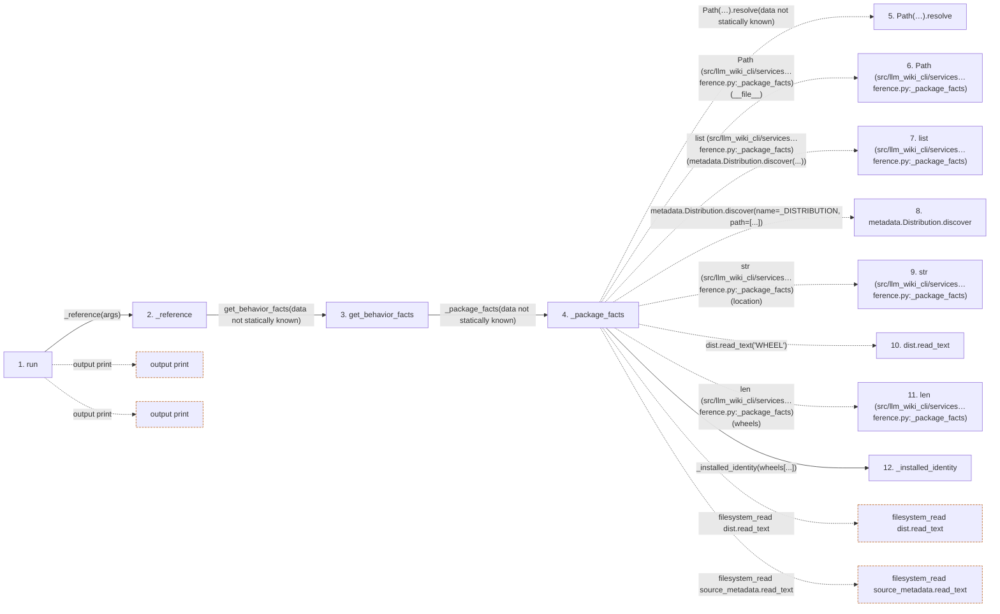

# reference

**Entry point:** `run` (`cli`)
**Source:** [reference_cmd](../modules/reference_cmd.md)
**Modules touched:** [behavior_reference](../modules/behavior_reference.md), [change_selection](../modules/change_selection.md), [cli](../modules/cli.md), [cli_reference](../modules/cli_reference.md), and 14 more

**Complete modules touched:**

- [behavior_reference](../modules/behavior_reference.md)
- [change_selection](../modules/change_selection.md)
- [cli](../modules/cli.md)
- [cli_reference](../modules/cli_reference.md)
- [current_contracts](../modules/current_contracts.md)
- [documentation_query_builder](../modules/documentation_query_builder.md)
- [filesystem_guard](../modules/filesystem_guard.md)
- [helper_runtime](../modules/helper_runtime.md)
- [io](../modules/io.md)
- [knowledge_evidence](../modules/knowledge_evidence.md)
- [knowledge_storage](../modules/knowledge_storage.md)
- [knowledge_storage_io](../modules/knowledge_storage_io.md)
- [reference_cmd](../modules/reference_cmd.md)
- [skills](../modules/skills.md)
- [task_compact](../modules/task_compact.md)
- [task_contract](../modules/task_contract.md)
- [validation](../modules/validation.md)
- [workflow_profile](../modules/workflow_profile.md)

## Call sequence

> Static overview in presentation order, not runtime execution order. Arrows retain captured callers; representative internal continuations and boundary examples precede repeated helper detail.

```mermaid
sequenceDiagram
    participant p0 as run
    participant p1 as _reference
    participant p2 as ensure_guarded_directory
    participant p3 as atomic_write_private_bytes
    participant p4 as _absolute_path
    participant p5 as StorageReadSession
    participant p6 as get_behavior_facts
    participant p7 as load_behavior_facts
    participant p8 as load_cli_contract
    participant p9 as get_cli_contract
    participant p10 as _atomic_write_private_bytes_windows
    participant p11 as _atomic_write_private_bytes_posix
    participant p12 as _package_facts
    participant p13 as parse_behavior_facts
    participant p14 as parse_cli_contract
    participant p15 as build_cli_contract
    participant p16 as read_guarded
    participant p17 as build_cli_parser
    participant p18 as open_windows_private_write_file
    participant p19 as _task_facts
    participant p20 as list_bundled_skills
    participant p21 as replace_windows_file_write_through
    participant p22 as _commit_windows_absent_snapshot
    participant p23 as validate_behavior_facts
    participant p24 as verify_windows_restrictive_dacl
    participant p25 as _restore_posix_quarantined_entry
    participant p26 as _build_parser
    participant p27 as normalize_task_request
    participant p28 as _validate_range
    participant p29 as json.dumps (src/llm_wiki_cli/commands/reference_cmd.py:run)
    participant p30 as content.encode
    p0->>p1: _reference
    p0->>p2: ensure_guarded_directory
    p0->>p3: atomic_write_private_bytes
    p0->>p4: _absolute_path
    p0->>p5: StorageReadSession
    p1->>p6: get_behavior_facts
    p1->>p7: load_behavior_facts
    p1->>p8: load_cli_contract
    p1->>p9: get_cli_contract
    p3->>p10: _atomic_write_private_bytes_windows
    p3->>p11: _atomic_write_private_bytes_posix
    p6->>p12: _package_facts
    p7->>p13: parse_behavior_facts
    p8->>p14: parse_cli_contract
    p6->>p15: build_cli_contract
    p7->>p16: read_guarded
    p6->>p17: build_cli_parser
    p10->>p18: open_windows_private_write_file
    p6->>p19: _task_facts
    p6->>p20: list_bundled_skills
    p10->>p21: replace_windows_file_write_through
    p10->>p22: _commit_windows_absent_snapshot
    p6->>p23: validate_behavior_facts
    p10->>p24: verify_windows_restrictive_dacl
    p11->>p25: _restore_posix_quarantined_entry
    p17->>p26: _build_parser
    p19->>p27: normalize_task_request
    p16->>p28: _validate_range
    p0-->>p29: json.dumps (src/llm_wiki_cli/commands/reference_cmd.py:run)(contract, indent=2, sort_keys=True, ensure_ascii=False)
    p0-->>p30: content.encode('utf-8')
```

<!-- Auto-generated from static call edges. Dashed arrows are external or unresolved calls. Reviewed runtime conditions and side effects belong in Behavior. -->

> Call sequence diagram shows 30 of 1041 interactions; 1011 omitted to keep the visualization within the 30-interaction and generated-diagram limits, with uncertain identities omitted rather than inferred.

> Captured boundary calls: external 1 of 469 (468 omitted); unresolved 1 of 207 (206 omitted). These counts cover the captured static trace.

Omitted captured detail, grouped by actual caller occurrence and target module:

| Caller | Parent step | Target module | Kind | Omitted interactions |
| --- | --- | --- | --- | --- |
| `src/llm_wiki_cli/services/behavior_reference.py:_package_facts` | 4 | - | unresolved | 4 |
| `src/llm_wiki_cli/services/behavior_reference.py:_package_facts` | 4 | - | external | 10 |
| `src/llm_wiki_cli/services/behavior_reference.py:_package_facts` | 4 | [src/llm_wiki_cli/services/behavior_reference.py](../modules/behavior_reference.md) | internal | 3 |
| `src/llm_wiki_cli/services/behavior_reference.py:_installed_identity` | 12 | - | external | 3 |
| `src/llm_wiki_cli/services/behavior_reference.py:_installed_identity` | 12 | - | unresolved | 1 |
| `src/llm_wiki_cli/services/behavior_reference.py:_installed_identity` | 12 | [src/llm_wiki_cli/services/behavior_reference.py](../modules/behavior_reference.md) | internal | 1 |
| `src/llm_wiki_cli/services/behavior_reference.py:_identity` | 17 | - | external | 3 |
| `src/llm_wiki_cli/services/behavior_reference.py:_identity` | 17 | - | unresolved | 2 |
> Omission summary shows 8 of 203 groups; 195 further groups are not expanded here. Counts above include all omitted interactions.
> Detailed flow queries retain their own coverage and limits; omitted paths may execute at runtime.

> Trace truncated at the depth limit; deeper calls are omitted.

## Data flow

<!-- Auto-generated static analysis. Treat values and boundaries as best-effort hints, not runtime proof. -->

### Analysis coverage

**Effect analysis partially available.** Flow assembly and source effect analysis are separate; empty observations do not prove an empty handler body.

Source steps: 366; effect analysis evaluated: 246, partial: 16, unavailable: 104. Counts include steps omitted from the displayed trace.

Collector observations for 262 source steps with known totals: observed: 1376, emitted: 1342, omitted: 34. Unavailable totals are excluded.

- Callable record unavailable for one or more source steps; those steps have no represented callable body.
- Effect collector omitted observations before flow assembly; displayed effects are partial.
- Effect collector totals unavailable; observed counts cover captured records only.

| Step | Callable record | Effect analysis | Collector totals | Observed | Emitted | Omitted |
|---|---|---|---|---:|---:|---:|
| `run` | `available` | `evaluated` | `available` | `5` | `5` | `0` |
| `_reference` | `available` | `evaluated` | `available` | `3` | `3` | `0` |
| `get_behavior_facts` | `available` | `evaluated` | `available` | `6` | `6` | `0` |
| `_package_facts` | `available` | `evaluated` | `available` | `6` | `6` | `0` |
| `Path(…).resolve` | `not_applicable` | `not_applicable` | `not_applicable` | — | — | — |
| `Path (src/llm_wiki_cli/services…ference.py:_package_facts)` | `not_applicable` | `not_applicable` | `not_applicable` | — | — | — |
| `list (src/llm_wiki_cli/services…ference.py:_package_facts)` | `not_applicable` | `not_applicable` | `not_applicable` | — | — | — |
| `metadata.Distribution.discover` | `not_applicable` | `not_applicable` | `not_applicable` | — | — | — |
| `str (src/llm_wiki_cli/services…ference.py:_package_facts)` | `not_applicable` | `not_applicable` | `not_applicable` | — | — | — |
| `dist.read_text` | `not_applicable` | `not_applicable` | `not_applicable` | — | — | — |
| `len (src/llm_wiki_cli/services…ference.py:_package_facts)` | `not_applicable` | `not_applicable` | `not_applicable` | — | — | — |
| `_installed_identity` | `available` | `evaluated` | `available` | `2` | `2` | `0` |

### Step data

| Step | Inputs | Reads | Writes | Returns |
|---|---|---|---|---|
| `run` | `args` | `sys` | - | `none` |
| `_reference` | `args` | - | - | `(...)`, `(...)` |
| `get_behavior_facts` | - | `config`, `config`, `config`, `skills`, `BEHAVIOR_FACTS_SCHEMA_VERSION` | - | `result` |
| `_package_facts` | - | `_DISTRIBUTION` | - | `_installed_identity(...)`, `_identity(...)`, `_installed_identity(...)` |
| `Path(…).resolve` | - | - | - | - |
| `Path (src/llm_wiki_cli/services…ference.py:_package_facts)` | - | - | - | - |
| `list (src/llm_wiki_cli/services…ference.py:_package_facts)` | - | - | - | - |
| `metadata.Distribution.discover` | - | - | - | - |
| `str (src/llm_wiki_cli/services…ference.py:_package_facts)` | - | - | - | - |
| `dist.read_text` | - | - | - | - |
| `len (src/llm_wiki_cli/services…ference.py:_package_facts)` | - | - | - | - |
| `_installed_identity` | `distribution: metadata.Distribution` | - | - | `_identity(...)` |

### Call data

| From | To | Line | Call |
|---|---|---:|---|
| run | _reference | 71 | `_reference(args)` |
| _reference | get_behavior_facts | 48 | `get_behavior_facts(data not statically known)` |
| get_behavior_facts | _package_facts | 148 | `_package_facts(data not statically known)` |
| _package_facts | Path(…).resolve | 31 | `Path(__file__).resolve(data not statically known)` |
| _package_facts | Path (src/llm_wiki_cli/services…ference.py:_package_facts) | 31 | `Path(__file__)` |
| _package_facts | list (src/llm_wiki_cli/services…ference.py:_package_facts) | 32 | `list(metadata.Distribution.discover(...))` |
| _package_facts | metadata.Distribution.discover | 33 | `metadata.Distribution.discover(name=_DISTRIBUTION, path=[...])` |
| _package_facts | str (src/llm_wiki_cli/services…ference.py:_package_facts) | 33 | `str(location)` |
| _package_facts | dist.read_text | 35 | `dist.read_text('WHEEL')` |
| _package_facts | len (src/llm_wiki_cli/services…ference.py:_package_facts) | 36 | `len(wheels)` |
| _package_facts | _installed_identity | 37 | `_installed_identity(wheels[...])` |

### Boundary effects

| Kind | Target | Step | Line |
|---|---|---|---:|
| output | `print` | `run` | 88 |
| output | `print` | `run` | 108 |
| filesystem_read | `dist.read_text` | `_package_facts` | 35 |
| filesystem_read | `source_metadata.read_text` | `_package_facts` | 44 |

### Static analysis gaps

| Kind | Step | Target | Line |
|---|---|---|---:|
| unresolved_call | `_package_facts` | `Path(__file__).resolve` | 31 |
| external_call | `_package_facts` | `metadata.Distribution.discover` | 33 |
| step_limit | `run` | `first 12 steps` | 0 |
| truncated_flow | `run` | `depth limit` | 0 |

## Behavior

This flow starts at `run` and is classified as `cli`. The generated call and data-flow sections are bounded static projections; runtime conditions and side effects require source-level confirmation.
