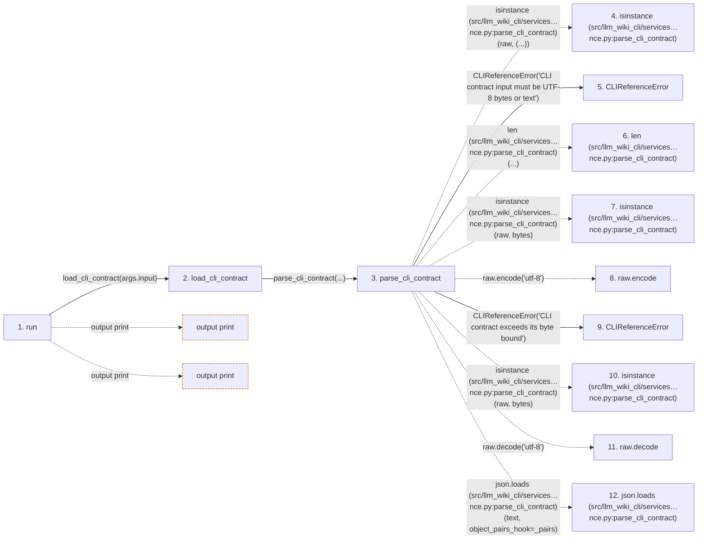

# reference

**Entry point:** `run` (`cli`)
**Source:** [reference_cmd](../modules/reference_cmd.md)
**Modules touched:** [cli](../modules/cli.md), [cli_reference](../modules/cli_reference.md), [docs_cmd](../modules/docs_cmd.md), [filesystem_guard](../modules/filesystem_guard.md), and 6 more

**Complete modules touched:**

- [cli](../modules/cli.md)
- [cli_reference](../modules/cli_reference.md)
- [docs_cmd](../modules/docs_cmd.md)
- [filesystem_guard](../modules/filesystem_guard.md)
- [io](../modules/io.md)
- [knowledge_evidence](../modules/knowledge_evidence.md)
- [knowledge_storage](../modules/knowledge_storage.md)
- [knowledge_storage_io](../modules/knowledge_storage_io.md)
- [publication_cmd](../modules/publication_cmd.md)
- [reference_cmd](../modules/reference_cmd.md)

## Call sequence

> Static overview in presentation order, not runtime execution order. Arrows retain captured callers; representative internal continuations and boundary examples precede repeated helper detail.

```mermaid
sequenceDiagram
    participant p0 as run
    participant p1 as load_cli_contract
    participant p2 as get_cli_contract
    participant p3 as render_cli_reference
    participant p4 as ensure_guarded_directory
    participant p5 as atomic_write_private_bytes
    participant p6 as _absolute_path
    participant p7 as StorageReadSession
    participant p8 as parse_cli_contract
    participant p9 as build_cli_contract
    participant p10 as read_guarded
    participant p11 as build_cli_parser
    participant p12 as _atomic_write_private_bytes_windows
    participant p13 as _atomic_write_private_bytes_posix
    participant p14 as _validate_range
    participant p15 as _build_parser
    participant p16 as guard_windows_directory_chain
    participant p17 as _value
    participant p18 as open_windows_readonly_file
    participant p19 as _command
    participant p20 as _assert_windows_file_binding
    participant p21 as validate_cli_contract
    participant p22 as open_windows_private_write_file
    participant p23 as replace_windows_file_write_through
    participant p24 as _commit_windows_absent_snapshot
    participant p25 as verify_windows_restrictive_dacl
    participant p26 as _raise_io_error
    participant p27 as _restore_posix_quarantined_entry
    participant p28 as _json_tree
    participant p29 as json.dumps (src/llm_wiki_cli/commands/reference_cmd.py:run)
    participant p30 as content.encode
    p0->>p1: load_cli_contract
    p0->>p2: get_cli_contract
    p0->>p3: render_cli_reference
    p0->>p4: ensure_guarded_directory
    p0->>p5: atomic_write_private_bytes
    p0->>p6: _absolute_path
    p0->>p7: StorageReadSession
    p1->>p8: parse_cli_contract
    p2->>p9: build_cli_contract
    p1->>p10: read_guarded
    p2->>p11: build_cli_parser
    p5->>p12: _atomic_write_private_bytes_windows
    p5->>p13: _atomic_write_private_bytes_posix
    p10->>p14: _validate_range
    p11->>p15: _build_parser
    p10->>p16: guard_windows_directory_chain
    p9->>p17: _value
    p10->>p18: open_windows_readonly_file
    p9->>p19: _command
    p10->>p20: _assert_windows_file_binding
    p8->>p21: validate_cli_contract
    p12->>p22: open_windows_private_write_file
    p12->>p23: replace_windows_file_write_through
    p12->>p24: _commit_windows_absent_snapshot
    p12->>p25: verify_windows_restrictive_dacl
    p10->>p26: _raise_io_error
    p13->>p27: _restore_posix_quarantined_entry
    p21->>p28: _json_tree
    p0-->>p29: json.dumps (src/llm_wiki_cli/commands/reference_cmd.py:run)(contract, indent=2, sort_keys=True, ensure_ascii=False)
    p0-->>p30: content.encode('utf-8')
```

<!-- Auto-generated from static call edges. Dashed arrows are external or unresolved calls. Reviewed runtime conditions and side effects belong in Behavior. -->

> Call sequence diagram shows 30 of 1531 interactions; 1501 omitted to keep the visualization within the 30-interaction and generated-diagram limits, with uncertain identities omitted rather than inferred.

> Captured boundary calls: external 1 of 461 (460 omitted); unresolved 1 of 689 (688 omitted). These counts cover the captured static trace.

Omitted captured detail, grouped by actual caller occurrence and target module:

| Caller | Parent step | Target module | Kind | Omitted interactions |
| --- | --- | --- | --- | --- |
| `src/llm_wiki_cli/services/cli_reference.py:parse_cli_contract` | 3 | - | external | 5 |
| `src/llm_wiki_cli/services/cli_reference.py:parse_cli_contract` | 3 | [src/llm_wiki_cli/services/cli_reference.py](../modules/cli_reference.md) | internal | 3 |
| `src/llm_wiki_cli/services/cli_reference.py:parse_cli_contract` | 3 | - | unresolved | 2 |
| `src/llm_wiki_cli/services/cli_reference.py:_json_tree` | 14 | [src/llm_wiki_cli/services/cli_reference.py](../modules/cli_reference.md) | internal | 4 |
| `src/llm_wiki_cli/services/cli_reference.py:_json_tree` | 14 | - | external | 7 |
| `src/llm_wiki_cli/services/cli_reference.py:_json_tree` | 14 | - | unresolved | 1 |
| `src/llm_wiki_cli/services/cli_reference.py:validate_cli_contract` | 13 | - | unresolved | 2 |
| `src/llm_wiki_cli/services/cli_reference.py:validate_cli_contract` | 13 | - | external | 3 |
> Omission summary shows 8 of 223 groups; 215 further groups are not expanded here. Counts above include all omitted interactions.
> Detailed flow queries retain their own coverage and limits; omitted paths may execute at runtime.

> Trace truncated at the depth limit; deeper calls are omitted.

## Data flow

<!-- Auto-generated static analysis. Treat values and boundaries as best-effort hints, not runtime proof. -->

### Analysis coverage

**Effect analysis partially available.** Flow assembly and source effect analysis are separate; empty observations do not prove an empty handler body.

Source steps: 382; effect analysis evaluated: 271, partial: 11, unavailable: 100. Counts include steps omitted from the displayed trace.

Collector observations for 282 source steps with known totals: observed: 1156, emitted: 1139, omitted: 17. Unavailable totals are excluded.

- Callable record unavailable for one or more source steps; those steps have no represented callable body.
- Effect collector omitted observations before flow assembly; displayed effects are partial.
- Effect collector totals unavailable; observed counts cover captured records only.

| Step | Callable record | Effect analysis | Collector totals | Observed | Emitted | Omitted |
|---|---|---|---|---:|---:|---:|
| `run` | `available` | `evaluated` | `available` | `5` | `5` | `0` |
| `load_cli_contract` | `available` | `evaluated` | `available` | `4` | `4` | `0` |
| `parse_cli_contract` | `available` | `evaluated` | `available` | `5` | `5` | `0` |
| `isinstance (src/llm_wiki_cli/services…nce.py:parse_cli_contract)` | `not_applicable` | `not_applicable` | `not_applicable` | — | — | — |
| `CLIReferenceError` | `unavailable` | `unavailable` | `unavailable` | — | — | — |
| `len (src/llm_wiki_cli/services…nce.py:parse_cli_contract)` | `not_applicable` | `not_applicable` | `not_applicable` | — | — | — |
| `isinstance (src/llm_wiki_cli/services…nce.py:parse_cli_contract)` | `not_applicable` | `not_applicable` | `not_applicable` | — | — | — |
| `raw.encode` | `not_applicable` | `not_applicable` | `not_applicable` | — | — | — |
| `CLIReferenceError` | `unavailable` | `unavailable` | `unavailable` | — | — | — |
| `isinstance (src/llm_wiki_cli/services…nce.py:parse_cli_contract)` | `not_applicable` | `not_applicable` | `not_applicable` | — | — | — |
| `raw.decode` | `not_applicable` | `not_applicable` | `not_applicable` | — | — | — |
| `json.loads (src/llm_wiki_cli/services…nce.py:parse_cli_contract)` | `not_applicable` | `not_applicable` | `not_applicable` | — | — | — |

### Step data

| Step | Inputs | Reads | Writes | Returns |
|---|---|---|---|---|
| `run` | `args` | `sys` | - | `none` |
| `load_cli_contract` | `path: str \| Path` | `MAX_CLI_CONTRACT_BYTES`, `CLIReferenceError` | - | `parse_cli_contract(...)` |
| `parse_cli_contract` | `raw: bytes \| str` | `MAX_CLI_CONTRACT_BYTES`, `_pairs`, `CLIReferenceError` | - | `value` |
| `isinstance (src/llm_wiki_cli/services…nce.py:parse_cli_contract)` | - | - | - | - |
| `CLIReferenceError` | - | - | - | - |
| `len (src/llm_wiki_cli/services…nce.py:parse_cli_contract)` | - | - | - | - |
| `isinstance (src/llm_wiki_cli/services…nce.py:parse_cli_contract)` | - | - | - | - |
| `raw.encode` | - | - | - | - |
| `CLIReferenceError` | - | - | - | - |
| `isinstance (src/llm_wiki_cli/services…nce.py:parse_cli_contract)` | - | - | - | - |
| `raw.decode` | - | - | - | - |
| `json.loads (src/llm_wiki_cli/services…nce.py:parse_cli_contract)` | - | - | - | - |

### Call data

| From | To | Line | Call |
|---|---|---:|---|
| run | load_cli_contract | 43 | `load_cli_contract(args.input)` |
| load_cli_contract | parse_cli_contract | 547 | `parse_cli_contract(...)` |
| parse_cli_contract | isinstance (src/llm_wiki_cli/services…nce.py:parse_cli_contract) | 527 | `isinstance(raw, (...))` |
| parse_cli_contract | CLIReferenceError | 528 | `CLIReferenceError('CLI contract input must be UTF-8 bytes or text')` |
| parse_cli_contract | len (src/llm_wiki_cli/services…nce.py:parse_cli_contract) | 530 | `len(...)` |
| parse_cli_contract | isinstance (src/llm_wiki_cli/services…nce.py:parse_cli_contract) | 530 | `isinstance(raw, bytes)` |
| parse_cli_contract | raw.encode | 530 | `raw.encode('utf-8')` |
| parse_cli_contract | CLIReferenceError | 533 | `CLIReferenceError('CLI contract exceeds its byte bound')` |
| parse_cli_contract | isinstance (src/llm_wiki_cli/services…nce.py:parse_cli_contract) | 534 | `isinstance(raw, bytes)` |
| parse_cli_contract | raw.decode | 534 | `raw.decode('utf-8')` |
| parse_cli_contract | json.loads (src/llm_wiki_cli/services…nce.py:parse_cli_contract) | 535 | `json.loads(text, object_pairs_hook=_pairs)` |

### Boundary effects

| Kind | Target | Step | Line |
|---|---|---|---:|
| output | `print` | `run` | 67 |
| output | `print` | `run` | 87 |

### Static analysis gaps

| Kind | Step | Target | Line |
|---|---|---|---:|
| external_call | `parse_cli_contract` | `isinstance` | 527 |
| external_call | `parse_cli_contract` | `isinstance` | 530 |
| unresolved_call | `parse_cli_contract` | `raw.encode` | 530 |
| external_call | `parse_cli_contract` | `isinstance` | 534 |
| unresolved_call | `parse_cli_contract` | `raw.decode` | 534 |
| external_call | `parse_cli_contract` | `json.loads` | 535 |
| step_limit | `run` | `first 12 steps` | 0 |
| truncated_flow | `run` | `depth limit` | 0 |

## Behavior

This flow starts at `run` and is classified as `cli`. The generated call and data-flow sections are bounded static projections; runtime conditions and side effects require source-level confirmation.
